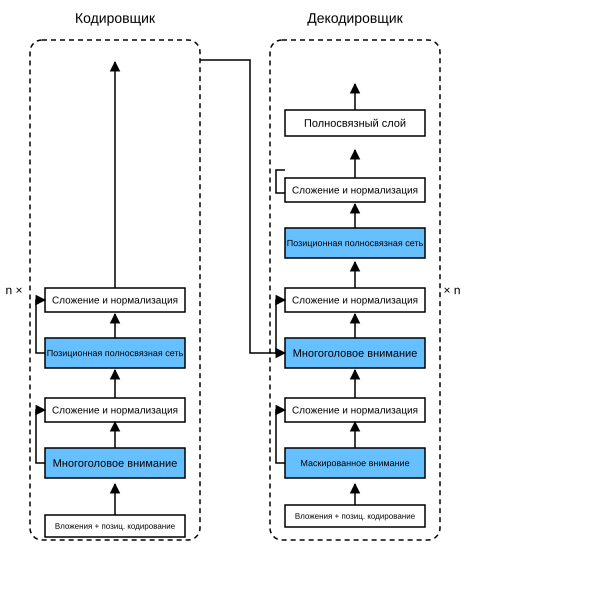

# 10.7 Transformer

В разделе 10.6 мы сравнили свёрточные нейронные сети (CNN), рекуррентные нейронные сети (RNN) и самовнимание (self-attention) (см. раздел 10.6.2). Самовнимание одновременно допускает параллельные вычисления и имеет самую короткую максимальную длину пути, поэтому проектировать на его основе глубокие архитектуры очень привлекательно. Ранние модели самовнимания по-прежнему опирались на рекуррентные нейронные сети для представления входа (Cheng et al., 2016; Lin et al., 2017; Paulus et al., 2017). Модель Transformer полностью основана на механизмах внимания и не содержит ни свёрточных, ни рекуррентных слоёв (Vaswani et al., 2017). Хотя Transformer изначально применялся к текстовым данным для обучения «последовательность в последовательность», сейчас его обобщили на многие области современного глубокого обучения, например на язык, зрение, речь и обучение с подкреплением.

## Модель

Transformer — экземпляр архитектуры «кодировщик — декодировщик». Его общая схема показана на рис. 10.7.1. Как видно, Transformer состоит из кодировщика и декодировщика. По сравнению с обучением «последовательность в последовательность» на основе внимания Баданау (рис. 10.4.1), блоки кодировщика и декодировщика Transformer строятся из модулей самовнимания, а вложения (эмбеддинги) исходной и целевой последовательностей дополняются позиционным кодированием, прежде чем подаются в кодировщик и декодировщик.



На рис. 10.7.1 изображена общая схема Transformer. Если смотреть в целом, кодировщик Transformer — это стопка из нескольких одинаковых слоёв, каждый из которых состоит из двух подслоёв (подслои обозначены $\mathrm{sublayer}$). Первый подслой — *многоголовое самовнимание* (multi-head self-attention) с агрегацией, второй — *позиционная полносвязная сеть* (positionwise feed-forward network). При вычислении самовнимания кодировщика запросы, ключи и значения происходят из выхода предыдущего слоя кодировщика. Вдохновлённые остаточными сетями из раздела 7.6, каждый подслой использует *остаточное соединение* (residual connection). В Transformer для любого входа $\mathbf{x} \in \mathbb{R}^d$ в любой позиции последовательности требуется $\mathrm{sublayer}(\mathbf{x}) \in \mathbb{R}^d$, чтобы остаточное соединение давало $\mathbf{x} + \mathrm{sublayer}(\mathbf{x}) \in \mathbb{R}^d$. После сложения в остаточном соединении сразу применяется *нормализация слоя* (layer normalization) (Ba et al., 2016). Таким образом, для каждой позиции входной последовательности кодировщик Transformer выдаёт $d$-мерный вектор представления.

Декодер Transformer также состоит из нескольких одинаковых слоёв с остаточными соединениями и нормализацией слоёв. Помимо двух подслоёв кодировщика, декодер вставляет между ними третий подслой — *внимание «кодировщик — декодировщик»* (encoder-decoder attention). В этом внимании запросы происходят из выхода предыдущего слоя декодера, а ключи и значения — из выхода всего кодировщика. В самовнимании декодера запросы, ключи и значения происходят из выхода предыдущего слоя декодера. Однако каждая позиция декодера может учитывать только позиции до неё. Такое *маскированное* (masked) внимание сохраняет *авторегрессионное* (auto-regressive) свойство: предсказание зависит только от уже сгенерированных выходов.

Многоголовое внимание с масштабированным скалярным произведением (раздел 10.5) и позиционное кодирование (раздел 10.6.3) мы уже описали и реализовали. Теперь реализуем оставшиеся части Transformer.

**MXNet:**

```python
from d2l import mxnet as d2l
from mxnet import autograd, np, npx
from mxnet.gluon import nn
import pandas as pd
npx.set_np()
```

**PyTorch:**

```python
from d2l import torch as d2l
import math
import pandas as pd
import torch
from torch import nn
```

**TensorFlow:**

```python
from d2l import tensorflow as d2l
import numpy as np
import pandas as pd
import tensorflow as tf
```

**PaddlePaddle:**

```python
from d2l import paddle as d2l
import math
import pandas as pd
import warnings
warnings.filterwarnings("ignore")
import paddle
from paddle import nn
```

## **Позиционная полносвязная сеть**

Позиционная полносвязная сеть применяет одну и ту же многослойную сеть (MLP) к представлениям всех позиций последовательности; поэтому её называют *позиционной* (positionwise). В реализации ниже вход `X` формы (размер пакета, число временных шагов или длина последовательности, число скрытых элементов или размерность признаков) двухслойным перцептроном преобразуется в выходной тензор формы (размер пакета, число временных шагов, `ffn_num_outputs`).

**MXNet:**

```python
#@save
class PositionWiseFFN(nn.Block):
    """Позиционная полносвязная сеть"""
    def __init__(self, ffn_num_hiddens, ffn_num_outputs, **kwargs):
        super(PositionWiseFFN, self).__init__(**kwargs)
        self.dense1 = nn.Dense(ffn_num_hiddens, flatten=False,
                               activation='relu')
        self.dense2 = nn.Dense(ffn_num_outputs, flatten=False)

    def forward(self, X):
        return self.dense2(self.dense1(X))
```

**PyTorch:**

```python
#@save
class PositionWiseFFN(nn.Module):
    """Позиционная полносвязная сеть"""
    def __init__(self, ffn_num_input, ffn_num_hiddens, ffn_num_outputs,
                 **kwargs):
        super(PositionWiseFFN, self).__init__(**kwargs)
        self.dense1 = nn.Linear(ffn_num_input, ffn_num_hiddens)
        self.relu = nn.ReLU()
        self.dense2 = nn.Linear(ffn_num_hiddens, ffn_num_outputs)

    def forward(self, X):
        return self.dense2(self.relu(self.dense1(X)))
```

**TensorFlow:**

```python
#@save
class PositionWiseFFN(tf.keras.layers.Layer):
    """Позиционная полносвязная сеть"""
    def __init__(self, ffn_num_hiddens, ffn_num_outputs, **kwargs):
        super().__init__(*kwargs)
        self.dense1 = tf.keras.layers.Dense(ffn_num_hiddens)
        self.relu = tf.keras.layers.ReLU()
        self.dense2 = tf.keras.layers.Dense(ffn_num_outputs)

    def call(self, X):
        return self.dense2(self.relu(self.dense1(X)))
```

**PaddlePaddle:**

```python
#@save
class PositionWiseFFN(nn.Layer):
    """Позиционная полносвязная сеть"""
    def __init__(self, ffn_num_input, ffn_num_hiddens, ffn_num_outputs,
                 **kwargs):
        super(PositionWiseFFN, self).__init__(**kwargs)
        self.dense1 = nn.Linear(ffn_num_input, ffn_num_hiddens)
        self.relu = nn.ReLU()
        self.dense2 = nn.Linear(ffn_num_hiddens, ffn_num_outputs)

    def forward(self, X):
        return self.dense2(self.relu(self.dense1(X)))
```

Пример показывает, что **изменение размерности последнего измерения тензора** меняет размерность выхода позиционной полносвязной сети. Поскольку одна и та же многослойная сеть применяется ко всем позициям, если входы во всех этих позициях одинаковы, то и выходы тоже одинаковы.

**MXNet:**

```python
ffn = PositionWiseFFN(4, 8)
ffn.initialize()
ffn(np.ones((2, 3, 4)))[0]
```

**PyTorch:**

```python
ffn = PositionWiseFFN(4, 4, 8)
ffn.eval()
ffn(d2l.ones((2, 3, 4)))[0]
```

**TensorFlow:**

```python
ffn = PositionWiseFFN(4, 8)
ffn(tf.ones((2, 3, 4)))[0]
```

**PaddlePaddle:**

```python
ffn = PositionWiseFFN(4, 4, 8)
ffn.eval()
ffn(d2l.ones((2, 3, 4)))[0]
```

## Остаточные соединения и нормализация слоёв

Теперь рассмотрим компонент *сложение и нормализация* (add&norm) на рис. 10.7.1. Как сказано выше, он состоит из остаточного соединения, за которым следует нормализация слоёв. Оба элемента важны для построения эффективных глубоких архитектур.

В разделе 7.5 мы объясняли, как батчевая нормализация перецентрирует и перемасштабирует данные внутри мини-батча. Нормализация слоёв и батчевая нормализация преследуют одну цель, но нормализация слоёв выполняется по признакам. Хотя батчевая нормализация широко применяется в компьютерном зрении, в задачах обработки естественного языка, где входы обычно имеют переменную длину, она обычно работает хуже нормализации слоёв.

Следующий код **сравнивает нормализацию слоёв и батчевую нормализацию по разным измерениям**.

**MXNet:**

```python
ln = nn.LayerNorm()
ln.initialize()
bn = nn.BatchNorm()
bn.initialize()
X = d2l.tensor([[1, 2], [2, 3]])
# Вычисляем среднее и дисперсию X в режиме обучения
with autograd.record():
    print('нормализация слоёв:', ln(X), '\nбатчевая нормализация:', bn(X))
```

**PyTorch:**

```python
ln = nn.LayerNorm(2)
bn = nn.BatchNorm1d(2)
X = d2l.tensor([[1, 2], [2, 3]], dtype=torch.float32)
# Вычисляем среднее и дисперсию X в режиме обучения
print('нормализация слоёв:', ln(X), '\nбатчевая нормализация:', bn(X))
```

**TensorFlow:**

```python
ln = tf.keras.layers.LayerNormalization()
bn = tf.keras.layers.BatchNormalization()
X = tf.constant([[1, 2], [2, 3]], dtype=tf.float32)
print('нормализация слоёв:', ln(X), '\nбатчевая нормализация:', bn(X, training=True))
```

**PaddlePaddle:**

```python
ln = nn.LayerNorm(2)
bn = nn.BatchNorm1D(2)
X = d2l.tensor([[1, 2], [2, 3]], dtype=paddle.float32)
# Вычисляем среднее и дисперсию X в режиме обучения
print('нормализация слоёв:', ln(X), '\nбатчевая нормализация:', bn(X))
```

Теперь можно **использовать остаточные соединения и нормализацию слоёв** для реализации класса `AddNorm`. Исключение (dropout) также применяется здесь как метод регуляризации.

**MXNet:**

```python
#@save
class AddNorm(nn.Block):
    """Нормализация слоёв после остаточного соединения"""
    def __init__(self, dropout, **kwargs):
        super(AddNorm, self).__init__(**kwargs)
        self.dropout = nn.Dropout(dropout)
        self.ln = nn.LayerNorm()

    def forward(self, X, Y):
        return self.ln(self.dropout(Y) + X)
```

**PyTorch:**

```python
#@save
class AddNorm(nn.Module):
    """Нормализация слоёв после остаточного соединения"""
    def __init__(self, normalized_shape, dropout, **kwargs):
        super(AddNorm, self).__init__(**kwargs)
        self.dropout = nn.Dropout(dropout)
        self.ln = nn.LayerNorm(normalized_shape)

    def forward(self, X, Y):
        return self.ln(self.dropout(Y) + X)
```

**TensorFlow:**

```python
#@save
class AddNorm(tf.keras.layers.Layer):
    """Нормализация слоёв после остаточного соединения"""
    def __init__(self, normalized_shape, dropout, **kwargs):
        super().__init__(**kwargs)
        self.dropout = tf.keras.layers.Dropout(dropout)
        self.ln = tf.keras.layers.LayerNormalization(normalized_shape)
        
    def call(self, X, Y, **kwargs):
        return self.ln(self.dropout(Y, **kwargs) + X)
```

**PaddlePaddle:**

```python
#@save
class AddNorm(nn.Layer):
    """Нормализация слоёв после остаточного соединения"""
    def __init__(self, normalized_shape, dropout, **kwargs):
        super(AddNorm, self).__init__(**kwargs)
        self.dropout = nn.Dropout(dropout)
        self.ln = nn.LayerNorm(normalized_shape)

    def forward(self, X, Y):
        return self.ln(self.dropout(Y) + X)
```

Остаточное соединение требует, чтобы два входа имели одинаковую форму, чтобы **после сложения выход имел ту же форму**.

**MXNet:**

```python
add_norm = AddNorm(0.5)
add_norm.initialize()
add_norm(d2l.ones((2, 3, 4)), d2l.ones((2, 3, 4))).shape
```

**PyTorch, PaddlePaddle:**

```python
add_norm = AddNorm([3, 4], 0.5)
add_norm.eval()
add_norm(d2l.ones((2, 3, 4)), d2l.ones((2, 3, 4))).shape
```

**TensorFlow:**

```python
add_norm = AddNorm([1, 2], 0.5)
add_norm(tf.ones((2, 3, 4)), tf.ones((2, 3, 4)), training=False).shape
```

## Кодировщик

Имея базовые компоненты кодировщика Transformer, сначала реализуем **один слой кодировщика**. Класс `EncoderBlock` ниже содержит два подслоя: многоголовое самовнимание и позиционную полносвязную сеть. Оба используют остаточные соединения и последующую нормализацию слоёв.

**MXNet:**

```python
#@save
class EncoderBlock(nn.Block):
    """Блок кодировщика Transformer"""
    def __init__(self, num_hiddens, ffn_num_hiddens, num_heads, dropout,
                 use_bias=False, **kwargs):
        super(EncoderBlock, self).__init__(**kwargs)
        self.attention = d2l.MultiHeadAttention(
            num_hiddens, num_heads, dropout, use_bias)
        self.addnorm1 = AddNorm(dropout)
        self.ffn = PositionWiseFFN(ffn_num_hiddens, num_hiddens)
        self.addnorm2 = AddNorm(dropout)

    def forward(self, X, valid_lens):
        Y = self.addnorm1(X, self.attention(X, X, X, valid_lens))
        return self.addnorm2(Y, self.ffn(Y))
```

**PyTorch:**

```python
#@save
class EncoderBlock(nn.Module):
    """Блок кодировщика Transformer"""
    def __init__(self, key_size, query_size, value_size, num_hiddens,
                 norm_shape, ffn_num_input, ffn_num_hiddens, num_heads,
                 dropout, use_bias=False, **kwargs):
        super(EncoderBlock, self).__init__(**kwargs)
        self.attention = d2l.MultiHeadAttention(
            key_size, query_size, value_size, num_hiddens, num_heads, dropout,
            use_bias)
        self.addnorm1 = AddNorm(norm_shape, dropout)
        self.ffn = PositionWiseFFN(
            ffn_num_input, ffn_num_hiddens, num_hiddens)
        self.addnorm2 = AddNorm(norm_shape, dropout)

    def forward(self, X, valid_lens):
        Y = self.addnorm1(X, self.attention(X, X, X, valid_lens))
        return self.addnorm2(Y, self.ffn(Y))
```

**TensorFlow:**

```python
#@save
class EncoderBlock(tf.keras.layers.Layer):
    """Блок кодировщика Transformer"""
    def __init__(self, key_size, query_size, value_size, num_hiddens,
                 norm_shape, ffn_num_hiddens, num_heads, dropout, bias=False, **kwargs):
        super().__init__(**kwargs)
        self.attention = d2l.MultiHeadAttention(key_size, query_size, value_size, num_hiddens,
                                                num_heads, dropout, bias)
        self.addnorm1 = AddNorm(norm_shape, dropout)
        self.ffn = PositionWiseFFN(ffn_num_hiddens, num_hiddens)
        self.addnorm2 = AddNorm(norm_shape, dropout)
        
    def call(self, X, valid_lens, **kwargs):
        Y = self.addnorm1(X, self.attention(X, X, X, valid_lens, **kwargs), **kwargs)
        return self.addnorm2(Y, self.ffn(Y), **kwargs)
```

**PaddlePaddle:**

```python
#@save
class EncoderBlock(nn.Layer):
    """Блок кодировщика Transformer"""
    def __init__(self, key_size, query_size, value_size, num_hiddens,
                 norm_shape, ffn_num_input, ffn_num_hiddens, num_heads,
                 dropout, use_bias=False, **kwargs):
        super(EncoderBlock, self).__init__(**kwargs)
        self.attention = d2l.MultiHeadAttention(
            key_size, query_size, value_size, num_hiddens, num_heads, dropout,
            use_bias)
        self.addnorm1 = AddNorm(norm_shape, dropout)
        self.ffn = PositionWiseFFN(
            ffn_num_input, ffn_num_hiddens, num_hiddens)
        self.addnorm2 = AddNorm(norm_shape, dropout)

    def forward(self, X, valid_lens):
        Y = self.addnorm1(X, self.attention(X, X, X, valid_lens))
        return self.addnorm2(Y, self.ffn(Y))
```

Как видно из кода, **ни один слой кодировщика Transformer не меняет форму своего входа**.

**MXNet:**

```python
X = d2l.ones((2, 100, 24))
valid_lens = d2l.tensor([3, 2])
encoder_blk = EncoderBlock(24, 48, 8, 0.5)
encoder_blk.initialize()
encoder_blk(X, valid_lens).shape
```

**PyTorch:**

```python
X = d2l.ones((2, 100, 24))
valid_lens = d2l.tensor([3, 2])
encoder_blk = EncoderBlock(24, 24, 24, 24, [100, 24], 24, 48, 8, 0.5)
encoder_blk.eval()
encoder_blk(X, valid_lens).shape
```

**TensorFlow:**

```python
X = tf.ones((2, 100, 24))
valid_lens = tf.constant([3, 2])
norm_shape = [i for i in range(len(X.shape))][1:]
encoder_blk = EncoderBlock(24, 24, 24, 24, norm_shape, 48, 8, 0.5)
encoder_blk(X, valid_lens, training=False).shape
```

**PaddlePaddle:**

```python
X = d2l.ones((2, 100, 24))
valid_lens = d2l.tensor([3, 2])
encoder_blk = EncoderBlock(24, 24, 24, 24, [100, 24], 24, 48, 8, 0.5)
encoder_blk.eval()
encoder_blk(X, valid_lens).shape
```

Ниже реализован **Transformer-кодировщик**: в нём складываются `num_layers` экземпляров класса `EncoderBlock`. Поскольку здесь используется фиксированное позиционное кодирование со значениями от $-1$ до $1$, значения обучаемых вложений входа сначала умножаются на квадратный корень из размерности вложения, а затем складываются с позиционным кодированием.

**MXNet:**

```python
#@save
class TransformerEncoder(d2l.Encoder):
    """Кодировщик Transformer"""
    def __init__(self, vocab_size, num_hiddens, ffn_num_hiddens,
                 num_heads, num_layers, dropout, use_bias=False, **kwargs):
        super(TransformerEncoder, self).__init__(**kwargs)
        self.num_hiddens = num_hiddens
        self.embedding = nn.Embedding(vocab_size, num_hiddens)
        self.pos_encoding = d2l.PositionalEncoding(num_hiddens, dropout)
        self.blks = nn.Sequential()
        for _ in range(num_layers):
            self.blks.add(
                EncoderBlock(num_hiddens, ffn_num_hiddens, num_heads, dropout,
                             use_bias))

    def forward(self, X, valid_lens, *args):
        # Поскольку значения позиционного кодирования лежат между -1 и 1,
        # поэтому значения вложений умножаем на квадратный корень из размерности вложения,
        # а затем складываем с позиционным кодированием.
        X = self.pos_encoding(self.embedding(X) * math.sqrt(self.num_hiddens))
        self.attention_weights = [None] * len(self.blks)
        for i, blk in enumerate(self.blks):
            X = blk(X, valid_lens)
            self.attention_weights[
                i] = blk.attention.attention.attention_weights
        return X
```

**PyTorch:**

```python
#@save
class TransformerEncoder(d2l.Encoder):
    """Кодировщик Transformer"""
    def __init__(self, vocab_size, key_size, query_size, value_size,
                 num_hiddens, norm_shape, ffn_num_input, ffn_num_hiddens,
                 num_heads, num_layers, dropout, use_bias=False, **kwargs):
        super(TransformerEncoder, self).__init__(**kwargs)
        self.num_hiddens = num_hiddens
        self.embedding = nn.Embedding(vocab_size, num_hiddens)
        self.pos_encoding = d2l.PositionalEncoding(num_hiddens, dropout)
        self.blks = nn.Sequential()
        for i in range(num_layers):
            self.blks.add_module("block"+str(i),
                EncoderBlock(key_size, query_size, value_size, num_hiddens,
                             norm_shape, ffn_num_input, ffn_num_hiddens,
                             num_heads, dropout, use_bias))

    def forward(self, X, valid_lens, *args):
        # Поскольку значения позиционного кодирования лежат между -1 и 1,
        # поэтому значения вложений умножаем на квадратный корень из размерности вложения,
        # а затем складываем с позиционным кодированием.
        X = self.pos_encoding(self.embedding(X) * math.sqrt(self.num_hiddens))
        self.attention_weights = [None] * len(self.blks)
        for i, blk in enumerate(self.blks):
            X = blk(X, valid_lens)
            self.attention_weights[
                i] = blk.attention.attention.attention_weights
        return X
```

**TensorFlow:**

```python
#@save
class TransformerEncoder(d2l.Encoder):
    """Кодировщик Transformer"""
    def __init__(self, vocab_size, key_size, query_size, value_size,
                 num_hiddens, norm_shape, ffn_num_hiddens, num_heads,
                 num_layers, dropout, bias=False, **kwargs):
        super().__init__(**kwargs)
        self.num_hiddens = num_hiddens
        self.embedding = tf.keras.layers.Embedding(vocab_size, num_hiddens)
        self.pos_encoding = d2l.PositionalEncoding(num_hiddens, dropout)
        self.blks = [EncoderBlock(
            key_size, query_size, value_size, num_hiddens, norm_shape,
            ffn_num_hiddens, num_heads, dropout, bias) for _ in range(
            num_layers)]
        
    def call(self, X, valid_lens, **kwargs):
        # Поскольку значения позиционного кодирования лежат между -1 и 1,
        # поэтому значения вложений умножаем на квадратный корень из размерности вложения,
        # а затем складываем с позиционным кодированием.
        X = self.pos_encoding(self.embedding(X) * tf.math.sqrt(
            tf.cast(self.num_hiddens, dtype=tf.float32)), **kwargs)
        self.attention_weights = [None] * len(self.blks)
        for i, blk in enumerate(self.blks):
            X = blk(X, valid_lens, **kwargs)
            self.attention_weights[
                i] = blk.attention.attention.attention_weights
        return X
```

**PaddlePaddle:**

```python
#@save
class TransformerEncoder(d2l.Encoder):
    """Кодировщик Transformer"""
    def __init__(self, vocab_size, key_size, query_size, value_size,
                 num_hiddens, norm_shape, ffn_num_input, ffn_num_hiddens,
                 num_heads, num_layers, dropout, use_bias=False, **kwargs):
        super(TransformerEncoder, self).__init__(**kwargs)
        self.num_hiddens = num_hiddens
        self.embedding = nn.Embedding(vocab_size, num_hiddens)
        self.pos_encoding = d2l.PositionalEncoding(num_hiddens, dropout)
        self.blks = nn.Sequential()
        for i in range(num_layers):
            self.blks.add_sublayer(str(i),
                EncoderBlock(key_size, query_size, value_size, num_hiddens,
                             norm_shape, ffn_num_input, ffn_num_hiddens,
                             num_heads, dropout, use_bias))

    def forward(self, X, valid_lens, *args):
        # Поскольку значения позиционного кодирования лежат между -1 и 1,
        # поэтому значения вложений умножаем на квадратный корень из размерности вложения,
        # а затем складываем с позиционным кодированием.
        X = self.pos_encoding(self.embedding(X) * math.sqrt(self.num_hiddens))
        self.attention_weights = [None] * len(self.blks)
        for i, blk in enumerate(self.blks):
            X = blk(X, valid_lens)
            self.attention_weights[
                i] = blk.attention.attention.attention_weights
        return X
```

Создадим **двухслойный Transformer-кодировщик** с заданными гиперпараметрами. Выход Transformer-кодировщика имеет форму (размер пакета, число временных шагов, `num_hiddens`).

**MXNet:**

```python
encoder = TransformerEncoder(200, 24, 48, 8, 2, 0.5)
encoder.initialize()
encoder(np.ones((2, 100)), valid_lens).shape
```

**PyTorch:**

```python
encoder = TransformerEncoder(
    200, 24, 24, 24, 24, [100, 24], 24, 48, 8, 2, 0.5)
encoder.eval()
encoder(d2l.ones((2, 100), dtype=torch.long), valid_lens).shape
```

**TensorFlow:**

```python
encoder = TransformerEncoder(200, 24, 24, 24, 24, [1, 2], 48, 8, 2, 0.5)
encoder(tf.ones((2, 100)), valid_lens, training=False).shape
```

**PaddlePaddle:**

```python
encoder = TransformerEncoder(
    200, 24, 24, 24, 24, [100, 24], 24, 48, 8, 2, 0.5)
encoder.eval()
encoder(d2l.ones((2, 100), dtype=paddle.int64), valid_lens).shape
```

## Декодировщик

Как показано на рис. 10.7.1, **Transformer-декодировщик тоже состоит из нескольких одинаковых слоёв**. Каждый слой, реализованный в классе `DecoderBlock`, содержит три подслоя: самовнимание декодировщика, внимание «кодировщик — декодировщик» и позиционную полносвязную сеть. Все они также обрамлены остаточными соединениями и последующей нормализацией слоёв.

Как говорилось выше, в маскированном многоголовом самовнимании декодировщика (первом подслое) запросы, ключи и значения происходят из выхода предыдущего слоя декодера. Что касается *модели «последовательность в последовательность»*, на этапе обучения токены всех позиций выходной последовательности известны, однако на этапе предсказания токены выходной последовательности генерируются по одному. Поэтому на любом шаге декодирования в самовнимании декодера используются только уже сгенерированные токены. Чтобы сохранить авторегрессионное свойство в декодере, маскированное самовнимание задаёт параметр `dec_valid_lens`, так что каждый запрос учитывает только позиции уже сгенерированных токенов декодера, то есть позиции до текущего запроса включительно.

**MXNet:**

```python
class DecoderBlock(nn.Block):
    """i-й блок декодера"""
    def __init__(self, num_hiddens, ffn_num_hiddens, num_heads,
                 dropout, i, **kwargs):
        super(DecoderBlock, self).__init__(**kwargs)
        self.i = i
        self.attention1 = d2l.MultiHeadAttention(num_hiddens, num_heads,
                                                 dropout)
        self.addnorm1 = AddNorm(dropout)
        self.attention2 = d2l.MultiHeadAttention(num_hiddens, num_heads,
                                                 dropout)
        self.addnorm2 = AddNorm(dropout)
        self.ffn = PositionWiseFFN(ffn_num_hiddens, num_hiddens)
        self.addnorm3 = AddNorm(dropout)

    def forward(self, X, state):
        enc_outputs, enc_valid_lens = state[0], state[1]
        # На этапе обучения все токены выходной последовательности обрабатываются одновременно,
        # поэтому state[2][self.i] инициализируется значением None.
        # На этапе предсказания выходная последовательность декодируется токен за токеном,
        # поэтому state[2][self.i] содержит выходные представления, декодированные i-м блоком до текущего шага
        if state[2][self.i] is None:
            key_values = X
        else:
            key_values = np.concatenate((state[2][self.i], X), axis=1)
        state[2][self.i] = key_values

        if autograd.is_training():
            batch_size, num_steps, _ = X.shape
            # Начало dec_valid_lens: (batch_size, num_steps),
            # где каждая строка равна [1, 2, ..., num_steps]
            dec_valid_lens = np.tile(np.arange(1, num_steps + 1, ctx=X.ctx),
                                     (batch_size, 1))
        else:
            dec_valid_lens = None

        # Самовнимание
        X2 = self.attention1(X, key_values, key_values, dec_valid_lens)
        Y = self.addnorm1(X, X2)
        # Внимание «кодировщик — декодировщик».
        # Начало enc_outputs: (batch_size, num_steps, num_hiddens)
        Y2 = self.attention2(Y, enc_outputs, enc_outputs, enc_valid_lens)
        Z = self.addnorm2(Y, Y2)
        return self.addnorm3(Z, self.ffn(Z)), state
```

**PyTorch:**

```python
class DecoderBlock(nn.Module):
    """i-й блок декодера"""
    def __init__(self, key_size, query_size, value_size, num_hiddens,
                 norm_shape, ffn_num_input, ffn_num_hiddens, num_heads,
                 dropout, i, **kwargs):
        super(DecoderBlock, self).__init__(**kwargs)
        self.i = i
        self.attention1 = d2l.MultiHeadAttention(
            key_size, query_size, value_size, num_hiddens, num_heads, dropout)
        self.addnorm1 = AddNorm(norm_shape, dropout)
        self.attention2 = d2l.MultiHeadAttention(
            key_size, query_size, value_size, num_hiddens, num_heads, dropout)
        self.addnorm2 = AddNorm(norm_shape, dropout)
        self.ffn = PositionWiseFFN(ffn_num_input, ffn_num_hiddens,
                                   num_hiddens)
        self.addnorm3 = AddNorm(norm_shape, dropout)

    def forward(self, X, state):
        enc_outputs, enc_valid_lens = state[0], state[1]
        # На этапе обучения все токены выходной последовательности обрабатываются одновременно,
        # поэтому state[2][self.i] инициализируется значением None.
        # На этапе предсказания выходная последовательность декодируется токен за токеном,
        # поэтому state[2][self.i] содержит выходные представления, декодированные i-м блоком до текущего шага
        if state[2][self.i] is None:
            key_values = X
        else:
            key_values = torch.cat((state[2][self.i], X), axis=1)
        state[2][self.i] = key_values
        if self.training:
            batch_size, num_steps, _ = X.shape
            # Начало dec_valid_lens: (batch_size, num_steps),
            # где каждая строка равна [1, 2, ..., num_steps]
            dec_valid_lens = torch.arange(
                1, num_steps + 1, device=X.device).repeat(batch_size, 1)
        else:
            dec_valid_lens = None

        # Самовнимание
        X2 = self.attention1(X, key_values, key_values, dec_valid_lens)
        Y = self.addnorm1(X, X2)
        # Внимание «кодировщик — декодировщик».
        # Начало enc_outputs: (batch_size, num_steps, num_hiddens)
        Y2 = self.attention2(Y, enc_outputs, enc_outputs, enc_valid_lens)
        Z = self.addnorm2(Y, Y2)
        return self.addnorm3(Z, self.ffn(Z)), state
```

**TensorFlow:**

```python
class DecoderBlock(tf.keras.layers.Layer):
    """i-й блок декодера"""
    def __init__(self, key_size, query_size, value_size, num_hiddens,
                 norm_shape, ffn_num_hiddens, num_heads, dropout, i, **kwargs):
        super().__init__(**kwargs)
        self.i = i
        self.attention1 = d2l.MultiHeadAttention(key_size, query_size, value_size, num_hiddens, num_heads, dropout)
        self.addnorm1 = AddNorm(norm_shape, dropout)
        self.attention2 = d2l.MultiHeadAttention(key_size, query_size, value_size, num_hiddens, num_heads, dropout)
        self.addnorm2 = AddNorm(norm_shape, dropout)
        self.ffn = PositionWiseFFN(ffn_num_hiddens, num_hiddens)
        self.addnorm3 = AddNorm(norm_shape, dropout)
        
    def call(self, X, state, **kwargs):
        enc_outputs, enc_valid_lens = state[0], state[1]
        # На этапе обучения все токены выходной последовательности обрабатываются одновременно,
        # поэтому state[2][self.i] инициализируется значением None.
        # На этапе предсказания выходная последовательность декодируется токен за токеном,
        # поэтому state[2][self.i] содержит выходные представления, декодированные i-м блоком до текущего шага
        if state[2][self.i] is None:
            key_values = X
        else:
            key_values = tf.concat((state[2][self.i], X), axis=1)
        state[2][self.i] = key_values
        if kwargs["training"]:
            batch_size, num_steps, _ = X.shape
           # Начало dec_valid_lens: (batch_size, num_steps),
            # где каждая строка равна [1, 2, ..., num_steps]
            dec_valid_lens = tf.repeat(tf.reshape(tf.range(1, num_steps + 1),
                                                 shape=(-1, num_steps)), repeats=batch_size, axis=0)

        else:
            dec_valid_lens = None
            
        # Самовнимание
        X2 = self.attention1(X, key_values, key_values, dec_valid_lens, **kwargs)
        Y = self.addnorm1(X, X2, **kwargs)
        # Внимание «кодировщик — декодировщик».
        # Начало enc_outputs: (batch_size, num_steps, num_hiddens)
        Y2 = self.attention2(Y, enc_outputs, enc_outputs, enc_valid_lens, **kwargs)
        Z = self.addnorm2(Y, Y2, **kwargs)
        return self.addnorm3(Z, self.ffn(Z), **kwargs), state
```

**PaddlePaddle:**

```python
class DecoderBlock(nn.Layer):
    """i-й блок декодера"""
    def __init__(self, key_size, query_size, value_size, num_hiddens,
                 norm_shape, ffn_num_input, ffn_num_hiddens, num_heads,
                 dropout, i, **kwargs):
        super(DecoderBlock, self).__init__(**kwargs)
        self.i = i
        self.attention1 = d2l.MultiHeadAttention(
            key_size, query_size, value_size, num_hiddens, num_heads, dropout)
        self.addnorm1 = AddNorm(norm_shape, dropout)
        self.attention2 = d2l.MultiHeadAttention(
            key_size, query_size, value_size, num_hiddens, num_heads, dropout)
        self.addnorm2 = AddNorm(norm_shape, dropout)
        self.ffn = PositionWiseFFN(ffn_num_input, ffn_num_hiddens,
                                   num_hiddens)
        self.addnorm3 = AddNorm(norm_shape, dropout)

    def forward(self, X, state):
        enc_outputs, enc_valid_lens = state[0], state[1]
        # На этапе обучения все токены выходной последовательности обрабатываются одновременно,
        # поэтому state[2][self.i] инициализируется значением None.
        # На этапе предсказания выходная последовательность декодируется токен за токеном,
        # поэтому state[2][self.i] содержит выходные представления, декодированные i-м блоком до текущего шага
        if state[2][self.i] is None:
            key_values = X
        else:
            key_values = paddle.concat((state[2][self.i], X), axis=1)
        state[2][self.i] = key_values
        if self.training:
            batch_size, num_steps, _ = X.shape
            # Начало dec_valid_lens: (batch_size, num_steps),
            # где каждая строка равна [1, 2, ..., num_steps]
            dec_valid_lens = paddle.arange(
                1, num_steps + 1).tile((batch_size, 1))
        else:
            dec_valid_lens = None

        # Самовнимание
        X2 = self.attention1(X, key_values, key_values, dec_valid_lens)
        Y = self.addnorm1(X, X2)
        # Внимание «кодировщик — декодировщик».
        # Начало enc_outputs: (batch_size, num_steps, num_hiddens)
        Y2 = self.attention2(Y, enc_outputs, enc_outputs, enc_valid_lens)
        Z = self.addnorm2(Y, Y2)
        return self.addnorm3(Z, self.ffn(Z)), state
```

Чтобы удобнее было выполнять масштабированное скалярное произведение во внимании «кодировщик — декодировщик» и сложение в остаточных соединениях, размерность признаков кодировщика и декодировщика одинакова и равна `num_hiddens`.

**MXNet:**

```python
decoder_blk = DecoderBlock(24, 48, 8, 0.5, 0)
decoder_blk.initialize()
X = np.ones((2, 100, 24))
state = [encoder_blk(X, valid_lens), valid_lens, [None]]
decoder_blk(X, state)[0].shape
```

**PyTorch, PaddlePaddle:**

```python
decoder_blk = DecoderBlock(24, 24, 24, 24, [100, 24], 24, 48, 8, 0.5, 0)
decoder_blk.eval()
X = d2l.ones((2, 100, 24))
state = [encoder_blk(X, valid_lens), valid_lens, [None]]
decoder_blk(X, state)[0].shape
```

**TensorFlow:**

```python
decoder_blk = DecoderBlock(24, 24, 24, 24, [1, 2], 48, 8, 0.5, 0)
X = tf.ones((2, 100, 24))
state = [encoder_blk(X, valid_lens), valid_lens, [None]]
decoder_blk(X, state, training=False)[0].shape
```

Теперь построим полный **Transformer-декодировщик** из `num_layers` экземпляров `DecoderBlock`. Наконец, полносвязный слой вычисляет предсказания для всех `vocab_size` возможных выходных токенов. Веса самовнимания декодера и веса внимания «кодировщик — декодировщик» сохраняются, чтобы их можно было визуализировать позже.

**MXNet:**

```python
class TransformerDecoder(d2l.AttentionDecoder):
    def __init__(self, vocab_size, num_hiddens, ffn_num_hiddens,
                 num_heads, num_layers, dropout, **kwargs):
        super(TransformerDecoder, self).__init__(**kwargs)
        self.num_hiddens = num_hiddens
        self.num_layers = num_layers
        self.embedding = nn.Embedding(vocab_size, num_hiddens)
        self.pos_encoding = d2l.PositionalEncoding(num_hiddens, dropout)
        self.blks = nn.Sequential()
        for i in range(num_layers):
            self.blks.add(
                DecoderBlock(num_hiddens, ffn_num_hiddens, num_heads,
                             dropout, i))
        self.dense = nn.Dense(vocab_size, flatten=False)

    def init_state(self, enc_outputs, enc_valid_lens, *args):
        return [enc_outputs, enc_valid_lens, [None] * self.num_layers]

    def forward(self, X, state):
        X = self.pos_encoding(self.embedding(X) * math.sqrt(self.num_hiddens))
        self._attention_weights = [[None] * len(self.blks) for _ in range (2)]
        for i, blk in enumerate(self.blks):
            X, state = blk(X, state)
            # Веса самовнимания декодера
            self._attention_weights[0][
                i] = blk.attention1.attention.attention_weights
            # Веса внимания «кодировщик — декодировщик»
            self._attention_weights[1][
                i] = blk.attention2.attention.attention_weights
        return self.dense(X), state

    @property
    def attention_weights(self):
        return self._attention_weights
```

**PyTorch:**

```python
class TransformerDecoder(d2l.AttentionDecoder):
    def __init__(self, vocab_size, key_size, query_size, value_size,
                 num_hiddens, norm_shape, ffn_num_input, ffn_num_hiddens,
                 num_heads, num_layers, dropout, **kwargs):
        super(TransformerDecoder, self).__init__(**kwargs)
        self.num_hiddens = num_hiddens
        self.num_layers = num_layers
        self.embedding = nn.Embedding(vocab_size, num_hiddens)
        self.pos_encoding = d2l.PositionalEncoding(num_hiddens, dropout)
        self.blks = nn.Sequential()
        for i in range(num_layers):
            self.blks.add_module("block"+str(i),
                DecoderBlock(key_size, query_size, value_size, num_hiddens,
                             norm_shape, ffn_num_input, ffn_num_hiddens,
                             num_heads, dropout, i))
        self.dense = nn.Linear(num_hiddens, vocab_size)

    def init_state(self, enc_outputs, enc_valid_lens, *args):
        return [enc_outputs, enc_valid_lens, [None] * self.num_layers]

    def forward(self, X, state):
        X = self.pos_encoding(self.embedding(X) * math.sqrt(self.num_hiddens))
        self._attention_weights = [[None] * len(self.blks) for _ in range (2)]
        for i, blk in enumerate(self.blks):
            X, state = blk(X, state)
            # Веса самовнимания декодера
            self._attention_weights[0][
                i] = blk.attention1.attention.attention_weights
            # Веса внимания «кодировщик — декодировщик»
            self._attention_weights[1][
                i] = blk.attention2.attention.attention_weights
        return self.dense(X), state

    @property
    def attention_weights(self):
        return self._attention_weights
```

**TensorFlow:**

```python
class TransformerDecoder(d2l.AttentionDecoder):
    def __init__(self, vocab_size, key_size, query_size, value_size,
                 num_hiddens, norm_shape, ffn_num_hidens, num_heads, num_layers, dropout, **kwargs):
        super().__init__(**kwargs)
        self.num_hiddens = num_hiddens
        self.num_layers = num_layers
        self.embedding = tf.keras.layers.Embedding(vocab_size, num_hiddens)
        self.pos_encoding = d2l.PositionalEncoding(num_hiddens, dropout)
        self.blks = [DecoderBlock(key_size, query_size, value_size, num_hiddens, norm_shape,
                                  ffn_num_hiddens, num_heads, dropout, i) for i in range(num_layers)]
        self.dense = tf.keras.layers.Dense(vocab_size)
        
    def init_state(self, enc_outputs, enc_valid_lens, *args):
        return [enc_outputs, enc_valid_lens, [None] * self.num_layers]
    
    def call(self, X, state, **kwargs):
        X = self.pos_encoding(self.embedding(X) * tf.math.sqrt(tf.cast(self.num_hiddens, dtype=tf.float32)), **kwargs)
        self._attention_weights = [[None] * len(self.blks) for _ in range(2)]  # В декодере 2 слоя внимания
        for i, blk in enumerate(self.blks):
            X, state = blk(X, state, **kwargs)
            # Веса самовнимания декодера
            self._attention_weights[0][i] = blk.attention1.attention.attention_weights
            # Веса внимания «кодировщик — декодировщик»
            self._attention_weights[1][i] = blk.attention2.attention.attention_weights
        return self.dense(X), state
    
    @property
    def attention_weights(self):
        return self._attention_weights
```

**PaddlePaddle:**

```python
class TransformerDecoder(d2l.AttentionDecoder):
    def __init__(self, vocab_size, key_size, query_size, value_size,
                 num_hiddens, norm_shape, ffn_num_input, ffn_num_hiddens,
                 num_heads, num_layers, dropout, **kwargs):
        super(TransformerDecoder, self).__init__(**kwargs)
        self.num_hiddens = num_hiddens
        self.num_layers = num_layers
        self.embedding = nn.Embedding(vocab_size, num_hiddens)
        self.pos_encoding = d2l.PositionalEncoding(num_hiddens, dropout)
        self.blks = nn.Sequential()
        for i in range(num_layers):
            self.blks.add_sublayer(str(i),
                DecoderBlock(key_size, query_size, value_size, num_hiddens,
                             norm_shape, ffn_num_input, ffn_num_hiddens,
                             num_heads, dropout, i))
        self.dense = nn.Linear(num_hiddens, vocab_size)

    def init_state(self, enc_outputs, enc_valid_lens, *args):
        return [enc_outputs, enc_valid_lens, [None] * self.num_layers]

    def forward(self, X, state):
        X = self.pos_encoding(self.embedding(X) * math.sqrt(self.num_hiddens))
        self._attention_weights = [[None] * len(self.blks) for _ in range (2)]
        for i, blk in enumerate(self.blks):
            X, state = blk(X, state)
            # Веса самовнимания декодера
            self._attention_weights[0][
                i] = blk.attention1.attention.attention_weights
            # Веса внимания «кодировщик — декодировщик»
            self._attention_weights[1][
                i] = blk.attention2.attention.attention_weights
        return self.dense(X), state

    @property
    def attention_weights(self):
        return self._attention_weights
```

## **Обучение**

Создадим модель «кодировщик — декодировщик» в соответствии с архитектурой Transformer. Здесь заданы два слоя для кодировщика и декодировщика, и каждый использует 4 головы внимания. Как и в разделе 9.7.4, для обучения «последовательность в последовательность» обучим Transformer на наборе данных машинного перевода «английский — французский».

**MXNet:**

```python
num_hiddens, num_layers, dropout, batch_size, num_steps = 32, 2, 0.1, 64, 10
lr, num_epochs, device = 0.005, 200, d2l.try_gpu()
ffn_num_hiddens, num_heads = 64, 4

train_iter, src_vocab, tgt_vocab = d2l.load_data_nmt(batch_size, num_steps)

encoder = TransformerEncoder(
    len(src_vocab), num_hiddens, ffn_num_hiddens, num_heads, num_layers,
    dropout)
decoder = TransformerDecoder(
    len(tgt_vocab), num_hiddens, ffn_num_hiddens, num_heads, num_layers,
    dropout)
net = d2l.EncoderDecoder(encoder, decoder)
d2l.train_seq2seq(net, train_iter, lr, num_epochs, tgt_vocab, device)
```

**PyTorch:**

```python
num_hiddens, num_layers, dropout, batch_size, num_steps = 32, 2, 0.1, 64, 10
lr, num_epochs, device = 0.005, 200, d2l.try_gpu()
ffn_num_input, ffn_num_hiddens, num_heads = 32, 64, 4
key_size, query_size, value_size = 32, 32, 32
norm_shape = [32]

train_iter, src_vocab, tgt_vocab = d2l.load_data_nmt(batch_size, num_steps)

encoder = TransformerEncoder(
    len(src_vocab), key_size, query_size, value_size, num_hiddens,
    norm_shape, ffn_num_input, ffn_num_hiddens, num_heads,
    num_layers, dropout)
decoder = TransformerDecoder(
    len(tgt_vocab), key_size, query_size, value_size, num_hiddens,
    norm_shape, ffn_num_input, ffn_num_hiddens, num_heads,
    num_layers, dropout)
net = d2l.EncoderDecoder(encoder, decoder)
d2l.train_seq2seq(net, train_iter, lr, num_epochs, tgt_vocab, device)
```

**TensorFlow:**

```python
num_hiddens, num_layers, dropout, batch_size, num_steps = 32, 2, 0.1, 64, 10
lr, num_epochs, device = 0.005, 200, d2l.try_gpu()
ffn_num_hiddens, num_heads = 64, 4
key_size, query_size, value_size = 32, 32, 32
norm_shape = [2]

train_iter, src_vocab, tgt_vocab = d2l.load_data_nmt(batch_size, num_steps)
encoder = TransformerEncoder(
    len(src_vocab), key_size, query_size, value_size, num_hiddens, norm_shape,
    ffn_num_hiddens, num_heads, num_layers, dropout)
decoder = TransformerDecoder(
    len(tgt_vocab), key_size, query_size, value_size, num_hiddens, norm_shape,
    ffn_num_hiddens, num_heads, num_layers, dropout)
net = d2l.EncoderDecoder(encoder, decoder)
d2l.train_seq2seq(net, train_iter, lr, num_epochs, tgt_vocab, device)
```

**PaddlePaddle:**

```python
num_hiddens, num_layers, dropout, batch_size, num_steps = 32, 2, 0.1, 64, 10
lr, num_epochs, device = 0.005, 200, d2l.try_gpu()
ffn_num_input, ffn_num_hiddens, num_heads = 32, 64, 4
key_size, query_size, value_size = 32, 32, 32
norm_shape = [32]

train_iter, src_vocab, tgt_vocab = d2l.load_data_nmt(batch_size, num_steps)

encoder = TransformerEncoder(
    len(src_vocab), key_size, query_size, value_size, num_hiddens,
    norm_shape, ffn_num_input, ffn_num_hiddens, num_heads,
    num_layers, dropout)
decoder = TransformerDecoder(
    len(tgt_vocab), key_size, query_size, value_size, num_hiddens,
    norm_shape, ffn_num_input, ffn_num_hiddens, num_heads,
    num_layers, dropout)
net = d2l.EncoderDecoder(encoder, decoder)
d2l.train_seq2seq(net, train_iter, lr, num_epochs, tgt_vocab, device)
```

После обучения модель Transformer **переводит несколько английских предложений на французский**, и мы вычисляем их оценки BLEU.

**MXNet, PyTorch, PaddlePaddle:**

```python
engs = ['go .', "i lost .", 'he\'s calm .', 'i\'m home .']
fras = ['va !', 'j\'ai perdu .', 'il est calme .', 'je suis chez moi .']
for eng, fra in zip(engs, fras):
    translation, dec_attention_weight_seq = d2l.predict_seq2seq(
        net, eng, src_vocab, tgt_vocab, num_steps, device, True)
    print(f'{eng} => {translation}, ',
          f'bleu {d2l.bleu(translation, fra, k=2):.3f}')
```

**TensorFlow:**

```python
engs = ['go .', "i lost .", 'he\'s calm .', 'i\'m home .']
fras = ['va !', 'j\'ai perdu .', 'il est calme .', 'je suis chez moi .']
for eng, fra in zip(engs, fras):
    translation, dec_attention_weight_seq = d2l.predict_seq2seq(
        net, eng, src_vocab, tgt_vocab, num_steps, True)
    print(f'{eng} => {translation}, ',
          f'bleu {d2l.bleu(translation, fra, k=2):.3f}')
```

Теперь, когда переводим последнее английское предложение на французский, давайте **визуализируем веса внимания Transformer**. Форма весов самовнимания кодировщика: (число слоёв кодировщика, число голов внимания, `num_steps` или число запросов, `num_steps` или число пар «ключ — значение»).

```python
enc_attention_weights = d2l.reshape(
    d2l.concat(net.encoder.attention_weights, 0),
    (num_layers, num_heads, -1, num_steps))
enc_attention_weights.shape
```

В самовнимании кодировщика запросы и ключи происходят из одной и той же входной последовательности. Поскольку токены заполнения не несут информации, указание действительной длины входной последовательности позволяет не вычислять внимание от запросов к позициям с токенами заполнения. Ниже построчно показаны веса двух слоёв многоголового внимания. Каждая голова внимания описывает разные отношения, опираясь на различные подпространства представлений запросов, ключей и значений.

**MXNet, TensorFlow:**

```python
d2l.show_heatmaps(
    enc_attention_weights, xlabel='Key positions', ylabel='Query positions',
    titles=['Head %d' % i for i in range(1, 5)], figsize=(7, 3.5))
```

**PyTorch, PaddlePaddle:**

```python
d2l.show_heatmaps(
    enc_attention_weights.cpu(), xlabel='Key positions',
    ylabel='Query positions', titles=['Head %d' % i for i in range(1, 5)],
    figsize=(7, 3.5))
```

**Чтобы визуализировать веса самовнимания декодера и веса внимания «кодировщик — декодировщик», нужно выполнить больше операций над данными.** Например, заполнить нулями веса маскированного внимания. Заметим, что у весов самовнимания декодера и весов внимания «кодировщик — декодировщик» один и тот же запрос: они начинаются с *токена начала последовательности* (beginning-of-sequence, BOS), за которым следуют уже выведенные токены.

**MXNet:**

```python
dec_attention_weights_2d = [d2l.tensor(head[0]).tolist()
                            for step in dec_attention_weight_seq
                            for attn in step for blk in attn for head in blk]
dec_attention_weights_filled = d2l.tensor(
    pd.DataFrame(dec_attention_weights_2d).fillna(0.0).values)
dec_attention_weights = d2l.reshape(dec_attention_weights_filled,
                                (-1, 2, num_layers, num_heads,  num_steps))
dec_self_attention_weights, dec_inter_attention_weights = \
    dec_attention_weights.transpose(1, 2, 3, 0, 4)
dec_self_attention_weights.shape, dec_inter_attention_weights.shape
```

**PyTorch:**

```python
dec_attention_weights_2d = [head[0].tolist()
                            for step in dec_attention_weight_seq
                            for attn in step for blk in attn for head in blk]
dec_attention_weights_filled = d2l.tensor(
    pd.DataFrame(dec_attention_weights_2d).fillna(0.0).values)
dec_attention_weights = d2l.reshape(dec_attention_weights_filled,
                                (-1, 2, num_layers, num_heads, num_steps))
dec_self_attention_weights, dec_inter_attention_weights = \
    dec_attention_weights.permute(1, 2, 3, 0, 4)
dec_self_attention_weights.shape, dec_inter_attention_weights.shape
```

**TensorFlow:**

```python
dec_attention_weights_2d = [head[0] for step in dec_attention_weight_seq
                            for attn in step 
                            for blk in attn for head in blk]
dec_attention_weights_filled = tf.convert_to_tensor(
    np.asarray(pd.DataFrame(dec_attention_weights_2d).fillna(
        0.0).values).astype(np.float32))
dec_attention_weights = tf.reshape(dec_attention_weights_filled, shape=(
    -1, 2, num_layers, num_heads, num_steps))
dec_self_attention_weights, dec_inter_attention_weights = tf.transpose(
    dec_attention_weights, perm=(1, 2, 3, 0, 4))
print(dec_self_attention_weights.shape, dec_inter_attention_weights.shape)
```

**PaddlePaddle:**

```python
dec_attention_weights_2d = [head[0].tolist()
                            for step in dec_attention_weight_seq
                            for attn in step for blk in attn for head in blk]
dec_attention_weights_filled = paddle.to_tensor(
    pd.DataFrame(dec_attention_weights_2d).fillna(0.0).values)
dec_attention_weights = dec_attention_weights_filled.reshape((
    -1, 2, num_layers, num_heads, num_steps))
dec_self_attention_weights, dec_inter_attention_weights = \
    dec_attention_weights.transpose((1, 2, 3, 0, 4))
dec_self_attention_weights.shape, dec_inter_attention_weights.shape
```

Из-за авторегрессионного свойства самовнимания декодера запросы не вычисляют внимание к парам «ключ — значение» после текущей позиции.

```python
# Добавляем единицу, чтобы включить токен начала последовательности
d2l.show_heatmaps(
    dec_self_attention_weights[:, :, :, :len(translation.split()) + 1],
    xlabel='Key positions', ylabel='Query positions',
    titles=['Head %d' % i for i in range(1, 5)], figsize=(7, 3.5))
```

Как и в случае с самовниманием кодировщика, указание действительной длины входной последовательности позволяет **запросам выходной последовательности не вычислять внимание к позициям входной последовательности с токенами заполнения**.

```python
d2l.show_heatmaps(
    dec_inter_attention_weights, xlabel='Key positions',
    ylabel='Query positions', titles=['Head %d' % i for i in range(1, 5)],
    figsize=(7, 3.5))
```

Хотя архитектура Transformer предложена для обучения «последовательность в последовательность», как будет сказано далее в книге, кодировщик или декодер Transformer часто используют отдельно для разных задач глубокого обучения.

## Резюме

* Transformer — пример архитектуры «кодировщик — декодировщик», хотя на практике кодировщик или декодировщик может использоваться и отдельно.
* В Transformer многоголовое самовнимание используется для представления входной и выходной последовательностей, однако декодировщик должен сохранять авторегрессионное свойство с помощью маскирования.
* Остаточные соединения и нормализация слоёв в Transformer — важные инструменты для обучения очень глубоких моделей.
* Позиционная полносвязная сеть в Transformer — одна и та же многослойная сеть, которая преобразует представления всех позиций последовательности.

## Упражнения

1. Как обучение более глубокого Transformer повлияет на скорость обучения и качество перевода?
1. Хорошая ли идея заменить в Transformer масштабированное скалярное произведение внимания на аддитивное внимание? Почему?
1. Для языковой модели что лучше использовать: кодировщик Transformer, декодировщик или оба? Как это спроектировать?
1. Какие проблемы возникают у Transformer при длинных входных последовательностях? Почему?
1. Как повысить скорость вычислений и эффективность использования памяти в Transformer? Подсказка: см. (Tay et al., 2020).
1. Как спроектировать задачу классификации изображений на основе Transformer без свёрточных сетей? Подсказка: см. Vision Transformer (Dosovitskiy et al., 2021).

**MXNet:**
[Обсуждение](https://discuss.d2l.ai/t/5755)

**PyTorch:**
[Обсуждение](https://discuss.d2l.ai/t/5756)

**PaddlePaddle:**
[Обсуждение](https://discuss.d2l.ai/t/11845)

## Литература

* Cheng, J., Dong, L., & Lapata, M. (2016). Long short-term memory-networks for machine reading. In *Proceedings of the 2016 Conference on Empirical Methods in Natural Language Processing*, 551–561.
* Lin, Z., Feng, M., Santos, C. N. d., Yu, M., Xiang, B., Zhou, B., & Bengio, Y. (2017). A structured self-attentive sentence embedding. *arXiv preprint arXiv:1703.03130*.
* Paulus, R., Xiong, C., & Socher, R. (2017). A deep reinforced model for abstractive summarization. *arXiv preprint arXiv:1705.04304*.
* Vaswani, A., Shazeer, N., Parmar, N., Uszkoreit, J., Jones, L., Gomez, A. N., Kaiser, Ł., & Polosukhin, I. (2017). Attention is all you need. *Advances in Neural Information Processing Systems*, 5998–6008.
* Ba, J. L., Kiros, J. R., & Hinton, G. E. (2016). Layer normalization. *arXiv preprint arXiv:1607.06450*.
* Tay, Y., Dehghani, M., Bahri, D., & Metzler, D. (2020). Efficient transformers: A survey. *arXiv preprint arXiv:2009.06732*.
* Dosovitskiy, A., Beyer, L., Kolesnikov, A., Weissenborn, D., Zhai, X., Unterthiner, T., Dehghani, M., Minderer, M., Heigold, G., Gelly, S., & others (2021). An image is worth 16x16 words: Transformers for image recognition at scale. *International Conference on Learning Representations*.
