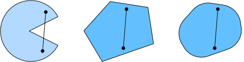
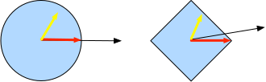

# 11.2 Выпуклость

*Выпуклость* (convexity) играет решающую роль в разработке алгоритмов оптимизации, главным образом потому, что в этом случае алгоритмы легче анализировать и проверять. Иными словами, если алгоритм плохо работает в условиях выпуклости, то обычно трудно ожидать хороших результатов в других условиях. Кроме того, хотя задачи оптимизации в глубоком обучении обычно невыпуклые, они часто демонстрируют некоторую выпуклость вблизи локальных минимумов. Это может привести к интересным новым вариантам оптимизации, таким как (Izmailov et al., 2018).

**MXNet:**

```python
%matplotlib inline
from d2l import mxnet as d2l
from mpl_toolkits import mplot3d
from mxnet import np, npx
npx.set_np()
```

**PyTorch:**

```python
%matplotlib inline
from d2l import torch as d2l
import numpy as np
from mpl_toolkits import mplot3d
import torch
```

**TensorFlow:**

```python
%matplotlib inline
from d2l import tensorflow as d2l
import numpy as np
from mpl_toolkits import mplot3d
import tensorflow as tf
```

**PaddlePaddle:**

```python
%matplotlib inline
from d2l import paddle as d2l
import warnings
warnings.filterwarnings("ignore")
import numpy as np
from mpl_toolkits import mplot3d
import paddle
```

## 11.2.1 Определения

Прежде чем проводить выпуклый анализ, нужно определить *выпуклые множества* (convex sets) и *выпуклые функции* (convex functions).

### 11.2.1.1 Выпуклые множества

*Выпуклое множество* (convex set) — основа выпуклости. Проще говоря, множество $\mathcal{X}$ в векторном пространстве называется *выпуклым* (convex), если для любых $a, b \in \mathcal{X}$ отрезок, соединяющий $a$ и $b$, тоже лежит в $\mathcal{X}$. В математических обозначениях это означает, что для всех $\lambda \in [0, 1]$

$$\lambda  a + (1-\lambda)  b \in \mathcal{X} \text{ при } a, b \in \mathcal{X}.$$

Это звучит довольно абстрактно, поэтому посмотрим на пример на рис. 11.2.1. В первом наборе есть отрезки, которые не полностью лежат внутри множества, поэтому этот набор невыпуклый, а два других набора такой проблемы не имеют.



**Рис. 11.2.1.** Первый набор невыпуклый, два других выпуклые

Теперь рассмотрим пересечение (рис. 11.2.2). Пусть $\mathcal{X}$ и $\mathcal{Y}$ — выпуклые множества. Тогда $\mathcal {X} \cap \mathcal{Y}$ тоже выпукло. Действительно, возьмём произвольные $a, b \in \mathcal{X} \cap \mathcal{Y}$. Поскольку $\mathcal{X}$ и $\mathcal{Y}$ выпуклы, отрезок, соединяющий $a$ и $b$, содержится и в $\mathcal{X}$, и в $\mathcal{Y}$. Значит, он содержится и в $\mathcal{X} \cap \mathcal{Y}$, что и требовалось доказать.


**Рис. 11.2.2.** Пересечение двух выпуклых множеств выпукло

Легко получить и более общий результат: для выпуклых множеств $\mathcal{X}_i$ их пересечение $\cap_{i} \mathcal{X}_i$ выпукло. Обратное неверно. Рассмотрим два непересекающихся множества $\mathcal{X} \cap \mathcal{Y} = \emptyset$ и возьмём $a \in \mathcal{X}$ и $b \in \mathcal{Y}$. Поскольку $\mathcal{X} \cap \mathcal{Y} = \emptyset$, на рис. 11.2.3 отрезок, соединяющий $a$ и $b$, обязан содержать часть, которая не принадлежит ни $\mathcal{X}$, ни $\mathcal{Y}$. Значит, отрезок не лежит и в $\mathcal{X} \cup \mathcal{Y}$, откуда следует, что объединение выпуклых множеств не обязательно выпукло, то есть *невыпукло* (nonconvex).


**Рис. 11.2.3.** Объединение двух выпуклых множеств не обязательно выпукло

Как правило, задачи глубокого обучения определяются на выпуклых множествах. Например, $\mathbb{R}^d$, то есть множество $d$-мерных векторов вещественных чисел, выпукло (ведь отрезок между любыми двумя точками из $\mathbb{R}^d$ тоже лежит в $\mathbb{R}^d$). В некоторых случаях используют переменные с ограниченной длиной, например шар радиуса $r$ определяется как $\{\mathbf{x} | \mathbf{x} \in \mathbb{R}^d \text{ и } \| \mathbf{x} \| \leq r\}$.

### 11.2.1.2 Выпуклые функции

Теперь, когда мы определили выпуклые множества, можно ввести *выпуклую функцию* (convex function) $f$. Пусть задано выпуклое множество $\mathcal{X}$. Функция $f: \mathcal{X} \to \mathbb{R}$ называется выпуклой, если для всех $x, x' \in \mathcal{X}$ и всех $\lambda \in [0, 1]$

$$\lambda f(x) + (1-\lambda) f(x') \geq f(\lambda x + (1-\lambda) x').$$

Чтобы проиллюстрировать это, построим несколько функций и проверим, какие из них удовлетворяют условию. Ниже мы определяем выпуклые и невыпуклые функции.

**MXNet, PyTorch, TensorFlow:**

```python
f = lambda x: 0.5 * x**2  # Выпуклая функция
g = lambda x: d2l.cos(np.pi * x)  # Невыпуклая функция
h = lambda x: d2l.exp(0.5 * x)  # Выпуклая функция

x, segment = d2l.arange(-2, 2, 0.01), d2l.tensor([-1.5, 1])
d2l.use_svg_display()
_, axes = d2l.plt.subplots(1, 3, figsize=(9, 3))
for ax, func in zip(axes, [f, g, h]):
    d2l.plot([x, segment], [func(x), func(segment)], axes=ax)
```

**PaddlePaddle:**

```python
f = lambda x: 0.5 * x**2  # Выпуклая функция
g = lambda x: d2l.cos(np.pi * x)  # Невыпуклая функция
h = lambda x: d2l.exp(0.5 * x)  # Выпуклая функция

x, segment = d2l.arange(-2, 2, 0.01, dtype='float32'), d2l.tensor([-1.5, 1])
d2l.use_svg_display()
_, axes = d2l.plt.subplots(1, 3, figsize=(9, 3))
for ax, func in zip(axes, [f, g, h]):
    d2l.plot([x, segment], [func(x), func(segment)], axes=ax)
```

Как и ожидалось, косинус невыпуклый, а парабола и экспонента выпуклые. Обратите внимание, что условие на $\mathcal{X}$ как выпуклое множество необходимо для того, чтобы выражение $f(\lambda x + (1-\lambda) x')$ было осмысленным. В противном случае результат $f(\lambda x + (1-\lambda) x')$ может оказаться не определён.

### 11.2.1.3 Неравенство Йенсена

Для выпуклой функции $f$ один из самых полезных математических инструментов — *неравенство Йенсена* (Jensen's inequality). Оно является обобщением определения выпуклости:

$$\sum_i \alpha_i f(x_i)  \geq f\left(\sum_i \alpha_i x_i\right) \text{ и } E_X[f(X)] \geq f\left(E_X[X]\right),\tag{11.2.1}$$

где $\alpha_i$ — неотрицательные вещественные числа с суммой $\sum_i \alpha_i = 1$, а $X$ — случайная величина. Другими словами, математическое ожидание выпуклой функции не меньше, чем выпуклая функция от математического ожидания, причём вторая часто оказывается более простым выражением. Чтобы доказать первое неравенство, мы многократно применяем определение выпуклости к одному слагаемому суммы.

Частое применение неравенства Йенсена — оценить сложное выражение более простым. Например, его можно применить к логарифмическому правдоподобию частично наблюдаемой случайной величины. А именно, поскольку $\int P(Y) P(X \mid Y) dY = P(X)$, получаем

$$E_{Y \sim P(Y)}[-\log P(X \mid Y)] \geq -\log P(X),$$

где $Y$ — типичная ненаблюдаемая случайная величина, $P(Y)$ — наилучшая догадка о её распределении, а $P(X)$ — распределение, полученное интегрированием по $Y$. Например, в кластеризации $Y$ может быть меткой кластера, а $P(X \mid Y)$ — порождающей моделью при использовании меток кластеров.

## 11.2.2 Свойства

Рассмотрим некоторые интересные свойства выпуклых функций.

### 11.2.2.1 Локальный минимум является глобальным минимумом

Прежде всего, локальный минимум выпуклой функции является также глобальным минимумом. Докажем это методом от противного.

Предположим, что $x^{\ast} \in \mathcal{X}$ — локальный минимум. Тогда существует достаточно малое положительное число $p$ такое, что для $x \in \mathcal{X}$, удовлетворяющих $0 < |x - x^{\ast}| \leq p$, выполняется $f(x^{\ast}) < f(x)$.

Допустим теперь, что локальный минимум $x^{\ast}$ не является глобальным минимумом $f$: существует $x' \in \mathcal{X}$, для которого $f(x') < f(x^{\ast})$. Тогда найдётся $\lambda \in [0, 1)$, например $\lambda = 1 - \frac{p}{|x^{\ast} - x'|}$, такое что $0 < |\lambda x^{\ast} + (1-\lambda) x' - x^{\ast}| \leq p$.

Однако по свойству выпуклости

$$\begin{aligned}
    f(\lambda x^{\ast} + (1-\lambda) x') &\leq \lambda f(x^{\ast}) + (1-\lambda) f(x') \\
    &< \lambda f(x^{\ast}) + (1-\lambda) f(x^{\ast}) \\
    &= f(x^{\ast}), \\
\end{aligned}$$

что противоречит тому, что $x^{\ast}$ — локальный минимум. Следовательно, не существует $x' \in \mathcal{X}$, для которого $f(x') < f(x^{\ast})$. Итак, локальный минимум $x^{\ast}$ является также глобальным минимумом.

Например, у выпуклой функции $f(x) = (x-1)^2$ есть локальный минимум $x=1$, который является и глобальным минимумом.

```python
f = lambda x: (x - 1) ** 2
d2l.set_figsize()
d2l.plot([x, segment], [f(x), f(segment)], 'x', 'f(x)')
```

То, что локальный минимум выпуклой функции является и глобальным, удобно. Это означает, что при минимизации функции мы не «застреваем». Однако заметим, что это не означает, что не может быть нескольких глобальных минимумов или что глобальный минимум может не существовать. Например, функция $f(x) = \mathrm{max}(|x|-1, 0)$ достигает минимума на всём интервале $[-1,1]$. Напротив, функция $f(x) = \exp(x)$ на $\mathbb{R}$ не имеет минимума: при $x \to -\infty$ она стремится к $0$, но ни при каком $x$ не принимает значения $0$.

### 11.2.2.2 Множества подуровня выпуклой функции выпуклы

Выпуклые множества удобно определять через *множества подуровня* (below sets) выпуклой функции. Точнее, для выпуклой функции $f$, определённой на выпуклом множестве $\mathcal{X}$, любое её множество подуровня

$$\mathcal{S}_b := \{x | x \in \mathcal{X} \text{ и } f(x) \leq b\}$$

выпукло.

Докажем это. Для любых $x, x' \in \mathcal{S}_b$ нужно показать, что при $\lambda \in [0, 1]$ выполнено $\lambda x + (1-\lambda) x' \in \mathcal{S}_b$. Поскольку $f(x) \leq b$ и $f(x') \leq b$, имеем

$$f(\lambda x + (1-\lambda) x') \leq \lambda f(x) + (1-\lambda) f(x') \leq b.$$

### 11.2.2.3 Выпуклость и вторая производная

Если у функции $f: \mathbb{R}^n \rightarrow \mathbb{R}$ существует вторая производная, то выпуклость легко проверить. Нужно лишь убедиться, что $\nabla^2f \succeq 0$, то есть для всех $\mathbf{x} \in \mathbb{R}^n$ выполняется $\mathbf{x}^\top \mathbf{H} \mathbf{x} \geq 0$. Например, функция $f(\mathbf{x}) = \frac{1}{2} \|\mathbf{x}\|^2$ выпукла, поскольку $\nabla^2 f = \mathbf{1}$, то есть её производная является единичной матрицей.

Более строго: $f$ выпукла тогда и только тогда, когда выпукла любая дважды дифференцируемая одномерная функция $f: \mathbb{R}^n \rightarrow \mathbb{R}$. Для любой дважды дифференцируемой многомерной функции $f: \mathbb{R}^{n} \rightarrow \mathbb{R}$ она выпукла тогда и только тогда, когда её матрица Гессе $\nabla^2f\succeq 0$.

Сначала докажем одномерный случай. Чтобы показать, что для выпуклой функции $f''(x) \geq 0$, воспользуемся

$$\frac{1}{2} f(x + \epsilon) + \frac{1}{2} f(x - \epsilon) \geq f\left(\frac{x + \epsilon}{2} + \frac{x - \epsilon}{2}\right) = f(x).$$

Поскольку вторая производная задаётся пределом конечной разности, получаем

$$f''(x) = \lim_{\epsilon \to 0} \frac{f(x+\epsilon) + f(x - \epsilon) - 2f(x)}{\epsilon^2} \geq 0.$$

Чтобы показать, что из $f'' \geq 0$ следует выпуклость $f$, используем тот факт, что $f'' \geq 0$ означает, что $f'$ — монотонно неубывающая функция. Пусть $a < x < b$ — три точки в $\mathbb{R}$, где $x = (1-\lambda)a + \lambda b$ и $\lambda \in (0, 1)$. По теореме о среднем существуют $\alpha \in [a, x]$ и $\beta \in [x, b]$, такие что

$$f'(\alpha) = \frac{f(x) - f(a)}{x-a} \text{ и } f'(\beta) = \frac{f(b) - f(x)}{b-x}.$$

Из монотонности $f'(\beta) \geq f'(\alpha)$, поэтому

$$\frac{x-a}{b-a}f(b) + \frac{b-x}{b-a}f(a) \geq f(x).$$

Поскольку $x = (1-\lambda)a + \lambda b$, получаем

$$\lambda f(b) + (1-\lambda)f(a) \geq f((1-\lambda)a + \lambda b),$$

что и доказывает выпуклость.

Во-вторых, для доказательства многомерного случая нам понадобится лемма: функция $f: \mathbb{R}^n \rightarrow \mathbb{R}$ выпукла тогда и только тогда, когда для всех $\mathbf{x}, \mathbf{y} \in \mathbb{R}^n$ выпукла функция

$$g(z) \stackrel{\mathrm{def}}{=} f(z \mathbf{x} + (1-z)  \mathbf{y}), \text{ где } z \in [0,1].$$

Чтобы показать, что выпуклость $f$ влечёт выпуклость $g$, достаточно проверить, что для всех $a, b, \lambda \in[0, 1]$ (так что $0 \leq \lambda a + (1-\lambda) b \leq 1$)

$$\begin{aligned} &g(\lambda a + (1-\lambda) b)\\
=&f\left(\left(\lambda a + (1-\lambda) b\right)\mathbf{x} + \left(1-\lambda a - (1-\lambda) b\right)\mathbf{y} \right)\\
=&f\left(\lambda \left(a \mathbf{x} + (1-a)  \mathbf{y}\right)  + (1-\lambda) \left(b \mathbf{x} + (1-b)  \mathbf{y}\right) \right)\\
\leq& \lambda f\left(a \mathbf{x} + (1-a)  \mathbf{y}\right)  + (1-\lambda) f\left(b \mathbf{x} + (1-b)  \mathbf{y}\right) \\
=& \lambda g(a) + (1-\lambda) g(b).
\end{aligned}$$

Чтобы показать обратное, достаточно проверить для всех $\lambda \in [0, 1]$

$$\begin{aligned} &f(\lambda \mathbf{x} + (1-\lambda) \mathbf{y})\\
=&g(\lambda \cdot 1 + (1-\lambda) \cdot 0)\\
\leq& \lambda g(1)  + (1-\lambda) g(0) \\
=& \lambda f(\mathbf{x}) + (1-\lambda) f(\mathbf{y}).
\end{aligned}$$

Наконец, используя лемму и результат для одномерного случая, докажем многомерный случай: многомерная функция $f:\mathbb{R}^n\rightarrow\mathbb{R}$ выпукла тогда и только тогда, когда выпукла $g(z) \stackrel{\mathrm{def}}{=} f(z \mathbf{x} + (1-z)  \mathbf{y})$ при $z \in [0,1]$, $\mathbf{x}, \mathbf{y} \in \mathbb{R}^n$. По одномерному случаю это условие выполнено тогда и только тогда, когда для всех $\mathbf{x}, \mathbf{y} \in \mathbb{R}^n$ выполнено $g'' = (\mathbf{x} - \mathbf{y})^\top \mathbf{H}(\mathbf{x} - \mathbf{y}) \geq 0$ ($\mathbf{H} \stackrel{\mathrm{def}}{=} \nabla^2f$). По определению положительно полуопределённой матрицы это эквивалентно $\mathbf{H} \succeq 0$.

## 11.2.3 Ограничения

Удобное свойство выпуклой оптимизации — возможность эффективно работать с *ограничениями* (constraints). Она позволяет решать *оптимизацию с ограничениями* (constrained optimization) вида

$$\begin{aligned} \mathop{\mathrm{minimize~}}_{\mathbf{x}} & f(\mathbf{x}) \\
    \text{ при условии } & c_i(\mathbf{x}) \leq 0 \text{ для всех } i \in \{1, \ldots, N\}.
\end{aligned}$$

Здесь $f$ — целевая функция, а $c_i$ — функции ограничений. Например, первое ограничение $c_1(\mathbf{x}) = \|\mathbf{x}\|_2 - 1$ ограничивает параметр $\mathbf{x}$ единичным шаром. Если же второе ограничение $c_2(\mathbf{x}) = \mathbf{v}^\top \mathbf{x} + b$, то оно соответствует всем $\mathbf{x}$ из полупространства. Одновременное выполнение обоих ограничений эквивалентно выбору в качестве множества ограничений сегмента шара.

### 11.2.3.1 Функция Лагранжа

Решать задачу оптимизации с ограничениями в общем случае трудно, и один из способов решения возникает из довольно простой физической интуиции. Представьте шар в коробке: шар скатится в самое низкое место, а сила тяжести будет уравновешена силами, с которыми стенки коробки действуют на шар. Коротко говоря, градиент целевой функции (то есть силы тяжести) компенсируется градиентом функции ограничения (из-за «отталкивания» стенки, которое удерживает шар внутри коробки). Заметим, что любое неактивное ограничение (то есть когда шар не касается стенки) не оказывает никакой силы на шар.

Здесь мы кратко выведем *функцию Лагранжа* $L$; описанные выше соображения можно выразить через следующую задачу поиска седловой точки:

$$L(\mathbf{x}, \alpha_1, \ldots, \alpha_n) = f(\mathbf{x}) + \sum_{i=1}^n \alpha_i c_i(\mathbf{x}) \text{ где } \alpha_i \geq 0.$$

Переменные $\alpha_i$ ($i=1,\ldots,n$) называются *множителями Лагранжа* (Lagrange multipliers): они обеспечивают корректное выполнение ограничений. Их величину выбирают так, чтобы для всех $i$ выполнялось $c_i(\mathbf{x}) \leq 0$. Например, для любого $\mathbf{x}$, при котором $c_i(\mathbf{x}) < 0$, в итоге выбираем $\alpha_i = 0$. Кроме того, это задача поиска *седловой точки* (saddle point): мы хотим *максимизировать* $L$ по $\alpha_i$ и одновременно *минимизировать* его по $\mathbf{x}$. Существует большое количество литературы о том, как получить функцию $L(\mathbf{x}, \alpha_1, \ldots, \alpha_n)$. Нам здесь достаточно знать, что седловая точка $L$ является оптимальным решением исходной задачи оптимизации с ограничениями.

### 11.2.3.2 Штрафы

Один из способов хотя бы приближённо удовлетворить задаче оптимизации с ограничениями — использовать функцию Лагранжа $L$. Помимо выполнения $c_i(\mathbf{x}) \leq 0$, достаточно добавить $\alpha_i c_i(\mathbf{x})$ к целевой функции $f(x)$. Это гарантирует, что ограничения не будут сильно нарушены.

Мы фактически уже использовали этот приём. Например, в затухании весов (раздел 4.5) к целевой функции добавляется $\frac{\lambda}{2} |\mathbf{w}|^2$, чтобы $\mathbf{w}$ не становился слишком большим. Если рассматривать это как задачу с ограничениями, то для некоторого радиуса $r$ это гарантирует $|\mathbf{w}|^2 - r^2 \leq 0$. Регулируя значение $\lambda$, можно менять размер $\mathbf{w}$.

Обычно добавление штрафа — хороший способ обеспечить приближённое выполнение ограничений. На практике это оказывается надёжнее, чем точное выполнение. Кроме того, для невыпуклых задач многие свойства точных методов из выпуклого случая (например, существование оптимального решения) перестают выполняться.

### 11.2.3.3 Проекции

Ещё одна стратегия выполнения ограничений — *проекции* (projections). Мы уже встречались с ними, например при отсечении градиентов в разделе 8.5, где длина градиента ограничивалась величиной $\theta$:

$$\mathbf{g} \leftarrow \mathbf{g} \cdot \mathrm{min}(1, \theta/\|\mathbf{g}\|).$$

Это и есть *проекция* $\mathbf{g}$ на шар радиуса $\theta$. В общем случае проекция на выпуклое множество $\mathcal{X}$ определяется как

$$\mathrm{Proj}_\mathcal{X}(\mathbf{x}) = \mathop{\mathrm{argmin}}_{\mathbf{x}' \in \mathcal{X}} \|\mathbf{x} - \mathbf{x}'\|.$$

Это точка множества $\mathcal{X}$, ближайшая к $\mathbf{X}$.



**Рис. 11.2.4.** Выпуклые проекции

Определение проекции может показаться абстрактным, поэтому рассмотрим рис. 11.2.4. На нём два выпуклых множества: круг и ромб. Точки внутри каждого множества (жёлтые) при проекции остаются на месте. Точки вне множеств (чёрные) проецируются в ближайшие к исходным точкам точки внутри множеств (красные). Хотя для шара $L_2$ направление сохраняется, в общем случае это не обязательно.

Одно из применений выпуклых проекций — вычисление разреженных весовых векторов. В этом случае вектор весов проецируется на шар $L_1$, который является обобщением примера с ромбом на рис. 11.2.4.

## Резюме

В контексте глубокого обучения главная цель выпуклых функций — помочь нам глубже понять алгоритмы оптимизации. Из них мы выводим, как появляются градиентный спуск и стохастический градиентный спуск.

* Пересечение выпуклых множеств выпукло, а объединение — не обязательно.
* По неравенству Йенсена «полное математическое ожидание многомерной выпуклой функции» не меньше, чем «значение этой функции, вычисленное по математическим ожиданиям переменных».
* Дважды дифференцируемая функция выпукла тогда и только тогда, когда её матрица Гессе (матрица вторых производных) является положительно полуопределённой.
* Выпуклые ограничения можно добавить с помощью функции Лагранжа. На практике достаточно добавить штраф к целевой функции.
* Проекция отображает точку в ближайшую к ней точку выпуклого множества.

## Упражнения

1. Предположим, мы хотим проверить выпуклость множества, проводя все прямые между точками внутри множества и проверяя, лежат ли эти прямые целиком внутри него. i. Докажите, что достаточно проверить только точки на границе. ii. Докажите, что достаточно проверить только вершины множества.
1. Обозначим шар радиуса $r$ через $p$-норму и докажите, что $\mathcal{B}_p[r] := \{\mathbf{x} | \mathbf{x} \in \mathbb{R}^d \text{ и } \|\mathbf{x}\|_p \leq r\}$ выпукло при всех $p \geq 1$.
1. Даны выпуклые функции $f$ и $g$. Покажите, что $\mathrm{max}(f, g)$ тоже выпукла. Докажите, что $\mathrm{min}(f, g)$ невыпукла.
1. Докажите, что нормировка softmax выпукла, то есть выпукла функция $f(x) = \log \sum_i \exp(x_i)$.
1. Докажите, что линейное подпространство $\mathcal{X} = \{\mathbf{x} | \mathbf{W} \mathbf{x} = \mathbf{b}\}$ — выпуклое множество.
1. Докажите, что при линейном подпространстве с $\mathbf{b} = \mathbf{0}$ проекция $\mathrm{Proj} \mathcal{X}$ на матрицу $\mathbf{M}$ может быть записана как $\mathbf{M} \mathbf{X}$.
1. Докажите, что для выпуклой дважды дифференцируемой функции $f$ при $\xi \in [0, \epsilon]$ можно записать $f(x + \epsilon) = f(x) + \epsilon f'(x) + \frac{1}{2} \epsilon^2 f''(x + \xi)$.
1. Для выпуклого множества $\mathcal{X}$ и двух векторов $\mathbf{x}$ и $\mathbf{y}$ докажите, что проекция не увеличивает расстояние: $\|\mathbf{x} - \mathbf{y}\| \geq \|\mathrm{Proj}_\mathcal{X}(\mathbf{x}) - \mathrm{Proj}_\mathcal{X}(\mathbf{y})\|$.

**MXNet:**
[Обсуждение](https://discuss.d2l.ai/t/3814)

**PyTorch:**
[Обсуждение](https://discuss.d2l.ai/t/3815)

**TensorFlow:**
[Обсуждение](https://discuss.d2l.ai/t/3816)

**PaddlePaddle:**
[Обсуждение](https://discuss.d2l.ai/t/11847)

## Литература

* Izmailov, P., Podoprikhin, D., Garipov, T., Vetrov, D., & Wilson, A. G. (2018). Averaging weights leads to wider optima and better generalization. *arXiv preprint arXiv:1803.05407*.
* Wigner, E. P. (1958). On the distribution of the roots of certain symmetric matrices. *Annals of Mathematics*, 325–327.
