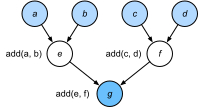

# 12.1 Компиляторы и интерпретаторы

До сих пор в этой книге мы в основном рассматривали *императивное программирование* (imperative programming). Императивное программирование использует такие операторы, как `print`, «`+`» и `if`, чтобы изменять состояние программы. Рассмотрим простую императивную программу:

```python
def add(a, b):
    return a + b

def fancy_func(a, b, c, d):
    e = add(a, b)
    f = add(c, d)
    g = add(e, f)
    return g

print(fancy_func(1, 2, 3, 4))
```

Python — это *интерпретируемый язык* (interpreted language). Поэтому при вычислении функции `fancy_func` выше он последовательно выполняет операции тела функции. То есть он вычислит `e = add(a, b)`, сохранит результат в переменной `e` и тем самым изменит состояние программы. Следующие две инструкции, `f = add(c, d)` и `g = add(e, f)`, работают так же: выполняют сложение и сохраняют результат в переменной. На рис. 12.1.1 показан поток данных.



**Рис. 12.1.1.** Поток данных при императивном программировании

Императивное программирование удобно, но может быть неэффективным. Во-первых, Python выполняет три вызова функций по отдельности и не учитывает, что `add` повторно вызывается внутри `fancy_func`. Если выполнять такие команды на одном GPU (или на нескольких), накладные расходы интерпретатора Python могут оказаться очень большими. Кроме того, значения переменных `e` и `f` нужно хранить до тех пор, пока не выполнятся все инструкции `fancy_func`. Дело в том, что программа не знает, понадобятся ли переменные `e` и `f` другим частям кода после выполнения инструкций `e = add(a, b)` и `f = add(c, d)`.

## 12.1.1 Символьное программирование

Рассмотрим другой вариант — *символьное программирование* (symbolic programming): код обычно выполняет вычисления только после того, как процедура полностью определена. Эту стратегию используют несколько фреймворков глубокого обучения, в том числе Theano и TensorFlow (у которого со временем появился и императивный режим). Обычно процесс состоит из следующих шагов:

1. определить вычислительный процесс;
1. скомпилировать процесс в исполняемую программу;
1. при заданных входных данных вызвать скомпилированную программу для выполнения.

Это позволяет проводить многочисленные оптимизации. Во-первых, в большинстве случаев можно обойтись без интерпретатора Python. Это устраняет узкое место в производительности, которое возникает, когда несколько быстрых GPU работают вместе с одним потоком Python на одном CPU. Во-вторых, компилятор может оптимизировать и переписать код, например превратив `print((1 + 2) + (3 + 4))` в `print(10)`. Такая оптимизация возможна потому, что компилятор видит весь код до того, как преобразовать его в машинные инструкции. Например, компилятор может освободить память, как только переменная больше не нужна (или вообще не выделять её), либо заменить фрагмент кода на полностью эквивалентный. Ниже мы имитируем императивное программирование, чтобы лучше понять идею символьного программирования.

```python
def add_():
    return '''
def add(a, b):
    return a + b
'''

def fancy_func_():
    return '''
def fancy_func(a, b, c, d):
    e = add(a, b)
    f = add(c, d)
    g = add(e, f)
    return g
'''

def evoke_():
    return add_() + fancy_func_() + 'print(fancy_func(1, 2, 3, 4))'

prog = evoke_()
print(prog)
y = compile(prog, '', 'exec')
exec(y)
```

Различия между императивным (интерпретируемым) и символьным программированием таковы:

* императивное программирование проще в использовании. В Python большая часть императивного кода понятна и проста. Его также легче отлаживать, потому что получить и напечатать все промежуточные значения переменных или использовать встроенные средства отладки Python гораздо проще;
* символьное программирование работает эффективнее и легче переносится. Его проще оптимизировать во время компиляции, а программу можно перенести в формат, не зависящий от Python. Это позволяет запускать программу в средах без Python и избежать возможных проблем с производительностью, связанных с интерпретатором Python.

## 12.1.2 Гибридное программирование

Исторически большинство фреймворков глубокого обучения выбирали между императивным и символьным программированием. Например, Theano, TensorFlow (созданный под влиянием Theano), Keras и CNTK использовали символьное программирование. Напротив, Chainer и PyTorch выбрали императивное программирование. В последующих версиях TensorFlow 2.0 и Keras добавили императивное программирование.

**MXNet:** Разработчики Gluon задались вопросом: можно ли объединить достоинства обеих моделей программирования? Так появилась *гибридная модель программирования* (hybrid programming). Она позволяет разрабатывать и отлаживать код в чисто императивном стиле, но при этом превращать большинство программ в символьные, когда нужны производительность промышленного уровня и развёртывание.

На практике это означает, что модели строятся с помощью классов `HybridBlock` или `HybridSequential`. По умолчанию они работают так же, как классы `Block` и `Sequential` в императивном программировании. Класс `HybridSequential` наследуется от `HybridBlock` так же, как `Sequential` наследуется от `Block`. Когда вызывается функция `hybridize`, Gluon компилирует модель в форму, которая используется в символьном программировании. Это позволяет оптимизировать вычислительно сложные компоненты, не меняя способа реализации модели. Ниже мы подробно опишем преимущества этого подхода на примере `Sequential` и `Block`.

**PyTorch:** Как было сказано выше, PyTorch основан на императивном программировании и использует динамический вычислительный граф. Чтобы использовать переносимость и эффективность символьного программирования, разработчики задались вопросом: можно ли объединить достоинства обеих моделей программирования? Так появился TorchScript. Он позволяет разрабатывать и отлаживать код в чисто императивном стиле, но при этом превращать большинство программ в символьные, когда нужны производительность промышленного уровня и развёртывание.

**TensorFlow:** Императивное программирование сейчас выбрано по умолчанию в TensorFlow 2, что удобно для тех, кто только начинает работать с этим языком. Тем не менее символьное программирование и вычислительные графы по-прежнему доступны в TensorFlow: их можно использовать через простой в применении декоратор `tf.function`. Это даёт TensorFlow императивную парадигму, позволяя определять более понятные функции, а затем оборачивать их с помощью механизма, который команда TensorFlow называет [autograph](https://www.tensorflow.org/api_docs/python/tf/autograph), и автоматически компилировать в вычислительный граф.

**PaddlePaddle:** Как было сказано выше, PaddlePaddle основан на императивном программировании и использует динамический вычислительный граф. Чтобы использовать переносимость и эффективность символьного программирования, разработчики задались вопросом: можно ли объединить достоинства обеих моделей программирования? Так появилась PaddlePaddle 2.0. Начиная с версии 2.0 PaddlePaddle позволяет разрабатывать и отлаживать код в чисто императивном стиле, но при этом превращать большинство программ в символьные, когда нужны производительность промышленного уровня и развёртывание.

## 12.1.3 Гибридное программирование для `Sequential`

Проще всего понять, как работает гибридное программирование, рассмотрев глубокую сеть с несколькими слоями. По традиции интерпретатор Python должен выполнить код всех слоёв, чтобы сформировать одну инструкцию, а затем передать её на CPU или GPU. Для одного (быстрого) вычислительного устройства это не создаёт серьёзных проблем. С другой стороны, если использовать мощный сервер с восемью GPU, например экземпляр AWS P3dn.24xlarge, Python будет с трудом загружать все GPU. Здесь узким местом становится однопоточный интерпретатор Python. Посмотрим, как решить эту проблему в коде, заменив `Sequential` на `HybridSequential`. Сначала определим простой многослойный перцептрон.

**MXNet:**

```python
from d2l import mxnet as d2l
from mxnet import np, npx
from mxnet.gluon import nn
npx.set_np()

# Фабричная функция для создания сети
def get_net():
    net = nn.HybridSequential()  
    net.add(nn.Dense(256, activation='relu'),
            nn.Dense(128, activation='relu'),
            nn.Dense(2))
    net.initialize()
    return net

x = np.random.normal(size=(1, 512))
net = get_net()
net(x)
```

**PyTorch:**

```python
from d2l import torch as d2l
import torch
from torch import nn

# Фабричная функция для создания сети
def get_net():
    net = nn.Sequential(nn.Linear(512, 256),
            nn.ReLU(),
            nn.Linear(256, 128),
            nn.ReLU(),
            nn.Linear(128, 2))
    return net

x = torch.randn(size=(1, 512))
net = get_net()
net(x)
```

**TensorFlow:**

```python
from d2l import tensorflow as d2l
import tensorflow as tf
from tensorflow.keras.layers import Dense

# Фабричная функция для создания сети
def get_net():
    net = tf.keras.Sequential()
    net.add(Dense(256, input_shape = (512,), activation = "relu"))
    net.add(Dense(128, activation = "relu"))
    net.add(Dense(2, activation = "linear"))
    return net

x = tf.random.normal([1,512])
net = get_net()
net(x)
```

**PaddlePaddle:**

```python
from d2l import paddle as d2l
import warnings
warnings.filterwarnings("ignore")
import paddle
from paddle import nn
from paddle.jit import to_static
from paddle.static import InputSpec

# Фабричная функция для создания сети
def get_net():
    blocks = [
        nn.Linear(512, 256),
        nn.ReLU(),
        nn.Linear(256, 128),
        nn.ReLU(),
        nn.Linear(128, 2)
    ]
    net = nn.Sequential(*blocks)
    return net

x = paddle.randn((1, 512))
net = get_net()
net(x)
```

**MXNet:** Вызвав функцию `hybridize`, мы получаем возможность компилировать и оптимизировать вычисления в многослойном перцептроне, при этом результаты вычислений модели не меняются.

**PyTorch:** Преобразовав модель с помощью функции `torch.jit.script`, мы получаем возможность компилировать и оптимизировать вычисления в многослойном перцептроне, при этом результаты вычислений модели не меняются.

**TensorFlow:** Изначально все функции в TensorFlow строились как вычислительные графы и по умолчанию компилировались JIT. Однако с выходом TensorFlow 2.x и EagerTensor граф перестал быть поведением по умолчанию. Включить эту возможность снова можно с помощью `tf.function`. Обычно `tf.function` используют как декоратор функции, как показано ниже, но его также можно вызывать напрямую, как обычную функцию Python. Результаты вычислений модели не меняются.

**PaddlePaddle:** Преобразовав модель с помощью функции `paddle.jit.to_static`, мы получаем возможность компилировать и оптимизировать вычисления в многослойном перцептроне, при этом результаты вычислений модели не меняются.

**MXNet:**

```python
net.hybridize()
net(x)
```

**PyTorch:**

```python
net = torch.jit.script(net)
net(x)
```

**TensorFlow:**

```python
net = tf.function(net)
net(x)
```

**PaddlePaddle:**

```python
net = paddle.jit.to_static(net)
net(x)
```

**MXNet:** Нам достаточно объявить блок как `HybridSequential`, написать тот же код, что и раньше, и вызвать `hybridize`. После этого сеть будет оптимизирована (сравнение производительности приведено ниже). К сожалению, такая магия работает не для каждого слоя: если слой унаследован от класса `Block`, а не `HybridBlock`, он оптимизирован не будет.

**PyTorch:** Мы пишем тот же код, что и раньше, и просто преобразуем модель с помощью `torch.jit.script`. После этого сеть будет оптимизирована (сравнение производительности приведено ниже).

**TensorFlow:** Мы пишем тот же код, что и раньше, и просто преобразуем модель с помощью `tf.function`. После этого сеть будет построена как вычислительный граф в промежуточном представлении MLIR в TensorFlow и пройдёт множество оптимизаций на уровне компилятора для быстрого выполнения (сравнение производительности приведено ниже). Включить XLA (ускорение линейной алгебры) в TensorFlow можно явно, добавив флаг `jit_compile = True` в вызов `tf.function()`. В некоторых случаях XLA может дополнительно оптимизировать JIT-скомпилированный код. Если указать это явно не нужно, режим графа всё равно включается, но XLA может ускорить некоторые крупные операции линейной алгебры, похожие на те, что встречаются в программах глубокого обучения, особенно в среде с GPU.

**PaddlePaddle:** Мы пишем тот же код, что и раньше, и просто преобразуем модель с помощью `paddle.jit.to_static`. После этого сеть будет оптимизирована (сравнение производительности приведено ниже).

### 12.1.3.1 Ускорение с помощью гибридного программирования

Чтобы показать, что компиляция действительно повышает производительность, сравним время выполнения `net(x)` до и после гибридизации. Сначала определим класс для измерения времени. Он пригодится в этой главе, когда будем оценивать и улучшать производительность моделей.

```python
#@save
class Benchmark:
    """Измерение времени выполнения"""
    def __init__(self, description='Готово'):
        self.description = description

    def __enter__(self):
        self.timer = d2l.Timer()
        return self

    def __exit__(self, *args):
        print(f'{self.description}: {self.timer.stop():.4f} сек')
```

**MXNet:** Теперь вызовем сеть дважды: с гибридизацией и без неё.

**PyTorch:** Теперь вызовем сеть дважды: с TorchScript и без него.

**TensorFlow:** Теперь вызовем сеть трижды: в режиме eager, в режиме графа и с JIT-компиляцией через XLA.

**PaddlePaddle:** Теперь вызовем сеть дважды: в динамическом императивном режиме и в статическом символьном режиме.

**MXNet:**

```python
net = get_net()
with Benchmark('без гибридизации'):
    for i in range(1000): net(x)
    npx.waitall()

net.hybridize()
with Benchmark('с гибридизацией'):
    for i in range(1000): net(x)
    npx.waitall()
```

**PyTorch:**

```python
net = get_net()
with Benchmark('без torchscript'):
    for i in range(1000): net(x)

net = torch.jit.script(net)
with Benchmark('с torchscript'):
    for i in range(1000): net(x)
```

**TensorFlow:**

```python
net = get_net()
with Benchmark('Режим eager'):
    for i in range(1000): net(x)

net = tf.function(net)
with Benchmark('Режим графа'):
    for i in range(1000): net(x)
```

**PaddlePaddle:**

```python
net = get_net()
with Benchmark('Императивный режим PaddlePaddle (динамический граф)'):
    for i in range(1000): net(x)

# InputSpec описывает сигнатуру входных данных модели: shape, dtype и name
x_spec = InputSpec(shape=[-1, 512], name='x') 
net = paddle.jit.to_static(get_net(),input_spec=[x_spec])
with Benchmark('Символьный режим PaddlePaddle (статический граф)'):
    for i in range(1000): net(x)
```

**MXNet:** Как видно из результатов, после вызова `hybridize` для экземпляра `HybridSequential` вычислительная производительность выросла благодаря символьному программированию.

**PyTorch:** Как видно из результатов, после того как экземпляр `nn.Sequential` преобразован функцией `torch.jit.script`, вычислительная производительность выросла благодаря символьному программированию.

**TensorFlow:** Как видно из результатов, после того как экземпляр `tf.keras.Sequential` преобразован функцией `tf.function`, производительность выросла благодаря символьному программированию, реализованному через режим выполнения графа в TensorFlow.

**PaddlePaddle:** Как видно из результатов, после того как экземпляр `nn.Sequential` преобразован функцией `paddle.jit.to_static`, вычислительная производительность выросла благодаря символьному программированию.

### 12.1.3.2 Сериализация

**MXNet:** Одно из преимуществ компилированных моделей в том, что модель вместе с параметрами можно сериализовать (сохранить) на диск. Это позволяет развёртывать обученные модели на других устройствах и удобно использовать их из других языков программирования. Кроме того, скомпилированный код обычно выполняется быстрее, чем императивный. Посмотрим, что делает `export`.

**PyTorch:** Одно из преимуществ компилированных моделей в том, что модель вместе с параметрами можно сериализовать (сохранить) на диск. Это позволяет развёртывать обученные модели на других устройствах и удобно использовать их из других языков программирования. Кроме того, скомпилированный код обычно выполняется быстрее, чем императивный. Посмотрим, что делает `save`.

**TensorFlow:** Одно из преимуществ компилированных моделей в том, что модель вместе с параметрами можно сериализовать (сохранить) на диск. Это позволяет развёртывать обученные модели на других устройствах и удобно использовать их из других языков программирования. Кроме того, скомпилированный код обычно выполняется быстрее, чем императивный. Низкоуровневый API для сохранения моделей в TensorFlow — `tf.saved_model`. Посмотрим, как работает `saved_model`.

**PaddlePaddle:** Одно из преимуществ компилированных моделей в том, что модель вместе с параметрами можно сериализовать (сохранить) на диск. Это позволяет развёртывать обученные модели на других устройствах и удобно использовать их из других языков программирования. Кроме того, скомпилированный код обычно выполняется быстрее, чем императивный. Посмотрим, что делает `paddle.jit.save`.

**MXNet:**

```python
net.export('my_mlp')
!ls -lh my_mlp*
```

**PyTorch:**

```python
net.save('my_mlp')
!ls -lh my_mlp*
```

**TensorFlow:**

```python
net = get_net()
tf.saved_model.save(net, 'my_mlp')
!ls -lh my_mlp*
```

**PaddlePaddle:**

```python
paddle.jit.save(net, './my_mlp')
!ls -lh my_mlp*
```

**MXNet:** Модель разбивается на два файла: один большой двоичный файл с параметрами и JSON-файл с описанием программы, необходимой для вычисления модели. Эти файлы могут читать и другие языки программирования, например C++, R, Scala и Perl, если они поддерживаются Python или MXNet. Посмотрим первые строки описания модели.

```python
!head my_mlp-symbol.json
```

**MXNet:** Ранее мы показали, что после вызова `hybridize` модель получает высокую вычислительную производительность и переносимость. Обратите внимание, что гибридизация может ограничивать гибкость модели, особенно в том, что касается управления потоком выполнения.

Кроме того, в то время как экземпляр `Block` требует вызова функции `forward`, экземпляр `HybridBlock` использует функцию `hybrid_forward`.

**MXNet:**

```python
class HybridNet(nn.HybridBlock):
    def __init__(self, **kwargs):
        super(HybridNet, self).__init__(**kwargs)
        self.hidden = nn.Dense(4)
        self.output = nn.Dense(2)

    def hybrid_forward(self, F, x):
        print('модуль F: ', F)
        print('значение x: ', x)
        x = F.npx.relu(self.hidden(x))
        print('результат : ', x)
        return self.output(x)
```

**MXNet:** Приведённый код реализует простую сеть с $4$ скрытыми элементами и $2$ выходами. Аргумент `F` добавлен в функцию `hybrid_forward` потому, что от режима гибридизации зависит, какая библиотека (`ndarray` или `symbol`) будет использоваться в коде. Эти два класса выполняют очень похожие функции, поэтому MXNet определяет этот аргумент автоматически. Чтобы понять, что происходит, мы выведем аргументы как часть вызова функции.

```python
net = HybridNet()
net.initialize()
x = np.random.normal(size=(1, 3))
net(x)
```

**MXNet:** Повторное прямое распространение даст тот же результат (подробности опущены). Теперь посмотрим, что происходит при вызове `hybridize`.

```python
net.hybridize()
net(x)
```

**MXNet:** Программа использует модуль `symbol` вместо модуля `ndarray` для представления `F`. Кроме того, даже если входные данные имеют тип `ndarray`, данные, проходящие через сеть, теперь преобразуются в тип `symbol`. Это преобразование и есть часть процесса компиляции. Повторный вызов функции даёт неожиданный результат:

```python
net(x)
```

**MXNet:** Это сильно отличается от того, что было раньше. Все операторы печати в `hybrid_forward` игнорируются. Действительно, при гибридном выполнении `net(x)` интерпретатор Python больше не используется. Это означает, что любой код Python (например, операторы `print`) будет проигнорирован ради более экономного выполнения и лучшей производительности. MXNet вместо интерпретатора Python напрямую вызывает бэкенд на C++. Кроме того, учтите, что модуль `symbol` не поддерживает некоторые функции (например, `asnumpy`), поэтому такие операции, как `a += b` и `a[:] = a + b`, нужно переписать в виде `a = a + b`. Тем не менее, когда важна скорость, компиляция модели того стоит. Выигрыш в скорости может составлять от небольшого процента до более чем двукратного, в зависимости в основном от сложности модели, быстродействия CPU и количества и быстродействия GPU.

## Резюме

* Императивное программирование упрощает разработку новых моделей: код можно писать, опираясь на управление потоком выполнения, а также пользоваться зрелой экосистемой Python.
* Символьное программирование требует сначала определить и скомпилировать программу, а потом её выполнить. Его преимущество — более высокая вычислительная производительность.

**MXNet:**

* MXNet может объединять достоинства императивного и символьного программирования в зависимости от потребностей пользователя.
* Модели, построенные из классов `HybridSequential` и `HybridBlock`, с помощью функции `hybridize` могут преобразовать императивную программу в символьную.

## Упражнения

**MXNet:**

1. Добавьте `x.asnumpy()` в первую строку функции `hybrid_forward` класса `HybridNet` из этого раздела, выполните код и посмотрите, какая возникнет ошибка. Почему так происходит?
1. Что произойдёт, если в функцию `hybrid_forward` добавить управляющие конструкции Python: `if` и `for`?
1. Вспомните модели из предыдущих глав, которые вас заинтересовали. Можно ли повысить их вычислительную производительность, переписав их?

**PyTorch, TensorFlow:**

1. Вспомните модели из предыдущих глав, которые вас заинтересовали. Можно ли повысить их вычислительную производительность?

**MXNet:**
[Обсуждение](https://discuss.d2l.ai/t/2789)

**PyTorch:**
[Обсуждение](https://discuss.d2l.ai/t/2788)

**TensorFlow:**
[Обсуждение](https://discuss.d2l.ai/t/2787)

**PaddlePaddle:**
[Обсуждение](https://discuss.d2l.ai/t/11857)
