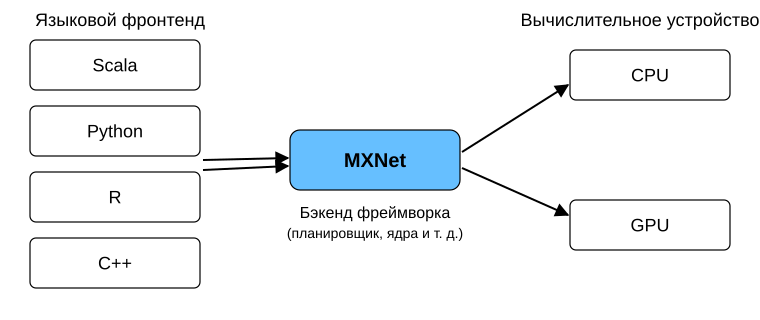
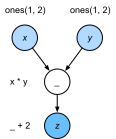
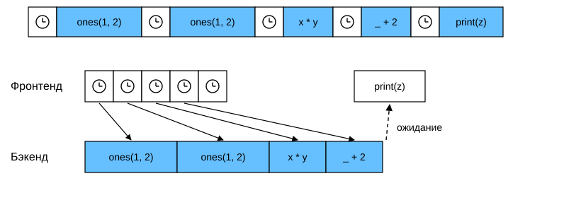

# 12.2 Асинхронные вычисления

Современные компьютеры — высокопараллельные системы: они состоят из нескольких процессорных ядер, нескольких GPU и множества вычислительных блоков. Обычно каждое ядро CPU имеет несколько потоков, каждое устройство — несколько GPU, а каждый GPU — несколько вычислительных блоков. Иными словами, мы можем одновременно делать много разных вещей, часто на разных устройствах. К сожалению, Python плохо приспособлен для написания параллельного и асинхронного кода, по крайней мере без дополнительной помощи: он однопоточный, и вряд ли это изменится в будущем. Поэтому многие фреймворки глубокого обучения, например MXNet и TensorFlow, используют модель *асинхронного программирования* (asynchronous programming) для повышения производительности, а PyTorch использует собственный планировщик Python и выбирает другой компромисс между производительностью и простотой. В PyTorch GPU-операции по умолчанию асинхронны: при вызове функции, работающей на GPU, операция ставится в очередь на определённом устройстве, но не обязана выполняться немедленно. Это позволяет параллельно выполнять больше вычислений, в том числе на CPU или на других GPU.

Поэтому понимание того, как устроено асинхронное программирование, помогает писать более эффективные программы: мы сознательно уменьшаем вычислительные затраты и зависимости между операциями. Это снижает нагрузку на память и повышает загрузку процессора.

**MXNet:**

```python
from d2l import mxnet as d2l
import numpy, os, subprocess
from mxnet import autograd, gluon, np, npx
from mxnet.gluon import nn
npx.set_np()
```

**PyTorch:**

```python
from d2l import torch as d2l
import numpy, os, subprocess
import torch
from torch import nn
```

**PaddlePaddle:**

```python
from d2l import paddle as d2l
import numpy, os, subprocess
import warnings
warnings.filterwarnings("ignore")
import paddle
from paddle import nn
d2l.try_gpu()
```

## Асинхронная обработка на уровне бэкенда

Для разминки рассмотрим простую задачу: сгенерируем случайную матрицу и перемножим её. Сделаем это и в NumPy, и в `mxnet.np`, и посмотрим, в чём разница.

**MXNet:**

```python
with d2l.Benchmark('numpy'):
    for _ in range(10):
        a = numpy.random.normal(size=(1000, 1000))
        b = numpy.dot(a, a)

with d2l.Benchmark('mxnet.np'):
    for _ in range(10):
        a = np.random.normal(size=(1000, 1000))
        b = np.dot(a, a)
```

Для разминки рассмотрим простую задачу: сгенерируем случайную матрицу и перемножим её. Сделаем это в NumPy и в тензорах PyTorch, чтобы увидеть разницу. Обратите внимание, что тензоры PyTorch создаются на GPU.

**PyTorch:**

```python
# Прогрев GPU
device = d2l.try_gpu()
a = torch.randn(size=(1000, 1000), device=device)
b = torch.mm(a, a)

with d2l.Benchmark('numpy'):
    for _ in range(10):
        a = numpy.random.normal(size=(1000, 1000))
        b = numpy.dot(a, a)

with d2l.Benchmark('torch'):
    for _ in range(10):
        a = torch.randn(size=(1000, 1000), device=device)
        b = torch.mm(a, a)
```

Для разминки рассмотрим простую задачу: сгенерируем случайную матрицу и перемножим её. Сделаем это в NumPy и в тензорах PaddlePaddle, чтобы увидеть разницу. Обратите внимание, что тензоры PaddlePaddle создаются на GPU.

**PaddlePaddle:**

```python
# Прогрев GPU
a = paddle.randn(shape=(1000, 1000))
b = paddle.mm(a, a)

with d2l.Benchmark('numpy'):
    for _ in range(10):
        a = numpy.random.normal(size=(1000, 1000))
        b = numpy.dot(a, a)

with d2l.Benchmark('paddle'):
    for _ in range(10):
        a = paddle.randn(shape=(1000, 1000))
        b = paddle.mm(a, a)
```

**MXNet:** По результатам бенчмарка MXNet работает быстрее на несколько порядков. Оба варианта выполняются на одном и том же процессоре, поэтому причина должна быть в чём-то другом. Принудительное ожидание завершения всех вычислений бэкенда перед возвратом результата показывает, что происходило раньше: вычисления выполняет бэкенд, а фронтенд возвращает управление Python.

**PyTorch:** По результатам бенчмарка PyTorch работает быстрее на несколько порядков. Скалярное произведение NumPy выполняется на CPU, а матричное умножение PyTorch — на GPU, и оно значительно быстрее. Но такой огромный разрыв во времени говорит о том, что есть и другая причина. По умолчанию GPU-операции в PyTorch асинхронны. Принудительное ожидание завершения всех вычислений перед возвратом результата показывает, что происходило раньше: вычисления выполняет бэкенд, а фронтенд возвращает управление Python.

**PaddlePaddle:** По результатам бенчмарка PaddlePaddle работает быстрее на несколько порядков. Скалярное произведение NumPy выполняется на CPU, а матричное умножение PaddlePaddle — на GPU, и оно значительно быстрее. Но такой огромный разрыв во времени говорит о том, что есть и другая причина. По умолчанию GPU-операции в PaddlePaddle асинхронны. Принудительное ожидание завершения всех вычислений перед возвратом результата показывает, что происходило раньше: вычисления выполняет бэкенд, а фронтенд возвращает управление Python.

**MXNet:**

```python
with d2l.Benchmark():
    for _ in range(10):
        a = np.random.normal(size=(1000, 1000))
        b = np.dot(a, a)
    npx.waitall()
```

**PyTorch:**

```python
with d2l.Benchmark():
    for _ in range(10):
        a = torch.randn(size=(1000, 1000), device=device)
        b = torch.mm(a, a)
    torch.cuda.synchronize(device)
```

**PaddlePaddle:**

```python
with d2l.Benchmark():
    for _ in range(10):
        a = paddle.randn(shape=(1000, 1000))
        b = paddle.mm(a, a)
    paddle.device.cuda.synchronize()
```

**MXNet:** В общих чертах MXNet состоит из *фронтенда* — интерфейса для прямого взаимодействия с пользователем, например через Python, — и *бэкенда*, которым система выполняет вычисления. Как показано на рис. 12.2.1, программы MXNet можно писать на разных языках: Python, R, Scala и C++. Независимо от языка фронтенда выполнение программы MXNet происходит в основном в бэкенде, реализованном на C++. Операции, которые отправляет фронтенд, передаются в бэкенд на выполнение. Бэкенд управляет собственными потоками, которые непрерывно забирают из очереди и выполняют задачи. Чтобы это работало, бэкенд должен отслеживать зависимости между шагами вычислительного графа. Поэтому невозможно распараллелить операции, которые зависят друг от друга.

**PyTorch:** В общих чертах PyTorch состоит из *фронтенда* — интерфейса для прямого взаимодействия с пользователем, например через Python, — и *бэкенда*, которым система выполняет вычисления. Как показано на рис. 12.2.1, программы PyTorch можно писать на разных языках, например на Python и C++. Независимо от языка фронтенда выполнение программы PyTorch происходит в основном в бэкенде, реализованном на C++. Операции, которые отправляет фронтенд, передаются в бэкенд на выполнение. Бэкенд управляет собственными потоками, которые непрерывно забирают из очереди и выполняют задачи. Чтобы это работало, бэкенд должен отслеживать зависимости между шагами вычислительного графа. Поэтому невозможно распараллелить операции, которые зависят друг от друга.

**PaddlePaddle:** В общих чертах PaddlePaddle состоит из *фронтенда* — интерфейса для прямого взаимодействия с пользователем, например через Python, — и *бэкенда*, которым система выполняет вычисления. Как показано на рис. 12.2.1, программы PaddlePaddle можно писать на разных языках: в основном на Python и C++. Независимо от языка фронтенда выполнение программы PaddlePaddle происходит в основном в бэкенде, реализованном на C++. Операции, которые отправляет фронтенд, передаются в бэкенд на выполнение. Бэкенд управляет собственными потоками, которые непрерывно забирают из очереди и выполняют задачи. Чтобы это работало, бэкенд должен отслеживать зависимости между шагами вычислительного графа. Поэтому невозможно распараллелить операции, которые зависят друг от друга.



Рассмотрим ещё один простой пример, чтобы лучше понять граф зависимостей.

**MXNet:**

```python
x = np.ones((1, 2))
y = np.ones((1, 2))
z = x * y + 2
z
```

**PyTorch:**

```python
x = torch.ones((1, 2), device=device)
y = torch.ones((1, 2), device=device)
z = x * y + 2
z
```

**PaddlePaddle:**

```python
x = paddle.ones((1, 2))
y = paddle.ones((1, 2))
z = x * y + 2
z
```



Этот фрагмент кода проиллюстрирован на рис. 12.2.2. Каждый раз, когда поток Python-фронтенда выполняет одну из первых трёх строк, он лишь передаёт задачу в очередь бэкенда. Когда результат последней строки нужно вывести, поток Python-фронтенда ждёт, пока поток бэкенда на C++ вычислит значение переменной `z`. Преимущество такой схемы в том, что поток фронтенда не выполняет сами вычисления. Поэтому производительность Python почти не влияет на общую производительность программы. На рис. 12.2.3 показано, как фронтенд и бэкенд взаимодействуют.



## Барьеры и блокировки

**MXNet:** Есть несколько операций, которые заставляют Python ждать завершения вычислений:

* самая очевидная — `npx.waitall()`: она не учитывает момент отправки команд и ждёт, пока завершатся все вычисления. На практике этой операцией лучше не злоупотреблять, если нет крайней необходимости, так как она может заметно снизить производительность;
* если нужно дождаться готовности только одной конкретной переменной, можно вызвать `z.wait_to_read()`. В этом случае MXNet не возвращает управление Python до тех пор, пока не будет вычислена переменная `z`. Вычисления, которые зависят от `z`, могут продолжиться после этого.

Посмотрим, как это работает на практике.

**MXNet:**

```python
with d2l.Benchmark('waitall'):
    b = np.dot(a, a)
    npx.waitall()

with d2l.Benchmark('wait_to_read'):
    b = np.dot(a, a)
    b.wait_to_read()
```

**MXNet:** Обе операции завершаются примерно за одно и то же время. Помимо явных блокировок, стоит помнить о *неявных* блокировках. Печать переменной — это блокировка, потому что для вывода значение должно быть готово. Кроме того, преобразование переменной в NumPy-массив через `z.asnumpy()` и в скаляр через `z.item()` тоже блокирующие операции. В NumPy нет понятия асинхронности, поэтому доступ к значениям требует ожидания, как и в функции `print`.

Частое копирование небольших объёмов данных из области MXNet в NumPy может испортить производительность даже эффективного кода: каждая такая операция требует вычислить все промежуточные результаты графа, чтобы получить нужные значения, и только потом можно делать что-то ещё.

**MXNet:**

```python
with d2l.Benchmark('numpy conversion'):
    b = np.dot(a, a)
    b.asnumpy()

with d2l.Benchmark('scalar conversion'):
    b = np.dot(a, a)
    b.sum().item()
```

## Улучшение вычислений

**MXNet:** В системах с сильной многопоточностью (даже обычный ноутбук имеет четыре и более потоков, а на многопроцессорных серверах их может быть больше 256) стоимость планирования операций может стать очень большой. Поэтому так важно, чтобы вычисления и планирование были асинхронными и параллельными. Чтобы показать пользу этого подхода, сравним, что происходит при последовательном (синхронном) и асинхронном выполнении многократного увеличения переменной на $1$. Синхронное выполнение имитируется вставкой барьера `wait_to_read` между сложениями.

```python
with d2l.Benchmark('synchronous'):
    for _ in range(10000):
        y = x + 1
        y.wait_to_read()

with d2l.Benchmark('asynchronous'):
    for _ in range(10000):
        y = x + 1
    npx.waitall()
```

Упрощённо взаимодействие потока Python-фронтенда и потока бэкенда на C++ можно описать так:

1. фронтенд отправляет бэкенду команду поставить в очередь вычисление `y = x + 1`;
1. затем бэкенд получает вычислительную задачу из очереди и выполняет её;
1. затем бэкенд возвращает результат вычисления фронтенду.

Пусть длительности этих трёх этапов равны $t_1, t_2, t_3$. Без асинхронного программирования общее время выполнения 10000 вычислений составляет примерно $10000 (t_1+ t_2 + t_3)$. При асинхронном программировании фронтенду не нужно ждать, пока бэкенд вернёт результат каждой итерации, поэтому общее время выполнения 10000 вычислений сокращается до $t_1 + 10000 t_2 + t_3$ (при условии $10000 t_2 > 9999t_1$).

## Резюме

* Фреймворки глубокого обучения отделяют управление в Python-фронтенде от выполнения в бэкенде, поэтому команды можно быстро и асинхронно ставить в очередь бэкенда, где они выполняются параллельно.
* Асинхронность даёт достаточно гибкий фронтенд, но имейте в виду: слишком длинная очередь задач может привести к чрезмерному потреблению памяти. Рекомендуется синхронизировать выполнение на каждом мини-батче, чтобы фронтенд и бэкенд работали примерно синхронно.
* Производители чипов предлагают сложные инструменты профилирования, которые позволяют точнее понять эффективность глубокого обучения.

**MXNet:**

* Преобразование памяти, управляемой MXNet, в Python заставляет бэкенд ждать готовности конкретных переменных. Такой же эффект имеют функции `print`, `asnumpy` и `item`. Обратите внимание: неправильное использование синхронизации может испортить производительность программы.

## Упражнения

**MXNet:**

1. Выше говорилось, что с асинхронными вычислениями общее время выполнения 10000 вычислений сокращается до $t_1 + 10000 t_2 + t_3$. Почему мы предполагаем, что $10000 t_2 > 9999 t_1$?
1. Измерьте разницу между `waitall` и `wait_to_read`. Подсказка: выполните несколько инструкций и синхронизируйтесь, чтобы получить промежуточные результаты.

**PyTorch:**

1. Проведите бенчмарк той же операции умножения матриц из этого раздела на CPU. Можно ли по-прежнему наблюдать асинхронность через бэкенд?

**PaddlePaddle:**

1. Проведите бенчмарк той же операции умножения матриц из этого раздела на CPU. Можно ли по-прежнему наблюдать асинхронность через бэкенд?

**MXNet:**
[Обсуждение](https://discuss.d2l.ai/t/2792)

**PyTorch:**
[Обсуждение](https://discuss.d2l.ai/t/2791)

**PaddlePaddle:**
[Обсуждение](https://discuss.d2l.ai/t/11858)
