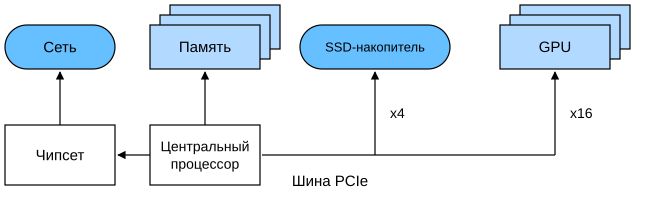
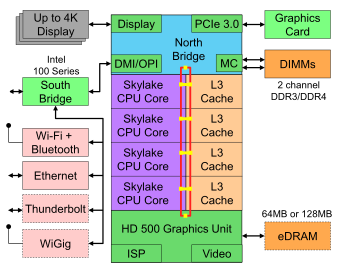
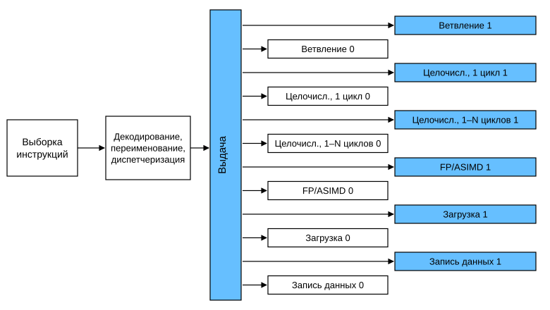
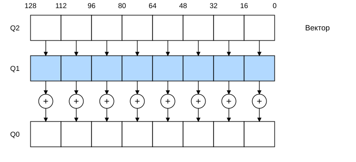
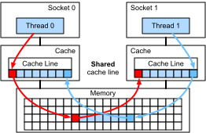

# 12.4 Аппаратное обеспечение

Чтобы строить системы с хорошей производительностью и улавливать статистические особенности задачи, нужно хорошо понимать алгоритмы и модели. При этом необходимо хотя бы примерно представлять, как устроено нижележащее аппаратное обеспечение. Этот раздел не заменяет курсов по проектированию аппаратуры и систем. Скорее, он служит отправной точкой для понимания того, почему одни алгоритмы работают эффективнее других и как добиться хорошей пропускной способности. Хорошо продуманная конструкция может дать разницу на порядки: одна и та же сеть либо обучается за одну неделю, либо не обучается вовсе, когда на обучение уходит три месяца и срок сдачи оказывается сорван. Начнём с компьютера в целом, затем подробно рассмотрим CPU и GPU, а в конце посмотрим, как соединяются между собой несколько компьютеров в дата-центре или в облаке.

> **Рис. 12.4.1.** Инфографика «Задержки, которые должен знать каждый программист» (из интерактивной публикации Колина Скотта по данным лекции Джеффа Дина, Stanford, 2010) не включена в перевод. Её данные приведены в таблицах 12.4.1 и 12.4.2 ниже

Общее представление о порядках величин даёт инфографика выше, а также таблицы в конце этого раздела. Они основаны на исследовании, которое отражает прогресс последнего десятилетия. Ниже обсуждаются базовые принципы этих чисел и то, как они помогают выбирать алгоритмы. Обсуждение очень общее и приблизительное. Разумеется, оно не заменяет полноценный курс, а лишь даёт статистическим моделистам достаточно сведений, чтобы принимать обоснованные проектные решения. Для углублённого знакомства с архитектурой компьютеров рекомендуем (Hennessy and Patterson, 2011) или актуальный курс по этой теме, например курс Krste Asanović.

## 12.4.1 Компьютер

Большинство исследователей и практиков глубокого обучения могут работать на компьютере с достаточным объёмом памяти, вычислительными ресурсами и каким-либо ускорителем, например одним или несколькими GPU. Компьютер состоит из следующих ключевых компонентов:

* процессор (также называемый CPU), который, помимо работы операционной системы и многих других функций, выполняет заданные программы. Обычно он содержит $8$ или более ядер;
* оперативная память (RAM), в которой хранятся и из которой извлекаются результаты вычислений: векторы весов, параметры активаций, а также обучающие данные;
* один или несколько сетевых интерфейсов Ethernet, скорость которых варьируется от 1 ГБ/с до 100 ГБ/с. На высокопроизводительных серверах могут использоваться более совершенные соединения;
* высокоскоростная шина расширения (PCIe), которая связывает систему с одним или несколькими GPU. Серверы поддерживают до $8$ ускорителей, обычно соединённых по более сложной топологии, а настольные системы имеют $1$ или $2$ ускорителя в зависимости от бюджета пользователя и мощности блока питания;
* энергонезависимые устройства хранения, например жёсткие диски и твердотельные накопители, которые во многих случаях подключаются через высокоскоростную шину расширения. Они обеспечивают достаточную скорость передачи для обучающих данных и промежуточных контрольных точек.

**Рис. 12.4.2.** Соединение компонентов компьютера

Как показано на рис. 12.4.2, высокоскоростная шина расширения состоит из нескольких линий, которые напрямую подключены к CPU и связывают его с большинством компонентов: сетью, GPU и хранилищем. Например, у AMD Threadripper 3 есть $64$ линии PCIe 4.0, каждая из которых может передавать данные в обоих направлениях со скоростью 16 Гбит/с. Память напрямую подключена к CPU, а её суммарная пропускная способность достигает 100 ГБ/с.

Когда мы запускаем код на компьютере, данные нужно передать процессору (CPU или GPU) для вычислений, а затем вернуть результаты в оперативную и постоянную память. Поэтому для хорошей производительности нужно, чтобы все шаги работы стыковались без задержек и ни одна часть системы не становилась узким местом. Например, если изображения загружаются медленно, процессор будет простаивать. Точно так же, если матрицы медленно передаются в CPU (или GPU), вычислительное устройство не сможет работать на полной скорости. Наконец, если нужно синхронизировать несколько компьютеров по сети, сеть не должна замедлять вычисления. Один из вариантов — чередовать коммуникацию и вычисления. Далее мы подробнее рассмотрим каждый компонент.

## 12.4.2 Память

Ключевые характеристики оперативной памяти — *пропускная способность* (bandwidth) и *задержка* (latency). То же справедливо и для устройств хранения, только различия между ними могут быть гораздо больше.

### 12.4.2.1 Жёсткие диски

*Жёсткий диск* (hard disk drive, HDD) используется уже полвека. Проще говоря, он содержит множество вращающихся пластин, над которыми может быть установлена головка для чтения и записи на любой заданной дорожке. Старшие модели вмещают до 16 ТБ на девяти пластинах. Одно из главных достоинств жёсткого диска — относительно низкая цена, а его многочисленные недостатки — характерные катастрофические режимы отказа и довольно высокая задержка чтения.

Чтобы понять последнее, нужно знать, что жёсткие диски вращаются примерно со скоростью 7200 оборотов в минуту. Быстрее вращать их нельзя: центробежная сила разрушила бы пластины. При обращении к определённому сектору диска есть ещё одна существенная проблема: нужно дождаться, пока пластина повернётся нужным местом под головку (головку можно перемещать, а раскрутить диск заново нельзя). Поэтому на получение нужных данных может уйти $8$ миллисекунд. Обычно говорят, что жёсткий диск работает примерно со скоростью 100 IOPS (операций ввода-вывода в секунду), и за последние двадцать лет эта цифра почти не изменилась. Не менее неприятно и то, что пропускная способность (около 100–200 МБ/с) тоже плохо растёт. Ведь каждая головка считывает биты одной дорожки, поэтому скорость передачи растёт лишь пропорционально квадратному корню из плотности записи. Поэтому для очень больших наборов данных жёсткие диски быстро переходят в роль архивного и низкоуровневого хранилища.

### 12.4.2.2 Твердотельные накопители

*Твердотельные накопители* (solid state drives, SSD) хранят информацию во флеш-памяти. Это позволяет получать сохранённые записи гораздо быстрее. Современные SSD способны выполнять $10$–$50$ тысяч IOPS, то есть примерно на три порядка быстрее жёстких дисков. Их пропускная способность составляет 1–3 ГБ/с, то есть примерно на порядок выше. Эти улучшения кажутся невероятными, но из-за особенностей устройства SSD у них остаются следующие дополнительные ограничения.

* SSD хранят информацию блоками (256 КБ и больше). Блок можно записать только целиком, поэтому запись отдельных битов в случайном порядке занимает много времени и производительность SSD при таком режиме очень низкая. Кроме того, запись часто требует много времени, потому что блок нужно сначала прочитать, стереть, а затем записать заново с новой информацией. Контроллеры и прошивка современных SSD уже содержат алгоритмы, которые смягчают эту проблему. Тем не менее запись всё равно остаётся гораздо медленнее чтения, особенно у накопителей QLC (четырёхуровневых ячеек). Ключ к производительности — поддерживать очередь операций, в которой чтение и запись крупных блоков по возможности выполняются в первую очередь;
* ячейки памяти в SSD изнашиваются довольно быстро (обычно после нескольких тысяч циклов записи). Алгоритмы выравнивания износа распределяют деградацию между многими ячейками. Поэтому SSD не рекомендуется использовать для файлов подкачки или больших журналов;
* наконец, резкий рост пропускной способности вынудил разработчиков компьютеров подключать SSD к шине PCIe. Такие накопители называют NVMe (энергонезависимая память с расширенным интерфейсом); они могут использовать до $4$ линий PCIe. На PCIe 4.0 их скорость достигает 8 ГБ/с.

### 12.4.2.3 Облачное хранилище

Облачное хранилище предлагает набор настраиваемых характеристик производительности. Иными словами, объём и скорость хранилища виртуальной машины можно динамически подбирать под потребности пользователя. Если задержка слишком велика (например, при обучении с большим количеством мелких записей), рекомендуется увеличить количество IOPS в настройках.

## 12.4.3 CPU

Центральный процессор (central processing unit, CPU) — основа любого компьютера. Он состоит из многих ключевых компонентов: *ядер процессора* (processor cores), которые выполняют машинный код; *шины* (bus), которая связывает разные компоненты (шины заметно различаются в зависимости от модели процессора, поколения и производителя); *кэша* (cache), который обеспечивает более высокую пропускную способность чтения и меньшую задержку по сравнению с основной памятью. Наконец, поскольку высокопроизводительная линейная алгебра и свёртки широко используются в обработке мультимедиа и машинном обучении, почти все современные CPU содержат *векторный процессорный блок* (vector processing unit), который помогает выполнять эти вычисления.

**Рис. 12.4.3.** Потребительский четырёхъядерный CPU Intel Skylake

На рис. 12.4.3 показан потребительский четырёхъядерный CPU Intel Skylake. Он включает встроенный GPU, кэш и кольцевую шину, которая соединяет четыре ядра. Периферийные устройства, такие как Ethernet, Wi-Fi, Bluetooth, контроллер SSD и USB, либо входят в состав чипсета, либо подключаются к CPU напрямую через PCIe.

### 12.4.3.1 Микроархитектура

Каждое ядро процессора состоит из довольно сложного набора компонентов. Хотя подробности у разных поколений и производителей различаются, базовые функции стандартны. Фронтенд загружает инструкции и пытается предсказать, по какому пути они пойдут (например, для управления потоком), а затем декодирует инструкции из ассемблерного кода в микроинструкции. Ассемблерный код обычно не является самым низкоуровневым кодом, который выполняет процессор: сложные микроинструкции могут декодироваться в набор более простых операций, которые затем обрабатываются исполнительными ядрами. Обычно исполнительное ядро способно одновременно выполнять много операций. Например, ядро ARM Cortex A77 на рис. 12.4.4 может одновременно выполнять до $8$ операций.

**Рис. 12.4.4.** Микроархитектура ARM Cortex A77

Это означает, что эффективная программа может выполнять несколько инструкций за один такт, если эти инструкции независимы друг от друга. Не все блоки обработки одинаковы: одни предназначены для целочисленных инструкций, а другие оптимизированы для операций с плавающей точкой. Чтобы повысить пропускную способность, процессор может одновременно выполнять несколько путей кода в ветвлениях, а затем отбрасывать результаты невыбранных ветвей. Поэтому блок предсказания ветвлений во фронтенде важен: дальше продолжается выполнение только самых перспективных путей.

### 12.4.3.2 Векторизация

Объём вычислений в глубоком обучении очень велик. Поэтому, чтобы справляться с задачами машинного обучения, CPU должен выполнять много операций за один такт. Такой режим работы обеспечивают векторные процессорные блоки. На ARM они называются NEON, а на x86 — [AVX2](https://en.wikipedia.org/wiki/Advanced_Vector_Extensions). Типичная их возможность — выполнение операций по схеме SIMD (single instruction multiple data, одна инструкция — много данных). На рис. 12.4.5 показано, как на ARM за один такт выполняется $8$ целочисленных сложений.

**Рис. 12.4.5.** 128-битная векторизация NEON

В зависимости от архитектуры такие регистры могут достигать $512$ бит и объединять до $64$ пар чисел. Например, можно перемножить два числа и прибавить к результату третье. Эта операция называется слиянием умножения и сложения (fused multiply-add). Intel OpenVINO использует именно эти процессоры, чтобы получать ощутимую пропускную способность при глубоком обучении на серверных CPU. Однако стоит отметить, что по сравнению с возможностями GPU эта цифра выглядит скромно. Например, у NVIDIA RTX 2080 Ti есть $4352$ CUDA-ядра, каждое из которых может выполнять такую операцию в любой момент.

### 12.4.3.3 Кэш

Рассмотрим такой случай: у нас есть CPU среднего размера с $4$ ядрами, как показано на рис. 12.4.3, работающий на частоте 2 ГГц. Пусть векторный процессорный блок поддерживает AVX2 с шириной $256$ бит, а количество инструкций за такт (IPC) равно 1. Предположим также, что для каждой операции AVX2 хотя бы один регистр должен получить инструкцию из памяти. Тогда CPU потребляет $4 \times 256 \text{ бит} = 128 \text{ байт}$ данных за каждый такт. Если мы не сможем передавать процессору $2 \times 10^9 \times 128 = 256 \times 10^9$ байт в секунду, он будет испытывать нехватку данных. К сожалению, интерфейс памяти этого чипа поддерживает только 20–40 Гбит/с, то есть на порядок меньше. Выход — по возможности не загружать новые данные из памяти, а хранить их в кэше CPU. Для этого и используется кэш. Обычно он состоит из следующих уровней.

* **Регистры** строго говоря не относятся к кэшу. Они помогают организовать выполнение инструкций. То есть регистры — это места хранения, к которым CPU обращается на тактовой скорости без задержки. У CPU есть несколько десятков регистров, поэтому эффективное их использование зависит от компилятора (или программиста). Например, в языке C есть ключевое слово `register`;
* **кэш первого уровня (L1)** — первый рубеж защиты от высоких требований к пропускной способности памяти. Он очень мал (обычно 32–64 КБ) и делится на данные и инструкции. Если нужные данные найдены в кэше L1, доступ к ним очень быстрый. Если их там нет, поиск продолжается вниз по иерархии кэша;
* **кэш второго уровня (L2)** — следующий уровень. В зависимости от архитектуры и размера процессора он может быть эксклюзивным или общим, то есть использоваться только одним ядром либо разделяться между несколькими ядрами. Кэш L2 больше L1 (обычно 256–512 КБ на ядро), но медленнее. Кроме того, сначала нужно проверить, что данных нет в L1, и только потом обращаться к L2, что добавляет небольшую задержку;
* **кэш третьего уровня (L3)** разделяется между несколькими ядрами и может быть очень большим. Серверные CPU AMD EPYC 3 имеют до 256 МБ кэша на нескольких кристаллах. Более типичные значения — 4–8 МБ.

Предсказание того, какие данные понадобятся дальше, — один из ключевых параметров при проектировании чипа. Например, рекомендуется обходить память *вперёд*, поскольку большинство алгоритмов кэширования пытаются читать данные *заранее* по возрастанию адресов, а не назад. Кроме того, хорошим способом повысить производительность является сохранение локальности обращений к памяти.

Добавление кэша — палка о двух концах. С одной стороны, он гарантирует, что ядрам процессора не будет не хватать данных. С другой стороны, он увеличивает размер чипа и занимает площадь, которую можно было бы использовать для повышения вычислительной мощности. Кроме того, *промах кэша* может оказаться очень дорогим. Рассмотрим худший случай — *ложное разделение* (false sharing), показанное на рис. 12.4.6. Когда поток на процессоре $1$ запрашивает данные, ячейка памяти кэширована на процессоре $0$. Чтобы удовлетворить запрос, процессор $0$ должен приостановить текущую работу, записать данные обратно в основную память, и только после этого процессор $1$ может прочитать их из памяти. На время этой операции оба процессора простаивают. По сравнению с эффективной однопроцессорной реализацией такой код на нескольких процессорах может работать значительно медленнее. Это ещё одна причина, по которой размер кэша ограничен, помимо его физического размера.

**Рис. 12.4.6.** Ложное разделение (иллюстрация предоставлена Intel)

## 12.4.4 GPU и другие ускорители

Без GPU глубокого обучения не было бы. Не будет преувеличением сказать, что именно глубокое обучение заметно увеличило доходы производителей GPU. Эта совместная эволюция аппаратуры и алгоритмов привела к тому, что глубокое обучение стало, к лучшему или к худшему, предпочтительной парадигмой статистического моделирования. Поэтому полезно понимать, в чём преимущества GPU и других ускорителей, например TPU (Jouppi et al., 2017).

На практике часто важно различие между ускорителями, оптимизированными для обучения, и теми, что оптимизированы для вывода (инференса). Для вывода достаточно вычислить прямое распространение в сети. Обратное распространение не требует хранения промежуточных данных. Кроме того, часто не нужна очень высокая точность вычислений (обычно достаточно FP16 или INT8). При обучении все промежуточные результаты нужно хранить, чтобы вычислять градиенты. Накопление градиентов также требует более высокой точности, чтобы избежать численного антипереполнения (или переполнения). Поэтому минимальный вариант — FP16 или смешанная точность FP16/FP32. Всё это требует более быстрой и более ёмкой памяти (HBM2 или GDDR6) и большей вычислительной мощности. Например, NVIDIA оптимизировала GPU [Turing](https://devblogs.nvidia.com/nvidia-turing-architecture-in-depth/) T4 для вывода, а GPU V100 — для обучения.

Вспомним векторизацию, показанную на рис. 12.4.5. Добавление векторных процессорных блоков в ядра CPU заметно повышает пропускную способность. Например, в примере на рис. 12.4.5 можно одновременно выполнить $16$ операций. Во-первых, что даст добавление операций, оптимизированных не только для векторных, но и для матричных вычислений? Позже мы обсудим тензорные ядра (tensor cores), созданные по этой стратегии. Во-вторых, что если добавить больше ядер? Коротко говоря, это две стратегии проектирования GPU. На рис. 12.4.7 показан общий вид базового блока обработки.

> **Рис. 12.4.7.** Блок обработки NVIDIA Turing (иллюстрация производителя) не включена в перевод. Блок содержит $16$ целочисленных и $16$ блоков с плавающей точкой, а также два тензорных ядра, которые ускоряют узкий набор операций глубокого обучения. Каждый потоковый мультипроцессор состоит из четырёх таких блоков

Далее $12$ потоковых мультипроцессоров объединяются в графические кластеры, из которых строится высокопроизводительный процессор TU102. Достаточное количество каналов памяти и кэш второго уровня дополняют конфигурацию. Подробности приведены на рис. 12.4.8. Причина такого проектирования — возможность независимо добавлять или удалять модули, что помогает создавать более компактные чипы и учитывать выход годных кристаллов (неисправные модули могут не включаться). К счастью, программирование таких устройств скрыто за CUDA и уровнем фреймворков, так что исследователь в глубоком обучении обычно этого не замечает. В частности, на GPU можно одновременно выполнять несколько программ, пока есть свободные ресурсы. Тем не менее полезно знать ограничения устройства, чтобы не выбрать модель памяти, которая не подходит по размеру.

> **Рис. 12.4.8.** Архитектура NVIDIA Turing (иллюстрация производителя) не включена в перевод. Она показывает кластеры потоковых мультипроцессоров, каналы памяти и кэш второго уровня

Наконец, стоит отдельно упомянуть *тензорные ядра* (tensor cores). Они являются примером растущей тенденции добавлять специализированные схемы оптимизации, которые особенно эффективны для глубокого обучения. Например, в TPU добавлена систолическая матрица для быстрого умножения матриц (Kung, 1988). Она рассчитана на очень большие операции над очень малым количеством данных (в TPU первого поколения — на одну величину). Тензорные ядра идут в противоположном направлении: они оптимизированы для небольших операций над матрицами размером $4 \times 4$ и $16 \times 16$ в зависимости от числовой точности. Обзор оптимизаций приведён на рис. 12.4.9.

> **Рис. 12.4.9.** Тензорные ядра в архитектуре NVIDIA Turing (иллюстрация производителя) не включена в перевод

Очевидно, что при оптимизации вычислений приходится идти на некоторые компромиссы. Один из них: GPU плохо справляются с разреженными данными и прерываниями. Хотя есть заметные исключения, например [Gunrock](https://github.com/gunrock/gunrock) (Wang et al., 2016), высокая пропускная способность GPU при чтении пакетами не подходит для шаблонов доступа к разреженным матрицам и векторам. Задачи эффективного доступа к разреженным данным и обработки прерываний активно исследуются. Например, существует библиотека [DGL](http://dgl.ai), созданная специально для глубокого обучения на графах.

## 12.4.5 Сеть и шины

Когда одного устройства недостаточно для оптимизации, данные приходится передавать туда и обратно, чтобы выполнять синхронизированную обработку, и тогда на первый план выходят сеть и шины. У них много параметров проектирования: пропускная способность, стоимость, расстояние и гибкость. На краю сети находится Wi-Fi: он очень удобен в использовании, охватывает хорошую зону и дёшев (ведь не нужны кабели), но даёт относительно скромную пропускную способность и высокую задержку. Ни один разумный исследователь машинного обучения не станет строить на нём серверный кластер. Далее мы сосредоточимся на соединениях, подходящих для глубокого обучения.

* **PCIe** — специализированная шина для высокой пропускной способности при соединении точка-точка (на каждой линии в слоте x16 — до 32 ГБ/с для PCIe 4.0) с задержкой порядка нескольких микросекунд (5 мкс). Линии PCIe очень ценны. Количество линий, которое есть у процессора: у AMD EPYC 3 — $128$, у Intel Xeon — $48$ на чип; у настольных CPU — $20$ (Ryzen 9) и $16$ (Core i9). Поскольку у GPU обычно $16$ линий, число GPU, которые могут работать на полной пропускной способности с CPU, ограничено. К тому же им приходится делить канал с другими высокоскоростными периферийными устройствами, например с хранилищем и Ethernet. Как и в случае с оперативной памятью, передача больших пакетов данных эффективнее, потому что уменьшаются накладные расходы на пакеты;
* **Ethernet** — самый распространённый способ подключения компьютеров. Он гораздо медленнее PCIe, но его установка очень дешева, он очень гибок и покрывает значительно большие расстояния. Типичная пропускная способность недорогих серверов составляет 1 Гбит/с. Высокопроизводительные устройства (например, [экземпляры C5](https://aws.amazon.com/ec2/instance-types/c5/) в облаке) обеспечивают 10–100 Гбит/с. Как и во всех предыдущих случаях, передача данных сопряжена с большими накладными расходами. Обратите внимание, что «голый» Ethernet почти никогда не используется напрямую: поверх физического соединения работают протоколы (например, UDP или TCP/IP), которые добавляют ещё больше накладных расходов. Как и PCIe, Ethernet предназначен для соединения двух устройств, например компьютера и коммутатора;
* **коммутатор** — способ соединить несколько устройств так, что любые два из них могут одновременно обмениваться данными по соединению «точка-точка» (обычно на полной пропускной способности). Например, Ethernet-коммутатор может с высокой пропускной способностью соединять $40$ серверов. Коммутаторы встречаются не только в традиционных компьютерных сетях. Даже линии PCIe могут коммутироваться, например в [экземплярах P2](https://aws.amazon.com/ec2/instance-types/p2/), где много GPU подключаются к одному хост-процессору;
* **NVLink** — альтернатива PCIe для очень высокопроизводительных соединений. Он обеспечивает скорость передачи до 300 Гбит/с на одну линию. Серверный GPU (Volta V100) имеет шесть линий, а потребительский GPU (RTX 2080 Ti) — только одну, и его скорость снижена до 100 Гбит/с. Для высокоскоростного обмена данными между GPU рекомендуется использовать [NCCL](https://github.com/NVIDIA/nccl).

## 12.4.6 Дополнительные задержки

Сводки из раздела выше взяты из работы [Eliot Eshelman](https://gist.github.com/eshelman), который сохранил обновлённую версию чисел в [GitHub gist](https://gist.github.com/eshelman/343a1c46cb3fba142c1afdcdeec17646). Они приведены в таблицах 12.4.1 и 12.4.2.

**Таблица 12.4.1.** Общие задержки

| Операция | Время | Примечания |
| :----------------------------------------- | -----: | :---------------------------------------------- |
| Обращение к L1 / попадание в L1            | 1.5 нс | 4 такта |
| Сложение, умножение и FMA с плавающей точкой | 1.5 нс | 4 такта |
| Обращение к L2 / попадание в L2            |   5 нс | 12–17 тактов |
| Ошибочное предсказание ветвления           |   6 нс | 15–20 тактов |
| Попадание в L3 (кэш не разделяется)        |  16 нс | 42 такта |
| Попадание в L3 (разделяется с другим ядром) |  25 нс | 65 тактов |
| Блокировка и разблокировка мьютекса        |  25 нс |                                                 |
| Попадание в L3 (строка изменена в другом ядре) |  29 нс | 75 тактов |
| Попадание в L3 (на удалённом сокете CPU)   |  40 нс | 100–300 тактов (40–116 нс) |
| Переход по QPI к другому CPU (за один переход) |  40 нс |                                                 |
| Обращение к памяти 64 МБ (локальный CPU)   |  46 нс | TinyMemBench на Broadwell E5-2690v4 |
| Обращение к памяти 64 МБ (удалённый CPU)   |  70 нс | TinyMemBench на Broadwell E5-2690v4 |
| Обращение к памяти 256 МБ (локальный CPU)  |  75 нс | TinyMemBench на Broadwell E5-2690v4 |
| Случайная запись в Intel Optane            |  94 нс | UCSD Non-Volatile Systems Lab |
| Обращение к памяти 256 МБ (удалённый CPU)  | 120 нс | TinyMemBench на Broadwell E5-2690v4 |
| Случайное чтение из Intel Optane           | 305 нс | UCSD Non-Volatile Systems Lab |
| Отправка 4 КБ по HPC-сети 100 Гбит/с       |   1 мкс | MVAPICH2 поверх Intel Omni-Path |
| Сжатие 1 КБ алгоритмом Google Snappy       |   3 мкс |                                                 |
| Отправка 4 КБ по Ethernet 10 Гбит/с        |  10 мкс |                                                 |
| Случайная запись 4 КБ на NVMe SSD          |  30 мкс | DC P3608 NVMe SSD (QoS 99%: 500 мкс) |
| Передача 1 МБ к GPU с NVLink и обратно     |  30 мкс | ~33 ГБ/с, NVIDIA 40GB NVLink |
| Передача 1 МБ к GPU через PCIe и обратно   |  80 мкс | ~12 ГБ/с, линия PCIe 3.0 x16 |
| Случайное чтение 4 КБ с NVMe SSD           | 120 мкс | DC P3608 NVMe SSD (QoS 99%) |
| Последовательное чтение 1 МБ с NVMe SSD    | 208 мкс | ~4.8 ГБ/с, DC P3608 NVMe SSD |
| Случайная запись 4 КБ на SATA SSD          | 500 мкс | DC S3510 SATA SSD (QoS 99.9%) |
| Случайное чтение 4 КБ с SATA SSD           | 500 мкс | DC S3510 SATA SSD (QoS 99.9%) |
| Полный цикл внутри одного дата-центра      | 500 мкс | Односторонний пинг ~250 мкс |
| Последовательное чтение 1 МБ с SATA SSD    |   2 мс | ~550 МБ/с, DC S3510 SATA SSD |
| Последовательное чтение 1 МБ с диска       |   5 мс | ~200 МБ/с, серверный HDD |
| Случайный доступ к диску (поиск и вращение) |  10 мс |                                                 |
| Отправка пакета Калифорния → Нидерланды → Калифорния | 150 мс |                                                 |

**Таблица 12.4.2.** Задержки GPU NVIDIA Tesla

| Операция | Время | Примечания |
| :------------------------------ | -----: | :---------------------------------------- |
| Доступ к разделяемой памяти GPU | 30 нс | 30–90 тактов (конфликты банков добавляют задержку) |
| Доступ к глобальной памяти GPU  | 200 нс | 200–800 тактов |
| Запуск ядра CUDA на GPU         |  10 мкс | Хост-CPU даёт GPU команду начать выполнение ядра |
| Передача 1 МБ к GPU с NVLink и обратно | 30 мкс | ~33 ГБ/с, NVIDIA 40GB NVLink |
| Передача 1 МБ к GPU через PCIe и обратно | 80 мкс | ~12 ГБ/с, линия PCI-Express x16 |

## Резюме

* У устройств есть накладные расходы на запуск. Поэтому передавать данные лучше крупными порциями и реже, а не мелкими и часто. Это относится к оперативной памяти, твердотельным накопителям, сети и GPU.
* Векторизация — ключ к производительности. Важно хорошо знать специфические возможности ускорителя. Например, некоторые процессоры Intel Xeon особенно подходят для операций INT8, GPU NVIDIA Volta хорошо справляются с матричными операциями FP16, а NVIDIA Turing работает с FP16, INT8 и INT4.
* Переполнение, возникающее из-за слишком малых типов данных в процессе обучения, может быть проблемой (при выводе оно обычно менее важно).
* Наложение данных (aliasing) может сильно ухудшить производительность. CPU с 64-битной архитектурой следует выравнивать по 64-битным границам. На GPU рекомендуется выравнивать размеры свёрток, например под тензорные ядра.
* Согласуйте алгоритм с аппаратурой (например, по объёму памяти и пропускной способности). Если параметры помещаются в кэш, можно получить ускорение на порядки.
* Прежде чем проверять результаты экспериментов, полезно набросать производительность нового алгоритма на бумаге. Это важно потому, что речь идёт о разнице на порядки и больше.
* Для поиска узких мест в производительности используйте отладчик и профилировщик.
* Аппаратура для обучения и аппаратура для вывода различаются по производительности и цене, и у каждой есть свои достоинства.

## Упражнения

1. Напишите программу на C, которая проверит, есть ли разница в скорости доступа к выровненной и невыровненной памяти. (Подсказка: учитывайте влияние кэша.)
1. Проверьте разницу в скорости при последовательном доступе к памяти и при доступе с заданным шагом.
1. Как измерить размер кэша на CPU?
1. Как распределить данные по нескольким каналам памяти, чтобы получить максимальную пропускную способность? Как это сделать, если есть много мелких потоков?
1. Жёсткий диск корпоративного класса вращается со скоростью 10 000 оборотов в минуту. В худшем случае за какое минимальное время диск может прочитать данные (считая, что головка перемещается почти мгновенно)? Почему 2,5-дюймовые жёсткие диски становятся всё популярнее в серверах по сравнению с 3,5- и 5,25-дюймовыми?
1. Допустим, производитель HDD увеличил плотность записи с 1 Тбит на квадратный дюйм до 5 Тбит на квадратный дюйм. Сколько информации поместится на одном кольце 2,5-дюймового жёсткого диска? Есть ли разница между внутренней и внешней дорожками?
1. При переходе от 8-битных типов данных к 16-битным количество кремния примерно увеличивается в четыре раза. Почему? Почему NVIDIA добавила операции INT4 в свои GPU Turing?
1. На сколько быстрее чтение в памяти вперёд, чем назад? Отличается ли эта цифра у разных компьютеров и производителей CPU? Почему? Напишите код на C, чтобы провести эксперимент.
1. Можно ли измерить размер кэша диска? Каков типичный размер у жёсткого диска? Нужен ли кэш твердотельному накопителю?
1. Измерьте накладные расходы на пакеты при отправке сообщения по Ethernet. Найдите различия между соединениями UDP и TCP/IP.
1. Прямой доступ к памяти (DMA) позволяет устройствам вне CPU напрямую записывать данные в память (и читать из неё). Зачем это нужно?
1. Посмотрите на показатели производительности GPU Turing T4. Почему производительность при переходе от FP16 к INT8 и INT4 только удваивается?
1. Сколько времени занимает путь пакета в оба конца от Сан-Франциско до Амстердама? Подсказка: можно считать, что расстояние составляет 10 000 км.

[Обсуждение](https://discuss.d2l.ai/t/5717)

## Литература

* Hennessy, J. L., & Patterson, D. A. (2011). *Computer architecture: A quantitative approach*. Elsevier.
* Kung, S. Y. (1988). *VLSI array processors*. Prentice Hall.
* Jouppi, N. P., Young, C., Patil, N., Patterson, D., et al. (2017). In-datacenter performance analysis of a tensor processing unit. *Proceedings of the 44th Annual International Symposium on Computer Architecture (ISCA)*, 1–12.
* Wang, Y., Davidson, A., Pan, Y., Wu, Y., Riffel, A., & Owens, J. D. (2016). Gunrock: A high-performance graph processing library on the GPU. *ACM SIGPLAN Notices*, 51(8), 11.
