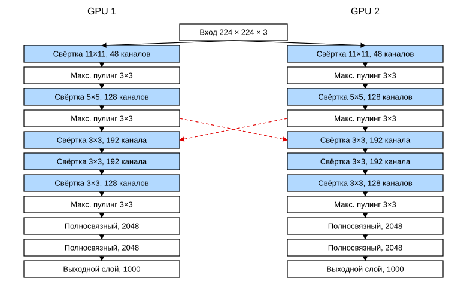
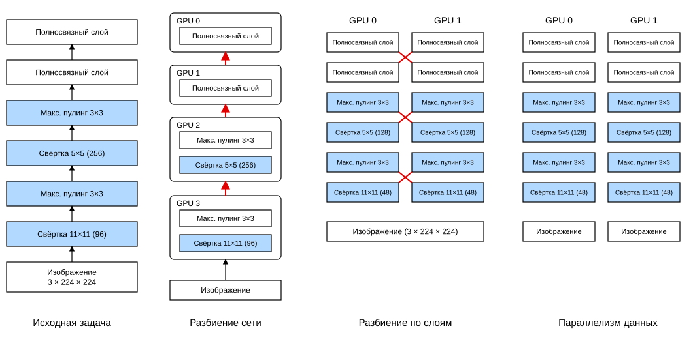
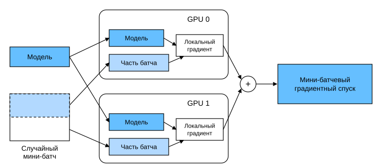

# 12.5 Обучение на нескольких GPU

До сих пор мы обсуждали, как эффективно обучать модели на CPU и GPU. В разделе 12.3 мы показали, как фреймворки глубокого обучения автоматически распараллеливают вычисления и коммуникацию между CPU и GPU, а в разделе 5.6 — как с помощью команды `nvidia-smi` вывести список доступных на компьютере GPU. Однако мы не обсуждали, как на практике распараллелить обучение глубокой сети. Есть ли способ разбить данные между несколькими устройствами так, чтобы всё работало правильно? Этот раздел подробно описывает, как обучать сеть параллельно с нуля, используя алгоритм стохастического градиентного спуска по минибатчам (см. раздел 11.5). Далее мы расскажем, как обучать сеть параллельно с помощью высокоуровневого API (см. раздел 12.6).

## 12.5.1 Разбиение задачи

Начнём с простой задачи компьютерного зрения и немного устаревшей сети. Эта сеть содержит несколько свёрточных и пулинговых слоёв, а в конце, возможно, несколько полносвязных слоёв. Она очень похожа на LeNet (LeCun et al., 1998) или AlexNet (Krizhevsky et al., 2012). Предположим, что у нас есть несколько GPU: на настольном сервере их два, на AWS g4dn.12xlarge — четыре, на p3.16xlarge — восемь, на p2.16xlarge — шестнадцать. Мы хотим разбить обучение так, чтобы получить хорошее ускорение и при этом пользоваться простыми и воспроизводимыми проектными решениями. В конце концов, несколько GPU одновременно увеличивают объём памяти и вычислительную мощность. Коротко говоря, для минибатча обучающих данных, который нужно классифицировать, у нас есть следующие варианты.

Первый подход — разбить сеть между несколькими GPU. Каждый GPU получает данные, поступающие в определённый слой, обрабатывает их через несколько последовательных слоёв и передаёт результат следующему GPU. Так можно обработать более крупную сеть, чем помещается на одном GPU. Кроме того, объём *памяти* (memory footprint), занимаемый на каждом GPU, хорошо контролируется, хотя он составляет лишь часть памяти всей сети.

Однако плотная синхронизация между интерфейсами GPU может быть трудной, особенно если вычислительная нагрузка слоёв плохо сбалансирована. Кроме того, интерфейсы между слоями требуют передачи большого объёма данных (например, активаций и градиентов), что может превысить пропускную способность шины GPU. К тому же порядок вычислительно затратных операций важен при таком разбиении. Лучшие результаты по этому вопросу описаны в работе (Mirhoseini et al., 2017). Это по-прежнему сложная задача, и пока неясно, может ли исследование дать хорошее линейное масштабирование для конкретной задачи. Итак, если фреймворк или операционная система сами не поддерживают объединение нескольких GPU, мы не рекомендуем этот подход.

Второй подход — разбить работу внутри слоя. Например, задачу можно распределить между четырьмя GPU, каждый из которых вычисляет $16$ каналов данных вместо $64$ каналов на одном GPU. То же можно сделать для полносвязного слоя, разбив количество выходных нейронов. На рис. 12.5.1 показана такая схема; она использовалась для GPU с очень малым объёмом памяти (тогда — 2 ГБ). Когда количество каналов или нейронов не слишком мало, такой подход даёт хороший прирост производительности. Кроме того, поскольку доступная память растёт линейно, несколько GPU могут обрабатывать всё более крупные сети.



**Рис. 12.5.1.** Модельный параллелизм в исходной схеме AlexNet из-за ограниченной памяти GPU

Однако здесь требуется много синхронизаций, или *барьерных операций* (barrier operation), потому что каждый слой зависит от результатов всех остальных слоёв. Кроме того, объём данных, которые нужно передавать, может быть даже больше, чем при разбиении слоёв между GPU. Поэтому с учётом затрат на пропускную способность и сложности мы не рекомендуем и этот подход.

Последний подход — разбить данные между несколькими GPU. Все GPU при этом получают разные наблюдения, но выполняют одну и ту же работу. После обработки каждого минибатча градиенты агрегируются на GPU. Это самый простой подход, он применим в любой ситуации, а синхронизация нужна лишь после обработки каждого минибатча. Более того, градиентные параметры, которые уже вычислены, можно начинать передавать, пока вычисляются остальные. Чем больше GPU, тем больше данных входит в минибатч, а значит, выше эффективность обучения. Однако добавление GPU не позволяет обучать более крупные модели.



**Рис. 12.5.2.** Параллелизация на нескольких GPU. Слева направо: исходная задача, параллелизм сети, послойный параллелизм, параллелизм данных

На рис. 12.5.2 сравниваются разные способы параллелизации на нескольких GPU. В целом, пока объём памяти GPU достаточен, параллелизм данных — самый удобный вариант. Подробное описание распределённого разбиения обучения см. в работе (Li et al., 2014). В ранние годы глубокого обучения память GPU была серьёзным ограничением, однако сейчас, за исключением очень специальных случаев, эта проблема решена. Дальше мы сосредоточимся на параллелизме данных.

## 12.5.2 Параллелизм данных

Допустим, в машине есть $k$ GPU. Учитывая модель, которую нужно обучить, каждый GPU хотя и имеет одинаковые и синхронизированные значения параметров, поддерживает независимо свой полный набор параметров модели. Например, на рис. 12.5.3 показано обучение модели с параллелизмом данных при $k=2$.



**Рис. 12.5.3.** Параллельное вычисление стохастического градиентного спуска по минибатчу с использованием данных на двух GPU

В общем случае обучение на $k$ GPU параллельно выполняется следующим образом:

* на каждой итерации обучения случайный минибатч делится на $k$ частей, которые равномерно распределяются по GPU;
* каждый GPU вычисляет значения функции потерь и градиенты параметров модели для своей части минибатча;
* локальные градиенты всех $k$ GPU агрегируются, чтобы получить стохастический градиент для текущего минибатча;
* агрегированный градиент рассылается на каждый GPU;
* каждый GPU, используя этот градиент минибатча, обновляет свой полный набор параметров модели.

На практике при обучении на $k$ GPU нужно увеличивать размер минибатча в $k$ раз, чтобы каждый GPU получал такой же объём работы, как при обучении на одном GPU. Поэтому на 16-GPU сервере размер минибатча можно заметно увеличить, и, вероятно, потребуется соответствующим образом повысить скорость обучения. Обратите также внимание, что пакетную нормализацию из раздела 7.5 тоже нужно скорректировать, например сохранять отдельные параметры пакетной нормализации для каждого GPU.

Далее мы используем простую сеть, чтобы продемонстрировать обучение на нескольких GPU.

**MXNet:**

```python
%matplotlib inline
from d2l import mxnet as d2l
from mxnet import autograd, gluon, np, npx
npx.set_np()
```

**PyTorch:**

```python
%matplotlib inline
from d2l import torch as d2l
import torch
from torch import nn
from torch.nn import functional as F
```

**PaddlePaddle:**

```python
%matplotlib inline
from d2l import paddle as d2l
import warnings
warnings.filterwarnings("ignore")
import paddle
from paddle import nn
from paddle.nn import functional as F
```

## 12.5.3 Простая сеть

Мы используем LeNet из раздела 6.6 (с небольшими изменениями) и определим его с нуля, чтобы подробно показать обмен параметрами и их синхронизацию.

**MXNet:**

```python
# Инициализация параметров модели
scale = 0.01
W1 = np.random.normal(scale=scale, size=(20, 1, 3, 3))
b1 = np.zeros(20)
W2 = np.random.normal(scale=scale, size=(50, 20, 5, 5))
b2 = np.zeros(50)
W3 = np.random.normal(scale=scale, size=(800, 128))
b3 = np.zeros(128)
W4 = np.random.normal(scale=scale, size=(128, 10))
b4 = np.zeros(10)
params = [W1, b1, W2, b2, W3, b3, W4, b4]

# Определение модели
def lenet(X, params):
    h1_conv = npx.convolution(data=X, weight=params[0], bias=params[1],
                              kernel=(3, 3), num_filter=20)
    h1_activation = npx.relu(h1_conv)
    h1 = npx.pooling(data=h1_activation, pool_type='avg', kernel=(2, 2),
                     stride=(2, 2))
    h2_conv = npx.convolution(data=h1, weight=params[2], bias=params[3],
                              kernel=(5, 5), num_filter=50)
    h2_activation = npx.relu(h2_conv)
    h2 = npx.pooling(data=h2_activation, pool_type='avg', kernel=(2, 2),
                     stride=(2, 2))
    h2 = h2.reshape(h2.shape[0], -1)
    h3_linear = np.dot(h2, params[4]) + params[5]
    h3 = npx.relu(h3_linear)
    y_hat = np.dot(h3, params[6]) + params[7]
    return y_hat

# Функция потерь: перекрёстная энтропия
loss = gluon.loss.SoftmaxCrossEntropyLoss()
```

**PyTorch:**

```python
# Инициализация параметров модели
scale = 0.01
W1 = torch.randn(size=(20, 1, 3, 3)) * scale
b1 = torch.zeros(20)
W2 = torch.randn(size=(50, 20, 5, 5)) * scale
b2 = torch.zeros(50)
W3 = torch.randn(size=(800, 128)) * scale
b3 = torch.zeros(128)
W4 = torch.randn(size=(128, 10)) * scale
b4 = torch.zeros(10)
params = [W1, b1, W2, b2, W3, b3, W4, b4]

# Определение модели
def lenet(X, params):
    h1_conv = F.conv2d(input=X, weight=params[0], bias=params[1])
    h1_activation = F.relu(h1_conv)
    h1 = F.avg_pool2d(input=h1_activation, kernel_size=(2, 2), stride=(2, 2))
    h2_conv = F.conv2d(input=h1, weight=params[2], bias=params[3])
    h2_activation = F.relu(h2_conv)
    h2 = F.avg_pool2d(input=h2_activation, kernel_size=(2, 2), stride=(2, 2))
    h2 = h2.reshape(h2.shape[0], -1)
    h3_linear = torch.mm(h2, params[4]) + params[5]
    h3 = F.relu(h3_linear)
    y_hat = torch.mm(h3, params[6]) + params[7]
    return y_hat

# Функция потерь: перекрёстная энтропия
loss = nn.CrossEntropyLoss(reduction='none')
```

**PaddlePaddle:**

```python
# Инициализация параметров модели
scale = 0.01
W1 = paddle.randn(shape=[20, 1, 3, 3]) * scale
b1 = paddle.zeros(shape=[20])
W2 = paddle.randn(shape=[50, 20, 5, 5]) * scale
b2 = paddle.zeros(shape=[50])
W3 = paddle.randn(shape=[800, 128]) * scale
b3 = paddle.zeros(shape=[128])
W4 = paddle.randn(shape=[128, 10]) * scale
b4 = paddle.zeros(shape=[10])
params = [W1, b1, W2, b2, W3, b3, W4, b4]

# Определение модели
def lenet(X, params):
    h1_conv = F.conv2d(x=X, weight=params[0], bias=params[1])
    h1_activation = F.relu(h1_conv)
    h1 = F.avg_pool2d(x=h1_activation, kernel_size=(2, 2), stride=(2, 2))
    h2_conv = F.conv2d(x=h1, weight=params[2], bias=params[3])
    h2_activation = F.relu(h2_conv)
    h2 = F.avg_pool2d(x=h2_activation, kernel_size=(2, 2), stride=(2, 2))
    h2 = h2.reshape([h2.shape[0], -1])
    h3_linear = paddle.mm(h2, params[4]) + params[5]
    h3 = F.relu(h3_linear)
    y_hat = paddle.mm(h3, params[6]) + params[7]
    return y_hat

# Функция потерь: перекрёстная энтропия
loss = nn.CrossEntropyLoss(reduction='none')
```

## 12.5.4 Синхронизация данных

Для эффективного обучения на нескольких GPU нужны две базовые операции. Во-первых, нужно **распределить параметры модели по нескольким устройствам** и прикрепить к ним градиенты (`get_params`). Без параметров невозможно вычислить сеть на GPU. Во-вторых, нужно суммировать параметры по нескольким устройствам, то есть нужна функция `allreduce`.

**MXNet:**

```python
def get_params(params, device):
    new_params = [p.copyto(device) for p in params]
    for p in new_params:
        p.attach_grad()
    return new_params
```

**PyTorch:**

```python
def get_params(params, device):
    new_params = [p.to(device) for p in params]
    for p in new_params:
        p.requires_grad_()
    return new_params
```

**PaddlePaddle:**

```python
def get_params(params, device):
    new_params = [paddle.to_tensor(p, place=device) for p in params]
    for p in new_params:
        p.stop_gradient = False
    return new_params
```

Скопируем параметры модели на один GPU.

```python
new_params = get_params(params, d2l.try_gpu(0))
print('вес b1:', new_params[1])
print('градиент b1:', new_params[1].grad)
```

Поскольку вычислений ещё не было, градиент весового параметра по-прежнему равен нулю. Допустим, теперь есть вектор, распределённый по нескольким GPU. Функция **`allreduce` складывает все векторы и рассылает результат всем GPU**. Обратите внимание, что данные нужно копировать на устройство, где накапливается результат, чтобы функция работала правильно.

**MXNet:**

```python
def allreduce(data):
    for i in range(1, len(data)):
        data[0][:] += data[i].copyto(data[0].ctx)
    for i in range(1, len(data)):
        data[0].copyto(data[i])
```

**PyTorch:**

```python
def allreduce(data):
    for i in range(1, len(data)):
        data[0][:] += data[i].to(data[0].device)
    for i in range(1, len(data)):
        data[i][:] = data[0].to(data[i].device)
```

**PaddlePaddle:**

```python
def allreduce(data):
    paddle.set_device("gpu:0")
    for i in range(1, len(data)):
        data[0] += paddle.to_tensor(data[i], place=data[0].place)
    for i in range(1, len(data)):
        data[i] = paddle.to_tensor(data[0], place=data[i].place) 
```

Создадим на разных устройствах векторы с разными значениями и сложим их.

**MXNet:**

```python
data = [np.ones((1, 2), ctx=d2l.try_gpu(i)) * (i + 1) for i in range(2)]
print('до allreduce:\n', data[0], '\n', data[1])
allreduce(data)
print('после allreduce:\n', data[0], '\n', data[1])
```

**PyTorch:**

```python
data = [torch.ones((1, 2), device=d2l.try_gpu(i)) * (i + 1) for i in range(2)]
print('до allreduce:\n', data[0], '\n', data[1])
allreduce(data)
print('после allreduce:\n', data[0], '\n', data[1])
```

**PaddlePaddle:**

```python
num_gpus = 2
devices = [d2l.try_gpu(i) for i in range(num_gpus)]

data = [paddle.to_tensor(paddle.ones(shape=[1, 2]) * (i + 1), place=devices[i]) for i in range(2)]
print('до allreduce:\n', data[0], '\n', data[1])
allreduce(data)
print('после allreduce:\n', data[0], '\n', data[1])
```

## 12.5.5 Распределение данных

Нам нужна простая вспомогательная функция, которая **равномерно распределяет минибатч по нескольким GPU**. Например, при двух GPU мы хотим, чтобы каждый GPU копировал половину данных. Поскольку встроенные функции фреймворков короче и удобнее, попробуем их на матрице $4 \times 5$.

**MXNet:**

```python
data = np.arange(20).reshape(4, 5)
devices = [npx.gpu(0), npx.gpu(1)]
split = gluon.utils.split_and_load(data, devices)
print('вход:', data)
print('устройства:', devices)
print('выход:', split)
```

**PyTorch:**

```python
data = torch.arange(20).reshape(4, 5)
devices = [torch.device('cuda:0'), torch.device('cuda:1')]
split = nn.parallel.scatter(data, devices)
print('вход:', data)
print('загрузка на', devices)
print('выход:', split)
```

**PaddlePaddle:**

```python
def paddlescatter(XY, devices): 
    xy = XY.shape[0]//len(devices) # Размер блока по числу GPU
    return [paddle.to_tensor(XY[i*xy:(i+1)*xy], place=device) for i,device in enumerate(devices)]

# Распределение данных
data = paddle.arange(20).reshape([4, 5])
split = paddlescatter(data, devices)

print('вход:', data)
print('загрузка на', devices)
print('выход:', split)
```

Для удобного повторного использования определим функцию `split_batch`, которая одновременно разбивает данные и метки.

**MXNet:**

```python
#@save
def split_batch(X, y, devices):
    """Разбивает X и y по нескольким устройствам"""
    assert X.shape[0] == y.shape[0]
    return (gluon.utils.split_and_load(X, devices),
            gluon.utils.split_and_load(y, devices))
```

**PyTorch:**

```python
#@save
def split_batch(X, y, devices):
    """Разбивает X и y по нескольким устройствам"""
    assert X.shape[0] == y.shape[0]
    return (nn.parallel.scatter(X, devices),
            nn.parallel.scatter(y, devices))
```

**PaddlePaddle:**

```python
#@save
def split_batch(X, y, devices):
    """Разбивает X и y по нескольким устройствам"""
    assert X.shape[0] == y.shape[0]
    return (paddlescatter(X, devices),
            paddlescatter(y, devices))
```

## 12.5.6 Обучение

Теперь мы можем **реализовать обучение с несколькими GPU на одном минибатче**. Для синхронизации данных между GPU используем рассмотренные вспомогательные функции `allreduce` и `split_and_load`. Никакого специального кода для параллелизма писать не нужно: поскольку в вычислительном графе внутри минибатча нет зависимостей между устройствами, вычисления выполняются параллельно «автоматически».

**MXNet:**

```python
def train_batch(X, y, device_params, devices, lr):
    X_shards, y_shards = split_batch(X, y, devices)
    with autograd.record():  # Вычисляем потери на каждом GPU отдельно
        ls = [loss(lenet(X_shard, device_W), y_shard)
              for X_shard, y_shard, device_W in zip(
                  X_shards, y_shards, device_params)]
    for l in ls:  # Обратное распространение выполняется на каждом GPU отдельно
        l.backward()
    # Суммируем градиенты всех GPU и рассылаем результат на все GPU
    for i in range(len(device_params[0])):
        allreduce([device_params[c][i].grad for c in range(len(devices))])
    # Обновляем параметры модели на каждом GPU отдельно
    for param in device_params:
        d2l.sgd(param, lr, X.shape[0])  # Здесь используем полный размер минибатча
```

**PyTorch:**

```python
def train_batch(X, y, device_params, devices, lr):
    X_shards, y_shards = split_batch(X, y, devices)
    # Вычисляем потери на каждом GPU отдельно
    ls = [loss(lenet(X_shard, device_W), y_shard).sum()
          for X_shard, y_shard, device_W in zip(
              X_shards, y_shards, device_params)]
    for l in ls:  # Обратное распространение выполняется на каждом GPU отдельно
        l.backward()
    # Суммируем градиенты всех GPU и рассылаем результат на все GPU
    with torch.no_grad():
        for i in range(len(device_params[0])):
            allreduce(
                [device_params[c][i].grad for c in range(len(devices))])
    # Обновляем параметры модели на каждом GPU отдельно
    for param in device_params:
        d2l.sgd(param, lr, X.shape[0]) # Здесь используем полный размер минибатча
```

**PaddlePaddle:**

```python
def train_batch(X, y, device_params, devices, lr):
    X_shards, y_shards = split_batch(X, y, devices)
    # Вычисляем потери на каждом GPU отдельно
    for i, (X_shard, y_shard, device_W) in enumerate(zip(
              X_shards, y_shards, device_params)) :
        # Выбираем GPU, на котором выполняется вычисление
        paddle.set_device(f"gpu:{i}") 
        y_shard = paddle.squeeze(y_shard)
        l = loss(lenet(X_shard, device_W), y_shard).sum()
        # Обратное распространение выполняется на каждом GPU отдельно
        l.backward()
    # Суммируем градиенты всех GPU и рассылаем результат на все GPU
    with paddle.no_grad():
        for i in range(len(device_params[0])):
            allreduce(
                [device_params[c][i].grad for c in range(len(devices))])
    # Обновляем параметры модели на каждом GPU отдельно
    for i in range(len(device_params)):
        paddle.set_device(f"gpu:{i}")
        param = device_params[i]
        d2l.sgd(param, lr, X.shape[0]) # Здесь используем полный размер минибатча
```

Теперь можно **определить функцию обучения**. В отличие от предыдущих глав, функция обучения должна выделять GPU и копировать все параметры модели на все устройства. Каждый минибатч обрабатывается функцией `train_batch` с использованием нескольких GPU. Точность модели мы вычисляем только на одном GPU, а остальные GPU в это время простаивают. Это относительно неэффективно, но удобно и позволяет сохранить код коротким.

**MXNet:**

```python
def train(num_gpus, batch_size, lr):
    train_iter, test_iter = d2l.load_data_fashion_mnist(batch_size)
    devices = [d2l.try_gpu(i) for i in range(num_gpus)]
    # Копируем параметры модели на num_gpus GPU
    device_params = [get_params(params, d) for d in devices]
    num_epochs = 10
    animator = d2l.Animator('эпоха', 'точность (тест)', xlim=[1, num_epochs])
    timer = d2l.Timer()
    for epoch in range(num_epochs):
        timer.start()
        for X, y in train_iter:
            # Обучение на одном минибатче с несколькими GPU
            train_batch(X, y, device_params, devices, lr)
            npx.waitall()
        timer.stop()
        # Оцениваем модель на GPU0
        animator.add(epoch + 1, (d2l.evaluate_accuracy_gpu(
            lambda x: lenet(x, device_params[0]), test_iter, devices[0]),))
    print(f'Точность на тесте: {animator.Y[0][-1]:.2f}, {timer.avg():.1f} с/эпоху, '
          f'на {str(devices)}')
```

**PyTorch:**

```python
def train(num_gpus, batch_size, lr):
    train_iter, test_iter = d2l.load_data_fashion_mnist(batch_size)
    devices = [d2l.try_gpu(i) for i in range(num_gpus)]
    # Копируем параметры модели на num_gpus GPU
    device_params = [get_params(params, d) for d in devices]
    num_epochs = 10
    animator = d2l.Animator('эпоха', 'точность (тест)', xlim=[1, num_epochs])
    timer = d2l.Timer()
    for epoch in range(num_epochs):
        timer.start()
        for X, y in train_iter:
            # Обучение на одном минибатче с несколькими GPU
            train_batch(X, y, device_params, devices, lr)
            torch.cuda.synchronize()
        timer.stop()
        # Оцениваем модель на GPU0
        animator.add(epoch + 1, (d2l.evaluate_accuracy_gpu(
            lambda x: lenet(x, device_params[0]), test_iter, devices[0]),))
    print(f'Точность на тесте: {animator.Y[0][-1]:.2f}, {timer.avg():.1f} с/эпоху, '
          f'на {str(devices)}')
```

**PaddlePaddle:**

```python
def train(num_gpus, batch_size, lr):
    train_iter, test_iter = d2l.load_data_fashion_mnist(batch_size)
    devices = [d2l.try_gpu(i) for i in range(num_gpus)]
    # Копируем параметры модели на num_gpus GPU
    device_params = [get_params(params, d) for d in devices]
    num_epochs = 10 
    animator = d2l.Animator('эпоха', 'точность (тест)', xlim=[1, num_epochs])
    timer = d2l.Timer()
    for epoch in range(num_epochs):
        timer.start()
        for X, y in train_iter:
            # Обучение на одном минибатче с несколькими GPU
            train_batch(X, y, device_params, devices, lr)
            paddle.device.cuda.synchronize()
        timer.stop()
        # Оцениваем модель на GPU0
        animator.add(epoch + 1, (d2l.evaluate_accuracy_gpu(
            lambda x: lenet(x, device_params[0]), test_iter, devices[0]),))
    print(f'Точность на тесте: {animator.Y[0][-1]:.2f}, {timer.avg():.1f} с/эпоху, '
        f'на {str(devices)}')
```

Посмотрим, насколько хорошо работает **обучение на одном GPU**. Сначала используем размер минибатча $256$ и скорость обучения $0.2$.

```python
train(num_gpus=1, batch_size=256, lr=0.2)
```

Оставим размер минибатча и скорость обучения без изменений и **увеличим число GPU до 2**: точность на тесте почти такая же, как в предыдущем эксперименте. Число GPU не влияет на сам алгоритм оптимизации. К сожалению, значимого ускорения нет: модель слишком мала, да и набор данных тоже слишком мал. В этом наборе данных наш простой способ обучения на нескольких GPU сильно страдает от накладных расходов Python. В будущем мы встретим более сложные модели и более сложные способы распараллеливания. Тем не менее посмотрим, что происходит на наборе данных Fashion-MNIST.

**MXNet, PyTorch:**

```python
train(num_gpus=2, batch_size=256, lr=0.2)
```

## Резюме

* Обучение глубокой сети на нескольких GPU можно организовать разными способами. Сеть можно разбивать между слоями, внутри слоёв или по данным. Первые два варианта требуют тщательно организованной передачи данных, а последний — самая простая стратегия.
* Параллельное обучение по данным не сложно само по себе: оно повышает эффективность обучения за счёт увеличения размера эффективного минибатча.
* При параллелизме данных данные делятся между несколькими GPU, каждый GPU выполняет свои прямое и обратное распространение, затем все градиенты агрегируются в один, и результат рассылается на все GPU.
* При большем размере минибатча скорость обучения также нужно немного повысить.

## Упражнения

1. При обучении на $k$ GPU измените размер минибатча с $b$ на $k \cdot b$, то есть масштабируйте его по количеству GPU.
1. Сравните точность модели при разных скоростях обучения. Как скорость обучения должна масштабироваться при увеличении количества GPU?
1. Реализуйте более эффективную функцию `allreduce` для агрегирования различных параметров на разных GPU. Почему такая реализация эффективнее?
1. Реализуйте вычисление точности модели на тестовых данных при обучении на нескольких GPU.

**MXNet:**
[Обсуждение](https://discuss.d2l.ai/t/2801)

**PyTorch:**
[Обсуждение](https://discuss.d2l.ai/t/2800)

**PaddlePaddle:**
[Обсуждение](https://discuss.d2l.ai/t/11860)

## Литература

* Li, M., Andersen, D. G., Park, J. W., Smola, A. J., Ahmed, A., Josifovski, V., Long, J., Shekita, E. J., & Su, B.-Y. (2014). Scaling distributed machine learning with the parameter server. *11th USENIX Symposium on Operating Systems Design and Implementation (OSDI 14)*, 583–598.
* Mirhoseini, A., Pham, H., Le, Q. V., Steiner, B., Larsen, R., Zhou, Y., Kumar, N., Norouzi, M., Bengio, S., & Dean, J. (2017). Device placement optimization with reinforcement learning. *Proceedings of the 34th International Conference on Machine Learning*, 70, 2430–2439.
