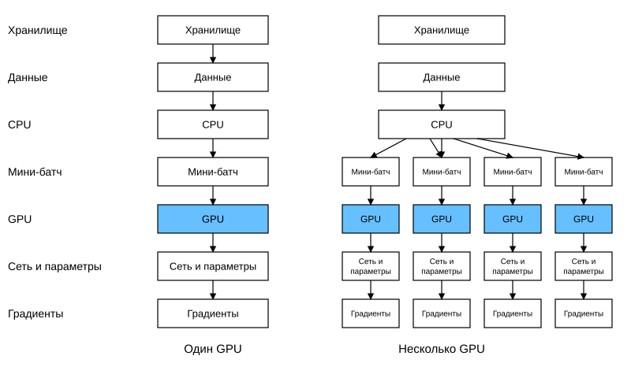
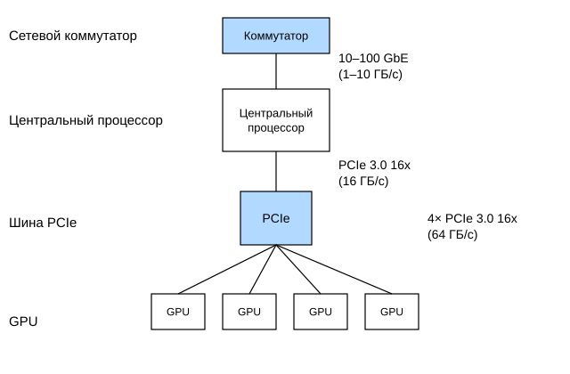
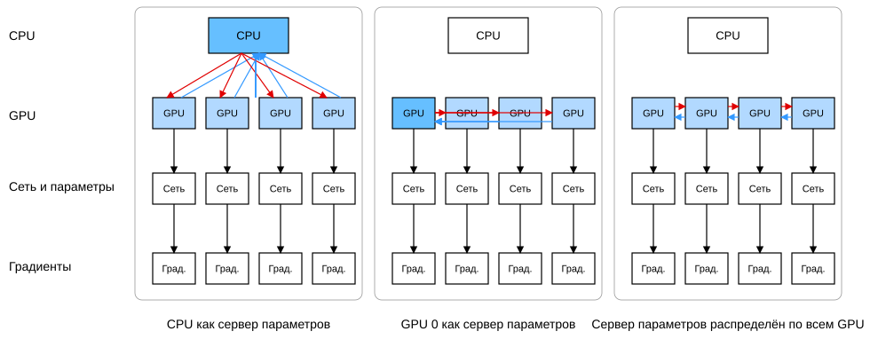
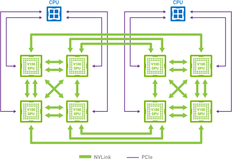
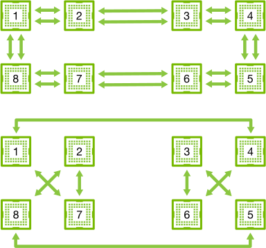
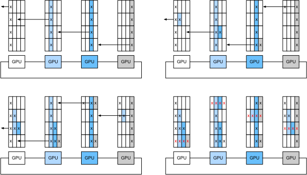
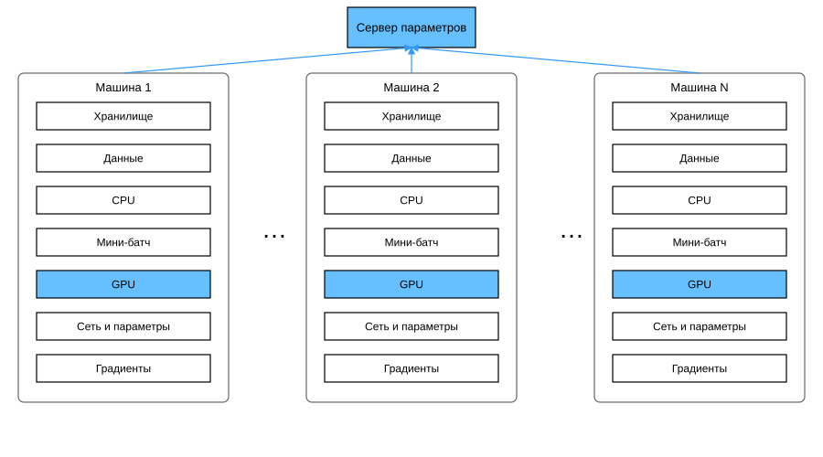
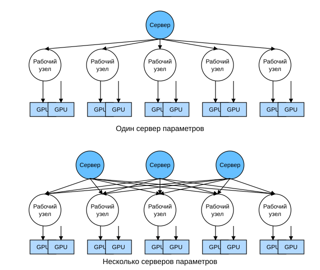

# 12.7 Сервер параметров

Когда мы переходим от одного GPU к нескольким GPU, а затем к нескольким серверам с несколькими GPU (которые могут быть распределены по разным стойкам и сетевым коммутаторам), алгоритмы распределённого параллельного обучения тоже становятся сложнее. Выяснится, что пропускная способность разных способов соединения сильно различается. Например, NVLink может обеспечить до 100 ГБ/с по шести линиям, 16-канальный PCIe 4.0 даёт 32 ГБ/с, а даже скоростной 100GbE Ethernet — лишь около 10 ГБ/с. С другой стороны, было бы нереалистично ожидать, что разработчик, занимающийся статистическим моделированием обучения, будет ещё и экспертом в системах и сетях.

Основная идея сервера параметров была впервые предложена в работе (Smola and Narayanamurthy, 2010) в контексте распределённых скрытых переменных. Затем в работе (Ahmed et al., 2012) были описаны семантики push и pull, а в (Li et al., 2014) — системы и открытые библиотеки. Ниже мы опишем компоненты, которые повышают вычислительную эффективность.

## 12.7.1 Обучение с распараллеливанием данных

Вспомним подход к обучению с распараллеливанием данных в распределённой архитектуре. Поскольку на практике его реализовать относительно просто, мы ограничимся только им. Современные GPU имеют большой объём памяти, поэтому в реальных сценариях (за исключением обучения на графах) рекомендуется только такой вариант параллельного обучения. На рис. 12.7.1 показан вариант параллелизма данных, рассмотренный в разделе 12.5. Ключевой момент здесь в том, что агрегация градиентов выполняется на одном GPU (GPU 0), после чего обновлённые параметры рассылаются всем GPU.

**Рис. 12.7.1.** Слева — обучение на одном GPU; справа — вариант обучения на нескольких GPU: (1) вычисляются потери и градиенты, (2) все градиенты агрегируются на одном GPU, (3) выполняется обновление параметров и они повторно рассылаются всем GPU

Если оглянуться, выбор GPU 0 для агрегации может показаться произвольным. Конечно, можно агрегировать на CPU. Более того, на практике, если оптимизационный алгоритм это поддерживает, часть параметров можно агрегировать на одном GPU, а другую часть — на другом. Например, если есть четыре градиента $\mathbf{g}_1, \ldots, \mathbf{g}_4$, связанных с вектором параметров, их агрегацию можно выполнить на отдельном GPU для каждого $\mathbf{g}_i$ ($i = 1, \ldots, 4$).

Такие рассуждения могут показаться легкомысленными и произвольными: математика ведь должна быть логически непротиворечивой. Однако мы имеем дело с реальным физическим оборудованием, описанным в разделе 12.4, где разные шины обладают разной пропускной способностью. Рассмотрим реальный сервер с четырьмя GPU, описанный в разделе 12.4. Если соединения в нём особенно полноценные, у него может быть сетевая карта 100GbE. Более типичные значения — в диапазоне 1–10 GbE, с эффективной пропускной способностью от 100 МБ/с до 1 ГБ/с. Поскольку у CPU слишком мало линий PCIe (например, у потребительских процессоров Intel их 24), подключить к нему напрямую все GPU нельзя, поэтому нужен [коммутатор (multiplexer)](https://www.broadcom.com/products/pcie-switches-bridges/pcie-switches). Пропускная способность CPU по каналу x16 Gen3 составляет 16 ГБ/с, с такой же скоростью каждый GPU подключён к коммутатору. Это означает, что обмен данными между GPU происходит эффективнее.

**Рис. 12.7.2.** Сервер с четырьмя GPU

Для удобства примем, что градиенты всех параметров в сумме занимают 160 МБ. В этом случае передача градиентов трёх GPU на четвёртый займёт 30 мс (на каждую передачу требуется 10 мс = 160 МБ / 16 ГБ/с). Ещё 30 мс уйдёт на обратную передачу вектора весов, и в итоге получается 60 мс. Если отправлять все данные на CPU, понадобится 80 мс, причём 40 мс будут потрачены впустую, потому что каждый из четырёх GPU должен отправить данные на CPU. Наконец, предположим, что градиенты можно разбить на четыре части по 40 МБ и агрегировать каждую часть на своём GPU одновременно. Поскольку коммутатор PCIe обеспечивает полную пропускную способность между всеми линиями, передача займёт $2.5\times 3=7.5$ мс вместо 30 мс, а вся операция синхронизации — 15 мс. Итак, одна и та же операция синхронизации параметров может занимать от 15 мс до 80 мс в зависимости от стратегии. На рис. 12.7.3 показаны разные стратегии обмена параметрами.

**Рис. 12.7.3.** Стратегии синхронизации параметров

Обратите внимание, что можно использовать ещё один инструмент для повышения производительности. В глубокой сети вычисление всех градиентов от верхних слоёв до нижних занимает некоторое время. Поэтому можно начать синхронизировать градиенты уже готовых параметров, не дожидаясь, пока будут вычислены градиенты остальных. Подробности см. в работе (Sergeev and Del Balso, 2018), а практическая реализация описана в [Horovod](https://github.com/horovod/horovod).

## 12.7.2 Кольцевая синхронизация (ring synchronization)

Когда речь заходит о синхронизации в современном аппаратном обеспечении для глубокого обучения, мы часто сталкиваемся с большим количеством специализированных сетевых соединений. Например, в экземплярах AWS p3.16xlarge и NVIDIA DGX-2 используется структура, показанная на рис. 12.7.4. Каждый GPU подключён к центральному процессору по линии PCIe, которая может работать со скоростью не более 16 ГБ/с. Кроме того, у каждого GPU есть шесть соединений NVLink, и каждое из них может передавать данные в обоих направлениях со скоростью 300 Гбит/с. Это примерно $300 \div 8 \div 2 \approx 18 \mathrm{GB/s}$ на каждое соединение в каждом направлении. Иными словами, совокупная пропускная способность NVLink заметно выше пропускной способности PCIe, и вопрос в том, как использовать её эффективно.

**Рис. 12.7.4.** Соединение NVLink на серверах с восемью GPU V100 (иллюстрация NVIDIA)

Результаты работы (Wang et al., 2018) показывают, что оптимальная стратегия синхронизации — разбить сеть на два кольца и синхронизировать данные непосредственно по этим кольцам. На рис. 12.7.5 показано, что сеть можно разложить на кольцо с удвоенной пропускной способностью NVLink (1-2-3-4-5-6-7-8-1) и кольцо с обычной пропускной способностью (1-4-6-3-5-8-2-7-1). В этом случае очень важно разработать эффективный протокол синхронизации.

**Рис. 12.7.5.** Разложение сети NVLink на два кольца

Рассмотрим мысленный эксперимент. Пусть есть кольцо из $n$ вычислительных узлов (или GPU). Градиенты можно передавать от первого узла ко второму; второй узел складывает свои локальные градиенты с полученными и отправляет результат третьему узлу, и так далее. После $n-1$ шага агрегированный градиент окажется в последнем посещённом узле. То есть время агрегации градиентов растёт линейно с количеством узлов. Но если действовать именно так, алгоритм будет довольно неэффективным: в любой момент времени обменивается данными только один узел. Что если разбить градиенты на $n$ блоков и начать синхронизацию блока $i$ с узла $i$? Поскольку размер каждого блока равен $1/n$, общее время составит $(n-1)/n \approx 1$. Иными словами, при увеличении размера кольца время агрегации градиентов не растёт. Это довольно удивительный результат. На рис. 12.7.6 показана последовательность шагов для $n=4$ узлов.

**Рис. 12.7.6.** Кольцевая синхронизация на 4 узлах. Каждый узел начинает отправлять часть градиентов своему левому соседу, пока у правого соседа не появится агрегированный градиент

Если применить тот же пример и синхронизировать 160 МБ данных на 8 GPU V100, получим примерно $2 \times 160 \text{ МБ} \div (3 \times 18 \text{ ГБ/с}) \approx 6 \text{ мс}$. Это лучше, чем результат при использовании шины PCIe, даже если теперь у нас 8 GPU. Заметим, что на практике эти цифры обычно немного хуже, потому что фреймворки глубокого обучения не могут объединять коммуникацию в большие пакетные передачи.

Есть распространённое заблуждение, что кольцевая синхронизация принципиально отличается от других алгоритмов синхронизации. На самом деле по сравнению с простым древовидным алгоритмом её единственное отличие в том, что путь синхронизации немного более тонко организован.

## 12.7.3 Обучение на нескольких машинах

На нескольких машинах распределённое обучение сталкивается с новыми трудностями: серверам нужно обмениваться данными, а соединены они через относительно медленную сетевую структуру. В некоторых случаях скорость такого соединения может быть ниже на порядок, поэтому синхронизация между устройствами становится сложной задачей. Ведь код обучения на разных машинах работает с незначительно разной скоростью, поэтому, если мы хотим использовать алгоритм синхронизации для распределённой оптимизации, нужно *синхронизировать* (synchronize) эти машины. На рис. 12.7.7 показано, как происходит распределённое параллельное обучение.

1. На каждой машине читается свой набор (отличающихся) минибатчей. Данные делятся между несколькими GPU и передаются в память GPU. Затем на каждом GPU отдельно вычисляются предсказания и градиенты по его минибатчу.
2. Градиенты со всех локальных GPU одной машины агрегируются на одном GPU (или их части агрегируются на разных GPU).
3. Градиенты каждой машины отправляются в её локальный CPU.
4. Все CPU отправляют градиенты на центральный сервер параметров, который агрегирует все градиенты.
5. Затем агрегированные градиенты используются для обновления параметров, и обновлённые параметры рассылаются обратно на CPU.
6. Информация об обновлённых параметрах отправляется на один (или несколько) локальных GPU.
7. Обновление параметров на всех GPU завершено.

**Рис. 12.7.7.** Распределённое параллельное обучение на нескольких машинах с несколькими GPU

Все эти операции кажутся довольно простыми, и на самом деле их можно эффективно выполнять внутри одной машины. Однако при большем числе машин центральный сервер параметров становится узким местом. Действительно, пропускная способность каждого сервера ограничена, поэтому для $m$ рабочих узлов время отправки всех градиентов на сервер равно $\mathcal{O}(m)$. Этот барьер можно преодолеть, увеличив число серверов параметров до $n$. Тогда каждый сервер должен хранить лишь $\mathcal{O}(1/n)$ параметров, и общее время обновления и оптимизации становится $\mathcal{O}(m/n)$. Совпадение этих двух величин даёт стабильное масштабирование, независимо от того, сколько рабочих узлов мы используем. На практике одна и та же машина служит одновременно и рабочим узлом, и сервером. Схема приведена на рис. 12.7.8 (технические подробности см. в работе (Li et al., 2014)). В частности, очень трудно добиться того, чтобы несколько машин работали без неоправданных задержек.

**Рис. 12.7.8.** Сверху: один сервер параметров — узкое место из-за ограниченной пропускной способности; снизу: несколько серверов параметров хранят часть параметров и используют совокупную пропускную способность

## 12.7.4 Хранилище «ключ — значение»

На практике реализовать шаги, необходимые для распределённого обучения на нескольких GPU, совсем не просто. Поэтому стоит использовать общую абстракцию, а именно переопределить *хранилище «ключ — значение»* (key-value store) с семантикой обновления.

Для многих рабочих узлов и многих GPU вычисление градиента $i$ можно записать так:

$$\mathbf{g}_{i} = \sum_{k \in \text{workers}} \sum_{j \in \text{GPUs}} \mathbf{g}_{ijk},$$

где $\mathbf{g}_{ijk}$ — часть градиента $i$, которая расположена на GPU $j$ рабочего узла $k$. Ключевое свойство этой операции в том, что она является *коммутативной редукцией* (commutative reduction): она превращает много векторов в один, и порядок, в котором это делается, не важен. Это очень удобно для нашей задачи, потому что не нужно тонко контролировать, в какой момент получать какой градиент. Кроме того, заметим, что эта операция независима для разных $i$.

Это позволяет определить две операции: *push* (для накопления градиентов) и *pull* (для получения агрегированных градиентов). Поскольку слоёв много, а значит, и много разных наборов градиентов, градиенты нужно индексировать ключом $i$. Сходство с *хранилищем «ключ — значение»*, введённым в Dynamo (DeCandia et al., 2007), не случайно: у них много общих свойств, особенно при распределении параметров между несколькими серверами.

Операции push и pull для хранилища «ключ — значение» описываются так:

* **push(key, value)** отправляет конкретные значения градиента от рабочего узла в общее хранилище, где значения агрегируются определённым образом (например, складываются);
* **pull(key, value)** получает из общего хранилища агрегированное значение, полученное определённым образом (например, объединяя градиенты со всех рабочих узлов).

Скрывая всю сложность синхронизации за простыми операциями push и pull, мы разделяем задачи специалиста по статистическому моделированию (который хочет выражать оптимизацию простыми средствами) и системного инженера (которому приходится разбираться с неизбежной сложностью распределённой синхронизации).

## Резюме

* Синхронизация должна в высокой степени учитывать конкретную сетевую инфраструктуру и соединения внутри сервера, так как от этого существенно зависит время синхронизации.
* Кольцевая синхронизация оптимальна для серверов p3 и DGX-2, но для других серверов это может быть не так.
* Когда для увеличения пропускной способности добавляется несколько серверов параметров, хорошо работает иерархическая стратегия синхронизации.

## Упражнения

1. Попробуйте дополнительно улучшить производительность кольцевой синхронизации. (Подсказка: сообщения можно отправлять в обоих направлениях.)
1. Можно ли разрешить асинхронную коммуникацию, пока вычисления ещё продолжаются? Как это повлияет на производительность?
1. Как справиться с ситуацией, когда в процессе длительных вычислений выходит из строя один из серверов? Попробуйте придумать механизм отказоустойчивости, который позволит не перезапускать вычисления.

[Обсуждение](https://discuss.d2l.ai/t/5774)

## Литература

* DeCandia, G., Hastorun, D., Jampani, M., Kakulapati, G., Lakshman, A., Pilchin, A., Sivasubramanian, S., Vosshall, P., & Vogels, W. (2007). Dynamo: Amazon's highly available key-value store. *ACM SIGOPS Operating Systems Review*, 41(6), 205–220.
* Wang, L., Li, M., Liberty, E., & Smola, A. J. (2018). Optimal message scheduling for aggregation. *Networks*, 2–3.
* Ahmed, A., Aly, M., Gonzalez, J., Narayanamurthy, S., & Smola, A. J. (2012). Scalable inference in latent variable models. *Proceedings of the Fifth ACM International Conference on Web Search and Data Mining*, 123–132.
* Li, M., Andersen, D. G., Park, J. W., Smola, A. J., Ahmed, A., Josifovski, V., Long, J., Shekita, E. J., & Su, B.-Y. (2014). Scaling distributed machine learning with the parameter server. *11th USENIX Symposium on Operating Systems Design and Implementation (OSDI 14)*, 583–598.
* Smola, A., & Narayanamurthy, S. (2010). An architecture for parallel topic models. *Proceedings of the VLDB Endowment*, 3(1–2), 703–710.
