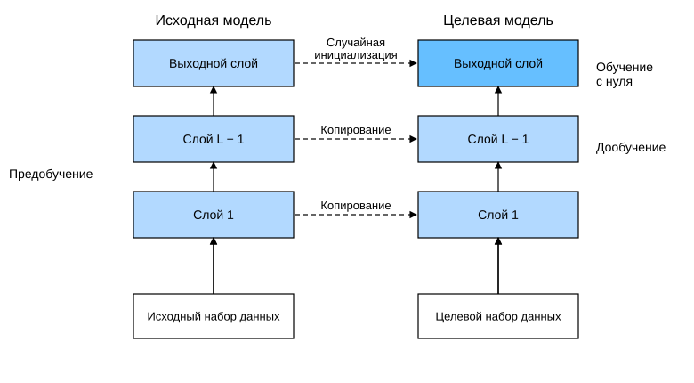

# 13.2 Дообучение

В предыдущих разделах мы обучали модели на наборе Fashion-MNIST, в котором всего 60 тысяч изображений. Мы также упоминали ImageNet — самый широко используемый в научном сообществе набор изображений, содержащий более 10 миллионов изображений и 1000 классов объектов. Однако наборы данных, с которыми мы встречаемся на практике, обычно по размеру находятся между этими двумя.

Предположим, мы хотим распознавать на фотографиях разные типы стульев, чтобы затем предлагать пользователю ссылки для покупки. Один из возможных способов — сначала выбрать 100 распространённых видов стульев, сфотографировать каждый вид с 1000 разных ракурсов, а затем обучить классификационную модель на собранном наборе изображений. Хотя такой набор данных о стульях может быть больше Fashion-MNIST, число примеров по-прежнему составляет менее одной десятой от ImageNet. Сложная модель, подходящая для ImageNet, на таком наборе о стульях, скорее всего, переобучится. Кроме того, из-за ограниченного числа обучающих примеров точность обученной модели может не соответствовать практическим требованиям.

Очевидное решение этих проблем — собрать больше данных. Однако сбор и разметка данных могут занимать много времени и средств. Например, чтобы собрать набор данных ImageNet, исследователи потратили миллионы долларов на финансирование исследований. Хотя стоимость сбора данных сейчас значительно снизилась, её нельзя игнорировать.

Другое решение — применить *трансферное обучение* (transfer learning) и перенести знания, полученные на *исходном наборе данных* (source dataset), на *целевой набор данных* (target dataset). Например, хотя большинство изображений в наборе ImageNet не имеют отношения к стульям, модель, обученная на этом наборе, может выделять более общие признаки изображений. Они помогают распознавать края, текстуры, формы и сочетания объектов. Такие же признаки могут эффективно работать и для распознавания стульев.

## 13.2.1 Этапы

В этом разделе рассматривается распространённый приём трансферного обучения: *дообучение* (fine-tuning). Как показано на рис. 13.2.1, дообучение включает четыре этапа.

1. Предварительно обучить нейронную сеть на исходном наборе данных (например, ImageNet). Это *исходная модель* (source model).
1. Создать новую нейронную сеть — *целевую модель* (target model). Она копирует все элементы архитектуры исходной модели и её параметры, кроме выходного слоя. Мы предполагаем, что параметры содержат знания, полученные на исходном наборе данных, которые применимы и к целевому набору. Также мы предполагаем, что выходной слой исходной модели тесно связан с метками исходного набора данных, поэтому в целевой модели этот слой не используется.
1. Добавить в целевую модель выходной слой с числом выходов, равным числу классов целевого набора данных. Затем случайным образом инициализировать параметры этого слоя.
1. Обучить целевую модель на целевом наборе данных (например, наборе о стульях). Выходной слой обучается с нуля, а параметры всех остальных слоёв дообучаются на основе параметров исходной модели.



**Рис. 13.2.1.** Дообучение

Когда целевой набор данных значительно меньше исходного, дообучение помогает повысить способность модели к обобщению.

## 13.2.2 Распознавание хот-догов

Продемонстрируем дообучение на конкретном примере: распознавании хот-догов. Мы дообучим модель ResNet на небольшом наборе данных. Эта модель предварительно обучена на ImageNet. Набор содержит несколько тысяч изображений с хот-догами и без них. Мы будем использовать дообученную модель, чтобы определять, есть ли на изображении хот-дог.

**MXNet:**

```python
%matplotlib inline
from d2l import mxnet as d2l
from mxnet import gluon, init, np, npx
from mxnet.gluon import nn
import os

npx.set_np()
```

**PyTorch:**

```python
%matplotlib inline
from d2l import torch as d2l
from torch import nn
import torch
import torchvision
import os
```

**PaddlePaddle:**

```python
%matplotlib inline
from d2l import paddle as d2l
import warnings
warnings.filterwarnings("ignore")
from paddle import nn
import paddle
import paddle.vision as paddlevision
import os
```

### 13.2.2.1 Получение набора данных

**Набор данных о хот-догах взят из интернета.** Он содержит 1400 изображений «положительного» класса с хот-догами и столько же изображений «отрицательного» класса с другими продуктами. По 1000 изображений каждого класса используются для обучения, остальные — для тестирования.

После распаковки скачанного набора данных мы получаем две папки: `hotdog/train` и `hotdog/test`. В каждой из них есть подпапки `hotdog` (есть хот-дог) и `not-hotdog` (нет хот-дога), а в подпапках находятся изображения соответствующего класса.

```python
#@save
d2l.DATA_HUB['hotdog'] = (d2l.DATA_URL + 'hotdog.zip', 
                         'fba480ffa8aa7e0febbb511d181409f899b9baa5')

data_dir = d2l.download_extract('hotdog')
```

Создадим два экземпляра, которые читают все изображения из обучающего и тестового наборов данных.

**MXNet:**

```python
train_imgs = gluon.data.vision.ImageFolderDataset(
    os.path.join(data_dir, 'train'))
test_imgs = gluon.data.vision.ImageFolderDataset(
    os.path.join(data_dir, 'test'))
```

**PyTorch:**

```python
train_imgs = torchvision.datasets.ImageFolder(os.path.join(data_dir, 'train'))
test_imgs = torchvision.datasets.ImageFolder(os.path.join(data_dir, 'test'))
```

**PaddlePaddle:**

```python
train_imgs = paddlevision.datasets.DatasetFolder(os.path.join(data_dir, 'train'))
test_imgs = paddlevision.datasets.DatasetFolder(os.path.join(data_dir, 'test'))
```

Ниже показаны первые 8 изображений положительного класса и последние 8 изображений отрицательного класса. Как видно, **размер и соотношение сторон изображений различаются**.

```python
hotdogs = [train_imgs[i][0] for i in range(8)]
not_hotdogs = [train_imgs[-i - 1][0] for i in range(8)]
d2l.show_images(hotdogs + not_hotdogs, 2, 8, scale=1.4);
```

Во время обучения мы сначала вырезаем из изображения область случайного размера со случайным соотношением сторон, а затем масштабируем её до входного изображения размером $224 \times 224$. Во время тестирования мы масштабируем высоту и ширину изображения до 256 пикселей и затем вырезаем центральную область $224 \times 224$ в качестве входа. Кроме того, для каналов RGB (красного, зелёного и синего) мы *нормализуем* каждый канал отдельно. А именно, из каждого значения канала вычитается среднее значение по этому каналу, а результат делится на стандартное отклонение по нему.

**MXNet:**

```python
# Нормализуем каждый канал по средним значениям и стандартным отклонениям RGB-каналов
normalize = gluon.data.vision.transforms.Normalize(
    [0.485, 0.456, 0.406], [0.229, 0.224, 0.225])

train_augs = gluon.data.vision.transforms.Compose([
    gluon.data.vision.transforms.RandomResizedCrop(224),
    gluon.data.vision.transforms.RandomFlipLeftRight(),
    gluon.data.vision.transforms.ToTensor(),
    normalize])

test_augs = gluon.data.vision.transforms.Compose([
    gluon.data.vision.transforms.Resize(256),
    gluon.data.vision.transforms.CenterCrop(224),
    gluon.data.vision.transforms.ToTensor(),
    normalize])
```

**PyTorch:**

```python
# Нормализуем каждый канал по средним значениям и стандартным отклонениям RGB-каналов
normalize = torchvision.transforms.Normalize(
    [0.485, 0.456, 0.406], [0.229, 0.224, 0.225])

train_augs = torchvision.transforms.Compose([
    torchvision.transforms.RandomResizedCrop(224),
    torchvision.transforms.RandomHorizontalFlip(),
    torchvision.transforms.ToTensor(),
    normalize])

test_augs = torchvision.transforms.Compose([
    torchvision.transforms.Resize([256, 256]),
    torchvision.transforms.CenterCrop(224),
    torchvision.transforms.ToTensor(),
    normalize])
```

**PaddlePaddle:**

```python
# Нормализуем каждый канал по средним значениям и стандартным отклонениям RGB-каналов
normalize = paddle.vision.transforms.Normalize(
    [0.485, 0.456, 0.406], [0.229, 0.224, 0.225])

train_augs = paddlevision.transforms.Compose([
    paddlevision.transforms.RandomResizedCrop(224),
    paddlevision.transforms.RandomHorizontalFlip(),
    paddlevision.transforms.ToTensor(),
    normalize])

test_augs = paddlevision.transforms.Compose([
    paddlevision.transforms.Resize(256),
    paddlevision.transforms.CenterCrop(224),
    paddlevision.transforms.ToTensor(),
    normalize])
```

### 13.2.2.2 Определение и инициализация модели

Мы используем ResNet-18, предварительно обученную на ImageNet, в качестве исходной модели. Здесь мы указываем `pretrained=True`, чтобы автоматически загрузить предобученные параметры модели. Если эта модель используется впервые, для загрузки нужен доступ в интернет.

**MXNet:**

```python
pretrained_net = gluon.model_zoo.vision.resnet18_v2(pretrained=True)
```

**PyTorch:**

```python
pretrained_net = torchvision.models.resnet18(pretrained=True)
```

**PaddlePaddle:**

```python
pretrained_net = paddlevision.models.resnet18(pretrained=True)
```

**MXNet:** Экземпляр предобученной исходной модели содержит два атрибута: `features` и `output`. Первый содержит все слои модели, кроме выходного, второй — выходной слой модели. Основное назначение такого разделения — упростить дообучение параметров всех слоёв, кроме выходного. Атрибут `output` исходной модели показан ниже.

**PyTorch, PaddlePaddle:** Экземпляр предобученной исходной модели содержит множество слоёв признаков и выходной слой `fc`. Основное назначение такого разделения — упростить дообучение параметров всех слоёв, кроме выходного. Атрибут `fc` исходной модели показан ниже.

**MXNet:**

```python
pretrained_net.output
```

**PyTorch, PaddlePaddle:**

```python
pretrained_net.fc
```

После глобального среднего пулинга ResNet полносвязный слой выдаёт 1000 выходов — по числу классов ImageNet. Затем мы строим новую нейронную сеть как целевую модель. Она определяется так же, как предобученная исходная модель, но число выходов последнего слоя задаётся равным числу классов целевого набора данных (а не 1000).

В приведённом ниже коде параметры атрибута `features` целевой модели `finetune_net` инициализируются значениями соответствующих слоёв исходной модели. Поскольку эти параметры предобучены на ImageNet и достаточно хороши, обычно для их дообучения достаточно небольшой скорости обучения.

Параметры атрибута `output` инициализируются случайно; для обучения с нуля обычно нужна более высокая скорость обучения. Пусть скорость обучения в `Trainer` равна $\eta$, тогда для параметров `output` мы зададим скорость обучения $10\eta$.

**MXNet:**

```python
finetune_net = gluon.model_zoo.vision.resnet18_v2(classes=2)
finetune_net.features = pretrained_net.features
finetune_net.output.initialize(init.Xavier())
# Скорость обучения выходного слоя в десять раз больше, чем у остальных слоёв
finetune_net.output.collect_params().setattr('lr_mult', 10)
```

**PyTorch:**

```python
finetune_net = torchvision.models.resnet18(pretrained=True)
finetune_net.fc = nn.Linear(finetune_net.fc.in_features, 2)
nn.init.xavier_uniform_(finetune_net.fc.weight);
```

**PaddlePaddle:**

```python
finetune_net = paddlevision.models.resnet18(pretrained=True)
finetune_net.fc = nn.Linear(pretrained_net.fc.state_dict()['weight'].shape[0], 2)
nn.initializer.XavierUniform(pretrained_net.fc.state_dict()['weight']);
```

### 13.2.2.3 Дообучение модели

Сначала определим функцию обучения `train_fine_tuning`, которая использует дообучение и поэтому может вызываться многократно.

**MXNet:**

```python
def train_fine_tuning(net, learning_rate, batch_size=128, num_epochs=5):
    train_iter = gluon.data.DataLoader(
        train_imgs.transform_first(train_augs), batch_size, shuffle=True)
    test_iter = gluon.data.DataLoader(
        test_imgs.transform_first(test_augs), batch_size)
    devices = d2l.try_all_gpus()
    net.collect_params().reset_ctx(devices)
    net.hybridize()
    loss = gluon.loss.SoftmaxCrossEntropyLoss()
    trainer = gluon.Trainer(net.collect_params(), 'sgd', {
        'learning_rate': learning_rate, 'wd': 0.001})
    d2l.train_ch13(net, train_iter, test_iter, loss, trainer, num_epochs,
                   devices)
```

**PyTorch:**

```python
# Если param_group=True, параметры выходного слоя используют в десять раз большую скорость обучения
def train_fine_tuning(net, learning_rate, batch_size=128, num_epochs=5,
                      param_group=True):
    train_iter = torch.utils.data.DataLoader(torchvision.datasets.ImageFolder(
        os.path.join(data_dir, 'train'), transform=train_augs),
        batch_size=batch_size, shuffle=True)
    test_iter = torch.utils.data.DataLoader(torchvision.datasets.ImageFolder(
        os.path.join(data_dir, 'test'), transform=test_augs),
        batch_size=batch_size)
    devices = d2l.try_all_gpus()
    loss = nn.CrossEntropyLoss(reduction="none")
    if param_group:
        params_1x = [param for name, param in net.named_parameters()
             if name not in ["fc.weight", "fc.bias"]]
        trainer = torch.optim.SGD([{'params': params_1x},
                                   {'params': net.fc.parameters(),
                                    'lr': learning_rate * 10}],
                                lr=learning_rate, weight_decay=0.001)
    else:
        trainer = torch.optim.SGD(net.parameters(), lr=learning_rate,
                                  weight_decay=0.001)    
    d2l.train_ch13(net, train_iter, test_iter, loss, trainer, num_epochs,
                   devices)
```

**PaddlePaddle:**

```python
# Если param_group=True, параметры выходного слоя используют в десять раз большую скорость обучения
def train_fine_tuning(net, learning_rate, batch_size=128, num_epochs=5,
                      param_group=True):
    train_iter = paddle.io.DataLoader(paddle.vision.datasets.DatasetFolder(
        os.path.join(data_dir, 'train'), transform=train_augs),
        batch_size=batch_size, shuffle=True)
    test_iter = paddle.io.DataLoader(paddle.vision.datasets.DatasetFolder(
        os.path.join(data_dir, 'test'), transform=test_augs),
        batch_size=batch_size)
    devices = d2l.try_all_gpus()
    loss = nn.CrossEntropyLoss(reduction="none")
    if param_group:
        params_1x = [param for name, param in net.named_parameters()
             if name not in ["fc.weight", "fc.bias"]]
        trainer = paddle.optimizer.SGD(learning_rate=learning_rate, parameters=[{'params': params_1x},
                                   {'params': net.fc.parameters(),
                                    'learning_rate': learning_rate * 10}],
                                    weight_decay=0.001)
    else:
        trainer = paddle.optimizer.SGD(learning_rate=learning_rate, parameters=net.parameters(), 
                                  weight_decay=0.001)
    d2l.train_ch13(net, train_iter, test_iter, loss, trainer, num_epochs, devices)
```

Теперь **дообучим модель** с небольшой скоростью обучения на параметрах, полученных предобучением.

**MXNet:**

```python
train_fine_tuning(finetune_net, 0.01)
```

**PyTorch, PaddlePaddle:**

```python
train_fine_tuning(finetune_net, 5e-5)
```

**Для сравнения** определим такую же модель, но **инициализируем все её параметры случайными значениями**. Поскольку вся модель обучается с нуля, нужна более высокая скорость обучения.

**MXNet:**

```python
scratch_net = gluon.model_zoo.vision.resnet18_v2(classes=2)
scratch_net.initialize(init=init.Xavier())
train_fine_tuning(scratch_net, 0.1)
```

**PyTorch:**

```python
scratch_net = torchvision.models.resnet18()
scratch_net.fc = nn.Linear(scratch_net.fc.in_features, 2)
train_fine_tuning(scratch_net, 5e-4, param_group=False)
```

**PaddlePaddle:**

```python
scratch_net = paddlevision.models.resnet18()
scratch_net.fc = nn.Linear(pretrained_net.fc.state_dict()['weight'].shape[0], 2)
train_fine_tuning(scratch_net, 5e-4, param_group=False)
```

Как и ожидалось, дообученная модель обычно показывает лучший результат, поскольку её начальные значения параметров удачнее.

## Резюме

* Трансферное обучение переносит знания, полученные на исходном наборе данных, на целевой набор данных. Дообучение — распространённый приём трансферного обучения.
* Целевая модель копирует все элементы архитектуры исходной модели вместе с её параметрами, кроме выходного слоя, и дообучает эти параметры на целевом наборе данных. Выходной слой целевой модели нужно обучать с нуля.
* Обычно параметры для дообучения берут с небольшой скоростью обучения, а выходной слой, обучаемый с нуля, — с более высокой.

## Упражнения

1. Продолжайте увеличивать скорость обучения `finetune_net`. Как изменится точность модели?
2. В сравнительном эксперименте дополнительно подберите гиперпараметры для `finetune_net` и `scratch_net`. Различаются ли их точности и теперь?
3. Задайте параметры `finetune_net` перед выходным слоем равными параметрам исходной модели и не обновляйте их во время обучения. Как изменится точность модели? Подсказка: можно использовать такой код.

**MXNet:**

```python
finetune_net.features.collect_params().setattr('grad_req', 'null')
```

**PyTorch:**

```python
for param in finetune_net.parameters():
    param.requires_grad = False
```

**PaddlePaddle:**

```python
for param in finetune_net.parameters():
    param.stop_gradient = True
```

4. На самом деле в наборе данных `ImageNet` есть класс «хот-дог». Мы можем получить соответствующие весовые параметры его выходного слоя с помощью следующего кода. Но как нам использовать эти весовые параметры?

**MXNet:**

```python
weight = pretrained_net.output.weight
hotdog_w = np.split(weight.data(), 1000, axis=0)[713]
hotdog_w.shape
```

**PyTorch:**

```python
weight = pretrained_net.fc.weight
hotdog_w = torch.split(weight.data, 1, dim=0)[934]
hotdog_w.shape
```

**PaddlePaddle:**

```python
weight = pretrained_net.fc.weight
hotdog_w = paddle.split(weight.T, 1000, axis=0)[713]
hotdog_w.shape
```

**MXNet:**
[Обсуждение](https://discuss.d2l.ai/t/2893)

**PyTorch:**
[Обсуждение](https://discuss.d2l.ai/t/2894)

**PaddlePaddle:**
[Обсуждение](https://discuss.d2l.ai/t/11802)
