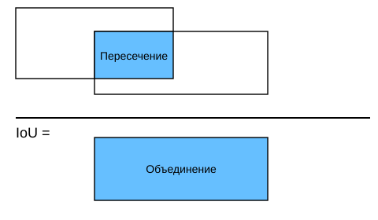
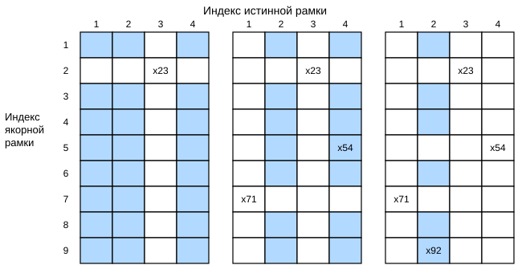

# 13.4 Якорные рамки

Алгоритмы обнаружения объектов обычно выбирают большое количество областей входного изображения, определяют, содержат ли они интересующие нас объекты, и уточняют границы областей, чтобы точнее предсказать *истинную ограничивающую рамку* (ground-truth bounding box) объекта. Разные модели могут использовать разные способы выбора областей. Здесь мы рассмотрим один из них: для каждого пикселя мы создаём несколько ограничивающих рамок с разными масштабами и разными соотношениями сторон (aspect ratio). Такие рамки называются *якорными рамками* (anchor box). В разделе 13.7 мы спроектируем модель обнаружения на основе якорных рамок.

Сначала изменим точность вывода, чтобы результаты были компактнее.

**MXNet:**

```python
%matplotlib inline
from d2l import mxnet as d2l
from mxnet import gluon, image, np, npx

np.set_printoptions(2)  # Уменьшаем точность вывода
npx.set_np()
```

**PyTorch:**

```python
%matplotlib inline
from d2l import torch as d2l
import torch

torch.set_printoptions(2)  # Уменьшаем точность вывода
```

**PaddlePaddle:**

```python
%matplotlib inline
from d2l import paddle as d2l
import warnings
warnings.filterwarnings("ignore")
import paddle
import numpy as np

paddle.set_printoptions(2)  # Уменьшаем точность вывода
```

## 13.4.1 Генерация нескольких якорных рамок

Пусть высота входного изображения равна $h$, а ширина — $w$. Мы создаём якорные рамки с центром в каждом пикселе изображения: *масштаб* (scale) равен $s\in (0, 1]$, а *соотношение сторон* (aspect ratio) — $r > 0$. Тогда **ширина и высота якорной рамки равны $hs\sqrt{r}$ и $hs/\sqrt{r}$ соответственно.** Заметим, что если задано положение центра, то при известных ширине и высоте рамка определена однозначно.

Чтобы получить рамки разных форм, зададим несколько значений масштаба $s_1,\ldots, s_n$ и несколько значений соотношения сторон $r_1,\ldots, r_m$. Если использовать все комбинации этих масштабов и соотношений сторон с центром в каждом пикселе, то входное изображение получит всего $whnm$ якорных рамок. Хотя такие рамки, возможно, покроют все истинные ограничивающие рамки, вычислительная сложность легко становится слишком высокой. На практике мы рассматриваем только те комбинации, которые содержат $s_1$ или $r_1$:

$$(s_1, r_1), (s_1, r_2), \ldots, (s_1, r_m), (s_2, r_1), (s_3, r_1), \ldots, (s_n, r_1).$$

Таким образом, число якорных рамок с центром в одном пикселе равно $n+m-1$. Для всего входного изображения будет сгенерировано $wh(n+m-1)$ якорных рамок.

Описанный способ генерации якорных рамок реализован в функции `multibox_prior` ниже. Мы передаём ей входное изображение, список масштабов и список соотношений сторон, а функция возвращает все якорные рамки.

**MXNet:**

```python
#@save
def multibox_prior(data, sizes, ratios):
    """Генерирует якорные рамки разной формы с центром в каждом пикселе"""
    in_height, in_width = data.shape[-2:]
    device, num_sizes, num_ratios = data.ctx, len(sizes), len(ratios)
    boxes_per_pixel = (num_sizes + num_ratios - 1)
    size_tensor = d2l.tensor(sizes, ctx=device)
    ratio_tensor = d2l.tensor(ratios, ctx=device)

    # Чтобы переместить опорные точки в центр пикселя, задаём смещение.
    # Так как высота и ширина пикселя равны 1, смещаем центр на 0.5
    offset_h, offset_w = 0.5, 0.5
    steps_h = 1.0 / in_height  # Шаг масштабирования по оси y
    steps_w = 1.0 / in_width  # Шаг масштабирования по оси x

    # Генерируем все центры якорных рамок
    center_h = (d2l.arange(in_height, ctx=device) + offset_h) * steps_h
    center_w = (d2l.arange(in_width, ctx=device) + offset_w) * steps_w
    shift_x, shift_y = d2l.meshgrid(center_w, center_h)
    shift_x, shift_y = shift_x.reshape(-1), shift_y.reshape(-1)

    # Генерируем «boxes_per_pixel» значений высоты и ширины,
    # которые затем используются для вычисления угловых координат якорных рамок (xmin, xmax, ymin, ymax)
    w = np.concatenate((size_tensor * np.sqrt(ratio_tensor[0]),
                        sizes[0] * np.sqrt(ratio_tensor[1:]))) \
                        * in_height / in_width  # Учитываем прямоугольный вход
    h = np.concatenate((size_tensor / np.sqrt(ratio_tensor[0]),
                        sizes[0] / np.sqrt(ratio_tensor[1:])))
    # Делим на 2, чтобы получить полувысоту и полуширину
    anchor_manipulations = np.tile(np.stack((-w, -h, w, h)).T,
                                   (in_height * in_width, 1)) / 2

    # У каждого центра будет «boxes_per_pixel» якорных рамок,
    # поэтому создаём сетку всех центров якорных рамок, повторённую «boxes_per_pixel» раз
    out_grid = d2l.stack([shift_x, shift_y, shift_x, shift_y],
                         axis=1).repeat(boxes_per_pixel, axis=0)
    output = out_grid + anchor_manipulations
    return np.expand_dims(output, axis=0)
```

**PyTorch:**

```python
#@save
def multibox_prior(data, sizes, ratios):
    """Генерирует якорные рамки разной формы с центром в каждом пикселе"""
    in_height, in_width = data.shape[-2:]
    device, num_sizes, num_ratios = data.device, len(sizes), len(ratios)
    boxes_per_pixel = (num_sizes + num_ratios - 1)
    size_tensor = d2l.tensor(sizes, device=device)
    ratio_tensor = d2l.tensor(ratios, device=device)

    # Чтобы переместить опорные точки в центр пикселя, задаём смещение.
    # Так как высота и ширина пикселя равны 1, смещаем центр на 0.5
    offset_h, offset_w = 0.5, 0.5
    steps_h = 1.0 / in_height  # Шаг масштабирования по оси y
    steps_w = 1.0 / in_width  # Шаг масштабирования по оси x

    # Генерируем все центры якорных рамок
    center_h = (torch.arange(in_height, device=device) + offset_h) * steps_h
    center_w = (torch.arange(in_width, device=device) + offset_w) * steps_w
    shift_y, shift_x = torch.meshgrid(center_h, center_w, indexing='ij')
    shift_y, shift_x = shift_y.reshape(-1), shift_x.reshape(-1)

    # Генерируем «boxes_per_pixel» значений высоты и ширины,
    # которые затем используются для вычисления угловых координат якорных рамок (xmin, xmax, ymin, ymax)
    w = torch.cat((size_tensor * torch.sqrt(ratio_tensor[0]),
                   sizes[0] * torch.sqrt(ratio_tensor[1:])))\
                   * in_height / in_width  # Учитываем прямоугольный вход
    h = torch.cat((size_tensor / torch.sqrt(ratio_tensor[0]),
                   sizes[0] / torch.sqrt(ratio_tensor[1:])))
    # Делим на 2, чтобы получить полувысоту и полуширину
    anchor_manipulations = torch.stack((-w, -h, w, h)).T.repeat(
                                        in_height * in_width, 1) / 2

    # У каждого центра будет «boxes_per_pixel» якорных рамок,
    # поэтому создаём сетку всех центров якорных рамок, повторённую «boxes_per_pixel» раз
    out_grid = torch.stack([shift_x, shift_y, shift_x, shift_y],
                dim=1).repeat_interleave(boxes_per_pixel, dim=0)
    output = out_grid + anchor_manipulations
    return output.unsqueeze(0)
```

**PaddlePaddle:**

```python
#@save
def multibox_prior(data, sizes, ratios):
    """Генерирует якорные рамки разной формы с центром в каждом пикселе"""
    in_height, in_width = data.shape[-2:]
    place, num_sizes, num_ratios = data.place, len(sizes), len(ratios)
    boxes_per_pixel = (num_sizes + num_ratios - 1)
    size_tensor = paddle.to_tensor(sizes, place=place)
    ratio_tensor = paddle.to_tensor(ratios, place=place)

    # Чтобы переместить опорные точки в центр пикселя, задаём смещение.
    # Так как высота и ширина пикселя равны 1, смещаем центр на 0.5
    offset_h, offset_w = 0.5, 0.5
    steps_h = 1.0 / in_height  # Шаг масштабирования по оси y
    steps_w = 1.0 / in_width  # Шаг масштабирования по оси x

    # Генерируем все центры якорных рамок
    center_h = (paddle.arange(in_height) + offset_h) * steps_h
    center_w = (paddle.arange(in_width) + offset_w) * steps_w
    shift_y, shift_x = paddle.meshgrid(center_h, center_w)
    shift_y, shift_x = shift_y.reshape([-1]), shift_x.reshape([-1])

    # Генерируем «boxes_per_pixel» значений высоты и ширины,
    # которые затем используются для вычисления угловых координат якорных рамок (xmin, xmax, ymin, ymax)
    w = paddle.concat((size_tensor * paddle.sqrt(ratio_tensor[0]),
                       sizes[0] * paddle.sqrt(ratio_tensor[1:])))\
                       * in_height / in_width  # Учитываем прямоугольный вход
    h = paddle.concat((size_tensor / paddle.sqrt(ratio_tensor[0]),
                   sizes[0] / paddle.sqrt(ratio_tensor[1:])))
    # Делим на 2, чтобы получить полувысоту и полуширину
    anchor_manipulations = paddle.tile(paddle.stack((-w, -h, w, h)).T,
                                        (in_height * in_width, 1)) / 2

    # У каждого центра будет «boxes_per_pixel» якорных рамок,
    # поэтому создаём сетку всех центров якорных рамок, повторённую «boxes_per_pixel» раз
    out_grid = paddle.stack([shift_x, shift_y, shift_x, shift_y], axis=1)
    out_grid = paddle.tile(out_grid, repeat_times=[boxes_per_pixel]).reshape((-1, out_grid.shape[1]))
    output = out_grid + anchor_manipulations
    return output.unsqueeze(0)
```

Посмотрим, **какую форму имеет возвращаемая переменная `Y`**: (размер батча, число якорных рамок, 4).

**MXNet:**

```python
img = image.imread('../img/catdog.jpg').asnumpy()
h, w = img.shape[:2]

print(h, w)
X = np.random.uniform(size=(1, 3, h, w))
Y = multibox_prior(X, sizes=[0.75, 0.5, 0.25], ratios=[1, 2, 0.5])
Y.shape
```

**PyTorch:**

```python
img = d2l.plt.imread('../img/catdog.jpg')
h, w = img.shape[:2]

print(h, w)
X = torch.rand(size=(1, 3, h, w))
Y = multibox_prior(X, sizes=[0.75, 0.5, 0.25], ratios=[1, 2, 0.5])
Y.shape
```

**PaddlePaddle:**

```python
img = d2l.plt.imread('../img/catdog.jpg')
h, w = img.shape[:2]

print(h, w)
X = paddle.rand(shape=(1, 3, h, w))
Y = multibox_prior(X, sizes=[0.75, 0.5, 0.25], ratios=[1, 2, 0.5])
Y.shape
```

Если изменить форму переменной якорных рамок `Y` на (высота изображения, ширина изображения, число якорных рамок с центром в одном пикселе, 4), то мы получим все якорные рамки с центром в заданном пикселе. Далее **получим первую якорную рамку с центром в пикселе (250, 250)**. Она содержит четыре элемента: координаты $(x, y)$ левого верхнего и правого нижнего углов рамки. Координаты по обеим осям в выводе поделены на ширину и высоту изображения соответственно.

**MXNet, PyTorch:**

```python
boxes = Y.reshape(h, w, 5, 4)
boxes[250, 250, 0, :]
```

**PaddlePaddle:**

```python
boxes = Y.reshape([h, w, 5, 4])
boxes[250, 250, 0, :]
```

Чтобы **показать все якорные рамки с центром в некотором пикселе изображения**, определим функцию `show_bboxes`, которая рисует несколько ограничивающих рамок на изображении.

```python
#@save
def show_bboxes(axes, bboxes, labels=None, colors=None):
    """Показывает все ограничивающие рамки"""
    def _make_list(obj, default_values=None):
        if obj is None:
            obj = default_values
        elif not isinstance(obj, (list, tuple)):
            obj = [obj]
        return obj
        
    labels = _make_list(labels)
    colors = _make_list(colors, ['b', 'g', 'r', 'm', 'c'])
    for i, bbox in enumerate(bboxes):
        color = colors[i % len(colors)]
        rect = d2l.bbox_to_rect(d2l.numpy(bbox), color)
        axes.add_patch(rect)
        if labels and len(labels) > i:
            text_color = 'k' if color == 'w' else 'w'
            axes.text(rect.xy[0], rect.xy[1], labels[i],
                      va='center', ha='center', fontsize=9, color=text_color,
                      bbox=dict(facecolor=color, lw=0))
```

Как видно из кода выше, значения координат по осям $x$ и $y$ в переменной `boxes` поделены на ширину и высоту изображения. При рисовании якорных рамок нужно вернуть исходные значения координат. Поэтому ниже мы определяем переменную `bbox_scale`. Теперь можно нарисовать все якорные рамки с центром в (250, 250). Как показано ниже, синяя якорная рамка с масштабом 0.75 и соотношением сторон 1 хорошо охватывает собаку на изображении.

```python
d2l.set_figsize()
bbox_scale = d2l.tensor((w, h, w, h))
fig = d2l.plt.imshow(img)
show_bboxes(fig.axes, boxes[250, 250, :, :] * bbox_scale,
            ['s=0.75, r=1', 's=0.5, r=1', 's=0.25, r=1', 's=0.75, r=2',
             's=0.75, r=0.5'])
```

## 13.4.2 Пересечение над объединением (IoU)

Мы только что сказали, что некоторая якорная рамка «хорошо» охватывает собаку на изображении. Как можно количественно оценить это «хорошо», если известна истинная ограничивающая рамка объекта? Интуитивно можно измерить сходство якорной рамки и истинной ограничивающей рамки. *Коэффициент Жаккара* (Jaccard index) измеряет сходство двух множеств. Для множеств $\mathcal{A}$ и $\mathcal{B}$ коэффициент Жаккара равен отношению размера их пересечения к размеру их объединения:

$$J(\mathcal{A},\mathcal{B}) = \frac{\left|\mathcal{A} \cap \mathcal{B}\right|}{\left| \mathcal{A} \cup \mathcal{B}\right|}.$$

Фактически мы можем рассматривать область пикселей любой ограничивающей рамки как множество пикселей. Так можно измерить сходство двух ограничивающих рамок с помощью коэффициента Жаккара их множеств пикселей. Для двух ограничивающих рамок этот коэффициент обычно называют *пересечением над объединением* (intersection over union, IoU): это отношение площади пересечения двух рамок к площади их объединения, как показано на рис. 13.4.1. Значения IoU лежат в диапазоне от 0 до 1: 0 означает, что рамки не имеют общих пикселей, а 1 — что рамки полностью совпадают.



**Рис. 13.4.1.** Пересечение над объединением — это отношение площади пересечения двух ограничивающих рамок к площади их объединения

В следующих разделах IoU будет использоваться для измерения сходства между якорной рамкой и истинной ограничивающей рамкой, а также между разными якорными рамками. Для двух списков якорных или ограничивающих рамок функция `box_iou` ниже вычисляет попарные значения IoU.

**MXNet:**

```python
#@save
def box_iou(boxes1, boxes2):
    """Вычисляет попарное IoU для двух списков якорных или ограничивающих рамок"""
    box_area = lambda boxes: ((boxes[:, 2] - boxes[:, 0]) *
                              (boxes[:, 3] - boxes[:, 1]))
    # Формы boxes1, boxes2, areas1, areas2:
    # boxes1: (количество boxes1, 4),
    # boxes2: (количество boxes2, 4),
    # areas1: (количество boxes1,),
    # areas2: (количество boxes2,)
    areas1 = box_area(boxes1)
    areas2 = box_area(boxes2)

    # Формы inter_upperlefts, inter_lowerrights, inters:
    # (количество boxes1, количество boxes2, 2)
    inter_upperlefts = np.maximum(boxes1[:, None, :2], boxes2[:, :2])
    inter_lowerrights = np.minimum(boxes1[:, None, 2:], boxes2[:, 2:])
    inters = (inter_lowerrights - inter_upperlefts).clip(min=0)
    # Форма inter_areas и union_areas: (количество boxes1, количество boxes2)
    inter_areas = inters[:, :, 0] * inters[:, :, 1]
    union_areas = areas1[:, None] + areas2 - inter_areas
    return inter_areas / union_areas
```

**PyTorch:**

```python
#@save
def box_iou(boxes1, boxes2):
    """Вычисляет попарное IoU для двух списков якорных или ограничивающих рамок"""
    box_area = lambda boxes: ((boxes[:, 2] - boxes[:, 0]) *
                              (boxes[:, 3] - boxes[:, 1]))
    # Формы boxes1, boxes2, areas1, areas2:
    # boxes1: (количество boxes1, 4),
    # boxes2: (количество boxes2, 4),
    # areas1: (количество boxes1,),
    # areas2: (количество boxes2,)
    areas1 = box_area(boxes1)
    areas2 = box_area(boxes2)
    # Формы inter_upperlefts, inter_lowerrights, inters:
    # (количество boxes1, количество boxes2, 2)
    inter_upperlefts = torch.max(boxes1[:, None, :2], boxes2[:, :2])
    inter_lowerrights = torch.min(boxes1[:, None, 2:], boxes2[:, 2:])
    inters = (inter_lowerrights - inter_upperlefts).clamp(min=0)
    # Форма inter_areas и union_areas: (количество boxes1, количество boxes2)
    inter_areas = inters[:, :, 0] * inters[:, :, 1]
    union_areas = areas1[:, None] + areas2 - inter_areas
    return inter_areas / union_areas
```

**PaddlePaddle:**

```python
#@save
def box_iou(boxes1, boxes2):
    """Вычисляет попарное IoU для двух списков якорных или ограничивающих рамок"""
    box_area = lambda boxes: ((boxes[:, 2] - boxes[:, 0]) *
                              (boxes[:, 3] - boxes[:, 1]))
    # Формы boxes1, boxes2, areas1, areas2:
    # boxes1: (количество boxes1, 4),
    # boxes2: (количество boxes2, 4),
    # areas1: (количество boxes1,),
    # areas2: (количество boxes2,)
    areas1 = box_area(boxes1)
    areas2 = box_area(boxes2)
    # Формы inter_upperlefts, inter_lowerrights, inters:
    # (количество boxes1, количество boxes2, 2)
    inter_upperlefts = paddle.maximum(boxes1[:, None, :2], boxes2[:, :2])
    inter_lowerrights = paddle.minimum(boxes1[:, None, 2:], boxes2[:, 2:])
    inters = (inter_lowerrights - inter_upperlefts).clip(min=0)
    # Форма inter_areas и union_areas: (количество boxes1, количество boxes2)
    inter_areas = inters[:, :, 0] * inters[:, :, 1]
    union_areas = areas1[:, None] + areas2 - inter_areas
    return inter_areas / union_areas
```

## 13.4.3 Разметка якорных рамок в обучающих данных

В обучающем наборе каждую якорную рамку мы рассматриваем как обучающий пример. Чтобы обучить модель обнаружения объектов, нам нужны метки *класса* (class) и *смещения* (offset) для каждой якорной рамки. Класс — это категория объекта, связанного с якорной рамкой, а смещение — это смещение истинной ограничивающей рамки относительно якорной рамки. При предсказании мы генерируем много якорных рамок для каждого изображения, предсказываем классы и смещения всех якорных рамок, уточняем их положение по предсказанным смещениям, чтобы получить предсказанные ограничивающие рамки, и в конце выводим только те предсказанные рамки, которые удовлетворяют заданным условиям.

Обучающий набор для обнаружения объектов содержит положения *истинных ограничивающих рамок* и метки категорий объектов, которые в них находятся. Чтобы разметить любую сгенерированную якорную рамку, мы можем использовать положение и метку класса той истинной ограничивающей рамки, которая ближе всего к этой якорной рамке. Ниже описан алгоритм, который назначает ближайшую истинную ограничивающую рамку каждой якорной рамке.

### 13.4.3.1 Назначение истинных ограничивающих рамок якорным рамкам

Пусть якорные рамки — $A_1, A_2, \ldots, A_{n_a}$, а истинные ограничивающие рамки — $B_1, B_2, \ldots, B_{n_b}$, где $n_a \geq n_b$. Определим матрицу $\mathbf{X} \in \mathbb{R}^{n_a \times n_b}$, в которой элемент $x_{ij}$ в $i$-й строке и $j$-м столбце — это IoU якорной рамки $A_i$ и истинной ограничивающей рамки $B_j$. Алгоритм состоит из следующих шагов.

1. Найдём наибольший элемент матрицы $\mathbf{X}$ и обозначим его индекс строки и индекс столбца через $i_1$ и $j_1$. Затем назначим истинную ограничивающую рамку $B_{j_1}$ якорной рамке $A_{i_1}$. Это интуитивно понятно, поскольку $A_{i_1}$ и $B_{j_1}$ — самая близкая пара среди всех сочетаний якорных и истинных рамок. После этого назначения удалим все элементы в ${i_1}$-й строке и ${j_1}$-м столбце матрицы.
1. Найдём наибольший из оставшихся элементов матрицы $\mathbf{X}$ и обозначим его индекс строки и индекс столбца через $i_2$ и $j_2$. Назначим истинную ограничивающую рамку $B_{j_2}$ якорной рамке $A_{i_2}$ и удалим все элементы в ${i_2}$-й строке и ${j_2}$-м столбце матрицы.
1. Теперь в матрице $\mathbf{X}$ удалены элементы двух строк и двух столбцов. Продолжаем так, пока не удалим все элементы в $n_b$ столбцах матрицы $\mathbf{X}$. К этому моменту каждой из $n_b$ якорных рамок назначена своя истинная ограничивающая рамка.
1. Проходим только по оставшимся $n_a - n_b$ якорным рамкам. Например, для любой якорной рамки $A_i$ находим в $i$-й строке матрицы $\mathbf{X}$ истинную ограничивающую рамку $B_j$ с наибольшим IoU с $A_i$. Назначаем $B_j$ рамке $A_i$ только в том случае, если это IoU больше заранее заданного порога.

Рассмотрим этот алгоритм на конкретном примере. Как показано на рис. 13.4.2 (слева), пусть наибольший элемент матрицы $\mathbf{X}$ равен $x_{23}$. Тогда назначаем истинную ограничивающую рамку $B_3$ якорной рамке $A_2$. Далее удаляем все элементы второй строки и третьего столбца, находим наибольший элемент $x_{71}$ среди оставшихся (затенённая область) и назначаем рамку $B_1$ якорной рамке $A_7$. Затем, как показано на рис. 13.4.2 (в центре), удаляем все элементы седьмой строки и первого столбца, находим наибольший элемент $x_{54}$ среди оставшихся (затенённая область) и назначаем рамку $B_4$ якорной рамке $A_5$. Наконец, как показано на рис. 13.4.2 (справа), удаляем все элементы пятой строки и четвёртого столбца, находим наибольший элемент $x_{92}$ среди оставшихся (затенённая область) и назначаем рамку $B_2$ якорной рамке $A_9$. После этого остаётся пройти по оставшимся якорным рамкам $A_1, A_3, A_4, A_6, A_8$ и решить, назначать ли им истинные рамки, исходя из порога.



**Рис. 13.4.2.** Назначение истинных ограничивающих рамок якорным рамкам

Этот алгоритм реализован в функции `assign_anchor_to_bbox` ниже.

**MXNet:**

```python
#@save
def assign_anchor_to_bbox(ground_truth, anchors, device, iou_threshold=0.5):
    """Назначает ближайшую истинную ограничивающую рамку якорным рамкам"""
    num_anchors, num_gt_boxes = anchors.shape[0], ground_truth.shape[0]
    # Элемент x_ij в строке i и столбце j — это IoU якорной рамки i и истинной ограничивающей рамки j
    jaccard = box_iou(anchors, ground_truth)
    # Тензор назначенных истинных ограничивающих рамок для каждой якорной рамки
    anchors_bbox_map = np.full((num_anchors,), -1, dtype=np.int32, ctx=device)
    # По порогу решаем, назначать ли истинную ограничивающую рамку
    max_ious, indices = np.max(jaccard, axis=1), np.argmax(jaccard, axis=1)
    anc_i = np.nonzero(max_ious >= iou_threshold)[0]
    box_j = indices[max_ious >= iou_threshold]
    anchors_bbox_map[anc_i] = box_j
    col_discard = np.full((num_anchors,), -1)
    row_discard = np.full((num_gt_boxes,), -1)
    for _ in range(num_gt_boxes):
        max_idx = np.argmax(jaccard)
        box_idx = (max_idx % num_gt_boxes).astype('int32')
        anc_idx = (max_idx / num_gt_boxes).astype('int32')
        anchors_bbox_map[anc_idx] = box_idx
        jaccard[:, box_idx] = col_discard
        jaccard[anc_idx, :] = row_discard
    return anchors_bbox_map
```

**PyTorch:**

```python
#@save
def assign_anchor_to_bbox(ground_truth, anchors, device, iou_threshold=0.5):
    """Назначает ближайшую истинную ограничивающую рамку якорным рамкам"""
    num_anchors, num_gt_boxes = anchors.shape[0], ground_truth.shape[0]
    # Элемент x_ij в строке i и столбце j — это IoU якорной рамки i и истинной ограничивающей рамки j
    jaccard = box_iou(anchors, ground_truth)
    # Тензор назначенных истинных ограничивающих рамок для каждой якорной рамки
    anchors_bbox_map = torch.full((num_anchors,), -1, dtype=torch.long,
                                  device=device)
    # По порогу решаем, назначать ли истинную ограничивающую рамку
    max_ious, indices = torch.max(jaccard, dim=1)
    anc_i = torch.nonzero(max_ious >= iou_threshold).reshape(-1)
    box_j = indices[max_ious >= iou_threshold]
    anchors_bbox_map[anc_i] = box_j
    col_discard = torch.full((num_anchors,), -1)
    row_discard = torch.full((num_gt_boxes,), -1)
    for _ in range(num_gt_boxes):
        max_idx = torch.argmax(jaccard)
        box_idx = (max_idx % num_gt_boxes).long()
        anc_idx = (max_idx / num_gt_boxes).long()
        anchors_bbox_map[anc_idx] = box_idx
        jaccard[:, box_idx] = col_discard
        jaccard[anc_idx, :] = row_discard
    return anchors_bbox_map
```

**PaddlePaddle:**

```python
#@save
def assign_anchor_to_bbox(ground_truth, anchors, place, iou_threshold=0.5):
    """Назначает ближайшую истинную ограничивающую рамку якорным рамкам"""
    num_anchors, num_gt_boxes = anchors.shape[0], ground_truth.shape[0]
    # Элемент x_ij в строке i и столбце j — это IoU якорной рамки i и истинной ограничивающей рамки j
    jaccard = box_iou(anchors, ground_truth)
    # Тензор назначенных истинных ограничивающих рамок для каждой якорной рамки
    anchors_bbox_map = paddle.full((num_anchors,), -1, dtype=paddle.int64)
    # По порогу решаем, назначать ли истинную ограничивающую рамку
    max_ious = paddle.max(jaccard, axis=1)
    indices = paddle.argmax(jaccard, axis=1)
    anc_i = paddle.nonzero(max_ious >= 0.5).reshape([-1])
    box_j = indices[max_ious >= 0.5]
    anchors_bbox_map[anc_i] = box_j
    col_discard = paddle.full((num_anchors,), -1)
    row_discard = paddle.full((num_gt_boxes,), -1)
    for _ in range(num_gt_boxes):
        max_idx = paddle.argmax(jaccard)
        box_idx = paddle.cast((max_idx % num_gt_boxes), dtype='int64')
        anc_idx = paddle.cast((max_idx / num_gt_boxes), dtype='int64')
        anchors_bbox_map[anc_idx] = box_idx
        jaccard[:, box_idx] = col_discard
        jaccard[anc_idx, :] = row_discard
    return anchors_bbox_map
```

### 13.4.3.2 Разметка классов и смещений

Теперь можно разметить классы и смещения каждой якорной рамки. Пусть якорная рамка $A$ назначена истинной рамке $B$. С одной стороны, класс якорной рамки $A$ помечается так же, как класс $B$. С другой стороны, смещение якорной рамки $A$ задаётся по относительному положению центров $B$ и $A$, а также по относительному размеру этих рамок. Поскольку положения и размеры рамок в наборе данных различаются, мы можем применить к этим относительным величинам преобразование, чтобы смещения были распределены равномернее и их было легче аппроксимировать. Здесь мы используем одно распространённое преобразование. **Пусть даны рамки $A$ и $B$ с координатами центров $(x_a, y_a)$ и $(x_b, y_b)$, шириной $w_a$ и $w_b$ и высотой $h_a$ и $h_b$. Тогда смещение рамки $A$ записывается как:**

$$\left( \frac{ \frac{x_b - x_a}{w_a} - \mu_x }{\sigma_x},
\frac{ \frac{y_b - y_a}{h_a} - \mu_y }{\sigma_y},
\frac{ \log \frac{w_b}{w_a} - \mu_w }{\sigma_w},
\frac{ \log \frac{h_b}{h_a} - \mu_h }{\sigma_h}\right),$$

где по умолчанию $\mu_x = \mu_y = \mu_w = \mu_h = 0$, $\sigma_x=\sigma_y=0.1$, а $\sigma_w=\sigma_h=0.2$. Это преобразование реализовано в функции `offset_boxes` ниже.

```python
#@save
def offset_boxes(anchors, assigned_bb, eps=1e-6):
    """Преобразование смещений якорных рамок"""
    c_anc = d2l.box_corner_to_center(anchors)
    c_assigned_bb = d2l.box_corner_to_center(assigned_bb)
    offset_xy = 10 * (c_assigned_bb[:, :2] - c_anc[:, :2]) / c_anc[:, 2:]
    offset_wh = 5 * d2l.log(eps + c_assigned_bb[:, 2:] / c_anc[:, 2:])
    offset = d2l.concat([offset_xy, offset_wh], axis=1)
    return offset
```

Если якорной рамке не назначена истинная ограничивающая рамка, мы просто помечаем её класс как *фон* (background). Якорные рамки класса «фон» обычно называют *отрицательными*, а остальные — *положительными*. Мы реализуем функцию `multibox_target` ниже: она использует истинные ограничивающие рамки (параметр `labels`) и **размечает классы и смещения якорных рамок** (параметр `anchors`). Индекс фона полагается равным нулю, а индекс каждого нового класса увеличивается на единицу.

**MXNet:**

```python
#@save
def multibox_target(anchors, labels):
    """Размечает якорные рамки с помощью истинных ограничивающих рамок"""
    batch_size, anchors = labels.shape[0], anchors.squeeze(0)
    batch_offset, batch_mask, batch_class_labels = [], [], []
    device, num_anchors = anchors.ctx, anchors.shape[0]
    for i in range(batch_size):
        label = labels[i, :, :]
        anchors_bbox_map = assign_anchor_to_bbox(
            label[:, 1:], anchors, device)
        bbox_mask = np.tile((np.expand_dims((anchors_bbox_map >= 0),
                                            axis=-1)), (1, 4)).astype('int32')
        # Инициализируем метки классов и координаты назначенных рамок нулями
        class_labels = d2l.zeros(num_anchors, dtype=np.int32, ctx=device)
        assigned_bb = d2l.zeros((num_anchors, 4), dtype=np.float32,
                                ctx=device)
        # С помощью истинных ограничивающих рамок размечаем классы якорных рамок.
        # Если якорная рамка не назначена, помечаем её как фон (значение ноль)
        indices_true = np.nonzero(anchors_bbox_map >= 0)[0]
        bb_idx = anchors_bbox_map[indices_true]
        class_labels[indices_true] = label[bb_idx, 0].astype('int32') + 1
        assigned_bb[indices_true] = label[bb_idx, 1:]
        # Преобразование смещений
        offset = offset_boxes(anchors, assigned_bb) * bbox_mask
        batch_offset.append(offset.reshape(-1))
        batch_mask.append(bbox_mask.reshape(-1))
        batch_class_labels.append(class_labels)
    bbox_offset = d2l.stack(batch_offset)
    bbox_mask = d2l.stack(batch_mask)
    class_labels = d2l.stack(batch_class_labels)
    return (bbox_offset, bbox_mask, class_labels)
```

**PyTorch:**

```python
#@save
def multibox_target(anchors, labels):
    """Размечает якорные рамки с помощью истинных ограничивающих рамок"""
    batch_size, anchors = labels.shape[0], anchors.squeeze(0)
    batch_offset, batch_mask, batch_class_labels = [], [], []
    device, num_anchors = anchors.device, anchors.shape[0]
    for i in range(batch_size):
        label = labels[i, :, :]
        anchors_bbox_map = assign_anchor_to_bbox(
            label[:, 1:], anchors, device)
        bbox_mask = ((anchors_bbox_map >= 0).float().unsqueeze(-1)).repeat(
            1, 4)
        # Инициализируем метки классов и координаты назначенных рамок нулями
        class_labels = torch.zeros(num_anchors, dtype=torch.long,
                                   device=device)
        assigned_bb = torch.zeros((num_anchors, 4), dtype=torch.float32,
                                  device=device)
        # С помощью истинных ограничивающих рамок размечаем классы якорных рамок.
        # Если якорная рамка не назначена, помечаем её как фон (значение ноль)
        indices_true = torch.nonzero(anchors_bbox_map >= 0)
        bb_idx = anchors_bbox_map[indices_true]
        class_labels[indices_true] = label[bb_idx, 0].long() + 1
        assigned_bb[indices_true] = label[bb_idx, 1:]
        # Преобразование смещений
        offset = offset_boxes(anchors, assigned_bb) * bbox_mask
        batch_offset.append(offset.reshape(-1))
        batch_mask.append(bbox_mask.reshape(-1))
        batch_class_labels.append(class_labels)
    bbox_offset = torch.stack(batch_offset)
    bbox_mask = torch.stack(batch_mask)
    class_labels = torch.stack(batch_class_labels)
    return (bbox_offset, bbox_mask, class_labels)
```

**PaddlePaddle:**

```python
#@save
def multibox_target(anchors, labels):
    """Размечает якорные рамки с помощью истинных ограничивающих рамок"""
    batch_size, anchors = labels.shape[0], anchors.squeeze(0)
    batch_offset, batch_mask, batch_class_labels = [], [], []
    place, num_anchors = anchors.place, anchors.shape[0]
    for i in range(batch_size):
        label = labels[i, :, :]
        anchors_bbox_map = assign_anchor_to_bbox(
            label[:, 1:], anchors, place)
        bbox_mask = paddle.tile(paddle.to_tensor((anchors_bbox_map >= 0), dtype='float32').unsqueeze(-1), (1, 4))
        # Инициализируем метки классов и координаты назначенных рамок нулями
        class_labels = paddle.zeros(paddle.to_tensor(num_anchors), dtype=paddle.int64)
        assigned_bb = paddle.zeros(paddle.to_tensor((num_anchors, 4)), dtype=paddle.float32)
        # С помощью истинных ограничивающих рамок размечаем классы якорных рамок.
        # Если якорная рамка не назначена, помечаем её как фон (значение ноль)
        indices_true = paddle.nonzero(anchors_bbox_map >= 0).numpy()
        bb_idx = anchors_bbox_map[indices_true].numpy()
        class_labels[indices_true] = label.numpy()[bb_idx, 0][:] + 1
        assigned_bb[indices_true] = label.numpy()[bb_idx, 1:]
        class_labels = paddle.to_tensor(class_labels)
        assigned_bb = paddle.to_tensor(assigned_bb)
        # Преобразование смещений
        offset = offset_boxes(anchors, assigned_bb) * bbox_mask
        batch_offset.append(offset.reshape([-1]))
        batch_mask.append(bbox_mask.reshape([-1]))
        batch_class_labels.append(class_labels)
    bbox_offset = paddle.stack(batch_offset)
    bbox_mask = paddle.stack(batch_mask)
    class_labels = paddle.stack(batch_class_labels)
    return (bbox_offset, bbox_mask, class_labels)
```

### 13.4.3.3 Пример

Рассмотрим разметку якорных рамок на конкретном примере. Мы уже определили истинные ограничивающие рамки собаки и кошки на загруженном изображении. Первый элемент каждой рамки — класс (0 — собака, 1 — кошка), остальные четыре элемента — координаты $(x, y)$ левого верхнего и правого нижнего углов (значения от 0 до 1). Также построим пять якорных рамок, заданных координатами левого верхнего и правого нижнего углов: $A_0, \ldots, A_4$ (индексы начинаются с 0). **Нарисуем на изображении эти истинные ограничивающие рамки и якорные рамки.**

```python
ground_truth = d2l.tensor([[0, 0.1, 0.08, 0.52, 0.92],
                         [1, 0.55, 0.2, 0.9, 0.88]])
anchors = d2l.tensor([[0, 0.1, 0.2, 0.3], [0.15, 0.2, 0.4, 0.4],
                    [0.63, 0.05, 0.88, 0.98], [0.66, 0.45, 0.8, 0.8],
                    [0.57, 0.3, 0.92, 0.9]])

fig = d2l.plt.imshow(img)
show_bboxes(fig.axes, ground_truth[:, 1:] * bbox_scale, ['dog', 'cat'], 'k')
show_bboxes(fig.axes, anchors * bbox_scale, ['0', '1', '2', '3', '4']);
```

С помощью функции `multibox_target`, определённой выше, мы можем **разметить классы и смещения этих якорных рамок по истинным ограничивающим рамкам собаки и кошки**. В этом примере индексы классов фона, собаки и кошки равны 0, 1 и 2 соответственно. Ниже мы добавляем размерность и для якорных рамок, и для истинных ограничивающих рамок.

**MXNet:**

```python
labels = multibox_target(np.expand_dims(anchors, axis=0),
                         np.expand_dims(ground_truth, axis=0))
```

**PyTorch:**

```python
labels = multibox_target(anchors.unsqueeze(dim=0),
                         ground_truth.unsqueeze(dim=0))
```

**PaddlePaddle:**

```python
labels = multibox_target(anchors.unsqueeze(axis=0),
                         ground_truth.unsqueeze(axis=0))
```

Возвращаются три тензора. Третий содержит размеченные классы входных якорных рамок.

Разберём метки классов, возвращённые ниже, исходя из положения якорных и истинных рамок на изображении. Прежде всего среди всех пар якорных и истинных рамок наибольшее IoU у якорной рамки $A_4$ и истинной рамки кошки. Поэтому класс $A_4$ помечается как кошка. Исключим пары, в которые входят $A_4$ или истинная рамка кошки. Среди оставшихся пар наибольшее IoU у якорной рамки $A_1$ и истинной рамки собаки. Поэтому класс $A_1$ помечается как собака. Далее нужно пройти по трём оставшимся неразмеченным якорным рамкам: $A_0$, $A_2$ и $A_3$. Для $A_0$ истинная рамка с наибольшим IoU относится к классу собаки, но IoU ниже заранее заданного порога (0.5), поэтому класс помечается как фон. Для $A_2$ истинная рамка с наибольшим IoU относится к классу кошки, и IoU превышает порог, поэтому класс помечается как кошка. Для $A_3$ истинная рамка с наибольшим IoU относится к классу кошки, но значение ниже порога, поэтому класс помечается как фон.

```python
labels[2]
```

Второй возвращаемый элемент — маска, её форма (размер батча, число якорных рамок ×4). Элементы маски соответствуют четырём смещениям каждой якорной рамки. Поскольку нас не интересует обнаружение фона, смещения отрицательного класса не должны влиять на целевую функцию. Поэлементным умножением нули маски отфильтровывают смещения отрицательных классов до вычисления целевой функции.

```python
labels[1]
```

Первый возвращаемый элемент содержит четыре смещения, размеченные для каждой якорной рамки. Обратите внимание, что смещения якорных рамок отрицательного класса помечены нулями.

```python
labels[0]
```

## 13.4.4 Предсказание ограничивающих рамок с помощью подавления немаксимумов

При предсказании мы сначала генерируем много якорных рамок для изображения, затем для каждой из них предсказываем класс и смещение. *Предсказанная ограничивающая рамка* строится по одной из якорных рамок с предсказанным смещением. Ниже мы реализуем функцию `offset_inverse`, которая принимает якорные рамки и предсказанные смещения и **применяет обратное преобразование смещений, чтобы получить координаты предсказанных ограничивающих рамок**.

```python
#@save
def offset_inverse(anchors, offset_preds):
    """Предсказание ограничивающих рамок по якорным рамкам с предсказанными смещениями"""
    anc = d2l.box_corner_to_center(anchors)
    pred_bbox_xy = (offset_preds[:, :2] * anc[:, 2:] / 10) + anc[:, :2]
    pred_bbox_wh = d2l.exp(offset_preds[:, 2:] / 5) * anc[:, 2:]
    pred_bbox = d2l.concat((pred_bbox_xy, pred_bbox_wh), axis=1)
    predicted_bbox = d2l.box_center_to_corner(pred_bbox)
    return predicted_bbox
```

Когда якорных рамок много, может получиться много похожих предсказанных ограничивающих рамок с заметным перекрытием, которые окружают один и тот же объект. Чтобы упростить вывод, мы можем использовать *подавление немаксимумов* (non-maximum suppression, NMS): оно объединяет похожие предсказанные рамки, относящиеся к одному объекту.

Вот как работает подавление немаксимумов. Для предсказанной ограничивающей рамки $B$ модель обнаружения вычисляет предсказанную вероятность каждого класса. Пусть наибольшая из них равна $p$; класс, которому она соответствует, и есть предсказанный класс $B$. Величину $p$ называют *уверенностью* (confidence) предсказанной рамки $B$. Для одного изображения все предсказанные непустые (не фоновые) ограничивающие рамки сортируются по убыванию уверенности, и получается список $L$. Затем мы обрабатываем отсортированный список $L$ следующими шагами.

1. Выбираем из $L$ предсказанную рамку $B_1$ с наибольшей уверенностью в качестве эталона и удаляем из $L$ все остальные предсказанные рамки, у которых IoU с $B_1$ превышает заранее заданный порог $\epsilon$. Теперь $L$ содержит рамку с наибольшей уверенностью и не содержит других рамок, слишком похожих на неё. Иными словами, рамки с *немаксимальной* уверенностью *подавлены*.
1. Выбираем из $L$ предсказанную рамку $B_2$ со второй по величине уверенностью в качестве нового эталона и удаляем из $L$ все остальные рамки, у которых IoU с $B_2$ больше $\epsilon$.
1. Повторяем процесс, пока каждая предсказанная рамка в $L$ не побывает эталоном. К этому моменту любая пара рамок в $L$ имеет IoU меньше порога $\epsilon$, поэтому никакие две рамки не слишком похожи друг на друга.
1. Выводим все предсказанные рамки из списка $L$.

**Функция `nms` ниже сортирует уверенности по убыванию и возвращает их индексы.**

**MXNet:**

```python
#@save
def nms(boxes, scores, iou_threshold):
    """Сортирует уверенности предсказанных ограничивающих рамок"""
    B = scores.argsort()[::-1]
    keep = []  # Индексы рамок, которые нужно сохранить
    while B.size > 0:
        i = B[0]
        keep.append(i)
        if B.size == 1: break
        iou = box_iou(boxes[i, :].reshape(-1, 4),
                      boxes[B[1:], :].reshape(-1, 4)).reshape(-1)
        inds = np.nonzero(iou <= iou_threshold)[0]
        B = B[inds + 1]
    return np.array(keep, dtype=np.int32, ctx=boxes.ctx)
```

**PyTorch:**

```python
#@save
def nms(boxes, scores, iou_threshold):
    """Сортирует уверенности предсказанных ограничивающих рамок"""
    B = torch.argsort(scores, dim=-1, descending=True)
    keep = []  # Индексы рамок, которые нужно сохранить
    while B.numel() > 0:
        i = B[0]
        keep.append(i)
        if B.numel() == 1: break
        iou = box_iou(boxes[i, :].reshape(-1, 4),
                      boxes[B[1:], :].reshape(-1, 4)).reshape(-1)
        inds = torch.nonzero(iou <= iou_threshold).reshape(-1)
        B = B[inds + 1]
    return d2l.tensor(keep, device=boxes.device)
```

**PaddlePaddle:**

```python
#@save
def nms(boxes, scores, iou_threshold):
    """Сортирует уверенности предсказанных ограничивающих рамок"""
    B = paddle.argsort(scores, axis=-1, descending=True)
    keep = []  # Индексы рамок, которые нужно сохранить
    while B.numel().item() > 0:
        i = B[0]
        keep.append(i.item())
        if B.numel().item() == 1: break
        iou = box_iou(boxes[i.numpy(), :].reshape([-1, 4]),
                      paddle.to_tensor(boxes.numpy()[B[1:].numpy(), :]).reshape([-1, 4])).reshape([-1])
        inds = paddle.nonzero(iou <= iou_threshold).numpy().reshape([-1])
        B = paddle.to_tensor(B.numpy()[inds + 1])
    return paddle.to_tensor(keep, place=boxes.place, dtype='int64')
```

Определим функцию `multibox_detection`, которая **применяет подавление немаксимумов к предсказанным ограничивающим рамкам**. Реализация немного сложнее, не беспокойтесь о ней. Сразу после реализации мы покажем её работу на конкретном примере.

**MXNet:**

```python
#@save
def multibox_detection(cls_probs, offset_preds, anchors, nms_threshold=0.5,
                       pos_threshold=0.009999999):
    """Предсказывает ограничивающие рамки с помощью подавления немаксимумов"""
    device, batch_size = cls_probs.ctx, cls_probs.shape[0]
    anchors = np.squeeze(anchors, axis=0)
    num_classes, num_anchors = cls_probs.shape[1], cls_probs.shape[2]
    out = []
    for i in range(batch_size):
        cls_prob, offset_pred = cls_probs[i], offset_preds[i].reshape(-1, 4)
        conf, class_id = np.max(cls_prob[1:], 0), np.argmax(cls_prob[1:], 0)
        predicted_bb = offset_inverse(anchors, offset_pred)
        keep = nms(predicted_bb, conf, nms_threshold)

        # Находим все индексы, которые не вошли в keep, и помечаем их классом «фон»
        all_idx = np.arange(num_anchors, dtype=np.int32, ctx=device)
        combined = d2l.concat((keep, all_idx))
        unique, counts = np.unique(combined, return_counts=True)
        non_keep = unique[counts == 1]
        all_id_sorted = d2l.concat((keep, non_keep))
        class_id[non_keep] = -1
        class_id = class_id[all_id_sorted].astype('float32')
        conf, predicted_bb = conf[all_id_sorted], predicted_bb[all_id_sorted]
        # pos_threshold — порог для непустых предсказаний
        below_min_idx = (conf < pos_threshold)
        class_id[below_min_idx] = -1
        conf[below_min_idx] = 1 - conf[below_min_idx]
        pred_info = d2l.concat((np.expand_dims(class_id, axis=1),
                                np.expand_dims(conf, axis=1),
                                predicted_bb), axis=1)
        out.append(pred_info)
    return d2l.stack(out)
```

**PyTorch:**

```python
#@save
def multibox_detection(cls_probs, offset_preds, anchors, nms_threshold=0.5,
                       pos_threshold=0.009999999):
    """Предсказывает ограничивающие рамки с помощью подавления немаксимумов"""
    device, batch_size = cls_probs.device, cls_probs.shape[0]
    anchors = anchors.squeeze(0)
    num_classes, num_anchors = cls_probs.shape[1], cls_probs.shape[2]
    out = []
    for i in range(batch_size):
        cls_prob, offset_pred = cls_probs[i], offset_preds[i].reshape(-1, 4)
        conf, class_id = torch.max(cls_prob[1:], 0)
        predicted_bb = offset_inverse(anchors, offset_pred)
        keep = nms(predicted_bb, conf, nms_threshold)

        # Находим все индексы, которые не вошли в keep, и помечаем их классом «фон»
        all_idx = torch.arange(num_anchors, dtype=torch.long, device=device)
        combined = torch.cat((keep, all_idx))
        uniques, counts = combined.unique(return_counts=True)
        non_keep = uniques[counts == 1]
        all_id_sorted = torch.cat((keep, non_keep))
        class_id[non_keep] = -1
        class_id = class_id[all_id_sorted]
        conf, predicted_bb = conf[all_id_sorted], predicted_bb[all_id_sorted]
        # pos_threshold — порог для непустых предсказаний
        below_min_idx = (conf < pos_threshold)
        class_id[below_min_idx] = -1
        conf[below_min_idx] = 1 - conf[below_min_idx]
        pred_info = torch.cat((class_id.unsqueeze(1),
                               conf.unsqueeze(1),
                               predicted_bb), dim=1)
        out.append(pred_info)
    return d2l.stack(out)
```

**PaddlePaddle:**

```python
#@save
def multibox_detection(cls_probs, offset_preds, anchors, nms_threshold=0.5,
                       pos_threshold=0.009999999):
    """Предсказывает ограничивающие рамки с помощью подавления немаксимумов"""
    batch_size = cls_probs.shape[0]
    anchors = anchors.squeeze(0)
    num_classes, num_anchors = cls_probs.shape[1], cls_probs.shape[2]
    out = []
    for i in range(batch_size):
        cls_prob, offset_pred = cls_probs[i], offset_preds[i].reshape([-1, 4])
        conf = paddle.max(cls_prob[1:], 0)
        class_id = paddle.argmax(cls_prob[1:], 0)
        predicted_bb = offset_inverse(anchors, offset_pred)
        keep = nms(predicted_bb, conf, nms_threshold)

        # Находим все индексы, которые не вошли в keep, и помечаем их классом «фон»
        all_idx = paddle.arange(num_anchors, dtype='int64')
        combined = paddle.concat((keep, all_idx))
        uniques, counts = combined.unique(return_counts=True)
        non_keep = uniques[counts == 1]
        all_id_sorted = paddle.concat([keep, non_keep])
        class_id[non_keep.numpy()] = -1
        class_id = class_id[all_id_sorted]
        conf, predicted_bb = conf[all_id_sorted], predicted_bb[all_id_sorted]
        # pos_threshold — порог для непустых предсказаний
        below_min_idx = (conf < pos_threshold)
        class_id[below_min_idx.numpy()] = -1
        conf[below_min_idx.numpy()] = 1 - conf[below_min_idx.numpy()]
        pred_info = paddle.concat((paddle.to_tensor(class_id, dtype='float32').unsqueeze(1),
                               paddle.to_tensor(conf, dtype='float32').unsqueeze(1),
                               predicted_bb), axis=1)
        out.append(pred_info)
    return paddle.stack(out)
```

Теперь применим описанный алгоритм к конкретному примеру с четырьмя якорными рамками. Для простоты предположим, что все предсказанные смещения равны нулю, то есть предсказанные ограничивающие рамки совпадают с якорными. Для каждого из классов фона, собаки и кошки зададим предсказанную вероятность.

**MXNet, PyTorch:**

```python
anchors = d2l.tensor([[0.1, 0.08, 0.52, 0.92], [0.08, 0.2, 0.56, 0.95],
                      [0.15, 0.3, 0.62, 0.91], [0.55, 0.2, 0.9, 0.88]])
offset_preds = d2l.tensor([0] * d2l.size(anchors))
cls_probs = d2l.tensor([[0] * 4,  # Предсказанные вероятности фона
                      [0.9, 0.8, 0.7, 0.1],  # Предсказанные вероятности собаки
                      [0.1, 0.2, 0.3, 0.9]])  # Предсказанные вероятности кошки
```

**PaddlePaddle:**

```python
anchors = d2l.tensor([[0.1, 0.08, 0.52, 0.92], [0.08, 0.2, 0.56, 0.95],
                      [0.15, 0.3, 0.62, 0.91], [0.55, 0.2, 0.9, 0.88]])
offset_preds = d2l.tensor([0] * anchors.numel().item())
cls_probs = d2l.tensor([[0] * 4,  # Предсказанные вероятности фона
                      [0.9, 0.8, 0.7, 0.1],  # Предсказанные вероятности собаки
                      [0.1, 0.2, 0.3, 0.9]])  # Предсказанные вероятности кошки
```

Мы можем **нарисовать на изображении эти предсказанные ограничивающие рамки и уверенности**.

```python
fig = d2l.plt.imshow(img)
show_bboxes(fig.axes, anchors * bbox_scale,
            ['dog=0.9', 'dog=0.8', 'dog=0.7', 'cat=0.9'])
```

Теперь вызовем функцию `multibox_detection` для подавления немаксимумов с порогом 0.5. Заметим, что мы добавили размерность к входным тензорам.

Результат имеет форму (размер батча, число якорных рамок, 6). Шесть элементов самой внутренней размерности описывают одну и ту же предсказанную ограничивающую рамку. Первый элемент — индекс предсказанного класса, начиная с 0 (0 — собака, 1 — кошка), значение -1 означает фон или то, что рамка удалена при подавлении немаксимумов. Второй элемент — уверенность предсказанной рамки. Остальные четыре элемента — координаты $(x, y)$ левого верхнего и правого нижнего углов предсказанной рамки (значения от 0 до 1).

**MXNet:**

```python
output = multibox_detection(np.expand_dims(cls_probs, axis=0),
                            np.expand_dims(offset_preds, axis=0),
                            np.expand_dims(anchors, axis=0),
                            nms_threshold=0.5)
output
```

**PyTorch:**

```python
output = multibox_detection(cls_probs.unsqueeze(dim=0),
                            offset_preds.unsqueeze(dim=0),
                            anchors.unsqueeze(dim=0),
                            nms_threshold=0.5)
output
```

**PaddlePaddle:**

```python
output = multibox_detection(cls_probs.unsqueeze(axis=0),
                            offset_preds.unsqueeze(axis=0),
                            anchors.unsqueeze(axis=0),
                            nms_threshold=0.5)
output
```

Удалив предсказанные ограничивающие рамки класса -1 (фон), мы можем **вывести окончательные предсказанные ограничивающие рамки, сохранённые после подавления немаксимумов**.

```python
fig = d2l.plt.imshow(img)
for i in d2l.numpy(output[0]):
    if i[0] == -1:
        continue
    label = ('dog=', 'cat=')[int(i[0])] + str(i[1])
    show_bboxes(fig.axes, [d2l.tensor(i[2:]) * bbox_scale], label)
```

На практике перед подавлением немаксимумов можно удалить предсказанные рамки с низкой уверенностью, чтобы уменьшить вычислительную нагрузку этого алгоритма. Также можно выполнить постобработку результата подавления немаксимумов, например оставить только рамки с более высокой уверенностью в качестве окончательного вывода.

## Резюме

* Мы создаём якорные рамки разной формы с центром в каждом пикселе изображения.
* Пересечение над объединением (IoU), также называемое коэффициентом Жаккара, измеряет сходство двух ограничивающих рамок. Это отношение площади их пересечения к площади их объединения.
* В обучающем наборе каждой якорной рамке нужны две метки: класс объекта, связанного с ней, и смещение истинной ограничивающей рамки относительно якорной рамки.
* При предсказании подавление немаксимумов (NMS) позволяет удалить похожие предсказанные ограничивающие рамки и упростить вывод.

## Упражнения

1. Измените значения `sizes` и `ratios` в функции `multibox_prior`. Как меняются созданные якорные рамки?
1. Постройте и визуализируйте две ограничивающие рамки с IoU, равным 0.5. Как они перекрываются?
1. Измените переменную `anchors` в разделах 13.4.3 и 13.4.4. Как изменятся результаты?
1. Подавление немаксимумов — жадный алгоритм, который подавляет предсказанные рамки, *удаляя* их. Возможно ли, что некоторые удалённые рамки на самом деле полезны? Как изменить алгоритм, чтобы подавление было мягким? Можно обратиться к Soft-NMS (Bodla et al., 2017).
1. Можно ли обучить подавление немаксимумов вместо того, чтобы задавать его вручную?

**MXNet:**
[Обсуждение](https://discuss.d2l.ai/t/2945)

**PyTorch:**
[Обсуждение](https://discuss.d2l.ai/t/2946)

**PaddlePaddle:**
[Обсуждение](https://discuss.d2l.ai/t/11804)

## Литература

* Bodla, N., Singh, B., Chellappa, R., & Davis, L. S. (2017). Soft-NMS — Improving object detection with one line of code. *Proceedings of the IEEE International Conference on Computer Vision*, 5561–5569.
