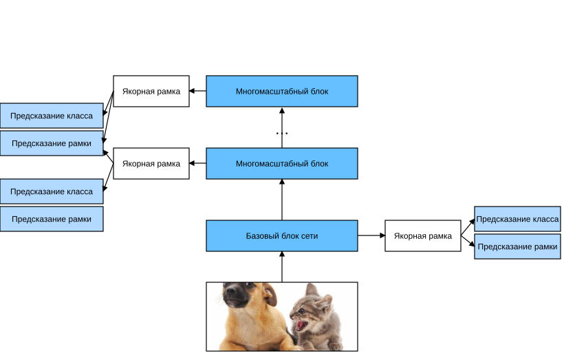

# 13.7 Одноступенчатое обнаружение с несколькими окнами (SSD)

В разделах 13.3–13.6 мы рассмотрели ограничивающие рамки, якорные рамки, обнаружение в нескольких масштабах и набор данных для обнаружения. Теперь мы готовы использовать эти знания, чтобы спроектировать модель обнаружения объектов: одноступенчатое обнаружение с несколькими окнами (single shot multibox detection, SSD) (Liu et al., 2016). Эта модель простая, быстрая и широко используется. Хотя это лишь один из многих методов обнаружения объектов, некоторые проектные решения и детали реализации из этого раздела применимы и к другим моделям.

## Модель

На рис. 13.7.1 показана архитектура модели SSD. Модель в основном состоит из базовой сети, за которой следуют несколько блоков многомасштабных признаков. Базовая сеть извлекает признаки из входного изображения, поэтому в ней можно использовать глубокую свёрточную сеть. В оригинальной статье SSD базовой сетью была VGG, обрезанная перед слоем классификации (Liu et al., 2016); сейчас её также часто заменяют на ResNet. Базовую сеть можно спроектировать так, чтобы её выход имел большие высоту и ширину. Тогда на основе этой карты признаков будет создано больше якорных рамок, которые помогут обнаруживать мелкие объекты. Каждый следующий блок многомасштабных признаков уменьшает высоту и ширину карты признаков, полученной от предыдущего слоя (например, вдвое), и расширяет рецептивное поле каждого элемента карты признаков на входном изображении.

Напомним из раздела 13.5 идею обнаружения в нескольких масштабах: глубокая нейронная сеть строит иерархическое представление изображения. Карты признаков, расположенные ближе к верху рис. 13.7.1, малы, но имеют большое рецептивное поле, поэтому они подходят для обнаружения меньшего количества, но более крупных объектов. Итак, с помощью блоков многомасштабных признаков SSD создаёт якорные рамки разных размеров и обнаруживает объекты разных размеров, предсказывая классы и смещения ограничивающих рамок. Поэтому это модель обнаружения в нескольких масштабах.



Далее мы рассмотрим детали реализации отдельных блоков на рис. 13.7.1. Сначала обсудим, как реализовать предсказание классов и ограничивающих рамок.

### **Слой предсказания классов**

Пусть количество классов объектов равно $q$. Тогда у якорных рамок $q+1$ класс, где класс 0 — фон. Пусть на некотором масштабе высота и ширина карты признаков равны $h$ и $w$. Если с центром в каждом её элементе создать $a$ якорных рамок, то нужно классифицировать $hwa$ якорных рамок. Если использовать полносвязный слой для выхода, легко получить слишком много параметров модели. Вспомним из раздела 7.3 метод, в котором каналы свёрточного слоя используются для вывода предсказаний классов, и одноступенчатое обнаружение с несколькими окнами применяет тот же подход, чтобы снизить сложность модели.

Конкретно, слой предсказания классов использует свёрточный слой, который сохраняет высоту и ширину входа. Тогда выход и вход соответствуют друг другу по пространственным координатам карты признаков. Рассмотрим одну и ту же пространственную координату ($x$, $y$) выхода и входа: канал с координатами ($x$, $y$) выходной карты признаков содержит предсказания классов для всех якорных рамок, созданных с центром в координатах ($x$, $y$) входной карты признаков. Поэтому число выходных каналов равно $a(q+1)$, и канал с индексом $i(q+1) + j$ ($0 \leq j \leq q$) соответствует предсказанию для якорной рамки с индексом $i$ и класса с индексом $j$.

Ниже мы определяем такой слой предсказания классов; параметры `num_anchors` и `num_classes` задают $a$ и $q$ соответственно. Слой использует свёртку $3\times3$ с паддингом 1. Высота и ширина входа и выхода этого свёрточного слоя не меняются.

**MXNet:**

```python
%matplotlib inline
from d2l import mxnet as d2l
from mxnet import autograd, gluon, image, init, np, npx
from mxnet.gluon import nn

npx.set_np()

def cls_predictor(num_anchors, num_classes):
    return nn.Conv2D(num_anchors * (num_classes + 1), kernel_size=3,
                     padding=1)
```

**PyTorch:**

```python
%matplotlib inline
from d2l import torch as d2l
import torch
import torchvision
from torch import nn
from torch.nn import functional as F

def cls_predictor(num_inputs, num_anchors, num_classes):
    return nn.Conv2d(num_inputs, num_anchors * (num_classes + 1),
                     kernel_size=3, padding=1)
```

**PaddlePaddle:**

```python
%matplotlib inline
from d2l import paddle as d2l
import warnings
warnings.filterwarnings("ignore")
import paddle
from paddle import nn
from paddle.nn import functional as F
import paddle.vision as paddlevision

def cls_predictor(num_inputs, num_anchors, num_classes):
    return nn.Conv2D(num_inputs, num_anchors * (num_classes + 1),
                     kernel_size=3, padding=1)
```

### (**Слой предсказания ограничивающих рамок**)

Слой предсказания ограничивающих рамок устроен так же, как слой предсказания классов. Единственное отличие в том, что для каждой якорной рамки здесь нужно предсказать 4 смещения, а не $q+1$ значений классов.

**MXNet:**

```python
def bbox_predictor(num_anchors):
    return nn.Conv2D(num_anchors * 4, kernel_size=3, padding=1)
```

**PyTorch:**

```python
def bbox_predictor(num_inputs, num_anchors):
    return nn.Conv2d(num_inputs, num_anchors * 4, kernel_size=3, padding=1)
```

**PaddlePaddle:**

```python
def bbox_predictor(num_inputs, num_anchors):
    return nn.Conv2D(num_inputs, num_anchors * 4, kernel_size=3, padding=1)
```

### **Объединение предсказаний разных масштабов**

Как мы уже говорили, SSD использует карты признаков разных масштабов, чтобы создавать якорные рамки и предсказывать их классы и смещения. На разных масштабах форма карт признаков или число якорных рамок с центром в одном элементе могут различаться. Поэтому формы предсказаний на разных масштабах могут отличаться.

В следующем примере мы строим для одного мини-батча две карты признаков разных масштабов (`Y1` и `Y2`), где высота и ширина `Y2` вдвое меньше, чем у `Y1`. В качестве примера возьмём предсказание классов: допустим, каждый элемент `Y1` и `Y2` создаёт соответственно 5 и 3 якорные рамки. Допустим также, что число классов объектов равно 10. Тогда число каналов в выходе предсказания классов для карт признаков `Y1` и `Y2` равно $5\times(10+1)=55$ и $3\times(10+1)=33$ соответственно. Форма любого выхода — (размер батча, число каналов, высота, ширина).

**MXNet:**

```python
def forward(x, block):
    block.initialize()
    return block(x)

Y1 = forward(np.zeros((2, 8, 20, 20)), cls_predictor(5, 10))
Y2 = forward(np.zeros((2, 16, 10, 10)), cls_predictor(3, 10))
Y1.shape, Y2.shape
```

**PyTorch:**

```python
def forward(x, block):
    return block(x)

Y1 = forward(torch.zeros((2, 8, 20, 20)), cls_predictor(8, 5, 10))
Y2 = forward(torch.zeros((2, 16, 10, 10)), cls_predictor(16, 3, 10))
Y1.shape, Y2.shape
```

**PaddlePaddle:**

```python
def forward(x, block):
    return block(x)

Y1 = forward(paddle.zeros((2, 8, 20, 20)), cls_predictor(8, 5, 10))
Y2 = forward(paddle.zeros((2, 16, 10, 10)), cls_predictor(16, 3, 10))
Y1.shape, Y2.shape
```

Как видно, кроме размера батча, все остальные три измерения у двух выходов разные. Чтобы объединить эти два выхода предсказаний и повысить эффективность вычислений, мы приведём тензоры к более единообразному формату.

Измерение каналов содержит предсказания для якорных рамок с одним и тем же центром. Сначала мы переносим измерение каналов в последнее место. Поскольку размер батча на разных масштабах не меняется, мы можем привести предсказания к двумерному виду (размер батча, высота × ширина × число каналов), что удобно для последующего объединения по измерению 1.

**MXNet:**

```python
def flatten_pred(pred):
    return npx.batch_flatten(pred.transpose(0, 2, 3, 1))

def concat_preds(preds):
    return np.concatenate([flatten_pred(p) for p in preds], axis=1)
```

**PyTorch:**

```python
def flatten_pred(pred):
    return torch.flatten(pred.permute(0, 2, 3, 1), start_dim=1)

def concat_preds(preds):
    return torch.cat([flatten_pred(p) for p in preds], dim=1)
```

**PaddlePaddle:**

```python
def flatten_pred(pred):
    return paddle.flatten(pred.transpose([0, 2, 3, 1]), start_axis=1)

def concat_preds(preds):
    return paddle.concat([flatten_pred(p) for p in preds], axis=1)
```

Так, хотя `Y1` и `Y2` различаются по числу каналов, высоте и ширине, мы всё равно можем объединить эти два выхода предсказаний для одного мини-батча на двух разных масштабах.

```python
concat_preds([Y1, Y2]).shape
```

### **Блок уменьшения высоты и ширины вдвое**

Чтобы обнаруживать объекты на нескольких масштабах, мы определяем блок `down_sample_blk`, который уменьшает вдвое высоту и ширину входной карты признаков. По сути, в этом блоке используется проект VGG-блока из раздела 7.2. Точнее, каждый блок уменьшения вдвое состоит из двух свёрточных слоёв $3\times3$ с паддингом 1 и слоя максимального пулинга $2\times2$ с шагом 2. Мы знаем, что свёрточный слой $3\times3$ с паддингом 1 не меняет форму карты признаков. Однако последующий слой максимального пулинга $2\times2$ уменьшает высоту и ширину входной карты признаков вдвое. Для входа и выхода этого блока, поскольку $1\times 2+(3-1)+(3-1)=6$, каждый элемент выхода имеет рецептивное поле $6\times6$ на входе. Поэтому блок уменьшения вдвое расширяет рецептивное поле каждого элемента в выходной карте признаков.

**MXNet:**

```python
def down_sample_blk(num_channels):
    blk = nn.Sequential()
    for _ in range(2):
        blk.add(nn.Conv2D(num_channels, kernel_size=3, padding=1),
                nn.BatchNorm(in_channels=num_channels),
                nn.Activation('relu'))
    blk.add(nn.MaxPool2D(2))
    return blk
```

**PyTorch:**

```python
def down_sample_blk(in_channels, out_channels):
    blk = []
    for _ in range(2):
        blk.append(nn.Conv2d(in_channels, out_channels,
                             kernel_size=3, padding=1))
        blk.append(nn.BatchNorm2d(out_channels))
        blk.append(nn.ReLU())
        in_channels = out_channels
    blk.append(nn.MaxPool2d(2))
    return nn.Sequential(*blk)
```

**PaddlePaddle:**

```python
def down_sample_blk(in_channels, out_channels):
    blk = []
    for _ in range(2):
        blk.append(nn.Conv2D(in_channels, out_channels,
                             kernel_size=3, padding=1))
        blk.append(nn.BatchNorm2D(out_channels))
        blk.append(nn.ReLU())
        in_channels = out_channels
    blk.append(nn.MaxPool2D(2))
    return nn.Sequential(*blk)
```

В следующем примере блок уменьшения вдвое меняет число входных каналов и вдвое уменьшает высоту и ширину входной карты признаков.

**MXNet:**

```python
forward(np.zeros((2, 3, 20, 20)), down_sample_blk(10)).shape
```

**PyTorch:**

```python
forward(torch.zeros((2, 3, 20, 20)), down_sample_blk(3, 10)).shape
```

**PaddlePaddle:**

```python
forward(paddle.zeros((2, 3, 20, 20)), down_sample_blk(3, 10)).shape
```

### **Базовый блок сети**

Базовый блок сети извлекает признаки из входного изображения. Для простоты вычислений мы строим небольшую базовую сеть, которая последовательно соединяет 3 блока уменьшения вдвое и постепенно удваивает число каналов. При входном изображении размером $256\times256$ этот базовый блок выдаёт карту признаков размером $32 \times 32$ ($256/2^3=32$).

**MXNet:**

```python
def base_net():
    blk = nn.Sequential()
    for num_filters in [16, 32, 64]:
        blk.add(down_sample_blk(num_filters))
    return blk

forward(np.zeros((2, 3, 256, 256)), base_net()).shape
```

**PyTorch:**

```python
def base_net():
    blk = []
    num_filters = [3, 16, 32, 64]
    for i in range(len(num_filters) - 1):
        blk.append(down_sample_blk(num_filters[i], num_filters[i+1]))
    return nn.Sequential(*blk)

forward(torch.zeros((2, 3, 256, 256)), base_net()).shape
```

**PaddlePaddle:**

```python
def base_net():
    blk = []
    num_filters = [3, 16, 32, 64]
    for i in range(len(num_filters) - 1):
        blk.append(down_sample_blk(num_filters[i], num_filters[i+1]))
    return nn.Sequential(*blk)

forward(paddle.zeros((2, 3, 256, 256)), base_net()).shape
```

### Полная модель

**Полная модель одноступенчатого обнаружения с несколькими окнами состоит из пяти блоков**. Карта признаков, которую выдаёт каждый блок, используется и для создания якорных рамок, и для предсказания их классов и смещений. Из этих пяти блоков первый — базовый блок сети, со второго по четвёртый — блоки уменьшения вдвое, а последний блок использует глобальный максимальный пулинг, чтобы уменьшить высоту и ширину до 1. Технически блоки со второго по пятый — это блоки многомасштабных признаков с рис. 13.7.1.

**MXNet:**

```python
def get_blk(i):
    if i == 0:
        blk = base_net()
    elif i == 4:
        blk = nn.GlobalMaxPool2D()
    else:
        blk = down_sample_blk(128)
    return blk
```

**PyTorch:**

```python
def get_blk(i):
    if i == 0:
        blk = base_net()
    elif i == 1:
        blk = down_sample_blk(64, 128)
    elif i == 4:
        blk = nn.AdaptiveMaxPool2d((1,1))
    else:
        blk = down_sample_blk(128, 128)
    return blk
```

**PaddlePaddle:**

```python
def get_blk(i):
    if i == 0:
        blk = base_net()
    elif i == 1:
        blk = down_sample_blk(64, 128)
    elif i == 4:
        blk = nn.AdaptiveMaxPool2D((1,1))
    else:
        blk = down_sample_blk(128, 128)
    return blk
```

Теперь **определим прямое распространение для каждого блока**. В отличие от задачи классификации изображений, выход здесь включает: карту признаков `Y` сверточной сети; якорные рамки, созданные по `Y` на текущем масштабе; предсказанные по `Y` классы и смещения этих якорных рамок.

**MXNet:**

```python
def blk_forward(X, blk, size, ratio, cls_predictor, bbox_predictor):
    Y = blk(X)
    anchors = d2l.multibox_prior(Y, sizes=size, ratios=ratio)
    cls_preds = cls_predictor(Y)
    bbox_preds = bbox_predictor(Y)
    return (Y, anchors, cls_preds, bbox_preds)
```

**PyTorch:**

```python
def blk_forward(X, blk, size, ratio, cls_predictor, bbox_predictor):
    Y = blk(X)
    anchors = d2l.multibox_prior(Y, sizes=size, ratios=ratio)
    cls_preds = cls_predictor(Y)
    bbox_preds = bbox_predictor(Y)
    return (Y, anchors, cls_preds, bbox_preds)
```

**PaddlePaddle:**

```python
def blk_forward(X, blk, size, ratio, cls_predictor, bbox_predictor):
    Y = blk(X)
    anchors = d2l.multibox_prior(Y, sizes=size, ratios=ratio)
    cls_preds = cls_predictor(Y)
    bbox_preds = bbox_predictor(Y)
    return (Y, anchors, cls_preds, bbox_preds)
```

Напомним, что на рис. 13.7.1 блок многомасштабных признаков ближе к верху предназначен для обнаружения крупных объектов, поэтому ему нужны якорные рамки большего размера. В приведённом выше прямом распространении для каждого блока многомасштабных признаков мы передаём в функцию `multibox_prior` через параметр `sizes` список из двух значений масштаба. Ниже интервал от 0.2 до 1.05 равномерно делится на пять частей, чтобы задать пять наборов меньших масштабов: 0.2, 0.37, 0.54, 0.71 и 0.88. Большие значения для каждого масштаба задаются как $\sqrt{0.2 \times 0.37} = 0.272$, $\sqrt{0.37 \times 0.54} = 0.447$ и так далее.

[Гиперпараметры]

```python
sizes = [[0.2, 0.272], [0.37, 0.447], [0.54, 0.619], [0.71, 0.79],
         [0.88, 0.961]]
ratios = [[1, 2, 0.5]] * 5
num_anchors = len(sizes[0]) + len(ratios[0]) - 1
```

Теперь мы можем **определить полную модель** `TinySSD` следующим образом.

**MXNet:**

```python
class TinySSD(nn.Block):
    def __init__(self, num_classes, **kwargs):
        super(TinySSD, self).__init__(**kwargs)
        self.num_classes = num_classes
        for i in range(5):
            # Эквивалентно присваиванию self.blk_i = get_blk(i)
            setattr(self, f'blk_{i}', get_blk(i))
            setattr(self, f'cls_{i}', cls_predictor(num_anchors, num_classes))
            setattr(self, f'bbox_{i}', bbox_predictor(num_anchors))

    def forward(self, X):
        anchors, cls_preds, bbox_preds = [None] * 5, [None] * 5, [None] * 5
        for i in range(5):
            # getattr(self, 'blk_%d' % i) — это обращение к self.blk_i
            X, anchors[i], cls_preds[i], bbox_preds[i] = blk_forward(
                X, getattr(self, f'blk_{i}'), sizes[i], ratios[i],
                getattr(self, f'cls_{i}'), getattr(self, f'bbox_{i}'))
        anchors = np.concatenate(anchors, axis=1)
        cls_preds = concat_preds(cls_preds)
        cls_preds = cls_preds.reshape(
            cls_preds.shape[0], -1, self.num_classes + 1)
        bbox_preds = concat_preds(bbox_preds)
        return anchors, cls_preds, bbox_preds
```

**PyTorch:**

```python
class TinySSD(nn.Module):
    def __init__(self, num_classes, **kwargs):
        super(TinySSD, self).__init__(**kwargs)
        self.num_classes = num_classes
        idx_to_in_channels = [64, 128, 128, 128, 128]
        for i in range(5):
            # Эквивалентно присваиванию self.blk_i = get_blk(i)
            setattr(self, f'blk_{i}', get_blk(i))
            setattr(self, f'cls_{i}', cls_predictor(idx_to_in_channels[i],
                                                    num_anchors, num_classes))
            setattr(self, f'bbox_{i}', bbox_predictor(idx_to_in_channels[i],
                                                      num_anchors))

    def forward(self, X):
        anchors, cls_preds, bbox_preds = [None] * 5, [None] * 5, [None] * 5
        for i in range(5):
            # getattr(self, 'blk_%d' % i) — это обращение к self.blk_i
            X, anchors[i], cls_preds[i], bbox_preds[i] = blk_forward(
                X, getattr(self, f'blk_{i}'), sizes[i], ratios[i],
                getattr(self, f'cls_{i}'), getattr(self, f'bbox_{i}'))
        anchors = torch.cat(anchors, dim=1)
        cls_preds = concat_preds(cls_preds)
        cls_preds = cls_preds.reshape(
            cls_preds.shape[0], -1, self.num_classes + 1)
        bbox_preds = concat_preds(bbox_preds)
        return anchors, cls_preds, bbox_preds
```

**PaddlePaddle:**

```python
class TinySSD(nn.Layer):
    def __init__(self, num_classes, **kwargs):
        super(TinySSD, self).__init__(**kwargs)
        self.num_classes = num_classes
        idx_to_in_channels = [64, 128, 128, 128, 128]
        for i in range(5):
            # Эквивалентно присваиванию self.blk_i = get_blk(i)
            setattr(self, f'blk_{i}', get_blk(i))
            setattr(self, f'cls_{i}', cls_predictor(idx_to_in_channels[i],
                                                    num_anchors, num_classes))
            setattr(self, f'bbox_{i}', bbox_predictor(idx_to_in_channels[i],
                                                      num_anchors))

    def forward(self, X):
        anchors, cls_preds, bbox_preds = [None] * 5, [None] * 5, [None] * 5
        for i in range(5):
            # getattr(self, 'blk_%d' % i) — это обращение к self.blk_i
            X, anchors[i], cls_preds[i], bbox_preds[i] = blk_forward(
                X, getattr(self, f'blk_{i}'), sizes[i], ratios[i],
                getattr(self, f'cls_{i}'), getattr(self, f'bbox_{i}'))
        anchors = paddle.concat(anchors, axis=1)
        cls_preds = concat_preds(cls_preds)
        cls_preds = cls_preds.reshape(
            (cls_preds.shape[0], -1, self.num_classes + 1))
        bbox_preds = concat_preds(bbox_preds)
        return anchors, cls_preds, bbox_preds
```

**Создадим экземпляр модели и выполним прямое распространение** для мини-батча изображений `X` размером $256 \times 256$ пикселей.

Как показано выше, первый блок выдаёт карту признаков размером $32 \times 32$. Напомним, что со второго по четвёртый блоки — это блоки уменьшения вдвое, а пятый блок — глобальный слой пулинга. Поскольку с центром в каждом элементе карты признаков создаются 4 якорные рамки, на всех пяти масштабах для одного изображения получается $(32^2 + 16^2 + 8^2 + 4^2 + 1)\times 4 = 5444$ якорных рамок.

**MXNet:**

```python
net = TinySSD(num_classes=1)
net.initialize()
X = np.zeros((32, 3, 256, 256))
anchors, cls_preds, bbox_preds = net(X)

print('выходные якорные рамки:', anchors.shape)
print('выход предсказаний классов:', cls_preds.shape)
print('выход предсказаний рамок:', bbox_preds.shape)
```

**PyTorch:**

```python
net = TinySSD(num_classes=1)
X = torch.zeros((32, 3, 256, 256))
anchors, cls_preds, bbox_preds = net(X)

print('выходные якорные рамки:', anchors.shape)
print('выход предсказаний классов:', cls_preds.shape)
print('выход предсказаний рамок:', bbox_preds.shape)
```

**PaddlePaddle:**

```python
net = TinySSD(num_classes=1)
X = paddle.zeros((32, 3, 256, 256))
anchors, cls_preds, bbox_preds = net(X)

print('выходные якорные рамки:', anchors.shape)
print('выход предсказаний классов:', cls_preds.shape)
print('выход предсказаний рамок:', bbox_preds.shape)
```

## Обучение модели

Теперь опишем, как обучать модель одноступенчатого обнаружения с несколькими окнами для обнаружения объектов.

### Чтение набора данных и инициализация

Сначала **загрузим** набор **данных для обнаружения бананов**, описанный в разделе 13.6.

```python
batch_size = 32
train_iter, _ = d2l.load_data_bananas(batch_size)
```

В наборе данных для обнаружения бананов у объектов один класс. После определения модели нужно **инициализировать её параметры и задать алгоритм оптимизации**.

**MXNet:**

```python
device, net = d2l.try_gpu(), TinySSD(num_classes=1)
net.initialize(init=init.Xavier(), ctx=device)
trainer = gluon.Trainer(net.collect_params(), 'sgd',
                        {'learning_rate': 0.2, 'wd': 5e-4})
```

**PyTorch:**

```python
device, net = d2l.try_gpu(), TinySSD(num_classes=1)
trainer = torch.optim.SGD(net.parameters(), lr=0.2, weight_decay=5e-4)
```

**PaddlePaddle:**

```python
device, net = d2l.try_gpu(), TinySSD(num_classes=1)
trainer = paddle.optimizer.SGD(learning_rate=0.2, 
                               parameters=net.parameters(), 
                               weight_decay=5e-4)
```

### **Определение функций потерь и оценки**

Для обнаружения объектов есть два типа потерь. Первый — потеря, связанная с классами якорных рамок: её можно вычислить с помощью функции перекрёстной энтропии, которую мы использовали в задачах классификации. Второй — потеря, связанная со смещениями положительных якорных рамок: предсказание смещений — это задача регрессии. Однако здесь для этой задачи мы не используем квадратичную потерю из раздела 3.1, а берём потерю в норме $L_1$, то есть модуль разности предсказанного и истинного значений. Маска `bbox_masks` исключает из вычисления потерь отрицательные и дополняющие якорные рамки. Наконец, мы складываем потери классов и смещений якорных рамок и получаем итоговую функцию потерь модели.

**MXNet:**

```python
cls_loss = gluon.loss.SoftmaxCrossEntropyLoss()
bbox_loss = gluon.loss.L1Loss()

def calc_loss(cls_preds, cls_labels, bbox_preds, bbox_labels, bbox_masks):
    cls = cls_loss(cls_preds, cls_labels)
    bbox = bbox_loss(bbox_preds * bbox_masks, bbox_labels * bbox_masks)
    return cls + bbox
```

**PyTorch:**

```python
cls_loss = nn.CrossEntropyLoss(reduction='none')
bbox_loss = nn.L1Loss(reduction='none')

def calc_loss(cls_preds, cls_labels, bbox_preds, bbox_labels, bbox_masks):
    batch_size, num_classes = cls_preds.shape[0], cls_preds.shape[2]
    cls = cls_loss(cls_preds.reshape(-1, num_classes),
                   cls_labels.reshape(-1)).reshape(batch_size, -1).mean(dim=1)
    bbox = bbox_loss(bbox_preds * bbox_masks,
                     bbox_labels * bbox_masks).mean(dim=1)
    return cls + bbox
```

**PaddlePaddle:**

```python
cls_loss = nn.CrossEntropyLoss(reduction='none')
bbox_loss = nn.L1Loss(reduction='none')

def calc_loss(cls_preds, cls_labels, bbox_preds, bbox_labels, bbox_masks):
    batch_size, num_classes = cls_preds.shape[0], cls_preds.shape[2]
    cls = cls_loss(cls_preds.reshape((-1, num_classes)),
                   cls_labels.reshape([-1])).reshape((batch_size, -1)).mean(axis=1)
    bbox = bbox_loss(bbox_preds * bbox_masks,
                     bbox_labels * bbox_masks).mean(axis=1)
    return cls + bbox
```

Для оценки результатов классификации можно использовать точность. Поскольку для смещений применяется потеря в норме $L_1$, для оценки предсказаний ограничивающих рамок мы используем *среднюю абсолютную ошибку* (mean absolute error). Эти предсказания получаются из созданных якорных рамок и их предсказанных смещений.

**MXNet:**

```python
def cls_eval(cls_preds, cls_labels):
    # Поскольку предсказания классов находятся в последнем измерении, argmax нужно задать последнее измерение.
    return float((cls_preds.argmax(axis=-1).astype(
        cls_labels.dtype) == cls_labels).sum())

def bbox_eval(bbox_preds, bbox_labels, bbox_masks):
    return float((np.abs((bbox_labels - bbox_preds) * bbox_masks)).sum())
```

**PyTorch:**

```python
def cls_eval(cls_preds, cls_labels):
    # Поскольку предсказания классов находятся в последнем измерении, argmax нужно задать последнее измерение.
    return float((cls_preds.argmax(dim=-1).type(
        cls_labels.dtype) == cls_labels).sum())

def bbox_eval(bbox_preds, bbox_labels, bbox_masks):
    return float((torch.abs((bbox_labels - bbox_preds) * bbox_masks)).sum())
```

**PaddlePaddle:**

```python
def cls_eval(cls_preds, cls_labels):
    # Поскольку предсказания классов находятся в последнем измерении, argmax нужно задать последнее измерение.
    return float((cls_preds.argmax(axis=-1).astype(
        cls_labels.dtype) == cls_labels).sum())

def bbox_eval(bbox_preds, bbox_labels, bbox_masks):
    return float((paddle.abs((bbox_labels - bbox_preds) * bbox_masks)).sum())
```

### **Обучение модели**

При обучении модели в прямом распространении мы генерируем многомасштабные якорные рамки (`anchors`) и предсказываем их классы (`cls_preds`) и смещения (`bbox_preds`). Затем по разметке `Y` мы размечаем классы (`cls_labels`) и смещения (`bbox_labels`) якорных рамок. В конце мы вычисляем функцию потерь по предсказанным и размеченным классам и смещениям. Для краткости тестовый набор данных здесь не оценивается.

**MXNet:**

```python
num_epochs, timer = 20, d2l.Timer()
animator = d2l.Animator(xlabel='эпоха', xlim=[1, num_epochs],
                        legend=['ошибка классов', 'MAE рамок'])
for epoch in range(num_epochs):
    # Метрики: сумма точности на обучении, число примеров в сумме точности,
    # сумма абсолютных ошибок, число примеров в сумме абсолютных ошибок
    metric = d2l.Accumulator(4)
    for features, target in train_iter:
        timer.start()
        X = features.as_in_ctx(device)
        Y = target.as_in_ctx(device)
        with autograd.record():
            # Генерируем многомасштабные якорные рамки и предсказываем для каждой из них класс и смещение
            anchors, cls_preds, bbox_preds = net(X)
            # Размечаем классы и смещения для каждой якорной рамки
            bbox_labels, bbox_masks, cls_labels = d2l.multibox_target(anchors,
                                                                      Y)
            # По предсказанным и размеченным классам и смещениям вычисляем функцию потерь
            l = calc_loss(cls_preds, cls_labels, bbox_preds, bbox_labels,
                          bbox_masks)
        l.backward()
        trainer.step(batch_size)
        metric.add(cls_eval(cls_preds, cls_labels), cls_labels.size,
                   bbox_eval(bbox_preds, bbox_labels, bbox_masks),
                   bbox_labels.size)
    cls_err, bbox_mae = 1 - metric[0] / metric[1], metric[2] / metric[3]
    animator.add(epoch + 1, (cls_err, bbox_mae))
print(f'ошибка классов {cls_err:.2e}, MAE рамок {bbox_mae:.2e}')
print(f'{len(train_iter._dataset) / timer.stop():.1f} примеров/с на '
      f'{str(device)}')
```

**PyTorch:**

```python
num_epochs, timer = 20, d2l.Timer()
animator = d2l.Animator(xlabel='эпоха', xlim=[1, num_epochs],
                        legend=['ошибка классов', 'MAE рамок'])
net = net.to(device)
for epoch in range(num_epochs):
    # Сумма точности на обучении, число примеров в сумме точности,
    # сумма абсолютных ошибок, число примеров в сумме абсолютных ошибок
    metric = d2l.Accumulator(4)
    net.train()
    for features, target in train_iter:
        timer.start()
        trainer.zero_grad()
        X, Y = features.to(device), target.to(device)
        # Генерируем многомасштабные якорные рамки и предсказываем для каждой из них класс и смещение
        anchors, cls_preds, bbox_preds = net(X)
        # Размечаем классы и смещения для каждой якорной рамки
        bbox_labels, bbox_masks, cls_labels = d2l.multibox_target(anchors, Y)
        # По предсказанным и размеченным классам и смещениям вычисляем функцию потерь
        l = calc_loss(cls_preds, cls_labels, bbox_preds, bbox_labels,
                      bbox_masks)
        l.mean().backward()
        trainer.step()
        metric.add(cls_eval(cls_preds, cls_labels), cls_labels.numel(),
                   bbox_eval(bbox_preds, bbox_labels, bbox_masks),
                   bbox_labels.numel())
    cls_err, bbox_mae = 1 - metric[0] / metric[1], metric[2] / metric[3]
    animator.add(epoch + 1, (cls_err, bbox_mae))
print(f'ошибка классов {cls_err:.2e}, MAE рамок {bbox_mae:.2e}')
print(f'{len(train_iter.dataset) / timer.stop():.1f} примеров/с на '
      f'{str(device)}')
```

**PaddlePaddle:**

```python
num_epochs, timer = 20, d2l.Timer()
animator = d2l.Animator(xlabel='эпоха', xlim=[1, num_epochs],
                        legend=['ошибка классов', 'MAE рамок'])
for epoch in range(num_epochs):
    # Сумма точности на обучении, число примеров в сумме точности,
    # сумма абсолютных ошибок, число примеров в сумме абсолютных ошибок
    metric = d2l.Accumulator(4)
    net.train()
    for features, target in train_iter:
        timer.start()
        trainer.clear_grad()
        X, Y = features, target
        # Генерируем многомасштабные якорные рамки и предсказываем для каждой из них класс и смещение
        anchors, cls_preds, bbox_preds = net(X)
        # Размечаем классы и смещения для каждой якорной рамки
        bbox_labels, bbox_masks, cls_labels = d2l.multibox_target(anchors, Y)
        # По предсказанным и размеченным классам и смещениям вычисляем функцию потерь
        l = calc_loss(cls_preds, cls_labels, bbox_preds, bbox_labels,
                      bbox_masks)
        l.mean().backward()
        trainer.step()
        metric.add(cls_eval(cls_preds, cls_labels), cls_labels.numel(),
                   bbox_eval(bbox_preds, bbox_labels, bbox_masks),
                   bbox_labels.numel())
    cls_err, bbox_mae = 1 - metric[0] / metric[1], metric[2] / metric[3]
    animator.add(epoch + 1, (cls_err, bbox_mae))
print(f'ошибка классов {cls_err:.2e}, MAE рамок {bbox_mae:.2e}')
print(f'{len(train_iter.dataset) / timer.stop():.1f} примеров/с на '
      f'{str(device)}')
```

## **Предсказание объектов**

На этапе предсказания мы хотим найти все интересующие нас объекты на изображении. Ниже мы загружаем тестовое изображение, меняем его размер и приводим к четырёхмерному формату, который нужен сверточным слоям.

**MXNet:**

```python
img = image.imread('../img/banana.jpg')
feature = image.imresize(img, 256, 256).astype('float32')
X = np.expand_dims(feature.transpose(2, 0, 1), axis=0)
```

**PyTorch:**

```python
X = torchvision.io.read_image('../img/banana.jpg').unsqueeze(0).float()
img = X.squeeze(0).permute(1, 2, 0).long()
```

**PaddlePaddle:**

```python
X = paddle.to_tensor(
            paddlevision.image.image_load(
                '../img/banana.jpg', backend="cv2"
                )[..., ::-1].transpose([2,0,1])
                ).unsqueeze(0).astype(paddle.float32)
img = X.squeeze(0).transpose([1, 2, 0]).astype(paddle.int64)
```

С помощью функции `multibox_detection` ниже мы по якорным рамкам и их предсказанным смещениям получаем предсказанные ограничивающие рамки. Затем с помощью не-максимального подавления удаляем похожие предсказанные рамки.

**MXNet:**

```python
def predict(X):
    anchors, cls_preds, bbox_preds = net(X.as_in_ctx(device))
    cls_probs = npx.softmax(cls_preds).transpose(0, 2, 1)
    output = d2l.multibox_detection(cls_probs, bbox_preds, anchors)
    idx = [i for i, row in enumerate(output[0]) if row[0] != -1]
    return output[0, idx]

output = predict(X)
```

**PyTorch:**

```python
def predict(X):
    net.eval()
    anchors, cls_preds, bbox_preds = net(X.to(device))
    cls_probs = F.softmax(cls_preds, dim=2).permute(0, 2, 1)
    output = d2l.multibox_detection(cls_probs, bbox_preds, anchors)
    idx = [i for i, row in enumerate(output[0]) if row[0] != -1]
    return output[0, idx]

output = predict(X)
```

**PaddlePaddle:**

```python
def predict(X):
    net.eval()
    anchors, cls_preds, bbox_preds = net(X)
    cls_probs = F.softmax(cls_preds, axis=2).transpose([0, 2, 1])
    output = d2l.multibox_detection(cls_probs, bbox_preds, anchors)
    idx = [i for i, row in enumerate(output[0]) if row[0] != -1]
    return output[0, :][idx]

output = predict(X)
```

Наконец, **выведем все ограничивающие рамки с уверенностью не ниже 0.9 как итоговый результат**.

**MXNet:**

```python
def display(img, output, threshold):
    d2l.set_figsize((5, 5))
    fig = d2l.plt.imshow(img.asnumpy())
    for row in output:
        score = float(row[1])
        if score < threshold:
            continue
        h, w = img.shape[0:2]
        bbox = [row[2:6] * np.array((w, h, w, h), ctx=row.ctx)]
        d2l.show_bboxes(fig.axes, bbox, '%.2f' % score, 'w')

display(img, output, threshold=0.9)
```

**PyTorch:**

```python
def display(img, output, threshold):
    d2l.set_figsize((5, 5))
    fig = d2l.plt.imshow(img)
    for row in output:
        score = float(row[1])
        if score < threshold:
            continue
        h, w = img.shape[0:2]
        bbox = [row[2:6] * torch.tensor((w, h, w, h), device=row.device)]
        d2l.show_bboxes(fig.axes, bbox, '%.2f' % score, 'w')

display(img, output.cpu(), threshold=0.9)
```

**PaddlePaddle:**

```python
def display(img, output, threshold):
    d2l.set_figsize((5, 5))
    fig = d2l.plt.imshow(img)
    for row in output:
        score = float(row[1])
        if score < threshold:
            continue
        h, w = img.shape[0:2]
        bbox = [row[2:6] * paddle.to_tensor((w, h, w, h))]
        d2l.show_bboxes(fig.axes, bbox, '%.2f' % score, 'w')

display(img, output.cpu(), threshold=0.9)
```

## Резюме

* Одноступенчатое обнаружение с несколькими окнами — это модель обнаружения в нескольких масштабах. На основе базового блока сети и нескольких блоков многомасштабных признаков SSD создаёт якорные рамки разного числа и размера и обнаруживает объекты разного размера, предсказывая классы и смещения этих якорных рамок.
* При обучении модели одноступенчатого обнаружения с несколькими окнами функция потерь вычисляется по предсказанным и размеченным классам и смещениям якорных рамок.

## Упражнения

1. Можно ли улучшить одноступенчатое обнаружение с несколькими окнами, изменив функцию потерь? Например, заменить потерю в норме $L_1$, которую мы используем для предсказания смещений, на сглаженную потерю в норме $L_1$. Вблизи нуля она использует квадратичную функцию и поэтому становится более гладкой. Эта гладкость задаётся гиперпараметром $\sigma$:

$$
f(x) =
    \begin{cases}
    (\sigma x)^2/2,& \text{если }|x| < 1/\sigma^2\\
    |x|-0.5/\sigma^2,& \text{в остальных случаях}
    \end{cases}
$$

При очень большом $\sigma$ эта потеря похожа на потерю в норме $L_1$. Когда значение $\sigma$ мало, функция потерь становится более гладкой.

**MXNet:**

```python
sigmas = [10, 1, 0.5]
lines = ['-', '--', '-.']
x = np.arange(-2, 2, 0.1)
d2l.set_figsize()

for l, s in zip(lines, sigmas):
    y = npx.smooth_l1(x, scalar=s)
    d2l.plt.plot(x.asnumpy(), y.asnumpy(), l, label='sigma=%.1f' % s)
d2l.plt.legend();
```

**PyTorch:**

```python
def smooth_l1(data, scalar):
    out = []
    for i in data:
        if abs(i) < 1 / (scalar ** 2):
            out.append(((scalar * i) ** 2) / 2)
        else:
            out.append(abs(i) - 0.5 / (scalar ** 2))
    return torch.tensor(out)

sigmas = [10, 1, 0.5]
lines = ['-', '--', '-.']
x = torch.arange(-2, 2, 0.1)
d2l.set_figsize()

for l, s in zip(lines, sigmas):
    y = smooth_l1(x, scalar=s)
    d2l.plt.plot(x, y, l, label='sigma=%.1f' % s)
d2l.plt.legend();
```

**PaddlePaddle:**

```python
def smooth_l1(data, scalar):
    out = []
    for i in data.numpy():
        if abs(i) < 1 / (scalar ** 2):
            out.append(((scalar * i) ** 2) / 2)
        else:
            out.append(abs(i) - 0.5 / (scalar ** 2))
    return paddle.to_tensor(out)

sigmas = [10, 1, 0.5]
lines = ['-', '--', '-.']
x = paddle.arange(-2.0, 2.0, 0.1, dtype=paddle.float32)
d2l.set_figsize()

for l, s in zip(lines, sigmas):
    y = smooth_l1(x, scalar=s)
    d2l.plt.plot(x, y, l, label='sigma=%.1f' % s)
d2l.plt.legend();
```

Кроме того, для предсказания классов в эксперименте использовалась перекрёстная энтропия: если предсказанная вероятность истинного класса $j$ равна $p_j$, то потеря равна $-\log p_j$. Также можно использовать фокальную потерю (Lin et al., 2017). При заданных гиперпараметрах $\gamma > 0$ и $\alpha > 0$ эта потеря определяется так:

$$ - \alpha (1-p_j)^{\gamma} \log p_j.$$

Видно, что увеличение $\gamma$ эффективно уменьшает относительную потерю для примеров с большой предсказанной вероятностью правильного класса (например, $p_j > 0.5$), поэтому обучение может сосредоточиться на трудных примерах, которые классифицируются неверно.

**MXNet:**

```python
def focal_loss(gamma, x):
    return -(1 - x) ** gamma * np.log(x)

x = np.arange(0.01, 1, 0.01)
for l, gamma in zip(lines, [0, 1, 5]):
    y = d2l.plt.plot(x.asnumpy(), focal_loss(gamma, x).asnumpy(), l,
                     label='gamma=%.1f' % gamma)
d2l.plt.legend();
```

**PyTorch:**

```python
def focal_loss(gamma, x):
    return -(1 - x) ** gamma * torch.log(x)

x = torch.arange(0.01, 1, 0.01)
for l, gamma in zip(lines, [0, 1, 5]):
    y = d2l.plt.plot(x, focal_loss(gamma, x), l, label='gamma=%.1f' % gamma)
d2l.plt.legend();
```

**PaddlePaddle:**

```python
def focal_loss(gamma, x):
    return -(1 - x) ** gamma * paddle.log(x)

x = paddle.arange(0.01, 1, 0.01, dtype=paddle.float32)
for l, gamma in zip(lines, [0, 1, 5]):
    y = d2l.plt.plot(x, focal_loss(gamma, x), l, label='gamma=%.1f' % gamma)
d2l.plt.legend();
```

2. Из-за ограничений объёма в этом разделе мы опустили некоторые детали реализации модели одноступенчатого обнаружения с несколькими окнами. Можно ли улучшить модель в следующих направлениях:
    1. когда объекты намного меньше изображения, модель может увеличить входное изображение;
    1. обычно есть много отрицательных якорных рамок. Чтобы распределение классов было более сбалансированным, можно уменьшить вдвое высоту и ширину отрицательных якорных рамок;
    1. в функции потерь задать гиперпараметры, которые по-разному взвешивают потерю классов и потерю смещений;
    1. оценивать модель обнаружения объектов другими методами, например теми, что описаны в статье об одноступенчатом обнаружении с несколькими окнами (Liu et al., 2016).

**MXNet:**
[Обсуждение](https://discuss.d2l.ai/t/3205)

**PyTorch:**
[Обсуждение](https://discuss.d2l.ai/t/3204)

**PaddlePaddle:**
[Обсуждение](https://discuss.d2l.ai/t/11807)
