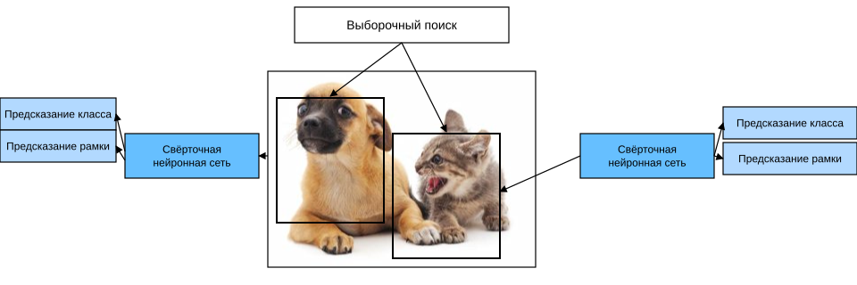
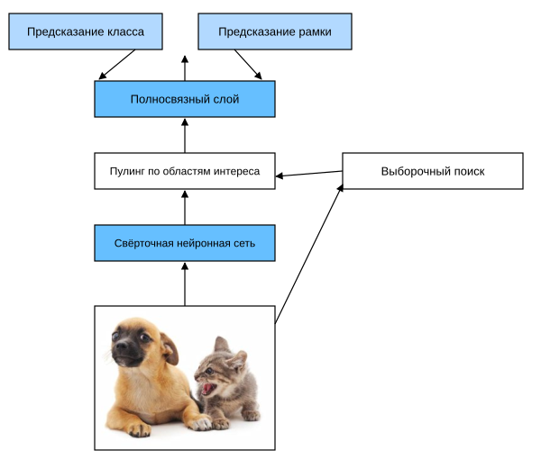
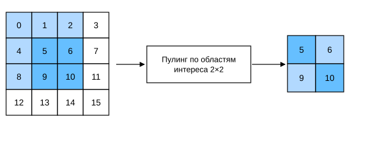
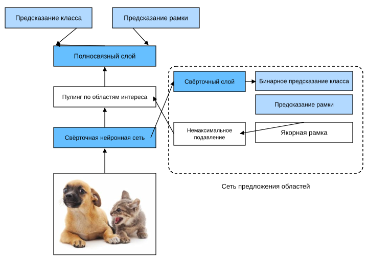
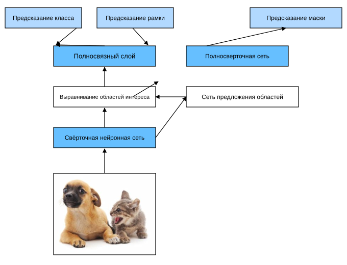

# 13.8 Семейство R-CNN

Помимо одноступенчатого обнаружения с несколькими окнами, описанного в разделе 13.7, область-свёрточные нейронные сети (region-based CNN, или regions with CNN features, R-CNN) :cite:`Girshick.Donahue.Darrell.ea.2014` тоже стали одним из первых шагов в применении глубоких моделей к обнаружению объектов. В этом разделе мы рассмотрим R-CNN и несколько его улучшений: быстрый R-CNN (Fast R-CNN) :cite:`Girshick.2015`, более быстрый R-CNN (Faster R-CNN) :cite:`Ren.He.Girshick.ea.2015` и маскированный R-CNN (Mask R-CNN) :cite:`He.Gkioxari.Dollar.ea.2017`. Из-за ограниченного объёма мы опишем лишь основные идеи этих моделей.

## R-CNN

*R-CNN* сначала выбирает из входного изображения несколько (например, 2000) *предложенных областей* (region proposals). Выбирать их можно и с помощью якорных рамок. Для каждой области задаются класс и ограничивающая рамка (например, смещение) :cite:`Girshick.Donahue.Darrell.ea.2014`. Затем свёрточная нейронная сеть выполняет прямое распространение для каждой предложенной области и извлекает её признаки. Далее по признакам каждой предложенной области предсказываются класс и ограничивающая рамка.



На рис. 13.8.1 показана модель R-CNN. Конкретно, R-CNN включает четыре шага:

1. Применить к входному изображению *выборочный поиск* (selective search), чтобы выбрать несколько качественных предложенных областей :cite:`Uijlings.Van-De-Sande.Gevers.ea.2013`. Такие области обычно выбираются на нескольких масштабах и имеют разную форму и размер. Каждой предложенной области назначаются класс и истинная ограничивающая рамка;
1. Выбрать предобученную свёрточную нейронную сеть и обрезать её перед выходным слоем. Каждую предложенную область привести к размеру, нужному сети, и выполнить прямое распространение, чтобы получить признаки предложенной области;
1. Использовать признаки каждой предложенной области вместе с её размеченным классом как обучающий пример. Обучить несколько метода опорных векторов для классификации объектов, где каждый метод опорных векторов определяет, принадлежит ли пример определённому классу;
1. Использовать признаки каждой предложенной области вместе с её размеченной ограничивающей рамкой как обучающий пример. Обучить модель линейной регрессии, которая предсказывает истинную ограничивающую рамку.

Хотя модель R-CNN эффективно извлекает признаки изображения с помощью предобученной свёрточной сети, она работает медленно. Представим, что из одного изображения выбирается тысяча предложенных областей. Тогда для обнаружения объектов потребуется тысяча прямых проходов свёрточной сети. Такой большой объём вычислений затрудняет широкое применение R-CNN на практике.

## Fast R-CNN

Главное узкое место R-CNN в том, что прямое распространение свёрточной сети для каждой предложенной области выполняется независимо, без совместного использования вычислений. Поскольку эти области часто перекрываются, независимое извлечение признаков приводит к повторным вычислениям. Одно из главных улучшений в *Fast R-CNN* :cite:`Girshick.2015` по сравнению с R-CNN состоит в том, что прямое распространение свёрточной сети выполняется только один раз — для всего изображения.



На рис. 13.8.2 показана модель Fast R-CNN. Её основные вычисления таковы:

1. По сравнению с R-CNN свёрточная сеть, которая извлекает признаки в Fast R-CNN, получает на вход всё изображение, а не отдельные предложенные области. Кроме того, эта сеть обычно обучается вместе с остальной моделью. Пусть входом служит одно изображение, а форма выхода свёрточной сети — $1 \times c \times h_1  \times w_1$;
1. Пусть выборочный поиск выдал $n$ предложенных областей. Эти области разной формы на выходе свёрточной сети задают области интереса (RoI) разной формы. Затем из этих областей интереса нужно извлечь признаки одинаковой формы (например, с заданной высотой $h_2$ и шириной $w_2$), чтобы их можно было объединить на выходе. Для этого Fast R-CNN вводит *пулинг по областям интереса* (RoI pooling): на вход он получает выход свёрточной сети и предложенные области, а на выход выдаёт объединённые признаки каждой предложенной области формы $n \times c \times h_2 \times w_2$;
1. С помощью полносвязного слоя форма выхода приводится к $n \times d$, где гиперпараметр $d$ зависит от архитектуры модели;
1. Для каждой из $n$ предложенных областей предсказываются класс и ограничивающая рамка. Точнее, при предсказании класса и рамки выход полносвязного слоя преобразуется в выход формы $n \times q$ ($q$ — число классов) и выход формы $n \times 4$ соответственно. Классы предсказываются с помощью softmax-регрессии.

Пулинг по областям интереса, введённый в Fast R-CNN, отличается от пулинга из раздела 6.5. В обычном пулинге форма выхода задаётся косвенно — через размер окна, отступ и шаг. Пулинг по областям интереса позволяет напрямую задать форму выхода для каждой области.

Например, зададим высоту и ширину выхода для каждой области равными $h_2$ и $w_2$. Для любой области интереса формы $h \times w$ её делят на сетку подокон $h_2 \times w_2$, где размер каждого подокна примерно равен $(h/h_2) \times (w/w_2)$. На практике высоту и ширину каждого подокна округляют вверх, а максимальный элемент подокна становится его выходом. Поэтому пулинг по областям интереса извлекает признаки одинаковой формы из областей интереса разной формы.

Для иллюстрации на рис. 13.8.3 показан вход $4 \times 4$, из которого мы выбрали область интереса $3\times 3$ в левом верхнем углу. Для этой области с помощью пулинга по областям интереса $2\times 2$ мы получаем выход $2\times 2$. Обратите внимание: четыре разделённых подокна содержат элементы 0, 1, 4, 5 (максимум 5); 2, 6 (максимум 6); 8, 9 (максимум 9); и 10.



Ниже мы показываем, как вычисляется пулинг по областям интереса. Пусть признаки `X`, которые извлекла свёрточная сеть, имеют высоту и ширину 4 и один канал.

**MXNet:**

```python
from mxnet import np, npx

npx.set_np()

X = np.arange(16).reshape(1, 1, 4, 4)
X
```

**PyTorch:**

```python
import torch
import torchvision

X = torch.arange(16.).reshape(1, 1, 4, 4)
X
```

**PaddlePaddle:**

```python
import warnings
warnings.filterwarnings("ignore")
import paddle
import paddle.vision as paddlevision

X = paddle.reshape(paddle.arange(16, dtype='float32'), (1,1,4,4))
X
```

Допустим также, что высота и ширина входного изображения равны 40 пикселям, а выборочный поиск выдал на нём две предложенные области. Каждая область описывается пятью элементами: классом области и координатами $(x, y)$ левого верхнего и правого нижнего углов.

**MXNet:**

```python
rois = np.array([[0, 0, 0, 20, 20], [0, 0, 10, 30, 30]])
```

**PyTorch:**

```python
rois = torch.Tensor([[0, 0, 0, 20, 20], [0, 0, 10, 30, 30]])
```

**PaddlePaddle:**

```python
rois = paddle.to_tensor([[0, 0, 20, 20], [0, 10, 30, 30]]).astype('float32')
```

Поскольку высота и ширина `X` в 10 раз меньше, чем у входного изображения, координаты двух предложенных областей сначала умножаются на `spatial_scale`, равный 0.1. Затем на `X` отмечаются две области интереса `X[:, :, 0:3, 0:3]` и `X[:, :, 1:4, 0:4]`. Наконец, в пулинге по областям интереса $2\times 2$ каждая область делится на сетку подокон, и из неё извлекаются признаки одной и той же формы $2\times 2$.

**MXNet:**

```python
npx.roi_pooling(X, rois, pooled_size=(2, 2), spatial_scale=0.1)
```

**PyTorch:**

```python
torchvision.ops.roi_pool(X, rois, output_size=(2, 2), spatial_scale=0.1)
```

**PaddlePaddle:**

```python
boxes_num = paddle.to_tensor([len(rois)]).astype('int32')
paddlevision.ops.roi_pool(X, rois, boxes_num, output_size=(2, 2), spatial_scale=0.1)
```

## Faster R-CNN

Чтобы точно обнаруживать объекты, модели Fast R-CNN обычно требуется много предложенных областей, которые создаёт выборочный поиск. *Faster R-CNN* :cite:`Ren.He.Girshick.ea.2015` предлагает заменить выборочный поиск на *сеть предложения областей* (region proposal network). Это позволяет уменьшить число предложенных областей и сохранить точность обнаружения.



На рис. 13.8.4 показана модель Faster R-CNN. По сравнению с Fast R-CNN в Faster R-CNN меняется только способ создания предложенных областей: вместо выборочного поиска используется сеть предложения областей, а остальная часть модели остаётся прежней. Конкретно, вычисления в сети предложения областей такие:

1. Преобразовать выход свёрточной сети с помощью свёрточного слоя $3\times 3$ с паддингом 1, а число выходных каналов обозначить $c$. Тогда каждый элемент карты признаков, которую извлекла свёрточная сеть для изображения, получает новый признак длины $c$;
1. С центром в каждом пикселе карты признаков создать несколько якорных рамок разного размера и соотношения сторон и разметить их;
1. По признаку длины $c$ в центральном элементе якорной рамки предсказать её бинарный класс (объект или фон) и ограничивающую рамку;
1. С помощью немаксимального подавления удалить похожие результаты среди предсказанных ограничивающих рамок, класс которых — объект. Оставшиеся предсказанные ограничивающие рамки и являются предложенными областями, которые нужны пулингу по областям интереса.

Стоит отметить, что сеть предложения областей — часть модели Faster R-CNN и обучается вместе со всей моделью. Иными словами, целевая функция Faster R-CNN включает не только предсказание классов и ограничивающих рамок для обнаружения объектов, но и предсказание бинарных классов и ограничивающих рамок якорных рамок в сети предложения областей. В результате сквозного обучения сеть предложения областей учится генерировать качественные предложенные области. Поэтому, даже при меньшем количестве предложенных областей, которые модель получает из данных, точность обнаружения сохраняется.

## Mask R-CNN

Если в обучающем наборе для каждого объекта также размечено его положение на уровне пикселей изображения, то *Mask R-CNN* :cite:`He.Gkioxari.Dollar.ea.2017` может эффективно использовать эту подробную разметку, чтобы дополнительно повысить точность обнаружения.



Как показано на рис. 13.8.5, Mask R-CNN построена на основе Faster R-CNN. Конкретно, Mask R-CNN заменяет пулинг по областям интереса на слой *выравнивания областей интереса* (RoI align), который использует *билинейную интерполяцию* (bilinear interpolation), чтобы сохранить пространственную информацию карты признаков. Это делает модель более пригодной для предсказаний на уровне пикселей. Выход слоя выравнивания содержит признаки одинаковой формы для всех областей интереса. Они используются не только для предсказания класса и ограничивающей рамки каждой области интереса, но и для предсказания положения объекта на уровне пикселей с помощью дополнительной полностью свёрточной сети. Следующие разделы главы подробнее расскажут, как с помощью полностью свёрточных сетей предсказывать семантику на уровне пикселей изображения.

## Резюме

* R-CNN выбирает из изображения несколько предложенных областей, для каждой из них выполняет прямое распространение свёрточной сети, чтобы извлечь признаки, а затем по этим признакам предсказывает класс и ограничивающую рамку предложенной области.
* Fast R-CNN — главное улучшение R-CNN: прямое распространение свёрточной сети выполняется только для всего изображения. Кроме того, он вводит пулинг по областям интереса, который извлекает признаки одинаковой формы из областей интереса разной формы.
* Faster R-CNN заменяет выборочный поиск из Fast R-CNN на обучаемую сеть предложения областей. Благодаря этому число предложенных областей уменьшается, а точность обнаружения сохраняется.
* Mask R-CNN добавляет к Faster R-CNN полностью свёрточную сеть, которая использует положения объектов на уровне пикселей и дополнительно повышает точность обнаружения.

## Упражнения

1. Можно ли рассматривать обнаружение объектов как задачу регрессии, например предсказывать ограничивающие рамки и вероятности классов? Можно опереться на архитектуру YOLO :cite:`Redmon.Divvala.Girshick.ea.2016`.
1. Сравните одноступенчатое обнаружение с несколькими окнами и методы из этого раздела. В чём их главное различие? Можно посмотреть рисунок 2 в статье :cite:`Zhao.Zheng.Xu.ea.2019`.

**MXNet:**
[Обсуждение](https://discuss.d2l.ai/t/3206)

**PyTorch:**
[Обсуждение](https://discuss.d2l.ai/t/3207)

**PaddlePaddle:**
[Обсуждение](https://discuss.d2l.ai/t/11808)
