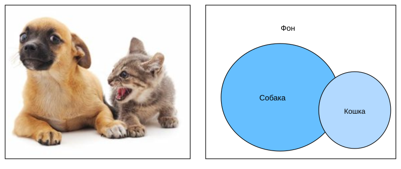

# 13.9 Семантическая сегментация и набор данных

В задачах обнаружения объектов, которые обсуждались в разделах 13.3–13.8, мы всегда размечали и предсказывали объекты на изображении с помощью прямоугольных ограничивающих рамок. Этот раздел посвящён *семантической сегментации* (semantic segmentation): она делит изображение на области, которые относятся к разным семантическим классам. В отличие от обнаружения объектов, семантическая сегментация распознаёт и понимает содержимое каждого пикселя изображения: разметка и предсказание семантических областей выполняются на уровне пикселей. На рис. 13.9.1 показана разметка изображения для семантической сегментации с классами «собака», «кошка» и «фон». По сравнению с обнаружением объектов пиксельные границы, которые задаёт сегментация, заметно точнее.



**Рис. 13.9.1.** Разметка для семантической сегментации изображения с классами «собака», «кошка» и «фон»

## 13.9.1 Сегментация изображений и сегментация экземпляров

В компьютерном зрении есть ещё две важные задачи, близкие к семантической сегментации: *сегментация изображений* (image segmentation) и *сегментация экземпляров* (instance segmentation). Коротко различим их с семантической сегментацией.

* *Сегментация изображений* делит изображение на составляющие области. Методы этой задачи обычно используют связи между пикселями изображения. При обучении им не нужна разметка пикселей, а при предсказании нельзя гарантировать, что выделенные области будут иметь нужный нам смысл. Если взять изображение с рис. 13.9.1 как вход, сегментация изображений может разделить собаку на две области: одну, где преобладают чёрный цвет (нос и глаза), и другую, где преобладает жёлтый (остальное тело).
* *Сегментация экземпляров*, или *одновременное обнаружение и сегментация* (simultaneous detection and segmentation), изучает, как выделять на уровне пикселей области отдельных экземпляров объектов на изображении. В отличие от семантической сегментации, сегментация экземпляров различает не только семантические классы, но и отдельные экземпляры объектов. Например, если на изображении две собаки, сегментация экземпляров должна определить, какой из двух собак принадлежит каждый пиксель.

## 13.9.2 Набор данных семантической сегментации Pascal VOC2012

**Один из важнейших наборов данных для семантической сегментации — [Pascal VOC2012](http://host.robots.ox.ac.uk/pascal/VOC/voc2012/).** Ниже мы подробнее рассмотрим этот набор.

**MXNet:**

```python
%matplotlib inline
from d2l import mxnet as d2l
from mxnet import gluon, image, np, npx
import os

npx.set_np()
```

**PyTorch:**

```python
%matplotlib inline
from d2l import torch as d2l
import torch
import torchvision
import os
```

**PaddlePaddle:**

```python
%matplotlib inline
from d2l import paddle as d2l
import warnings
warnings.filterwarnings("ignore")
import paddle
import paddle.vision as paddlevision
import os
```

Архив набора данных весит около 2 ГБ, поэтому загрузка может занять некоторое время. Распакованный набор находится в `../data/VOCdevkit/VOC2012`.

```python
#@save
d2l.DATA_HUB['voc2012'] = (d2l.DATA_URL + 'VOCtrainval_11-May-2012.tar',
                           '4e443f8a2eca6b1dac8a6c57641b67dd40621a49')

voc_dir = d2l.download_extract('voc2012', 'VOCdevkit/VOC2012')
```

В каталоге `../data/VOCdevkit/VOC2012` находятся различные компоненты набора данных. Каталог `ImageSets/Segmentation` содержит текстовые файлы с перечнями обучающих и тестовых примеров, а каталоги `JPEGImages` и `SegmentationClass` хранят входные изображения и метки каждого примера соответственно. Метки здесь тоже представлены в виде изображений того же размера, что и размеченное входное изображение. Кроме того, пиксели одного цвета на метке принадлежат одному семантическому классу. Функция `read_voc_images` ниже **читает все входные изображения и метки в память**.

**MXNet:**

```python
#@save
def read_voc_images(voc_dir, is_train=True):
    """Читает все изображения VOC и их разметку"""
    txt_fname = os.path.join(voc_dir, 'ImageSets', 'Segmentation',
                             'train.txt' if is_train else 'val.txt')
    with open(txt_fname, 'r') as f:
        images = f.read().split()
    features, labels = [], []
    for i, fname in enumerate(images):
        features.append(image.imread(os.path.join(
            voc_dir, 'JPEGImages', f'{fname}.jpg')))
        labels.append(image.imread(os.path.join(
            voc_dir, 'SegmentationClass', f'{fname}.png')))
    return features, labels

train_features, train_labels = read_voc_images(voc_dir, True)
```

**PyTorch:**

```python
#@save
def read_voc_images(voc_dir, is_train=True):
    """Читает все изображения VOC и их разметку"""
    txt_fname = os.path.join(voc_dir, 'ImageSets', 'Segmentation',
                             'train.txt' if is_train else 'val.txt')
    mode = torchvision.io.image.ImageReadMode.RGB
    with open(txt_fname, 'r') as f:
        images = f.read().split()
    features, labels = [], []
    for i, fname in enumerate(images):
        features.append(torchvision.io.read_image(os.path.join(
            voc_dir, 'JPEGImages', f'{fname}.jpg')))
        labels.append(torchvision.io.read_image(os.path.join(
            voc_dir, 'SegmentationClass' ,f'{fname}.png'), mode))
    return features, labels

train_features, train_labels = read_voc_images(voc_dir, True)
```

**PaddlePaddle:**

```python
#@save
def read_voc_images(voc_dir, is_train=True):
    """Читает все изображения VOC и их разметку"""
    txt_fname = os.path.join(voc_dir, 'ImageSets', 'Segmentation',
                             'train.txt' if is_train else 'val.txt')
    with open(txt_fname, 'r') as f:
        images = f.read().split()
    features, labels = [], []
    for i, fname in enumerate(images):
        features.append(paddle.vision.image.image_load(os.path.join(
            voc_dir, 'JPEGImages', f'{fname}.jpg'), backend='cv2')[..., ::-1].transpose(
            [2, 0, 1]))
        labels.append(paddle.vision.image.image_load(os.path.join(
            voc_dir, 'SegmentationClass', f'{fname}.png'), backend='cv2')[..., ::-1].transpose(
            [2, 0, 1]))
    return features, labels

train_features, train_labels = read_voc_images(voc_dir, True)
```

Ниже мы **рисуем первые 5 входных изображений и их метки**. На метках белый и чёрный цвета обозначают границы и фон, а остальные цвета соответствуют разным классам.

**MXNet:**

```python
n = 5
imgs = train_features[0:n] + train_labels[0:n]
d2l.show_images(imgs, 2, n);
```

**PyTorch:**

```python
n = 5
imgs = train_features[0:n] + train_labels[0:n]
imgs = [img.permute(1,2,0) for img in imgs]
d2l.show_images(imgs, 2, n);
```

**PaddlePaddle:**

```python
n = 5
imgs = train_features[0:n] + train_labels[0:n]
imgs = [img.transpose([1, 2, 0]) for img in imgs]
d2l.show_images(imgs, 2, n);
```

Далее **перечислим значения цветов RGB и названия классов**.

```python
#@save
VOC_COLORMAP = [[0, 0, 0], [128, 0, 0], [0, 128, 0], [128, 128, 0],
                [0, 0, 128], [128, 0, 128], [0, 128, 128], [128, 128, 128],
                [64, 0, 0], [192, 0, 0], [64, 128, 0], [192, 128, 0],
                [64, 0, 128], [192, 0, 128], [64, 128, 128], [192, 128, 128],
                [0, 64, 0], [128, 64, 0], [0, 192, 0], [128, 192, 0],
                [0, 64, 128]]

#@save
VOC_CLASSES = ['background', 'aeroplane', 'bicycle', 'bird', 'boat',
               'bottle', 'bus', 'car', 'cat', 'chair', 'cow',
               'diningtable', 'dog', 'horse', 'motorbike', 'person',
               'potted plant', 'sheep', 'sofa', 'train', 'tv/monitor']
```

С помощью этих двух констант можно удобно **найти индекс класса для каждого пикселя метки**. Мы определяем функцию `voc_colormap2label`, которая строит отображение из указанных выше значений RGB в индекс класса, и функцию `voc_label_indices`, которая отображает значения RGB меток набора Pascal VOC2012 в индексы классов.

**MXNet:**

```python
#@save
def voc_colormap2label():
    """Строит отображение из RGB в индекс класса VOC"""
    colormap2label = np.zeros(256 ** 3)
    for i, colormap in enumerate(VOC_COLORMAP):
        colormap2label[
            (colormap[0] * 256 + colormap[1]) * 256 + colormap[2]] = i
    return colormap2label

#@save
def voc_label_indices(colormap, colormap2label):
    """Отображает значения RGB в метках VOC в их индексы классов"""
    colormap = colormap.astype(np.int32)
    idx = ((colormap[:, :, 0] * 256 + colormap[:, :, 1]) * 256
           + colormap[:, :, 2])
    return colormap2label[idx]
```

**PyTorch:**

```python
#@save
def voc_colormap2label():
    """Строит отображение из RGB в индекс класса VOC"""
    colormap2label = torch.zeros(256 ** 3, dtype=torch.long)
    for i, colormap in enumerate(VOC_COLORMAP):
        colormap2label[
            (colormap[0] * 256 + colormap[1]) * 256 + colormap[2]] = i
    return colormap2label

#@save
def voc_label_indices(colormap, colormap2label):
    """Отображает значения RGB в метках VOC в их индексы классов"""
    colormap = colormap.permute(1, 2, 0).numpy().astype('int32')
    idx = ((colormap[:, :, 0] * 256 + colormap[:, :, 1]) * 256
           + colormap[:, :, 2])
    return colormap2label[idx]
```

**PaddlePaddle:**

```python
#@save
def voc_colormap2label():
    """Строит отображение из RGB в индекс класса VOC"""
    colormap2label = paddle.zeros([256 ** 3], dtype=paddle.int64)
    for i, colormap in enumerate(VOC_COLORMAP):
        colormap2label[
            (colormap[0] * 256 + colormap[1]) * 256 + colormap[2]] = i
    return colormap2label
    
#@save
def voc_label_indices(colormap, colormap2label):
    """Отображает значения RGB в метках VOC в их индексы классов"""
    colormap = colormap.transpose([1, 2, 0]).astype('int32')
    idx = ((colormap[:, :, 0] * 256 + colormap[:, :, 1]) * 256
           + colormap[:, :, 2])
    return colormap2label[idx]
```

**Например**, на первом примере изображения индекс класса для головы самолёта равен 1, а индекс фона равен 0.

```python
y = voc_label_indices(train_labels[0], voc_colormap2label())
y[105:115, 130:140], VOC_CLASSES[1]
```

### 13.9.2.1 Предобработка данных

В предыдущих экспериментах, например в разделах 7.1–7.4, мы масштабировали изображения так, чтобы они соответствовали входной форме модели. В семантической сегментации такой подход требует пересчитывать предсказанные классы пикселей обратно к исходному размеру входного изображения. Такое отображение может быть недостаточно точным, особенно для областей разных семантических классов. Чтобы избежать этой проблемы, мы не масштабируем изображения, а обрезаем их до фиксированного размера. Конкретно, мы **используем случайную обрезку из раздела 13.1, обрезая одну и ту же область входного изображения и метки**.

**MXNet:**

```python
#@save
def voc_rand_crop(feature, label, height, width):
    """Случайно обрезает признаки и метку"""
    feature, rect = image.random_crop(feature, (width, height))
    label = image.fixed_crop(label, *rect)
    return feature, label
```

**PyTorch:**

```python
#@save
def voc_rand_crop(feature, label, height, width):
    """Случайно обрезает признаки и метку"""
    rect = torchvision.transforms.RandomCrop.get_params(
        feature, (height, width))
    feature = torchvision.transforms.functional.crop(feature, *rect)
    label = torchvision.transforms.functional.crop(label, *rect)
    return feature, label
```

**PaddlePaddle:**

```python
#@save
def voc_rand_crop(feature, label, height, width):
    """Случайно обрезает признаки и метку"""
    rect = paddle.vision.transforms.RandomCrop((height, width))._get_param(
        img=feature, output_size=(height, width))
    feature = paddle.vision.transforms.crop(feature, *rect)
    label = paddle.vision.transforms.crop(label, *rect)
    return feature, label
```

**MXNet:**

```python
imgs = []
for _ in range(n):
    imgs += voc_rand_crop(train_features[0], train_labels[0], 200, 300)
d2l.show_images(imgs[::2] + imgs[1::2], 2, n);
```

**PyTorch:**

```python
imgs = []
for _ in range(n):
    imgs += voc_rand_crop(train_features[0], train_labels[0], 200, 300)

imgs = [img.permute(1, 2, 0) for img in imgs]
d2l.show_images(imgs[::2] + imgs[1::2], 2, n);
```

**PaddlePaddle:**

```python
imgs = []
for _ in range(n):
    imgs += voc_rand_crop(train_features[0].transpose([1, 2, 0]), train_labels[0].transpose([1, 2, 0]), 200, 300)
    
imgs = [img for img in imgs]
d2l.show_images(imgs[::2] + imgs[1::2], 2, n);
```

### 13.9.2.2 Собственный класс набора данных для семантической сегментации

Мы наследуем класс `Dataset` из высокоуровневого API и определяем собственный класс набора данных для семантической сегментации `VOCSegDataset`. Реализуя функцию `__getitem__`, мы можем получить доступ к входному изображению с индексом `idx` и к индексам классов его пикселей. Поскольку некоторые изображения набора могут быть меньше, чем размер случайной обрезки, такие примеры удаляются с помощью собственной функции `filter`. Кроме того, мы определяем функцию `normalize_image`, которая стандартизирует значения трёх каналов RGB входного изображения.

**MXNet:**

```python
#@save
class VOCSegDataset(gluon.data.Dataset):
    """Пользовательский набор данных для загрузки VOC"""
    def __init__(self, is_train, crop_size, voc_dir):
        self.rgb_mean = np.array([0.485, 0.456, 0.406])
        self.rgb_std = np.array([0.229, 0.224, 0.225])
        self.crop_size = crop_size
        features, labels = read_voc_images(voc_dir, is_train=is_train)
        self.features = [self.normalize_image(feature)
                         for feature in self.filter(features)]
        self.labels = self.filter(labels)
        self.colormap2label = voc_colormap2label()
        print('прочитано ' + str(len(self.features)) + ' примеров')

    def normalize_image(self, img):
        return (img.astype('float32') / 255 - self.rgb_mean) / self.rgb_std

    def filter(self, imgs):
        return [img for img in imgs if (
            img.shape[0] >= self.crop_size[0] and
            img.shape[1] >= self.crop_size[1])]

    def __getitem__(self, idx):
        feature, label = voc_rand_crop(self.features[idx], self.labels[idx],
                                       *self.crop_size)
        return (feature.transpose(2, 0, 1),
                voc_label_indices(label, self.colormap2label))

    def __len__(self):
        return len(self.features)
```

**PyTorch:**

```python
#@save
class VOCSegDataset(torch.utils.data.Dataset):
    """Пользовательский набор данных для загрузки VOC"""

    def __init__(self, is_train, crop_size, voc_dir):
        self.transform = torchvision.transforms.Normalize(
            mean=[0.485, 0.456, 0.406], std=[0.229, 0.224, 0.225])
        self.crop_size = crop_size
        features, labels = read_voc_images(voc_dir, is_train=is_train)
        self.features = [self.normalize_image(feature)
                         for feature in self.filter(features)]
        self.labels = self.filter(labels)
        self.colormap2label = voc_colormap2label()
        print('прочитано ' + str(len(self.features)) + ' примеров')

    def normalize_image(self, img):
        return self.transform(img.float() / 255)

    def filter(self, imgs):
        return [img for img in imgs if (
            img.shape[1] >= self.crop_size[0] and
            img.shape[2] >= self.crop_size[1])]

    def __getitem__(self, idx):
        feature, label = voc_rand_crop(self.features[idx], self.labels[idx],
                                       *self.crop_size)
        return (feature, voc_label_indices(label, self.colormap2label))

    def __len__(self):
        return len(self.features)
```

**PaddlePaddle:**

```python
#@save
class VOCSegDataset(paddle.io.Dataset):
    """Пользовательский набор данных для загрузки VOC"""

    def __init__(self, is_train, crop_size, voc_dir):
        self.transform = paddle.vision.transforms.Normalize(
            mean=[0.485, 0.456, 0.406], std=[0.229, 0.224, 0.225])
        self.crop_size = crop_size
        features, labels = read_voc_images(voc_dir, is_train=is_train)
        self.features = [self.normalize_image(feature)
                         for feature in self.filter(features)]
        self.labels = self.filter(labels)
        self.colormap2label = voc_colormap2label()
        print('прочитано ' + str(len(self.features)) + ' примеров')

    def normalize_image(self, img):
        return self.transform(img.astype("float32") / 255)

    def filter(self, imgs):
        return [img for img in imgs if (
            img.shape[1] >= self.crop_size[0] and
            img.shape[2] >= self.crop_size[1])]

    def __getitem__(self, idx):
        feature = paddle.to_tensor(self.features[idx],dtype='float32')
        label = paddle.to_tensor(self.labels[idx],dtype='float32')
        feature, label = voc_rand_crop(feature,label,
                                       *self.crop_size)
        return (feature, voc_label_indices(label, self.colormap2label))

    def __len__(self):
        return len(self.features)
```

### 13.9.2.3 Чтение набора данных

С помощью класса `VOCSegDataset` мы создаём отдельные экземпляры для обучающего и тестового наборов. Допустим, что размер случайно обрезанного выходного изображения равен $320\times 480$. Тогда мы можем посмотреть, сколько примеров осталось в обучающем и тестовом наборах.

```python
crop_size = (320, 480)
voc_train = VOCSegDataset(True, crop_size, voc_dir)
voc_test = VOCSegDataset(False, crop_size, voc_dir)
```

Задав размер батча 64, создадим итератор для обучающего набора. Если вывести форму первого минибатча, видно, что в отличие от классификации изображений или обнаружения объектов метки здесь представляют собой трёхмерный массив.

**MXNet:**

```python
batch_size = 64
train_iter = gluon.data.DataLoader(voc_train, batch_size, shuffle=True,
                                   last_batch='discard',
                                   num_workers=d2l.get_dataloader_workers())
for X, Y in train_iter:
    print(X.shape)
    print(Y.shape)
    break
```

**PyTorch:**

```python
batch_size = 64
train_iter = torch.utils.data.DataLoader(voc_train, batch_size, shuffle=True,
                                    drop_last=True,
                                    num_workers=d2l.get_dataloader_workers())
for X, Y in train_iter:
    print(X.shape)
    print(Y.shape)
    break
```

**PaddlePaddle:**

```python
batch_size = 64
train_iter = paddle.io.DataLoader(voc_train, batch_size=batch_size, shuffle=True,
                                  drop_last=True,
                                  return_list=True,
                                  num_workers=d2l.get_dataloader_workers())
for X, Y in train_iter:
    print(X.shape)
    print(Y.shape)
    break
```

### 13.9.2.4 Сборка всех компонентов

Наконец, определим функцию `load_data_voc`, которая загружает и читает набор данных Pascal VOC2012 для семантической сегментации. Она возвращает итераторы данных для обучающего и тестового наборов.

**MXNet:**

```python
#@save
def load_data_voc(batch_size, crop_size):
    """Загружает набор данных VOC для семантической сегментации"""
    voc_dir = d2l.download_extract('voc2012', os.path.join(
        'VOCdevkit', 'VOC2012'))
    num_workers = d2l.get_dataloader_workers()
    train_iter = gluon.data.DataLoader(
        VOCSegDataset(True, crop_size, voc_dir), batch_size,
        shuffle=True, last_batch='discard', num_workers=num_workers)
    test_iter = gluon.data.DataLoader(
        VOCSegDataset(False, crop_size, voc_dir), batch_size,
        last_batch='discard', num_workers=num_workers)
    return train_iter, test_iter
```

**PyTorch:**

```python
#@save
def load_data_voc(batch_size, crop_size):
    """Загружает набор данных VOC для семантической сегментации"""
    voc_dir = d2l.download_extract('voc2012', os.path.join(
        'VOCdevkit', 'VOC2012'))
    num_workers = d2l.get_dataloader_workers()
    train_iter = torch.utils.data.DataLoader(
        VOCSegDataset(True, crop_size, voc_dir), batch_size,
        shuffle=True, drop_last=True, num_workers=num_workers)
    test_iter = torch.utils.data.DataLoader(
        VOCSegDataset(False, crop_size, voc_dir), batch_size,
        drop_last=True, num_workers=num_workers)
    return train_iter, test_iter
```

**PaddlePaddle:**

```python
#@save
def load_data_voc(batch_size, crop_size):
    """Загружает набор данных VOC для семантической сегментации"""
    voc_dir = d2l.download_extract('voc2012', os.path.join(
        'VOCdevkit', 'VOC2012'))
    num_workers = d2l.get_dataloader_workers()
    train_iter = paddle.io.DataLoader(
        VOCSegDataset(True, crop_size, voc_dir), batch_size=batch_size,
        shuffle=True, return_list=True, drop_last=True, num_workers=num_workers)
    test_iter = paddle.io.DataLoader(
        VOCSegDataset(False, crop_size, voc_dir), batch_size=batch_size,
        drop_last=True, return_list=True, num_workers=num_workers)
    return train_iter, test_iter
```

## Резюме

* Семантическая сегментация делит изображение на области, принадлежащие разным семантическим классам, и распознаёт содержимое изображения на уровне пикселей.
* Важный набор данных для семантической сегментации называется Pascal VOC2012.
* Поскольку входное изображение и метка при семантической сегментации соответствуют друг другу пиксель в пиксель, входное изображение обрезается до фиксированного размера, а не масштабируется.

## Упражнения

1. Как можно применить семантическую сегментацию в беспилотных автомобилях и в диагностике по медицинским изображениям? Можете ли вы назвать другие области применения?
1. Вспомните описание аугментации данных в разделе 13.1. Какой из методов аугментации изображений, используемых в классификации, трудно применить в семантической сегментации?

**MXNet:**
[Обсуждение](https://discuss.d2l.ai/t/3296)

**PyTorch:**
[Обсуждение](https://discuss.d2l.ai/t/3295)

**PaddlePaddle:**
[Обсуждение](https://discuss.d2l.ai/t/11809)
