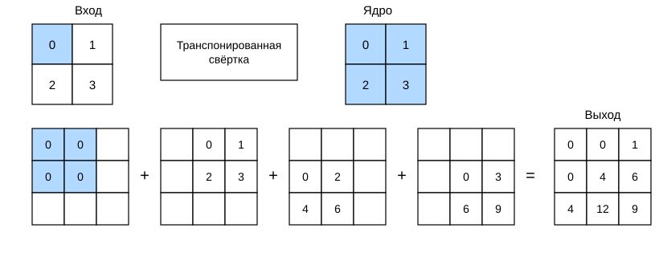
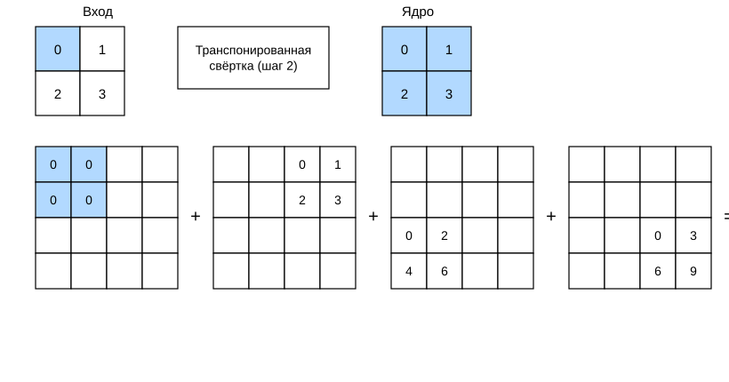

# 13.10 Транспонированная свёртка

Слои свёрточных нейронных сетей, которые мы рассматривали до сих пор, например свёрточные слои (раздел 6.2) и слои пулинга (раздел 6.5), обычно уменьшают пространственные размеры (высоту и ширину) входного изображения. Однако при семантической сегментации, где классификация выполняется на уровне пикселей, удобно, когда размеры входа и выхода совпадают. Например, канал выхода в каждой позиции может содержать результат классификации входного пикселя в той же позиции.

Чтобы этого добиться, особенно после того как пространственные размеры уменьшены слоями свёрточной сети, можно использовать другой тип слоя, который увеличивает пространственные размеры промежуточных карт признаков. В этом разделе мы рассмотрим *транспонированную свёртку* (transposed convolution) (Dumoulin and Visin, 2016), которая обращает уменьшение пространственных размеров, вызванное уменьшением выборки.

**MXNet:**

```python
from mxnet import np, npx, init
from mxnet.gluon import nn
from d2l import mxnet as d2l

npx.set_np()
```

**PyTorch:**

```python
import torch
from torch import nn
from d2l import torch as d2l
```

**PaddlePaddle:**

```python
from d2l import paddle as d2l
import paddle
from paddle import nn
```

## Базовая операция

Временно игнорируем каналы и начнём с базовой транспонированной свёртки с шагом 1 и без паддинга. Пусть есть входной тензор размера $n_h \times n_w$ и ядро свёртки размера $k_h \times k_w$. Сдвигая окно ядра с шагом 1, $n_w$ раз в каждой строке и $n_h$ раз в каждом столбце, мы получаем $n_h n_w$ промежуточных результатов. Каждый промежуточный результат — тензор размера $(n_h + k_h - 1) \times (n_w + k_w - 1)$, заполненный нулями в начале. Чтобы вычислить каждый промежуточный тензор, каждый элемент входного тензора умножается на ядро, и полученный тензор $k_h \times k_w$ записывается в соответствующую часть промежуточного тензора. Заметим, что положение этой части в промежуточном тензоре соответствует положению элемента во входном тензоре. Наконец, все промежуточные результаты складываются, и получается итоговый результат.

Например, на рис. 13.10.1 показано, как вычислить транспонированную свёртку с ядром $2\times 2$ для входного тензора $2\times 2$.



Выполним базовую операцию транспонированной свёртки для входной матрицы `X` и матрицы ядра `K` с помощью функции `trans_conv`.

```python
def trans_conv(X, K):
    h, w = K.shape
    Y = d2l.zeros((X.shape[0] + h - 1, X.shape[1] + w - 1))
    for i in range(X.shape[0]):
        for j in range(X.shape[1]):
            Y[i: i + h, j: j + w] += X[i, j] * K
    return Y
```

В отличие от обычной свёртки, которая «уменьшает» входные элементы с помощью ядра (раздел 6.2), транспонированная свёртка «распространяет» входные элементы с помощью ядра и тем самым даёт выход больше входа. Мы можем **проверить вывод этой реализации**, построив входной тензор `X` и тензор ядра `K` как на рис. 13.10.1. Эта реализация — базовая двумерная транспонированная свёртка.

```python
X = d2l.tensor([[0.0, 1.0], [2.0, 3.0]])
K = d2l.tensor([[0.0, 1.0], [2.0, 3.0]])
trans_conv(X, K)
```

Кроме того, если входной тензор `X` и ядро `K` — четырёхмерные тензоры, **можно получить тот же результат с помощью высокоуровневого API**.

**MXNet:**

```python
X, K = X.reshape(1, 1, 2, 2), K.reshape(1, 1, 2, 2)
tconv = nn.Conv2DTranspose(1, kernel_size=2)
tconv.initialize(init.Constant(K))
tconv(X)
```

**PyTorch:**

```python
X, K = X.reshape(1, 1, 2, 2), K.reshape(1, 1, 2, 2)
tconv = nn.ConvTranspose2d(1, 1, kernel_size=2, bias=False)
tconv.weight.data = K
tconv(X)
```

**PaddlePaddle:**

```python
X, K = X.reshape([1, 1, 2, 2]), K.reshape([1, 1, 2, 2])
tconv = nn.Conv2DTranspose(1, 1, kernel_size=2, bias_attr=False)
K = paddle.create_parameter(shape=K.shape, dtype="float32", 
        default_initializer=paddle.nn.initializer.Assign(K))
tconv.weight = K
tconv(X)
```

## **Заполнение, шаг и многоканальность**

В отличие от обычной свёртки, в транспонированной свёртке паддинг применяется к выходу (в обычной свёртке — к входу). Например, если задать паддинг по высоте и ширине равным 1, то первая и последняя строки и столбцы выхода транспонированной свёртки удаляются.

**MXNet:**

```python
tconv = nn.Conv2DTranspose(1, kernel_size=2, padding=1)
tconv.initialize(init.Constant(K))
tconv(X)
```

**PyTorch:**

```python
tconv = nn.ConvTranspose2d(1, 1, kernel_size=2, padding=1, bias=False)
tconv.weight.data = K
tconv(X)
```

**PaddlePaddle:**

```python
tconv = nn.Conv2DTranspose(1, 1, kernel_size=2, padding=1, bias_attr=False)
tconv.weight = K
tconv(X)
```

В транспонированной свёртке шаг задаётся для промежуточного результата (выхода), а не для входа. Используем те же входной тензор и тензор ядра, что и на рис. 13.10.1, и изменим шаг с 1 на 2. Это увеличивает высоту и ширину промежуточного тензора, поэтому выходной тензор показан на рис. 13.10.2.



Следующий код проверяет выход транспонированной свёртки с шагом 2 из рис. 13.10.2.

**MXNet:**

```python
tconv = nn.Conv2DTranspose(1, kernel_size=2, strides=2)
tconv.initialize(init.Constant(K))
tconv(X)
```

**PyTorch:**

```python
tconv = nn.ConvTranspose2d(1, 1, kernel_size=2, stride=2, bias=False)
tconv.weight.data = K
tconv(X)
```

**PaddlePaddle:**

```python
tconv = nn.Conv2DTranspose(1, 1, kernel_size=2, stride=2, bias_attr=False)
tconv.weight = K
tconv(X)
```

Для нескольких входных и выходных каналов транспонированная свёртка работает так же, как обычная. Пусть вход имеет $c_i$ каналов, и транспонированная свёртка назначает каждому входному каналу тензор ядра $k_h\times k_w$. Если задано несколько выходных каналов, то для каждого выходного канала будет ядро размера $c_i\times k_h\times k_w$.

Аналогично, если подать $\mathsf{X}$ на вход свёрточного слоя $f$, получить выход $\mathsf{Y}=f(\mathsf{X})$ и создать транспонированный свёрточный слой $g$ с теми же гиперпараметрами, но с числом выходных каналов, равным числу каналов в $\mathsf{X}$, то форма $g(Y)$ совпадёт с формой $\mathsf{X}$. Следующий пример это иллюстрирует.

**MXNet:**

```python
X = np.random.uniform(size=(1, 10, 16, 16))
conv = nn.Conv2D(20, kernel_size=5, padding=2, strides=3)
tconv = nn.Conv2DTranspose(10, kernel_size=5, padding=2, strides=3)
conv.initialize()
tconv.initialize()
tconv(conv(X)).shape == X.shape
```

**PyTorch:**

```python
X = torch.rand(size=(1, 10, 16, 16))
conv = nn.Conv2d(10, 20, kernel_size=5, padding=2, stride=3)
tconv = nn.ConvTranspose2d(20, 10, kernel_size=5, padding=2, stride=3)
tconv(conv(X)).shape == X.shape
```

**PaddlePaddle:**

```python
X = paddle.rand(shape=(1, 10, 16, 16))
conv = nn.Conv2D(10, 20, kernel_size=5, padding=2, stride=3)
tconv = nn.Conv2DTranspose(20, 10, kernel_size=5, padding=2, stride=3)
tconv(conv(X)).shape == X.shape
```

## **Связь с матричным транспонированием**

Почему транспонированная свёртка получила название от матричного транспонирования? Сначала посмотрим, как реализовать свёртку с помощью матричного умножения. В приведённом ниже примере мы задаём входной тензор `X` размера $3\times 3$ и ядро `K` размера $2\times 2$, а затем с помощью функции `corr2d` вычисляем выход свёртки `Y`.

**MXNet, PyTorch:**

```python
X = d2l.arange(9.0).reshape(3, 3)
K = d2l.tensor([[1.0, 2.0], [3.0, 4.0]])
Y = d2l.corr2d(X, K)
Y
```

**PaddlePaddle:**

```python
X = d2l.arange(9.0, dtype="float32").reshape((3, 3))
K = d2l.tensor([[1.0, 2.0], [3.0, 4.0]])
Y = d2l.corr2d(X, K)
Y
```

Далее перепишем ядро `K` в виде разреженной весовой матрицы `W`, в которой много нулей. Форма весовой матрицы равна (4, 9), а ненулевые элементы берутся из ядра `K`.

**MXNet, PyTorch:**

```python
def kernel2matrix(K):
    k, W = d2l.zeros(5), d2l.zeros((4, 9))
    k[:2], k[3:5] = K[0, :], K[1, :]
    W[0, :5], W[1, 1:6], W[2, 3:8], W[3, 4:] = k, k, k, k
    return W

W = kernel2matrix(K)
W
```

**PaddlePaddle:**

```python
def kernel2matrix(K):
    k, W = d2l.zeros([5]), d2l.zeros((4, 9))
    k[:2], k[3:5] = K[0, :], K[1, :]
    W[0, :5], W[1, 1:6], W[2, 3:8], W[3, 4:] = k, k, k, k
    return W

W = kernel2matrix(K)
W
```

Входной тензор `X` построчно преобразуется в вектор длины 9. Затем умножение матрицы `W` на векторизованный `X` даёт вектор длины 4. После изменения его формы получается тот же результат `Y`, что и при исходной свёртке: мы только что реализовали свёртку с помощью матричного умножения.

**MXNet, PyTorch:**

```python
Y == d2l.matmul(W, d2l.reshape(X, -1)).reshape(2, 2)
```

**PaddlePaddle:**

```python
Y == d2l.matmul(W, d2l.reshape(X, [-1])).reshape((2, 2))
```

Аналогично можно реализовать транспонированную свёртку с помощью матричного умножения. В следующем примере мы берём выход `Y` обычной свёртки $2 \times 2$ выше в качестве входа транспонированной свёртки. Чтобы реализовать её матричным умножением, достаточно транспонировать матрицу весов `W` до формы (9, 4).

**MXNet, PyTorch:**

```python
Z = trans_conv(Y, K)
Z == d2l.matmul(W.T, d2l.reshape(Y, -1)).reshape(3, 3)
```

**PaddlePaddle:**

```python
Z = trans_conv(Y, K)
Z == d2l.matmul(W.T, d2l.reshape(Y, [-1])).reshape((3, 3))
```

В общем виде, для входного вектора $\mathbf{x}$ и матрицы весов $\mathbf{W}$ прямое распространение свёртки можно реализовать как умножение входа на матрицу весов, выдающее вектор $\mathbf{y}=\mathbf{W}\mathbf{x}$. Поскольку обратное распространение следует правилу цепочки и $\nabla_{\mathbf{x}}\mathbf{y}=\mathbf{W}^\top$, обратное распространение свёртки можно реализовать как умножение входа на транспонированную матрицу весов $\mathbf{W}^\top$. Поэтому транспонированный свёрточный слой может поменять местами прямое и обратное распространение обычного свёрточного слоя: его прямое и обратное распространение умножают входной вектор на $\mathbf{W}^\top$ и $\mathbf{W}$ соответственно.

## Резюме

* В отличие от обычной свёртки, которая уменьшает входные элементы с помощью ядра, транспонированная свёртка распространяет входные элементы с помощью ядра и тем самым даёт выход, форма которого больше формы входа.
* Если подать $\mathsf{X}$ на вход свёрточного слоя $f$, получить выход $\mathsf{Y}=f(\mathsf{X})$ и создать транспонированный свёрточный слой $g$ с теми же гиперпараметрами, но с числом выходных каналов, равным числу каналов в $\mathsf{X}$, то форма $g(Y)$ совпадёт с формой $\mathsf{X}$.
* Свёртку можно реализовать с помощью матричного умножения. Транспонированный свёрточный слой может поменять местами прямое и обратное распространение обычного свёрточного слоя.

## Упражнения

1. В разделе «Связь с матричным транспонированием» входная свёртка `X` и транспонированный результат `Z` имеют одинаковую форму. Совпадают ли их значения? Почему?
1. Эффективно ли реализовывать свёртку через матричное умножение? Почему?

**MXNet:**
[Обсуждение](https://discuss.d2l.ai/t/3301)

**PyTorch:**
[Обсуждение](https://discuss.d2l.ai/t/3302)

**PaddlePaddle:**
[Обсуждение](https://discuss.d2l.ai/t/11810)
