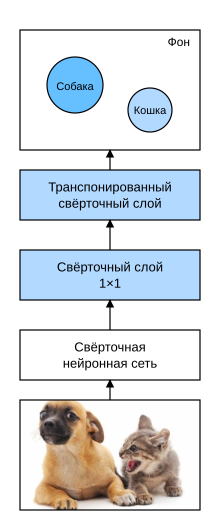

# 13.11 Полносвёрточные сети

Как было показано в разделе 13.9, семантическая сегментация классифицирует каждый пиксель изображения. *Полносвёрточная сеть* (fully convolutional network, FCN) использует свёрточную нейронную сеть для преобразования пикселей изображения в классы пикселей (Long et al., 2015). В отличие от свёрточных сетей, которые мы рассматривали в задачах классификации изображений или обнаружения объектов, полносвёрточная сеть возвращает высоту и ширину карт признаков промежуточных слоёв к размерам входного изображения. Для этого используется *транспонированная свёртка* (transposed convolution), введённая в разделе 13.10. Поэтому выход классификации соответствует входному изображению пиксель в пиксель: канал выхода в каждой позиции содержит предсказание класса для пикселя в этой позиции.

**MXNet:**

```python
%matplotlib inline
from d2l import mxnet as d2l
from mxnet import gluon, image, init, np, npx
from mxnet.gluon import nn

npx.set_np()
```

**PyTorch:**

```python
%matplotlib inline
from d2l import torch as d2l
import torch
import torchvision
from torch import nn
from torch.nn import functional as F
```

**PaddlePaddle:**

```python
%matplotlib inline
from d2l import paddle as d2l
import warnings
warnings.filterwarnings("ignore")
import paddle
from paddle import nn
from paddle.nn import functional as F
import paddle.vision as paddlevision
```

## 13.11.1 Построение модели

Рассмотрим самую базовую конструкцию полносвёрточной сети. Как показано на рис. 13.11.1, полносвёрточная сеть сначала использует свёрточную нейронную сеть для извлечения признаков изображения, затем свёрточным слоем $1\times 1$ приводит число каналов к числу классов, а в конце с помощью транспонированного свёрточного слоя (раздел 13.10) возвращает высоту и ширину карты признаков к размеру входного изображения. Поэтому выход модели имеет ту же высоту и ширину, что и входное изображение, а его каналы содержат предсказания классов для пикселя в этой позиции.



**Рис. 13.11.1.** Полносвёрточная сеть

Далее **используем ResNet-18, предобученную на ImageNet, чтобы извлекать признаки изображения**. Обозначим эту сеть как `pretrained_net`. Последние слои ResNet-18 — глобальный средний пулинг и полносвязный слой, но для полносвёрточной сети они не нужны.

**MXNet:**

```python
pretrained_net = gluon.model_zoo.vision.resnet18_v2(pretrained=True)
pretrained_net.features[-3:], pretrained_net.output
```

**PyTorch:**

```python
pretrained_net = torchvision.models.resnet18(pretrained=True)
list(pretrained_net.children())[-3:]
```

**PaddlePaddle:**

```python
pretrained_net = paddlevision.models.resnet18(pretrained=True)
list(pretrained_net.children())[-3:]
```

Теперь **создадим полносвёрточную сеть `net`**. Она повторяет большую часть предобученных слоёв ResNet-18, за исключением последнего глобального среднего пулинга и полносвязного слоя, ближайшего к выходу.

**MXNet:**

```python
net = nn.HybridSequential()
for layer in pretrained_net.features[:-2]:
    net.add(layer)
```

**PyTorch, PaddlePaddle:**

```python
net = nn.Sequential(*list(pretrained_net.children())[:-2])
```

Если на вход подать изображение высотой 320 и шириной 480, то прямое распространение `net` уменьшит высоту и ширину входа в 32 раза, то есть до 10 и 15.

**MXNet:**

```python
X = np.random.uniform(size=(1, 3, 320, 480))
net(X).shape
```

**PyTorch:**

```python
X = torch.rand(size=(1, 3, 320, 480))
net(X).shape
```

**PaddlePaddle:**

```python
X = paddle.rand(shape=(1, 3, 320, 480))
net(X).shape
```

Далее **с помощью свёрточного слоя $1\times1$ приведём число выходных каналов к числу классов набора Pascal VOC2012 (21 класс).** Наконец, нужно **увеличить высоту и ширину карты признаков в 32 раза**, чтобы вернуть их к высоте и ширине входного изображения. Вспомним, как вычисляется форма выхода свёрточного слоя из раздела 6.3. Поскольку $(320-64+16\times2+32)/32=10$ и $(480-64+16\times2+32)/32=15$, построим транспонированный свёрточный слой с шагом 32, а высоту и ширину ядра зададим равными 64, заполнение — 16. Видно, что если шаг равен $s$, заполнение равно $s/2$ (предполагаем, что $s/2$ — целое число), а высота и ширина ядра равны $2s$, то транспонированная свёртка увеличит высоту и ширину входа в $s$ раз.

**MXNet:**

```python
num_classes = 21
net.add(nn.Conv2D(num_classes, kernel_size=1),
        nn.Conv2DTranspose(
            num_classes, kernel_size=64, padding=16, strides=32))
```

**PyTorch:**

```python
num_classes = 21
net.add_module('final_conv', nn.Conv2d(512, num_classes, kernel_size=1))
net.add_module('transpose_conv', nn.ConvTranspose2d(num_classes, num_classes,
                                    kernel_size=64, padding=16, stride=32))
```

**PaddlePaddle:**

```python
num_classes = 21
net.add_sublayer('final_conv', nn.Conv2D(512, num_classes, kernel_size=1))
net.add_sublayer('transpose_conv', nn.Conv2DTranspose(num_classes, num_classes,
                                    kernel_size=64, padding=16, stride=32))
```

## 13.11.2 Инициализация транспонированного свёрточного слоя

При обработке изображений иногда нужно увеличить изображение, то есть выполнить *повышающую дискретизацию* (upsampling). *Билинейная интерполяция* (bilinear interpolation) — один из распространённых методов повышающей дискретизации. Её также часто используют для инициализации транспонированных свёрточных слоёв.

Чтобы объяснить билинейную интерполяцию, пусть задано входное изображение, и мы хотим вычислить значение каждого пикселя выходного изображения после повышающей дискретизации.

1. Отобразить координаты $(x,y)$ пикселя выходного изображения в координаты $(x',y')$ входного изображения, например по отношению размеров входа и выхода. Заметим, что $x'$ и $y'$ после отображения — вещественные числа.
2. Найти на входном изображении 4 ближайших к точке $(x',y')$ пикселя.
3. Значение пикселя выходного изображения с координатами $(x,y)$ вычислить по этим 4 пикселям входного изображения с учётом их относительного расстояния до $(x',y')$.

Повышающая дискретизация билинейной интерполяцией может быть реализована транспонированным свёрточным слоем, ядро которого строится функцией `bilinear_kernel`, приведённой ниже. Ради краткости мы приводим только реализацию функции `bilinear_kernel`, без обсуждения принципа алгоритма.

**MXNet:**

```python
def bilinear_kernel(in_channels, out_channels, kernel_size):
    factor = (kernel_size + 1) // 2
    if kernel_size % 2 == 1:
        center = factor - 1
    else:
        center = factor - 0.5
    og = (np.arange(kernel_size).reshape(-1, 1),
          np.arange(kernel_size).reshape(1, -1))
    filt = (1 - np.abs(og[0] - center) / factor) * \
           (1 - np.abs(og[1] - center) / factor)
    weight = np.zeros((in_channels, out_channels, kernel_size, kernel_size))
    weight[range(in_channels), range(out_channels), :, :] = filt
    return np.array(weight)
```

**PyTorch:**

```python
def bilinear_kernel(in_channels, out_channels, kernel_size):
    factor = (kernel_size + 1) // 2
    if kernel_size % 2 == 1:
        center = factor - 1
    else:
        center = factor - 0.5
    og = (torch.arange(kernel_size).reshape(-1, 1),
          torch.arange(kernel_size).reshape(1, -1))
    filt = (1 - torch.abs(og[0] - center) / factor) * \
           (1 - torch.abs(og[1] - center) / factor)
    weight = torch.zeros((in_channels, out_channels,
                          kernel_size, kernel_size))
    weight[range(in_channels), range(out_channels), :, :] = filt
    return weight
```

**PaddlePaddle:**

```python
def bilinear_kernel(in_channels, out_channels, kernel_size):
    factor = (kernel_size + 1) // 2
    if kernel_size % 2 == 1:
        center = factor - 1
    else:
        center = factor - 0.5
    og = (paddle.arange(kernel_size).reshape([-1, 1]),
          paddle.arange(kernel_size).reshape([1, -1]))
    filt = (1 - paddle.abs(og[0] - center) / factor) * \
           (1 - paddle.abs(og[1] - center) / factor)
    weight = paddle.zeros((in_channels, out_channels,
                          kernel_size, kernel_size))
    weight[range(in_channels), range(out_channels), :, :] = filt
    return weight
```

Теперь **проведём эксперимент с повышающей дискретизацией билинейной интерполяцией**, которую реализует транспонированный свёрточный слой. Создадим транспонированный свёрточный слой, который увеличивает высоту и ширину входа в 2 раза, и инициализируем его ядро функцией `bilinear_kernel`.

**MXNet:**

```python
conv_trans = nn.Conv2DTranspose(3, kernel_size=4, padding=1, strides=2)
conv_trans.initialize(init.Constant(bilinear_kernel(3, 3, 4)))
```

**PyTorch:**

```python
conv_trans = nn.ConvTranspose2d(3, 3, kernel_size=4, padding=1, stride=2,
                                bias=False)
conv_trans.weight.data.copy_(bilinear_kernel(3, 3, 4));
```

**PaddlePaddle:**

```python
conv_trans = nn.Conv2DTranspose(3, 3, kernel_size=4, padding=1, stride=2,
                                bias_attr=False)
conv_trans.weight.set_value(bilinear_kernel(3, 3, 4));
```

Прочитаем изображение `X` и результат повышающей дискретизации обозначим `Y`. Чтобы вывести изображение, нужно поменять местами измерения каналов.

**MXNet:**

```python
img = image.imread('../img/catdog.jpg')
X = np.expand_dims(img.astype('float32').transpose(2, 0, 1), axis=0) / 255
Y = conv_trans(X)
out_img = Y[0].transpose(1, 2, 0)
```

**PyTorch:**

```python
img = torchvision.transforms.ToTensor()(d2l.Image.open('../img/catdog.jpg'))
X = img.unsqueeze(0)
Y = conv_trans(X)
out_img = Y[0].permute(1, 2, 0).detach()
```

**PaddlePaddle:**

```python
img = paddlevision.transforms.ToTensor()(d2l.Image.open('../img/catdog.jpg'))
X = img.unsqueeze(0)
Y = conv_trans(X)
out_img = Y[0].transpose([1, 2, 0]).detach()
```

Видно, что транспонированный свёрточный слой увеличил высоту и ширину изображения в 2 раза. Кроме различия в масштабе координат, изображение, увеличенное билинейной интерполяцией, почти не отличается от исходного, который мы выводили в разделе 13.3.

**MXNet:**

```python
d2l.set_figsize()
print('input image shape:', img.shape)
d2l.plt.imshow(img.asnumpy());
print('output image shape:', out_img.shape)
d2l.plt.imshow(out_img.asnumpy());
```

**PyTorch:**

```python
d2l.set_figsize()
print('input image shape:', img.permute(1, 2, 0).shape)
d2l.plt.imshow(img.permute(1, 2, 0));
print('output image shape:', out_img.shape)
d2l.plt.imshow(out_img);
```

**PaddlePaddle:**

```python
d2l.set_figsize()
print('input image shape:', img.transpose([1, 2, 0]).shape)
d2l.plt.imshow(img.transpose([1, 2, 0]));
print('output image shape:', out_img.shape)
d2l.plt.imshow(out_img);
```

Полносвёрточная сеть **инициализирует транспонированный свёрточный слой повышающей дискретизацией билинейной интерполяцией. Для свёрточного слоя $1\times 1$ параметры инициализируются методом Xavier.**

**MXNet:**

```python
W = bilinear_kernel(num_classes, num_classes, 64)
net[-1].initialize(init.Constant(W))
net[-2].initialize(init=init.Xavier())
```

**PyTorch:**

```python
W = bilinear_kernel(num_classes, num_classes, 64)
net.transpose_conv.weight.data.copy_(W);
```

**PaddlePaddle:**

```python
W = bilinear_kernel(num_classes, num_classes, 64)
net.transpose_conv.weight.set_value(W);
```

## 13.11.3 Чтение набора данных

Для чтения набора данных используем интерфейс загрузки данных семантической сегментации из раздела 13.9. Зададим форму случайно обрезанного выходного изображения $320\times 480$: и высота, и ширина делятся на $32$.

**MXNet, PyTorch:**

```python
batch_size, crop_size = 32, (320, 480)
train_iter, test_iter = d2l.load_data_voc(batch_size, crop_size)
```

**PaddlePaddle:**

```python
import os    
def load_data_voc(batch_size, crop_size):
    """Загружает набор данных VOC для семантической сегментации"""
    voc_dir = d2l.download_extract('voc2012', os.path.join(
        'VOCdevkit', 'VOC2012'))
    train_iter = paddle.io.DataLoader(
        d2l.VOCSegDataset(True, crop_size, voc_dir), batch_size=batch_size,
        shuffle=True, return_list=True, drop_last=True, num_workers=0)
    test_iter = paddle.io.DataLoader(
        d2l.VOCSegDataset(False, crop_size, voc_dir), batch_size=batch_size,
        drop_last=True, return_list=True, num_workers=0)
    return train_iter, test_iter

batch_size, crop_size = 32, (320, 480)
train_iter, test_iter = load_data_voc(batch_size, crop_size)
```

## 13.11.4 Обучение

Теперь можно обучить полносвёрточную сеть. Функции потерь и вычисления точности здесь принципиально не отличаются от задачи классификации изображений: поскольку мы предсказываем классы пикселей с помощью каналов транспонированного свёрточного слоя, в вычислении потерь нужно явно указать измерение каналов. Кроме того, точность модели считается по тому, правильно ли предсказан класс каждого пикселя.

**MXNet:**

```python
num_epochs, lr, wd, devices = 5, 0.1, 1e-3, d2l.try_all_gpus()
loss = gluon.loss.SoftmaxCrossEntropyLoss(axis=1)
net.collect_params().reset_ctx(devices)
trainer = gluon.Trainer(net.collect_params(), 'sgd',
                        {'learning_rate': lr, 'wd': wd})
d2l.train_ch13(net, train_iter, test_iter, loss, trainer, num_epochs, devices)
```

**PyTorch:**

```python
def loss(inputs, targets):
    return F.cross_entropy(inputs, targets, reduction='none').mean(1).mean(1)

num_epochs, lr, wd, devices = 5, 0.001, 1e-3, d2l.try_all_gpus()
trainer = torch.optim.SGD(net.parameters(), lr=lr, weight_decay=wd)
d2l.train_ch13(net, train_iter, test_iter, loss, trainer, num_epochs, devices)
```

**PaddlePaddle:**

```python
def loss(inputs, targets):
    return F.cross_entropy(inputs.transpose([0, 2, 3, 1]), targets, reduction='none').mean(1).mean(1)

num_epochs, lr, wd, devices = 5, 0.001, 1e-3, d2l.try_all_gpus()
trainer = paddle.optimizer.SGD(learning_rate=lr, parameters=net.parameters(), weight_decay=wd)
d2l.train_ch13(net, train_iter, test_iter, loss, trainer, num_epochs, devices[:1])
```

## 13.11.5 Предсказание

При предсказании нужно стандартизировать входное изображение по каждому каналу и привести его к четырёхмерному формату, который требуется свёрточной нейронной сети.

**MXNet:**

```python
def predict(img):
    X = test_iter._dataset.normalize_image(img)
    X = np.expand_dims(X.transpose(2, 0, 1), axis=0)
    pred = net(X.as_in_ctx(devices[0])).argmax(axis=1)
    return pred.reshape(pred.shape[1], pred.shape[2])
```

**PyTorch:**

```python
def predict(img):
    X = test_iter.dataset.normalize_image(img).unsqueeze(0)
    pred = net(X.to(devices[0])).argmax(dim=1)
    return pred.reshape(pred.shape[1], pred.shape[2])
```

**PaddlePaddle:**

```python
def predict(img):
    X = paddle.to_tensor(test_iter.dataset.normalize_image(img),dtype='float32').unsqueeze(0)
    pred = net(X).argmax(axis=1)
    return pred.reshape([pred.shape[1], pred.shape[2]])
```

Чтобы **визуализировать предсказанный класс каждого пикселя**, сопоставим предсказанные классы с цветами их разметки в наборе данных.

**MXNet:**

```python
def label2image(pred):
    colormap = np.array(d2l.VOC_COLORMAP, ctx=devices[0], dtype='uint8')
    X = pred.astype('int32')
    return colormap[X, :]
```

**PyTorch:**

```python
def label2image(pred):
    colormap = torch.tensor(d2l.VOC_COLORMAP, device=devices[0])
    X = pred.long()
    return colormap[X, :]
```

**PaddlePaddle:**

```python
def label2image(pred):
    colormap = paddle.to_tensor(d2l.VOC_COLORMAP)
    X = pred.astype(paddle.int32)
    return colormap[X]
```

Размеры и формы изображений в тестовом наборе различаются. Поскольку модель использует транспонированный свёрточный слой с шагом 32, если высота или ширина входного изображения не делятся на 32, то высота или ширина выхода транспонированного свёрточного слоя будет отличаться от размера входного изображения. Чтобы решить эту проблему, можно вырезать из изображения несколько прямоугольных областей с высотой и шириной, кратными 32, и выполнить прямое распространение для пикселей каждой из этих областей. Заметим, что объединение этих областей должно полностью покрывать входное изображение. Если пиксель покрыт несколькими областями, то среднее значение выходов транспонированного свёрточного слоя для этого пикселя в разных областях можно использовать как вход операции `softmax`, чтобы предсказать класс.

Для простоты мы читаем лишь несколько крупных тестовых изображений и для предсказания вырезаем области размером $320\times480$, начиная с левого верхнего угла изображения. Для каждого из этих тестовых изображений мы по очереди выводим вырезанную область, результат предсказания и размеченный класс.

**MXNet:**

```python
voc_dir = d2l.download_extract('voc2012', 'VOCdevkit/VOC2012')
test_images, test_labels = d2l.read_voc_images(voc_dir, False)
n, imgs = 4, []
for i in range(n):
    crop_rect = (0, 0, 480, 320)
    X = image.fixed_crop(test_images[i], *crop_rect)
    pred = label2image(predict(X))
    imgs += [X, pred, image.fixed_crop(test_labels[i], *crop_rect)]
d2l.show_images(imgs[::3] + imgs[1::3] + imgs[2::3], 3, n, scale=2);
```

**PyTorch:**

```python
voc_dir = d2l.download_extract('voc2012', 'VOCdevkit/VOC2012')
test_images, test_labels = d2l.read_voc_images(voc_dir, False)
n, imgs = 4, []
for i in range(n):
    crop_rect = (0, 0, 320, 480)
    X = torchvision.transforms.functional.crop(test_images[i], *crop_rect)
    pred = label2image(predict(X))
    imgs += [X.permute(1,2,0), pred.cpu(),
             torchvision.transforms.functional.crop(
                 test_labels[i], *crop_rect).permute(1,2,0)]
d2l.show_images(imgs[::3] + imgs[1::3] + imgs[2::3], 3, n, scale=2);
```

**PaddlePaddle:**

```python
voc_dir = d2l.download_extract('voc2012', 'VOCdevkit/VOC2012')
test_images, test_labels = d2l.read_voc_images(voc_dir, False)
n, imgs = 4, []
for i in range(n):
    crop_rect = (0, 0, 320, 480)
    X = paddlevision.transforms.crop(test_images[i], *crop_rect)
    pred = label2image(predict(X))
    imgs += [X.transpose([1,2,0]).astype('uint8'), pred,
             paddlevision.transforms.crop(
                 test_labels[i], *crop_rect).transpose([1, 2, 0]).astype("uint8")]
d2l.show_images(imgs[::3] + imgs[1::3] + imgs[2::3], 3, n, scale=2);
```

## Резюме

* Полносвёрточная сеть сначала использует свёрточную нейронную сеть для извлечения признаков изображения, затем свёрточным слоем $1\times 1$ приводит число каналов к числу классов, а в конце транспонированным свёрточным слоем возвращает высоту и ширину карты признаков к размеру входного изображения.
* В полносвёрточной сети транспонированный свёрточный слой можно инициализировать билинейной интерполяцией для повышающей дискретизации.

## Упражнения

1. Если инициализировать транспонированный свёрточный слой случайным образом методом Xavier, что изменится в результатах?
1. Можно ли дополнительно повысить точность модели, подобрав гиперпараметры?
1. Предскажите классы всех пикселей тестовых изображений.
1. В оригинальной статье о полносвёрточных сетях (Long et al., 2015) также использовались выходы некоторых промежуточных слоёв свёрточной сети. Попробуйте реализовать эту идею.

**MXNet:**
[Обсуждение](https://discuss.d2l.ai/t/3298)

**PyTorch:**
[Обсуждение](https://discuss.d2l.ai/t/3297)

**PaddlePaddle:**
[Обсуждение](https://discuss.d2l.ai/t/11811)

## Литература

* Long, J., Shelhamer, E., & Darrell, T. (2015). Fully convolutional networks for semantic segmentation. *Proceedings of the IEEE Conference on Computer Vision and Pattern Recognition*, 3431–3440.
