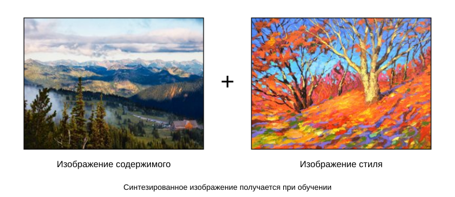
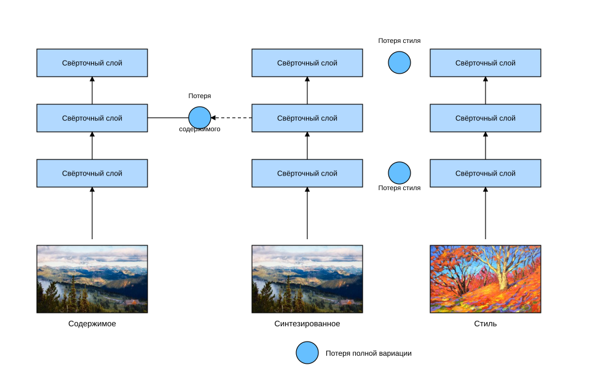

# 13.12 Перенос стиля

Любители фотографии, возможно, знакомы с фильтрами. Они меняют цветовой стиль фотографии, например делают пейзаж резче или кожу на портрете светлее. Однако фильтр обычно меняет лишь один аспект изображения. Чтобы получить желаемый стиль, может понадобиться перебрать множество различных комбинаций. Эта работа не менее сложна, чем настройка гиперпараметров модели.

В этом разделе мы покажем, как с помощью сверточных нейронных сетей автоматически применить стиль одного изображения к другому, то есть выполнить *перенос стиля* (style transfer) :cite:`Gatys.Ecker.Bethge.2016`. Здесь нужны два входных изображения: *содержимое* (content image) и *стиль* (style image). Мы будем использовать нейронную сеть, чтобы изменить изображение содержимого так, чтобы по стилю оно приблизилось к изображению стиля. Например, изображение содержимого на рис. 13.12.1 — это пейзаж, который автор книги сфотографировал в национальном парке Рейнир на окраине Сиэтла, а изображение стиля — картина с осенним дубом. Итоговое синтезированное изображение применяет мазки кисти из картины стиля, делая цвета ярче, и при этом сохраняет форму объектов из изображения содержимого.



## Метод

На простом примере рис. 13.12.2 поясняет метод переноса стиля на основе сверточной нейронной сети. Сначала мы инициализируем синтезированное изображение, например как копию изображения содержимого. Синтезированное изображение — единственная переменная, которую нужно обновлять в ходе переноса стиля, то есть это параметр модели, итерации по которому выполняются в процессе переноса. Затем мы выбираем предобученную сверточную нейронную сеть, которая извлекает признаки изображения, и её параметры в ходе обучения не обновляются. Эта глубокая сверточная сеть постепенно извлекает признаки изображения через несколько слоёв, и мы можем выбрать выходы некоторых слоёв как признаки содержимого или признаки стиля. В примере на рис. 13.12.2 предобученная сеть содержит три свёрточных слоя: второй слой выдаёт признаки содержимого, а первый и третий — признаки стиля.



Далее прямым распространением (направление сплошных стрелок) мы вычисляем функцию потерь переноса стиля, а обратным распространением (направление пунктирных стрелок) итеративно обновляем параметры модели, то есть само синтезированное изображение. Обычно функция потерь переноса стиля состоит из трёх частей:

1. *потеря содержимого* приближает синтезированное изображение к изображению содержимого по признакам содержимого;
1. *потеря стиля* приближает синтезированное изображение к изображению стиля по признакам стиля;
1. *потеря полной вариации* помогает уменьшить шум на синтезированном изображении.

Когда обучение модели закончено, мы выводим параметры переноса стиля, то есть получаем итоговое синтезированное изображение.

Далее в коде мы подробнее разберём технические детали переноса стиля.

## [**Чтение изображений содержимого и стиля**]

Сначала прочитаем изображения содержимого и стиля. По подписям осей на выведенных изображениях видно, что их размеры различаются.

**MXNet:**

```python
%matplotlib inline
from d2l import mxnet as d2l
from mxnet import autograd, gluon, image, init, np, npx
from mxnet.gluon import nn

npx.set_np()

d2l.set_figsize()
content_img = image.imread('../img/rainier.jpg')
d2l.plt.imshow(content_img.asnumpy());
```

**PyTorch:**

```python
%matplotlib inline
from d2l import torch as d2l
import torch
import torchvision
from torch import nn

d2l.set_figsize()
content_img = d2l.Image.open('../img/rainier.jpg')
d2l.plt.imshow(content_img);
```

**PaddlePaddle:**

```python
%matplotlib inline
from d2l import paddle as d2l
import paddle
import paddle.vision as paddlevision
import paddle.nn as nn

d2l.set_figsize()
content_img = d2l.Image.open('../img/rainier.jpg')
d2l.plt.imshow(content_img);
```

**MXNet:**

```python
style_img = image.imread('../img/autumn-oak.jpg')
d2l.plt.imshow(style_img.asnumpy());
```

**PyTorch, PaddlePaddle:**

```python
style_img = d2l.Image.open('../img/autumn-oak.jpg')
d2l.plt.imshow(style_img);
```

## [**Предобработка и постобработка**]

Определим функции предобработки и постобработки изображений. Функция предобработки `preprocess` стандартизирует входное изображение по каждому из трёх каналов RGB и приводит результат к формату входа, который принимает сверточная нейронная сеть. Функция постобработки `postprocess` возвращает значения пикселей выходного изображения к значениям до стандартизации. Поскольку функция вывода изображения требует, чтобы значения пикселей были в диапазоне от 0 до 1, значения меньше 0 и больше 1 мы заменяем на 0 и 1 соответственно.

**MXNet:**

```python
rgb_mean = np.array([0.485, 0.456, 0.406])
rgb_std = np.array([0.229, 0.224, 0.225])

def preprocess(img, image_shape):
    img = image.imresize(img, *image_shape)
    img = (img.astype('float32') / 255 - rgb_mean) / rgb_std
    return np.expand_dims(img.transpose(2, 0, 1), axis=0)

def postprocess(img):
    img = img[0].as_in_ctx(rgb_std.ctx)
    return (img.transpose(1, 2, 0) * rgb_std + rgb_mean).clip(0, 1)
```

**PyTorch:**

```python
rgb_mean = torch.tensor([0.485, 0.456, 0.406])
rgb_std = torch.tensor([0.229, 0.224, 0.225])

def preprocess(img, image_shape):
    transforms = torchvision.transforms.Compose([
        torchvision.transforms.Resize(image_shape),
        torchvision.transforms.ToTensor(),
        torchvision.transforms.Normalize(mean=rgb_mean, std=rgb_std)])
    return transforms(img).unsqueeze(0)

def postprocess(img):
    img = img[0].to(rgb_std.device)
    img = torch.clamp(img.permute(1, 2, 0) * rgb_std + rgb_mean, 0, 1)
    return torchvision.transforms.ToPILImage()(img.permute(2, 0, 1))
```

**PaddlePaddle:**

```python
rgb_mean = paddle.to_tensor([0.485, 0.456, 0.406])
rgb_std = paddle.to_tensor([0.229, 0.224, 0.225])

def preprocess(img, image_shape):
    transforms = paddlevision.transforms.Compose([
        paddlevision.transforms.Resize(image_shape),
        paddlevision.transforms.ToTensor(),
        paddlevision.transforms.Normalize(mean=rgb_mean, std=rgb_std)])
    return transforms(img).unsqueeze(0)

def postprocess(img):
    img = img[0]
    img = paddle.clip(img.transpose((1, 2, 0)) * rgb_std + rgb_mean, 0, 1)
    return img
```

## [**Извлечение признаков изображения**]

Для извлечения признаков изображения содержимого и стиля используем VGG-19, предобученную на наборе ImageNet :cite:`Gatys.Ecker.Bethge.2016`.

**MXNet:**

```python
pretrained_net = gluon.model_zoo.vision.vgg19(pretrained=True)
```

**PyTorch:**

```python
pretrained_net = torchvision.models.vgg19(pretrained=True)
```

**PaddlePaddle:**

```python
pretrained_net = paddlevision.models.vgg19(pretrained=True)
```

Чтобы извлечь признаки содержимого и стиля изображения, можно взять выходы некоторых слоёв сети VGG. Вообще говоря, чем ближе слой к входу, тем легче извлечь детали изображения; и наоборот, чем ближе слой к выходу, тем легче извлечь глобальную информацию. Чтобы синтезированное изображение не слишком сохраняло детали изображения содержимого, для признаков содержимого мы выбираем слой, который находится ближе к выходу VGG, — *слой содержимого*. Для согласования локальных и глобальных стилей мы также берём выходы разных слоёв VGG. Эти слои называются *слоями стиля*. Как описано в разделе 7.2, сеть VGG использует 5 блоков свёрток. В эксперименте мы выбираем в качестве слоя содержимого последний свёрточный слой четвёртого блока, а в качестве слоёв стиля — первый свёрточный слой каждого блока. Индексы этих слоёв можно узнать, выведя экземпляр `pretrained_net`.

```python
style_layers, content_layers = [0, 5, 10, 19, 28], [25]
```

Чтобы извлекать признаки с помощью слоёв VGG, нужны все слои от входа до ближайшего к выходу слоя содержимого или стиля. Ниже мы строим новую сеть `net`, которая содержит только нужные слои VGG.

**MXNet:**

```python
net = nn.Sequential()
for i in range(max(content_layers + style_layers) + 1):
    net.add(pretrained_net.features[i])
```

**PyTorch, PaddlePaddle:**

```python
net = nn.Sequential(*[pretrained_net.features[i] for i in
                      range(max(content_layers + style_layers) + 1)])
```

Для входа `X` простой вызов прямого распространения `net(X)` даёт только выход последнего слоя. Поскольку нам нужны выходы промежуточных слоёв, здесь мы вычисляем слой за слоем и сохраняем выходы слоёв содержимого и стиля.

```python
def extract_features(X, content_layers, style_layers):
    contents = []
    styles = []
    for i in range(len(net)):
        X = net[i](X)
        if i in style_layers:
            styles.append(X)
        if i in content_layers:
            contents.append(X)
    return contents, styles
```

Ниже определены две функции: функция `get_contents` извлекает признаки содержимого из изображения содержимого, а функция `get_styles` — признаки стиля из изображения стиля. Поскольку в процессе обучения параметры предобученной VGG менять не нужно, признаки содержимого и стиля можно извлечь до начала обучения. Поскольку синтезированное изображение — параметр модели, которую нужно обновлять в ходе переноса, признаки содержимого и стиля синтезированного изображения мы можем извлекать только во время обучения, вызывая функцию `extract_features`.

**MXNet:**

```python
def get_contents(image_shape, device):
    content_X = preprocess(content_img, image_shape).copyto(device)
    contents_Y, _ = extract_features(content_X, content_layers, style_layers)
    return content_X, contents_Y

def get_styles(image_shape, device):
    style_X = preprocess(style_img, image_shape).copyto(device)
    _, styles_Y = extract_features(style_X, content_layers, style_layers)
    return style_X, styles_Y
```

**PyTorch:**

```python
def get_contents(image_shape, device):
    content_X = preprocess(content_img, image_shape).to(device)
    contents_Y, _ = extract_features(content_X, content_layers, style_layers)
    return content_X, contents_Y

def get_styles(image_shape, device):
    style_X = preprocess(style_img, image_shape).to(device)
    _, styles_Y = extract_features(style_X, content_layers, style_layers)
    return style_X, styles_Y
```

**PaddlePaddle:**

```python
def get_contents(image_shape):
    content_X = preprocess(content_img, image_shape)
    contents_Y, _ = extract_features(content_X, content_layers, style_layers)
    return content_X, contents_Y

def get_styles(image_shape):
    style_X = preprocess(style_img, image_shape)
    _, styles_Y = extract_features(style_X, content_layers, style_layers)
    return style_X, styles_Y
```

## [**Определение функции потерь**]

Теперь опишем функцию потерь переноса стиля. Она состоит из трёх частей: потери содержимого, потери стиля и потери полной вариации.

### Потеря содержимого

Как и функция потерь в линейной регрессии, потеря содержимого измеряет различие между синтезированным изображением и изображением содержимого в признаках содержимого с помощью функции квадратичной ошибки. Оба аргумента этой функции — выходы слоя содержимого, которые вычисляет функция `extract_features`.

**MXNet:**

```python
def content_loss(Y_hat, Y):
    return np.square(Y_hat - Y).mean()
```

**PyTorch:**

```python
def content_loss(Y_hat, Y):
    # Отделяем целевое значение от графа, который динамически вычисляет градиенты:
    # это заданное значение, а не переменная
    return torch.square(Y_hat - Y.detach()).mean()
```

**PaddlePaddle:**

```python
def content_loss(Y_hat, Y):
    # Отделяем целевое значение от графа, который динамически вычисляет градиенты:
    # это заданное значение, а не переменная
    return paddle.square(Y_hat - Y.detach()).mean()
```

### Потеря стиля

Потеря стиля, как и потеря содержимого, использует функцию квадратичной ошибки, чтобы измерить различие между синтезированным изображением и изображением стиля в стиле. Чтобы выразить стиль выхода слоя стиля, сначала вычислим выход слоя стиля с помощью функции `extract_features`. Пусть число примеров в выходе равно 1, число каналов — $c$, высота и ширина — $h$ и $w$. Тогда этот выход можно преобразовать в матрицу $\mathbf{X}$ с $c$ строками и $hw$ столбцами. Эту матрицу можно рассматривать как составленную из $c$ векторов $\mathbf{x}_1, \ldots, \mathbf{x}_c$ длины $hw$. Вектор $\mathbf{x}_i$ представляет признаки стиля в канале $i$.

В *матрице Грама* $\mathbf{X}\mathbf{X}^\top \in \mathbb{R}^{c \times c}$ элемент $x_{ij}$ в строке $i$ и столбце $j$ — это скалярное произведение векторов $\mathbf{x}_i$ и $\mathbf{x}_j$. Он отражает корреляцию признаков стиля в каналах $i$ и $j$. Именно такой матрицей Грама мы выражаем стиль выхода слоя стиля. Заметим, что при большом $hw$ элементы матрицы Грама могут принимать большие значения. Кроме того, матрица Грама имеет размер $c \times c$, где $c$ — число каналов. Чтобы величина потери стиля не зависела от масштаба этих значений, функция `gram` ниже делит матрицу Грама на число её элементов, то есть на $chw$.

```python
def gram(X):
    num_channels, n = X.shape[1], d2l.size(X) // X.shape[1]
    X = d2l.reshape(X, (num_channels, n))
    return d2l.matmul(X, X.T) / (num_channels * n)
```

Естественно, два аргумента функции квадратичной ошибки для потери стиля — это матрицы Грама, построенные по выходам слоёв стиля для синтезированного изображения и изображения стиля. Здесь предполагается, что матрица Грама `gram_Y` для изображения стиля вычислена заранее.

**MXNet:**

```python
def style_loss(Y_hat, gram_Y):
    return np.square(gram(Y_hat) - gram_Y).mean()
```

**PyTorch:**

```python
def style_loss(Y_hat, gram_Y):
    return torch.square(gram(Y_hat) - gram_Y.detach()).mean()
```

**PaddlePaddle:**

```python
def style_loss(Y_hat, gram_Y):
    return paddle.square(gram(Y_hat) - gram_Y.detach()).mean()
```

### Потеря полной вариации

Иногда в синтезированном изображении остаётся много высокочастотного шума, то есть особенно ярких или особенно тёмных пикселей. Распространённый способ подавить шум — *шумоподавление полной вариацией* (total variation denoising). Пусть $x_{i, j}$ — значение пикселя с координатами $(i, j)$. Уменьшение потери полной вариации

$$\sum_{i, j} \left|x_{i, j} - x_{i+1, j}\right| + \left|x_{i, j} - x_{i, j+1}\right|$$

стремится сделать значения соседних пикселей как можно более близкими.

```python
def tv_loss(Y_hat):
    return 0.5 * (d2l.abs(Y_hat[:, :, 1:, :] - Y_hat[:, :, :-1, :]).mean() +
                  d2l.abs(Y_hat[:, :, :, 1:] - Y_hat[:, :, :, :-1]).mean())
```

### Функция потерь

[**Функция потерь переноса стиля — это взвешенная сумма потери содержимого, потери стиля и потери полной вариации**]. Регулируя эти весовые гиперпараметры, мы можем задать относительную важность сохранения содержимого, переноса стиля и шумоподавления для синтезированного изображения.

```python
content_weight, style_weight, tv_weight = 1, 1e3, 10

def compute_loss(X, contents_Y_hat, styles_Y_hat, contents_Y, styles_Y_gram):
    # Вычисляем потерю содержимого, потерю стиля и потерю полной вариации по отдельности
    contents_l = [content_loss(Y_hat, Y) * content_weight for Y_hat, Y in zip(
        contents_Y_hat, contents_Y)]
    styles_l = [style_loss(Y_hat, Y) * style_weight for Y_hat, Y in zip(
        styles_Y_hat, styles_Y_gram)]
    tv_l = tv_loss(X) * tv_weight
    # Суммируем все потери
    l = sum(10 * styles_l + contents_l + [tv_l])
    return contents_l, styles_l, tv_l, l
```

## [**Инициализация синтезированного изображения**]

При переносе стиля синтезированное изображение — единственная переменная, которую обновляют в ходе обучения. Поэтому мы можем определить простую модель `SynthesizedImage` и рассматривать синтезированное изображение как параметр модели. Прямое распространение модели просто возвращает параметр модели.

**MXNet:**

```python
class SynthesizedImage(nn.Block):
    def __init__(self, img_shape, **kwargs):
        super(SynthesizedImage, self).__init__(**kwargs)
        self.weight = self.params.get('weight', shape=img_shape)

    def forward(self):
        return self.weight.data()
```

**PyTorch:**

```python
class SynthesizedImage(nn.Module):
    def __init__(self, img_shape, **kwargs):
        super(SynthesizedImage, self).__init__(**kwargs)
        self.weight = nn.Parameter(torch.rand(*img_shape))

    def forward(self):
        return self.weight
```

**PaddlePaddle:**

```python
class SynthesizedImage(nn.Layer):
    def __init__(self, img_shape, **kwargs):
        super(SynthesizedImage, self).__init__(**kwargs)
        self.weight = paddle.create_parameter(shape=img_shape,
                                            dtype="float32")

    def forward(self):
        return self.weight
```

Далее определим функцию `get_inits`. Она создаёт экземпляр модели синтезированного изображения и инициализирует его изображением `X`. Матрицы Грама `styles_Y_gram` для изображения стиля на всех слоях стиля вычисляются заранее, до начала обучения.

**MXNet:**

```python
def get_inits(X, device, lr, styles_Y):
    gen_img = SynthesizedImage(X.shape)
    gen_img.initialize(init.Constant(X), ctx=device, force_reinit=True)
    trainer = gluon.Trainer(gen_img.collect_params(), 'adam',
                            {'learning_rate': lr})
    styles_Y_gram = [gram(Y) for Y in styles_Y]
    return gen_img(), styles_Y_gram, trainer
```

**PyTorch:**

```python
def get_inits(X, device, lr, styles_Y):
    gen_img = SynthesizedImage(X.shape).to(device)
    gen_img.weight.data.copy_(X.data)
    trainer = torch.optim.Adam(gen_img.parameters(), lr=lr)
    styles_Y_gram = [gram(Y) for Y in styles_Y]
    return gen_img(), styles_Y_gram, trainer
```

**PaddlePaddle:**

```python
def get_inits(X, lr, styles_Y):
    gen_img = SynthesizedImage(X.shape)
    gen_img.weight.set_value(X)
    trainer = paddle.optimizer.Adam(parameters = gen_img.parameters(), learning_rate=lr)
    styles_Y_gram = [gram(Y) for Y in styles_Y]
    return gen_img(), styles_Y_gram, trainer
```

## [**Обучение модели**]

Во время обучения переноса стиля мы многократно извлекаем признаки содержимого и стиля синтезированного изображения и вычисляем функцию потерь. Ниже определён цикл обучения.

**MXNet:**

```python
def train(X, contents_Y, styles_Y, device, lr, num_epochs, lr_decay_epoch):
    X, styles_Y_gram, trainer = get_inits(X, device, lr, styles_Y)
    animator = d2l.Animator(xlabel='epoch', ylabel='loss',
                            xlim=[10, num_epochs], ylim=[0, 20],
                            legend=['content', 'style', 'TV'],
                            ncols=2, figsize=(7, 2.5))
    for epoch in range(num_epochs):
        with autograd.record():
            contents_Y_hat, styles_Y_hat = extract_features(
                X, content_layers, style_layers)
            contents_l, styles_l, tv_l, l = compute_loss(
                X, contents_Y_hat, styles_Y_hat, contents_Y, styles_Y_gram)
        l.backward()
        trainer.step(1)
        if (epoch + 1) % lr_decay_epoch == 0:
            trainer.set_learning_rate(trainer.learning_rate * 0.8)
        if (epoch + 1) % 10 == 0:
            animator.axes[1].imshow(postprocess(X).asnumpy())
            animator.add(epoch + 1, [float(sum(contents_l)),
                                     float(sum(styles_l)), float(tv_l)])
    return X
```

**PyTorch:**

```python
def train(X, contents_Y, styles_Y, device, lr, num_epochs, lr_decay_epoch):
    X, styles_Y_gram, trainer = get_inits(X, device, lr, styles_Y)
    scheduler = torch.optim.lr_scheduler.StepLR(trainer, lr_decay_epoch, 0.8)
    animator = d2l.Animator(xlabel='epoch', ylabel='loss',
                            xlim=[10, num_epochs],
                            legend=['content', 'style', 'TV'],
                            ncols=2, figsize=(7, 2.5))
    for epoch in range(num_epochs):
        trainer.zero_grad()
        contents_Y_hat, styles_Y_hat = extract_features(
            X, content_layers, style_layers)
        contents_l, styles_l, tv_l, l = compute_loss(
            X, contents_Y_hat, styles_Y_hat, contents_Y, styles_Y_gram)
        l.backward()
        trainer.step()
        scheduler.step()
        if (epoch + 1) % 10 == 0:
            animator.axes[1].imshow(postprocess(X))
            animator.add(epoch + 1, [float(sum(contents_l)),
                                     float(sum(styles_l)), float(tv_l)])
    return X
```

**PaddlePaddle:**

```python
def train(X, contents_Y, styles_Y, lr, num_epochs, step_size):
    scheduler = paddle.optimizer.lr.StepDecay(learning_rate=lr, gamma=0.8, step_size=step_size)
    X, styles_Y_gram, trainer = get_inits(X, scheduler, styles_Y)
    animator = d2l.Animator(xlabel='epoch', ylabel='loss',
                            xlim=[10, num_epochs],
                            legend=['content', 'style', 'TV'],
                            ncols=2, figsize=(7, 2.5))
    for epoch in range(num_epochs):
        trainer.clear_grad()
        contents_Y_hat, styles_Y_hat = extract_features(
            X, content_layers, style_layers)
        contents_l, styles_l, tv_l, l = compute_loss(
            X, contents_Y_hat, styles_Y_hat, contents_Y, styles_Y_gram)
        l.backward()
        trainer.step()
        scheduler.step()
        if (epoch + 1) % 10 == 0:
            animator.axes[1].imshow(postprocess(X))
            animator.add(epoch + 1, [float(sum(contents_l)),
                                     float(sum(styles_l)), float(tv_l)])
    return X
```

Теперь [**обучим модель**]: сначала приведём высоту и ширину изображений содержимого и стиля к 300 и 450 пикселям и инициализируем синтезированное изображение изображением содержимого.

**MXNet:**

```python
device, image_shape = d2l.try_gpu(), (450, 300)
net.collect_params().reset_ctx(device)
content_X, contents_Y = get_contents(image_shape, device)
_, styles_Y = get_styles(image_shape, device)
output = train(content_X, contents_Y, styles_Y, device, 0.9, 500, 50)
```

**PyTorch:**

```python
device, image_shape = d2l.try_gpu(), (300, 450)
net = net.to(device)
content_X, contents_Y = get_contents(image_shape, device)
_, styles_Y = get_styles(image_shape, device)
output = train(content_X, contents_Y, styles_Y, device, 0.3, 500, 50)
```

**PaddlePaddle:**

```python
device, image_shape = d2l.try_gpu(),(300, 450)
content_X, contents_Y = get_contents(image_shape)
_, styles_Y = get_styles(image_shape)
output = train(content_X, contents_Y, styles_Y, 0.3, 500, 50)
```

Видно, что синтезированное изображение сохранило пейзаж и объекты изображения содержимого и одновременно перенесло цвета изображения стиля. Например, у синтезированного изображения есть цветовые пятна, как на изображении стиля, а некоторые из них даже имеют мелкую текстуру мазков кисти.

## Резюме

* Функция потерь переноса стиля обычно состоит из трёх частей: (1) потеря содержимого приближает синтезированное изображение к изображению содержимого по признакам содержимого; (2) потеря стиля приближает синтезированное изображение к изображению стиля по признакам стиля; (3) потеря полной вариации помогает уменьшить шум на синтезированном изображении.
* Мы можем извлекать признаки изображения с помощью предобученной сверточной нейронной сети и минимизировать функцию потерь, чтобы постепенно обновлять синтезированное изображение как параметр модели.
* Для выражения стиля выходов слоя стиля мы используем матрицы Грама.

## Упражнения

1. Как меняется выход при выборе других слоёв содержимого и стиля?
1. Подберите весовые гиперпараметры функции потерь. Сохраняет ли выход больше содержимого или больше подавляет шум?
1. Замените в эксперименте изображения содержимого и стиля. Можно ли создать более интересные синтезированные изображения?
1. Можно ли применить перенос стиля к тексту? Подсказка: см. обзорную работу :cite:`Hu.Lee.Aggarwal.ea.2020`.

**MXNet:**
[Обсуждение](https://discuss.d2l.ai/t/3299)

**PyTorch:**
[Обсуждение](https://discuss.d2l.ai/t/3300)

**PaddlePaddle:**
[Обсуждение](https://discuss.d2l.ai/t/11813)
