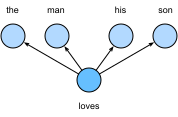
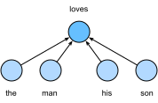

# 14.1 Вложения слов (word2vec)

Естественный язык — сложная система, с помощью которой выражают мысли. В этой системе слово — основная единица смысла. Как следует из названия, *векторы слов* — это векторы, представляющие значение слов; их можно также считать векторами признаков или представлениями слов. Технику отображения слов в вещественные векторы называют *вложением слов* (word embedding). В последние годы вложения слов постепенно стали базовым знанием в обработке естественного языка.

## 14.1.1 Почему one-hot-векторы — плохой выбор

В разделе 8.5 мы использовали one-hot-векторы для представления слов (слова там были символами). Пусть число различных слов в словаре (размер словаря) равно $N$, а каждому слову соответствует своё целое число (индекс) от $0$ до $N-1$. Чтобы получить one-hot-вектор слова с индексом $i$, мы создаём вектор длины $N$, состоящий из нулей, и ставим 1 в позицию $i$. Так каждое слово представляется вектором длины $N$, который можно сразу подавать в нейронную сеть.

Хотя one-hot-векторы легко строить, обычно они — плохой выбор. Главная причина в том, что one-hot-векторы не могут точно выразить сходство между разными словами, например часто используемое нами «косинусное сходство». Для векторов $\mathbf{x}, \mathbf{y} \in \mathbb{R}^d$ их косинусное сходство — это косинус угла между ними:

$$\frac{\mathbf{x}^\top \mathbf{y}}{\|\mathbf{x}\| \|\mathbf{y}\|} \in [-1, 1].$$

Поскольку косинусное сходство между one-hot-векторами любых двух разных слов равно 0, one-hot-векторы не могут кодировать сходство между словами.

## 14.1.2 Самоконтролируемый word2vec

Инструмент [word2vec](https://code.google.com/archive/p/word2vec/) предложен именно для решения этой проблемы. Он отображает каждое слово в вектор фиксированной длины, и эти векторы лучше выражают сходство и аналогии между разными словами. Инструмент word2vec включает две модели: *модель skip-gram* («пропуск-грамма») (Mikolov et al., 2013b) и *непрерывный мешок слов* (continuous bag of words, CBOW) (Mikolov et al., 2013a). Чтобы получить семантически осмысленные представления, их обучение опирается на условные вероятности, которые можно рассматривать как предсказание одних слов корпуса по другим. Поскольку размеченных данных нет, и skip-gram, и CBOW — самоконтролируемые модели.

Ниже мы опишем эти две модели и методы их обучения.

## 14.1.3 Модель skip-gram

Модель skip-gram предполагает, что слово можно использовать для порождения окружающих его слов в текстовой последовательности. Возьмём в качестве примера последовательность «the», «man», «loves», «his», «son». Пусть *центральным словом* выбрано «loves», а размер контекстного окна равен 2. Как показано на рис. 14.1.1, при заданном центральном слове «loves» модель skip-gram рассматривает условную вероятность порождения *контекстных слов* «the», «man», «his», «son»:

$$P(\textrm{"the"},\textrm{"man"},\textrm{"his"},\textrm{"son"}\mid\textrm{"loves"}).$$

Предположим, что контекстные слова порождаются независимо при заданном центральном слове (условная независимость). Тогда указанную условную вероятность можно переписать так:

$$P(\textrm{"the"}\mid\textrm{"loves"})\cdot P(\textrm{"man"}\mid\textrm{"loves"})\cdot P(\textrm{"his"}\mid\textrm{"loves"})\cdot P(\textrm{"son"}\mid\textrm{"loves"}).$$

**Рис. 14.1.1.** Модель skip-gram рассматривает условную вероятность порождения окружающих контекстных слов при заданном центральном слове

В модели skip-gram у каждого слова есть два $d$-мерных вектора, которые используются для вычисления условных вероятностей. Точнее, для слова с индексом $i$ в словаре обозначим через $\mathbf{v}_i\in\mathbb{R}^d$ и $\mathbf{u}_i\in\mathbb{R}^d$ два его вектора, когда оно выступает *центральным словом* и *контекстным словом* соответственно. Условную вероятность порождения любого контекстного слова $w_o$ (с индексом $o$ в словаре) при заданном центральном слове $w_c$ (с индексом $c$ в словаре) можно смоделировать операцией softmax над скалярными произведениями векторов:

$$P(w_o \mid w_c) = \frac{\text{exp}(\mathbf{u}_o^\top \mathbf{v}_c)}{ \sum_{i \in \mathcal{V}} \text{exp}(\mathbf{u}_i^\top \mathbf{v}_c)},\tag{14.1.1}$$

где множество индексов словаря $\mathcal{V} = \{0, 1, \ldots, |\mathcal{V}|-1\}$. Пусть дана текстовая последовательность длины $T$, где слово на временном шаге $t$ обозначено $w^{(t)}$. Предположим, что контекстные слова порождаются независимо при любом центральном слове. Для контекстного окна размера $m$ функция правдоподобия модели skip-gram — это вероятность порождения всех контекстных слов при любом заданном центральном слове:

$$ \prod_{t=1}^{T} \prod_{-m \leq j \leq m,\ j \neq 0} P(w^{(t+j)} \mid w^{(t)}),$$

где можно опустить любые временные шаги, меньшие $1$ или большие $T$.

### 14.1.3.1 Обучение

Параметры модели skip-gram — это вектор центрального слова и вектор контекстного слова для каждого слова словаря. При обучении мы находим параметры модели, максимизируя функцию правдоподобия (то есть методом максимального правдоподобия). Это равносильно минимизации следующей функции потерь:

$$ - \sum_{t=1}^{T} \sum_{-m \leq j \leq m,\ j \neq 0} \text{log}\, P(w^{(t+j)} \mid w^{(t)}).$$

Если для минимизации потерь используется стохастический градиентный спуск, то на каждой итерации можно случайно выбирать более короткую подпоследовательность, вычислять по ней (стохастический) градиент и обновлять параметры модели. Для вычисления этого (стохастического) градиента нужно получить градиенты логарифма условной вероятности по вектору центрального слова и по векторам контекстных слов. В общем случае, согласно (14.1.1), логарифм условной вероятности для центрального слова $w_c$ и контекстного слова $w_o$ равен

$$\log P(w_o \mid w_c) =\mathbf{u}_o^\top \mathbf{v}_c - \log\left(\sum_{i \in \mathcal{V}} \text{exp}(\mathbf{u}_i^\top \mathbf{v}_c)\right).\tag{14.1.2}$$

Дифференцируя, получаем градиент по вектору центрального слова $\mathbf{v}_c$:

$$\begin{aligned}\frac{\partial \text{log}\, P(w_o \mid w_c)}{\partial \mathbf{v}_c}&= \mathbf{u}_o - \frac{\sum_{j \in \mathcal{V}} \exp(\mathbf{u}_j^\top \mathbf{v}_c)\mathbf{u}_j}{\sum_{i \in \mathcal{V}} \exp(\mathbf{u}_i^\top \mathbf{v}_c)}\\&= \mathbf{u}_o - \sum_{j \in \mathcal{V}} \left(\frac{\text{exp}(\mathbf{u}_j^\top \mathbf{v}_c)}{ \sum_{i \in \mathcal{V}} \text{exp}(\mathbf{u}_i^\top \mathbf{v}_c)}\right) \mathbf{u}_j\\&= \mathbf{u}_o - \sum_{j \in \mathcal{V}} P(w_j \mid w_c) \mathbf{u}_j.\end{aligned}\tag{14.1.3}$$

Обратите внимание: для вычисления в (14.1.3) нужны условные вероятности всех слов словаря при центральном слове $w_c$. Градиенты для остальных векторов слов получаются аналогично.

После обучения для слова с индексом $i$ словаря мы получаем два вектора: $\mathbf{v}_i$ (как для центрального слова) и $\mathbf{u}_i$ (как для контекстного слова). В приложениях обработки естественного языка в качестве представления слова обычно используют вектор центрального слова модели skip-gram.

## 14.1.4 Модель непрерывного мешка слов (CBOW)

Модель *непрерывного мешка слов* (CBOW) похожа на модель skip-gram. Главное отличие в том, что CBOW предполагает: центральное слово порождается по окружающим его контекстным словам в текстовой последовательности. Например, в последовательности «the», «man», «loves», «his», «son» при центральном слове «loves» и контекстном окне размера 2 модель CBOW рассматривает условную вероятность порождения центрального слова «loves» по контекстным словам «the», «man», «his», «son» (как показано на рис. 14.1.2), то есть

$$P(\textrm{"loves"}\mid\textrm{"the"},\textrm{"man"},\textrm{"his"},\textrm{"son"}).$$

**Рис. 14.1.2.** Модель непрерывного мешка слов рассматривает условную вероятность порождения центрального слова по окружающим контекстным словам

Поскольку в модели CBOW несколько контекстных слов, при вычислении условной вероятности векторы этих слов усредняются. Точнее, для слова с индексом $i$ в словаре обозначим через $\mathbf{v}_i\in\mathbb{R}^d$ и $\mathbf{u}_i\in\mathbb{R}^d$ два вектора, используемых для *контекстного* и *центрального* слова соответственно (обозначения противоположны модели skip-gram). Условную вероятность порождения любого центрального слова $w_c$ (с индексом $c$ в словаре) при заданных контекстных словах $w_{o_1}, \ldots, w_{o_{2m}}$ (с индексами $o_1, \ldots, o_{2m}$ в словаре) можно смоделировать формулой

$$P(w_c \mid w_{o_1}, \ldots, w_{o_{2m}}) = \frac{\text{exp}\left(\frac{1}{2m}\mathbf{u}_c^\top (\mathbf{v}_{o_1} + \ldots, + \mathbf{v}_{o_{2m}}) \right)}{ \sum_{i \in \mathcal{V}} \text{exp}\left(\frac{1}{2m}\mathbf{u}_i^\top (\mathbf{v}_{o_1} + \ldots, + \mathbf{v}_{o_{2m}}) \right)}.\tag{14.1.4}$$

Для краткости положим $\mathcal{W}_o= \{w_{o_1}, \ldots, w_{o_{2m}}\}$ и $\bar{\mathbf{v}}_o = \left(\mathbf{v}_{o_1} + \ldots + \mathbf{v}_{o_{2m}} \right)/(2m)$. Тогда (14.1.4) упрощается до

$$P(w_c \mid \mathcal{W}_o) = \frac{\exp\left(\mathbf{u}_c^\top \bar{\mathbf{v}}_o\right)}{\sum_{i \in \mathcal{V}} \exp\left(\mathbf{u}_i^\top \bar{\mathbf{v}}_o\right)}.$$

Пусть дана текстовая последовательность длины $T$, где слово на временном шаге $t$ обозначено $w^{(t)}$. Для контекстного окна размера $m$ функция правдоподобия модели CBOW — это вероятность порождения всех центральных слов при заданных их контекстных словах:

$$ \prod_{t=1}^{T}  P(w^{(t)} \mid  w^{(t-m)}, \ldots, w^{(t-1)}, w^{(t+1)}, \ldots, w^{(t+m)}).$$

### 14.1.4.1 Обучение

Обучение модели CBOW почти не отличается от обучения модели skip-gram. Оценка максимального правдоподобия для CBOW равносильна минимизации следующей функции потерь:

$$  -\sum_{t=1}^T  \text{log}\, P(w^{(t)} \mid  w^{(t-m)}, \ldots, w^{(t-1)}, w^{(t+1)}, \ldots, w^{(t+m)}).$$

Заметим, что

$$\log\,P(w_c \mid \mathcal{W}_o) = \mathbf{u}_c^\top \bar{\mathbf{v}}_o - \log\,\left(\sum_{i \in \mathcal{V}} \exp\left(\mathbf{u}_i^\top \bar{\mathbf{v}}_o\right)\right).$$

Дифференцируя, получаем градиент по любому вектору контекстного слова $\mathbf{v}_{o_i}$ ($i = 1, \ldots, 2m$):

$$\frac{\partial \log\, P(w_c \mid \mathcal{W}_o)}{\partial \mathbf{v}_{o_i}} = \frac{1}{2m} \left(\mathbf{u}_c - \sum_{j \in \mathcal{V}} \frac{\exp(\mathbf{u}_j^\top \bar{\mathbf{v}}_o)\mathbf{u}_j}{ \sum_{i \in \mathcal{V}} \text{exp}(\mathbf{u}_i^\top \bar{\mathbf{v}}_o)} \right) = \frac{1}{2m}\left(\mathbf{u}_c - \sum_{j \in \mathcal{V}} P(w_j \mid \mathcal{W}_o) \mathbf{u}_j \right).\tag{14.1.5}$$

Градиенты для остальных векторов слов получаются аналогично. В отличие от модели skip-gram, в CBOW в качестве представления слова обычно используют векторы контекстных слов.

## Резюме

* Векторы слов — это векторы, представляющие значение слов; их можно также считать векторами признаков слов. Технику отображения слов в вещественные векторы называют вложением слов.
* Инструмент word2vec включает модель skip-gram и модель непрерывного мешка слов.
* Модель skip-gram предполагает, что слово можно использовать для порождения окружающих его слов в текстовой последовательности, а модель непрерывного мешка слов — что центральное слово порождается по контекстным словам.

## Упражнения

1. Какова вычислительная сложность каждого градиента? Какие проблемы возникают, если словарь велик?
1. Некоторые устойчивые словосочетания английского языка состоят из нескольких слов, например «new york». Как обучить для них векторы слов? Подсказка: см. раздел 4 статьи о word2vec (Mikolov et al., 2013b).
1. Рассмотрим устройство word2vec на примере модели skip-gram. Как связаны скалярное произведение двух векторов слов в модели skip-gram и косинусное сходство? Почему косинусное сходство векторов (обученных skip-gram) для пары семантически близких слов может быть высоким?

[Обсуждение](https://discuss.d2l.ai/t/5744)

## Литература

* Mikolov, T., Sutskever, I., Chen, K., Corrado, G. S., & Dean, J. (2013b). Distributed representations of words and phrases and their compositionality. In *Advances in neural information processing systems*, 3111–3119.
* Mikolov, T., Chen, K., Corrado, G., & Dean, J. (2013a). Efficient estimation of word representations in vector space. *arXiv preprint arXiv:1301.3781*.
