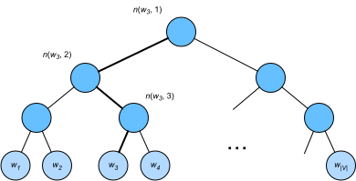

# 14.2 Приближённое обучение

Вспомним наше обсуждение в разделе 14.1. Основная идея модели skip-gram — с помощью операции softmax вычислить условную вероятность порождения контекстного слова $w_o$ при заданном центральном слове $w_c$ (формула (14.1.1)); соответствующие логарифмические потери даны в (14.1.2).

Из-за свойств операции softmax контекстное слово может быть любым элементом словаря $\mathcal{V}$, поэтому в (14.1.2) стоит сумма с числом слагаемых, равным размеру всего словаря. Следовательно, вычисление градиента модели skip-gram в (14.1.3) и градиента модели непрерывного мешка слов в (14.1.5) тоже содержит суммирование. К сожалению, вычислять градиент такой суммы по словарю (обычно из сотен тысяч или миллионов слов) очень дорого!

Чтобы снизить эту вычислительную сложность, в этом разделе мы рассмотрим два метода приближённого обучения: *отрицательную выборку* (negative sampling) и *иерархический softmax* (hierarchical softmax). Из-за сходства моделей skip-gram и непрерывного мешка слов мы опишем эти два метода на примере модели skip-gram.

## Отрицательная выборка

Отрицательная выборка изменяет исходную целевую функцию. Пусть задано контекстное окно центрального слова $w_c$. Будем считать, что любое контекстное слово $w_o$ из этого окна — событие, вероятность которого моделируется так:

$$P(D=1\mid w_c, w_o) = \sigma(\mathbf{u}_o^\top \mathbf{v}_c),$$

где $\sigma$ использует определение сигмоидной функции активации:

$$\sigma(x) = \frac{1}{1+\exp(-x)}.\tag{14.2.1}$$

Начнём обучение вложений слов с максимизации совместной вероятности всех таких событий в текстовой последовательности. Точнее, пусть дана текстовая последовательность длины $T$, слово на временном шаге $t$ обозначено $w^{(t)}$, а размер контекстного окна равен $m$. Рассмотрим максимизацию совместной вероятности

$$ \prod_{t=1}^{T} \prod_{-m \leq j \leq m,\ j \neq 0} P(D=1\mid w^{(t)}, w^{(t+j)}).\tag{14.2.2}$$

Однако (14.2.2) учитывает только события с положительными примерами. Совместная вероятность в (14.2.2) достигает максимума 1 лишь тогда, когда все векторы слов равны бесконечности. Разумеется, такой результат бессмыслен. Чтобы целевая функция стала осмысленнее, *отрицательная выборка* добавляет отрицательные примеры, выбранные из заранее заданного распределения.

Обозначим через $S$ событие «контекстное слово $w_o$ взято из контекстного окна центрального слова $w_c$». Для этого события, включающего $w_o$, из заранее заданного распределения $P(w)$ выбираем $K$ *шумовых слов*, не взятых из этого контекстного окна. Обозначим через $N_k$ событие «шумовое слово $w_k$ ($k=1, \ldots, K$) не взято из контекстного окна $w_c$». Предположим, что события $S, N_1, \ldots, N_K$ для положительного и отрицательных примеров взаимно независимы. Отрицательная выборка переписывает совместную вероятность из (14.2.2) (содержащую только положительные примеры) как

$$ \prod_{t=1}^{T} \prod_{-m \leq j \leq m,\ j \neq 0} P(w^{(t+j)} \mid w^{(t)}),$$

а условную вероятность приближает через события $S, N_1, \ldots, N_K$:

$$ P(w^{(t+j)} \mid w^{(t)}) =P(D=1\mid w^{(t)}, w^{(t+j)})\prod_{k=1,\ w_k \sim P(w)}^K P(D=0\mid w^{(t)}, w_k).\tag{14.2.3}$$

Обозначим через $i_t$ и $h_k$ индексы слова $w^{(t)}$ на временном шаге $t$ текстовой последовательности и шумового слова $w_k$ соответственно. Логарифмические потери для условной вероятности в (14.2.3) равны

$$
\begin{aligned}
-\log P(w^{(t+j)} \mid w^{(t)})
=& -\log P(D=1\mid w^{(t)}, w^{(t+j)}) - \sum_{k=1,\ w_k \sim P(w)}^K \log P(D=0\mid w^{(t)}, w_k)\\
=&-  \log\, \sigma\left(\mathbf{u}_{i_{t+j}}^\top \mathbf{v}_{i_t}\right) - \sum_{k=1,\ w_k \sim P(w)}^K \log\left(1-\sigma\left(\mathbf{u}_{h_k}^\top \mathbf{v}_{i_t}\right)\right)\\
=&-  \log\, \sigma\left(\mathbf{u}_{i_{t+j}}^\top \mathbf{v}_{i_t}\right) - \sum_{k=1,\ w_k \sim P(w)}^K \log\sigma\left(-\mathbf{u}_{h_k}^\top \mathbf{v}_{i_t}\right).
\end{aligned}
$$

Теперь видно, что стоимость вычисления градиента на каждом шаге обучения не зависит от размера словаря, а линейно зависит от $K$. Если гиперпараметр $K$ мал, то стоимость вычисления градиента на каждом шаге обучения с отрицательной выборкой невелика.

## Иерархический softmax

В качестве другого метода приближённого обучения *иерархический softmax* использует бинарное дерево (структуру данных, показанную на рис. 14.2.1), в котором каждый лист представляет слово словаря $\mathcal{V}$.

Обозначим через $L(w)$ число узлов (включая оба конца) на пути от корня до листа, представляющего слово $w$, в бинарном дереве. Пусть $n(w,j)$ — $j$-й узел на этом пути, а его вектор контекстного слова равен $\mathbf{u}_{n(w, j)}$. Например, на рис. 14.2.1 $L(w_3) = 4$. Иерархический softmax приближает условную вероятность из (14.1.1) выражением

$$P(w_o \mid w_c) = \prod_{j=1}^{L(w_o)-1} \sigma\left( [\![  n(w_o, j+1) = \text{leftChild}(n(w_o, j)) ]\!] \cdot \mathbf{u}_{n(w_o, j)}^\top \mathbf{v}_c\right),$$

где функция $\sigma$ определена в (14.2.1), $\text{leftChild}(n)$ — левый потомок узла $n$, а $[\![x]\!] = 1$, если $x$ истинно, и $[\![x]\!] = -1$ в противном случае.

Для иллюстрации вычислим условную вероятность порождения слова $w_3$ при заданном слове $w_c$ на рис. 14.2.1. Для этого нужны скалярные произведения вектора $\mathbf{v}_c$ слова $w_c$ и векторов нелистовых узлов на пути от корня до $w_3$ (путь выделен жирным на рис. 14.2.1), который последовательно проходит влево, вправо и влево:

$$P(w_3 \mid w_c) = \sigma(\mathbf{u}_{n(w_3, 1)}^\top \mathbf{v}_c) \cdot \sigma(-\mathbf{u}_{n(w_3, 2)}^\top \mathbf{v}_c) \cdot \sigma(\mathbf{u}_{n(w_3, 3)}^\top \mathbf{v}_c).$$

Поскольку $\sigma(x)+\sigma(-x) = 1$, условные вероятности порождения всех слов словаря $\mathcal{V}$ при любом заданном слове $w_c$ в сумме дают 1:

$$\sum_{w \in \mathcal{V}} P(w \mid w_c) = 1.\tag{14.2.4}$$

К счастью, благодаря структуре бинарного дерева величина $L(w_o)-1$ имеет порядок $\mathcal{O}(\text{log}_2|\mathcal{V}|)$. Когда размер словаря $\mathcal{V}$ велик, вычислительная стоимость каждого шага обучения с иерархическим softmax значительно ниже, чем без приближённого обучения.

## Резюме

* Отрицательная выборка строит функцию потерь, рассматривая взаимно независимые события, в которые входят и положительные, и отрицательные примеры. Объём вычислений при обучении линейно зависит от числа шумовых слов на каждом шаге.
* Иерархический softmax строит функцию потерь по пути от корня до листа в бинарном дереве. Вычислительная стоимость обучения зависит от логарифма размера словаря.

## Упражнения

1. Как выбирать шумовые слова при отрицательной выборке?
1. Проверьте, что (14.2.4) выполняется.
1. Как обучить модель непрерывного мешка слов с помощью отрицательной выборки и иерархического softmax соответственно?

[Обсуждение](https://discuss.d2l.ai/t/5741)
