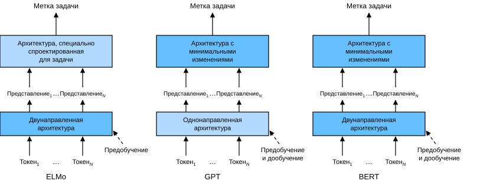
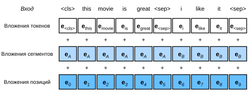

# 14.8 Двунаправленные представления кодировщика Transformer (BERT)

Мы познакомились с несколькими моделями вложений слов для понимания естественного языка. После предобучения результат можно считать матрицей, каждая строка которой — вектор, представляющий слово предопределённого словаря. Фактически все эти модели вложений слов *не зависят от контекста*. Сначала проиллюстрируем это свойство.

## 14.8.1 От контекстно-независимых представлений к контекстно-зависимым

Вспомним эксперименты из разделов 14.4 и 14.7. Например, и word2vec, и GloVe присваивают одному и тому же слову один и тот же предобученный вектор независимо от контекста слова (если он есть). Формально контекстно-независимое представление любого токена $x$ — это функция $f(x)$, которая принимает на вход только $x$. Учитывая обилие полисемии и сложную семантику естественного языка, у контекстно-независимых представлений есть очевидные ограничения. Например, слово «crane» в контекстах «a crane is flying» («летит журавль») и «a crane driver came» («пришёл крановщик») имеет совершенно разные значения; поэтому одному и тому же слову в зависимости от контекста можно присваивать разные представления.

Это стимулировало развитие «контекстно-зависимых» представлений слов, где представление слова зависит от его контекста. Поэтому контекстно-зависимое представление токена $x$ — функция $f(x, c(x))$, зависящая от $x$ и его контекста $c(x)$. Популярные контекстно-зависимые представления включают TagLM (language-model-augmented sequence tagger — разметчик последовательностей, дополненный языковой моделью) (Peters et al., 2017), CoVe (Context Vectors — контекстные векторы) (McCann et al., 2017) и ELMo (Embeddings from Language Models — вложения из языковых моделей) (Peters et al., 2018).

Например, принимая на вход всю последовательность, ELMo — это функция, которая присваивает представление каждому слову входной последовательности. Точнее, ELMo объединяет представления всех промежуточных слоёв предобученной двунаправленной LSTM в выходное представление. Затем представление ELMo добавляется как дополнительный признак в существующую контролируемую модель для прикладной задачи, например конкатенацией представления ELMo с исходным представлением токена (например, GloVe) в существующей модели. С одной стороны, после добавления представлений ELMo все веса в предобученной двунаправленной LSTM замораживаются. С другой стороны, существующая контролируемая модель специально настроена под данную задачу. Если для разных задач брать разные лучшие на тот момент модели, то добавление ELMo улучшало лучшие известные результаты (state of the art) в шести задачах обработки естественного языка: анализе тональности, логическом выводе на естественном языке, разметке семантических ролей, разрешении кореференции, распознавании именованных сущностей и ответах на вопросы.

## 14.8.2 От специфичных для задачи к независимым от задачи моделям

Хотя ELMo значительно улучшил решения для ряда задач обработки естественного языка, каждое решение по-прежнему опирается на специфичную для задачи архитектуру. Однако спроектировать конкретную архитектуру для каждой задачи обработки естественного языка на практике непросто. Модель GPT (Generative Pre-Training — генеративное предобучение) предлагает универсальную, не зависящую от задачи модель для контекстно-зависимых представлений (Radford et al., 2018). GPT построена на декодировщике Transformer и предобучает языковую модель, которая будет использоваться для представления текстовых последовательностей. При применении GPT к прикладной задаче выход языковой модели подаётся в дополнительный линейный выходной слой для предсказания метки задачи. В отличие от ELMo, замораживающего параметры предобученной модели, GPT дообучает все параметры предобученного декодировщика Transformer в ходе контролируемого обучения прикладной задачи. GPT оценивалась на двенадцати задачах — логический вывод на естественном языке, ответы на вопросы, сходство предложений и классификация — и улучшила лучшие известные результаты в девяти из них при минимальных изменениях архитектуры модели.

Однако из-за авторегрессионной природы языковых моделей GPT смотрит только вперёд (слева направо). В контекстах «i went to the bank to deposit cash» («я пошёл в банк положить наличные») и «i went to the bank to sit down» («я пошёл на берег присесть») GPT вернёт одно и то же представление «bank», поскольку оно чувствительно к левому контексту, хотя значения слова различаются.

## 14.8.3 BERT: лучшее из двух миров

Как мы видели, ELMo кодирует контекст двунаправленно, но использует специфичные для задачи архитектуры, а GPT не зависит от задачи, но кодирует контекст слева направо. Объединяя лучшее из двух миров, BERT (Bidirectional Encoder Representations from Transformers — двунаправленные представления кодировщика Transformer) кодирует контекст двунаправленно и требует лишь минимальных изменений архитектуры для широкого круга задач обработки естественного языка (Devlin et al., 2018). Используя предобученный кодировщик Transformer, BERT способен представить любой токен на основе его двунаправленного контекста. При контролируемом обучении прикладных задач BERT похож на GPT в двух аспектах. Во-первых, представления BERT подаются в добавленный выходной слой, причём архитектура модели минимально меняется в зависимости от природы задачи, например предсказание для каждого токена или для всей последовательности. Во-вторых, все параметры предобученного кодировщика Transformer дообучаются, а дополнительный выходной слой обучается с нуля. На рис. 14.8.1 показаны различия между ELMo, GPT и BERT.



**Рис. 14.8.1.** Сравнение ELMo, GPT и BERT

BERT улучшил лучшие известные результаты в 11 задачах обработки естественного языка, которые делятся на следующие категории: (1) классификация одиночного текста (например, анализ тональности), (2) классификация пар текстов (например, логический вывод на естественном языке), (3) ответы на вопросы, (4) разметка текста (например, распознавание именованных сущностей). Все эти модели — от контекстно-зависимого ELMo до независимых от задачи GPT и BERT — были предложены в 2018 году. Концептуально простое, но эмпирически мощное глубокое предобучение представлений естественного языка совершило переворот в решениях разных задач обработки естественного языка.

В остальной части этой главы мы подробно рассмотрим подготовку BERT к обучению. Когда в главе 15 мы будем объяснять приложения обработки естественного языка, мы покажем дообучение BERT для прикладных задач.

**MXNet:**

```python
from d2l import mxnet as d2l
from mxnet import gluon, np, npx
from mxnet.gluon import nn

npx.set_np()
```

**PyTorch:**

```python
from d2l import torch as d2l
import torch
from torch import nn
```

**PaddlePaddle:**

```python
from d2l import paddle as d2l
import warnings
warnings.filterwarnings("ignore")
import paddle
from paddle import nn
```

## 14.8.4 Входное представление

В обработке естественного языка одни задачи (например, анализ тональности) принимают на вход один текст, а другие (например, логический вывод на естественном языке) — пару текстовых последовательностей. Входная последовательность BERT однозначно представляет и одиночный текст, и пару текстов. Если вход — одиночный текст, входная последовательность BERT — это конкатенация специального токена класса `<cls>`, токенов текстовой последовательности и специального разделяющего токена `<sep>`. Если вход — пара текстов, входная последовательность BERT — это конкатенация `<cls>`, токенов первой текстовой последовательности, `<sep>`, токенов второй текстовой последовательности и `<sep>`. Мы будем последовательно отличать термин «входная последовательность BERT» от других видов «последовательностей». Например, одна *входная последовательность BERT* может включать либо одну *текстовую последовательность*, либо две *текстовые последовательности*.

Чтобы различать пары текстов, обученные вложения сегментов $\mathbf{e}_A$ и $\mathbf{e}_B$ добавляются к вложениям токенов первой и второй последовательностей соответственно. Для входа из одного текста используется только $\mathbf{e}_A$.

Следующая функция `get_tokens_and_segments` принимает на вход одно или два предложения и возвращает токены входной последовательности BERT и соответствующие им индексы сегментов.

```python
#@save
def get_tokens_and_segments(tokens_a, tokens_b=None):
    """Возвращает токены входной последовательности BERT и индексы их сегментов"""
    tokens = ['<cls>'] + tokens_a + ['<sep>']
    # 0 и 1 отмечают сегменты A и B соответственно
    segments = [0] * (len(tokens_a) + 2)
    if tokens_b is not None:
        tokens += tokens_b + ['<sep>']
        segments += [1] * (len(tokens_b) + 1)
    return tokens, segments
```

В качестве двунаправленной архитектуры BERT выбирает кодировщик Transformer. В кодировщике Transformer позиционные вложения добавляются к каждой позиции входной последовательности. Однако в отличие от исходного кодировщика Transformer BERT использует *обучаемые* позиционные вложения. Итак, на рис. 14.8.2 показано, что вложение входной последовательности BERT — это сумма вложений токенов, вложений сегментов и позиционных вложений.



**Рис. 14.8.2.** Вложение входной последовательности BERT — сумма вложений токенов, вложений сегментов и позиционных вложений

Следующий класс `BERTEncoder` похож на класс `TransformerEncoder`, реализованный в разделе 10.7. В отличие от `TransformerEncoder`, `BERTEncoder` использует вложения сегментов и обучаемые позиционные вложения.

**MXNet:**

```python
#@save
class BERTEncoder(nn.Block):
    """Кодировщик BERT"""
    def __init__(self, vocab_size, num_hiddens, ffn_num_hiddens, num_heads,
                 num_layers, dropout, max_len=1000, **kwargs):
        super(BERTEncoder, self).__init__(**kwargs)
        self.token_embedding = nn.Embedding(vocab_size, num_hiddens)
        self.segment_embedding = nn.Embedding(2, num_hiddens)
        self.blks = nn.Sequential()
        for _ in range(num_layers):
            self.blks.add(d2l.EncoderBlock(
                num_hiddens, ffn_num_hiddens, num_heads, dropout, True))
        # В BERT позиционные вложения обучаемые, поэтому мы создаём
        # параметр позиционных вложений достаточной длины
        self.pos_embedding = self.params.get('pos_embedding',
                                             shape=(1, max_len, num_hiddens))

    def forward(self, tokens, segments, valid_lens):
        # В следующем фрагменте кода форма X остаётся прежней:
        # (размер минибатча, максимальная длина последовательности, num_hiddens)
        X = self.token_embedding(tokens) + self.segment_embedding(segments)
        X = X + self.pos_embedding.data(ctx=X.ctx)[:, :X.shape[1], :]
        for blk in self.blks:
            X = blk(X, valid_lens)
        return X
```

**PyTorch:**

```python
#@save
class BERTEncoder(nn.Module):
    """Кодировщик BERT"""
    def __init__(self, vocab_size, num_hiddens, norm_shape, ffn_num_input,
                 ffn_num_hiddens, num_heads, num_layers, dropout,
                 max_len=1000, key_size=768, query_size=768, value_size=768,
                 **kwargs):
        super(BERTEncoder, self).__init__(**kwargs)
        self.token_embedding = nn.Embedding(vocab_size, num_hiddens)
        self.segment_embedding = nn.Embedding(2, num_hiddens)
        self.blks = nn.Sequential()
        for i in range(num_layers):
            self.blks.add_module(f"{i}", d2l.EncoderBlock(
                key_size, query_size, value_size, num_hiddens, norm_shape,
                ffn_num_input, ffn_num_hiddens, num_heads, dropout, True))
        # В BERT позиционные вложения обучаемые, поэтому мы создаём
        # параметр позиционных вложений достаточной длины
        self.pos_embedding = nn.Parameter(torch.randn(1, max_len,
                                                      num_hiddens))

    def forward(self, tokens, segments, valid_lens):
        # В следующем фрагменте кода форма X остаётся прежней:
        # (размер минибатча, максимальная длина последовательности, num_hiddens)
        X = self.token_embedding(tokens) + self.segment_embedding(segments)
        X = X + self.pos_embedding.data[:, :X.shape[1], :]
        for blk in self.blks:
            X = blk(X, valid_lens)
        return X
```

**PaddlePaddle:**

```python
#@save
class BERTEncoder(nn.Layer):
    """Кодировщик BERT"""
    def __init__(self, vocab_size, num_hiddens, norm_shape, ffn_num_input,
                 ffn_num_hiddens, num_heads, num_layers, dropout,
                 max_len=1000, key_size=768, query_size=768, value_size=768,
                 **kwargs):
        super(BERTEncoder, self).__init__(**kwargs)
        self.token_embedding = nn.Embedding(vocab_size, num_hiddens)
        self.segment_embedding = nn.Embedding(2, num_hiddens)
        self.blks = nn.Sequential()
        for i in range(num_layers):
            self.blks.add_sublayer(f"{i}", d2l.EncoderBlock(
                key_size, query_size, value_size, num_hiddens, norm_shape,
                ffn_num_input, ffn_num_hiddens, num_heads, dropout, True))
        # В BERT позиционные вложения обучаемые, поэтому мы создаём
        # параметр позиционных вложений достаточной длины
        x = paddle.randn([1, max_len, num_hiddens])    
        self.pos_embedding = paddle.create_parameter(shape=x.shape, dtype=str(x.numpy().dtype),
                                                     default_initializer=paddle.nn.initializer.Assign(x))

    def forward(self, tokens, segments, valid_lens):
        # В следующем фрагменте кода форма X остаётся прежней:
        # (размер минибатча, максимальная длина последовательности, num_hiddens)
        X = self.token_embedding(tokens) + self.segment_embedding(segments)
        X = X + self.pos_embedding[:, :X.shape[1], :]
        for blk in self.blks:
            X = blk(X, valid_lens)
        return X
```

Допустим, размер словаря равен 10 000. Чтобы продемонстрировать прямое распространение `BERTEncoder`, создадим экземпляр и инициализируем его параметры.

**MXNet:**

```python
vocab_size, num_hiddens, ffn_num_hiddens, num_heads = 10000, 768, 1024, 4
num_layers, dropout = 2, 0.2
encoder = BERTEncoder(vocab_size, num_hiddens, ffn_num_hiddens, num_heads,
                      num_layers, dropout)
encoder.initialize()
```

**PyTorch, PaddlePaddle:**

```python
vocab_size, num_hiddens, ffn_num_hiddens, num_heads = 10000, 768, 1024, 4
norm_shape, ffn_num_input, num_layers, dropout = [768], 768, 2, 0.2
encoder = BERTEncoder(vocab_size, num_hiddens, norm_shape, ffn_num_input,
                      ffn_num_hiddens, num_heads, num_layers, dropout)
```

Мы определяем `tokens` как 2 входные последовательности длины 8, где каждый токен — индекс словаря. Прямое распространение `BERTEncoder` с входом `tokens` возвращает результат кодирования, в котором каждый токен представлен вектором, длина которого определяется гиперпараметром `num_hiddens`. Этот гиперпараметр обычно называют *скрытым размером* (числом скрытых элементов) кодировщика Transformer.

**MXNet:**

```python
tokens = np.random.randint(0, vocab_size, (2, 8))
segments = np.array([[0, 0, 0, 0, 1, 1, 1, 1], [0, 0, 0, 1, 1, 1, 1, 1]])
encoded_X = encoder(tokens, segments, None)
encoded_X.shape
```

**PyTorch:**

```python
tokens = torch.randint(0, vocab_size, (2, 8))
segments = torch.tensor([[0, 0, 0, 0, 1, 1, 1, 1], [0, 0, 0, 1, 1, 1, 1, 1]])
encoded_X = encoder(tokens, segments, None)
encoded_X.shape
```

**PaddlePaddle:**

```python
tokens = paddle.randint(0, vocab_size, (2, 8))
segments = paddle.to_tensor([[0, 0, 0, 0, 1, 1, 1, 1], [0, 0, 0, 1, 1, 1, 1, 1]])
encoded_X = encoder(tokens, segments, None)
encoded_X.shape
```

## 14.8.5 Задачи предобучения

Прямое распространение `BERTEncoder` даёт представления BERT для каждого токена входного текста и для вставленных специальных токенов `<cls>` и `<sep>`. Далее мы используем эти представления, чтобы вычислить функцию потерь для предобучения BERT. Предобучение включает две задачи: маскированную языковую модель и предсказание следующего предложения.

### 14.8.5.1 Маскированная языковая модель (Masked Language Modeling)

Как показано в разделе 8.3, языковая модель предсказывает токен по контексту слева. Чтобы двунаправленно кодировать контекст для представления каждого токена, BERT случайно маскирует токены и самоконтролируемо предсказывает замаскированные токены по токенам двунаправленного контекста. Эту задачу называют *маскированной языковой моделью*.

В этой задаче предобучения 15% токенов случайно выбираются как замаскированные токены для предсказания. Чтобы предсказывать замаскированный токен, не «подсматривая» метку, простой подход — всегда заменять его во входной последовательности специальным токеном `<mask>`. Однако искусственный специальный токен `<mask>` никогда не появляется при дообучении. Чтобы избежать такого рассогласования между предобучением и дообучением, если токен замаскирован для предсказания (например, в предложении «this movie is great» выбран для маскирования и предсказания токен «great»), то во входной последовательности он заменяется на:

* специальный токен `<mask>` в 80% случаев (например, «this movie is great» превращается в «this movie is `<mask>`»);
* случайный токен в 10% случаев (например, «this movie is great» превращается в «this movie is drink»);
* неизменный токен-метку в 10% случаев (например, «this movie is great» превращается в «this movie is great»).

Заметим, что в 10% из 15% случаев вставляется случайный токен. Этот случайный шум побуждает BERT меньше смещаться в сторону замаскированного токена (особенно когда токен-метка остаётся без изменений) при двунаправленном кодировании контекста.

Мы реализуем следующий класс `MaskLM` для предсказания замаскированных токенов в задаче маскированной языковой модели при предобучении BERT. В предсказании используется многослойный перцептрон с одним скрытым слоем (`self.mlp`). При прямом распространении он принимает два входа: результат кодирования `BERTEncoder` и позиции токенов для предсказания. Выход — результаты предсказания в этих позициях.

**MXNet:**

```python
#@save
class MaskLM(nn.Block):
    """Задача маскированной языковой модели BERT"""
    def __init__(self, vocab_size, num_hiddens, **kwargs):
        super(MaskLM, self).__init__(**kwargs)
        self.mlp = nn.Sequential()
        self.mlp.add(
            nn.Dense(num_hiddens, flatten=False, activation='relu'))
        self.mlp.add(nn.LayerNorm())
        self.mlp.add(nn.Dense(vocab_size, flatten=False))

    def forward(self, X, pred_positions):
        num_pred_positions = pred_positions.shape[1]
        pred_positions = pred_positions.reshape(-1)
        batch_size = X.shape[0]
        batch_idx = np.arange(0, batch_size)
        # Допустим, batch_size=2, num_pred_positions=3,
        # тогда batch_idx — это np.array([0, 0, 0, 1, 1, 1])
        batch_idx = np.repeat(batch_idx, num_pred_positions)
        masked_X = X[batch_idx, pred_positions]
        masked_X = masked_X.reshape((batch_size, num_pred_positions, -1))
        mlm_Y_hat = self.mlp(masked_X)
        return mlm_Y_hat
```

**PyTorch:**

```python
#@save
class MaskLM(nn.Module):
    """Задача маскированной языковой модели BERT"""
    def __init__(self, vocab_size, num_hiddens, num_inputs=768, **kwargs):
        super(MaskLM, self).__init__(**kwargs)
        self.mlp = nn.Sequential(nn.Linear(num_inputs, num_hiddens),
                                 nn.ReLU(),
                                 nn.LayerNorm(num_hiddens),
                                 nn.Linear(num_hiddens, vocab_size))

    def forward(self, X, pred_positions):
        num_pred_positions = pred_positions.shape[1]
        pred_positions = pred_positions.reshape(-1)
        batch_size = X.shape[0]
        batch_idx = torch.arange(0, batch_size)
        # Допустим, batch_size=2, num_pred_positions=3,
        # тогда batch_idx — это np.array([0, 0, 0, 1, 1, 1])
        batch_idx = torch.repeat_interleave(batch_idx, num_pred_positions)
        masked_X = X[batch_idx, pred_positions]
        masked_X = masked_X.reshape((batch_size, num_pred_positions, -1))
        mlm_Y_hat = self.mlp(masked_X)
        return mlm_Y_hat
```

**PaddlePaddle:**

```python
#@save
class MaskLM(nn.Layer):
    """Задача маскированной языковой модели BERT"""
    def __init__(self, vocab_size, num_hiddens, num_inputs=768, **kwargs):
        super(MaskLM, self).__init__(**kwargs)
        self.mlp = nn.Sequential(nn.Linear(num_inputs, num_hiddens),
                                 nn.ReLU(),
                                 nn.LayerNorm(num_hiddens),
                                 nn.Linear(num_hiddens, vocab_size))

    def forward(self, X, pred_positions):
        num_pred_positions = pred_positions.shape[1]
        pred_positions = pred_positions.reshape([-1])
        batch_size = X.shape[0]
        batch_idx = paddle.arange(0, batch_size)
        # Допустим, batch_size=2, num_pred_positions=3,
        # тогда batch_idx — это np.array([0, 0, 0, 1, 1, 1])
        batch_idx = paddle.repeat_interleave(batch_idx, num_pred_positions)
        masked_X = X[batch_idx, pred_positions]
        masked_X = masked_X.reshape((batch_size, num_pred_positions, -1))
        mlm_Y_hat = self.mlp(masked_X)
        return mlm_Y_hat
```

Чтобы продемонстрировать прямое распространение `MaskLM`, создадим его экземпляр `mlm` и инициализируем. Напомним, что `encoded_X` — результат прямого распространения `BERTEncoder` — представляет 2 входные последовательности BERT. Определим `mlm_positions` как 3 индекса для предсказания в любой из входных последовательностей `encoded_X`. Прямое распространение `mlm` возвращает результаты предсказания `mlm_Y_hat` во всех замаскированных позициях `mlm_positions` последовательности `encoded_X`. Для каждого предсказания размер результата равен размеру словаря.

**MXNet:**

```python
mlm = MaskLM(vocab_size, num_hiddens)
mlm.initialize()
mlm_positions = np.array([[1, 5, 2], [6, 1, 5]])
mlm_Y_hat = mlm(encoded_X, mlm_positions)
mlm_Y_hat.shape
```

**PyTorch:**

```python
mlm = MaskLM(vocab_size, num_hiddens)
mlm_positions = torch.tensor([[1, 5, 2], [6, 1, 5]])
mlm_Y_hat = mlm(encoded_X, mlm_positions)
mlm_Y_hat.shape
```

**PaddlePaddle:**

```python
mlm = MaskLM(vocab_size, num_hiddens)
mlm_positions = paddle.to_tensor([[1, 5, 2], [6, 1, 5]])
mlm_Y_hat = mlm(encoded_X, mlm_positions)
mlm_Y_hat.shape
```

С истинными метками `mlm_Y` предсказанных токенов в замаскированных позициях и предсказаниями `mlm_Y_hat` можно вычислить потери кросс-энтропии для задачи маскированной языковой модели при предобучении BERT.

**MXNet:**

```python
mlm_Y = np.array([[7, 8, 9], [10, 20, 30]])
loss = gluon.loss.SoftmaxCrossEntropyLoss()
mlm_l = loss(mlm_Y_hat.reshape((-1, vocab_size)), mlm_Y.reshape(-1))
mlm_l.shape
```

**PyTorch:**

```python
mlm_Y = torch.tensor([[7, 8, 9], [10, 20, 30]])
loss = nn.CrossEntropyLoss(reduction='none')
mlm_l = loss(mlm_Y_hat.reshape((-1, vocab_size)), mlm_Y.reshape(-1))
mlm_l.shape
```

**PaddlePaddle:**

```python
mlm_Y = paddle.to_tensor([[7, 8, 9], [10, 20, 30]])
loss = nn.CrossEntropyLoss(reduction='none')
mlm_l = loss(mlm_Y_hat.reshape((-1, vocab_size)), mlm_Y.reshape([-1]))
mlm_l.shape
```

### 14.8.5.2 Предсказание следующего предложения (Next Sentence Prediction)

Хотя маскированная языковая модель способна кодировать двунаправленный контекст для представления слов, она не моделирует явно логические отношения между парами текстов. Чтобы помочь понять отношение между двумя текстовыми последовательностями, BERT в предобучении рассматривает задачу бинарной классификации — *предсказание следующего предложения*. При генерации пар предложений для предобучения в половине случаев это действительно подряд идущие предложения с меткой «истина»; в другой половине случаев второе предложение случайно выбирается из корпуса и помечается как «ложь».

Следующий класс `NextSentencePred` с помощью многослойного перцептрона с одним скрытым слоем предсказывает, является ли второе предложение следующим за первым во входной последовательности BERT. Благодаря самовниманию в кодировщике Transformer представление BERT специального токена `<cls>` уже кодирует оба входных предложения. Поэтому выходной слой (`self.output`) классификатора-перцептрона принимает на вход `X` — выход скрытого слоя перцептрона, входом которого служит закодированный токен `<cls>`.

**MXNet:**

```python
#@save
class NextSentencePred(nn.Block):
    """Задача предсказания следующего предложения BERT"""
    def __init__(self, **kwargs):
        super(NextSentencePred, self).__init__(**kwargs)
        self.output = nn.Dense(2)

    def forward(self, X):
        # Форма X: (размер минибатча, num_hiddens)
        return self.output(X)
```

**PyTorch:**

```python
#@save
class NextSentencePred(nn.Module):
    """Задача предсказания следующего предложения BERT"""
    def __init__(self, num_inputs, **kwargs):
        super(NextSentencePred, self).__init__(**kwargs)
        self.output = nn.Linear(num_inputs, 2)

    def forward(self, X):
        # Форма X: (размер минибатча, num_hiddens)
        return self.output(X)
```

**PaddlePaddle:**

```python
#@save
class NextSentencePred(nn.Layer):
    """Задача предсказания следующего предложения BERT"""
    def __init__(self, num_inputs, **kwargs):
        super(NextSentencePred, self).__init__(**kwargs)
        self.output = nn.Linear(num_inputs, 2)

    def forward(self, X):
        # Форма X: (размер минибатча, num_hiddens)
        return self.output(X)
```

Видно, что прямое распространение экземпляра `NextSentencePred` возвращает бинарное предсказание для каждой входной последовательности BERT.

**MXNet:**

```python
nsp = NextSentencePred()
nsp.initialize()
nsp_Y_hat = nsp(encoded_X)
nsp_Y_hat.shape
```

**PyTorch:**

```python
encoded_X = torch.flatten(encoded_X, start_dim=1)
# Форма входа NSP: (размер минибатча, num_hiddens)
nsp = NextSentencePred(encoded_X.shape[-1])
nsp_Y_hat = nsp(encoded_X)
nsp_Y_hat.shape
```

**PaddlePaddle:**

```python
encoded_X = paddle.flatten(encoded_X, start_axis=1)
# Форма входа NSP: (размер минибатча, num_hiddens)
nsp = NextSentencePred(encoded_X.shape[-1])
nsp_Y_hat = nsp(encoded_X)
nsp_Y_hat.shape
```

Можно также вычислить потери кросс-энтропии двух задач бинарной классификации.

**MXNet:**

```python
nsp_y = np.array([0, 1])
nsp_l = loss(nsp_Y_hat, nsp_y)
nsp_l.shape
```

**PyTorch:**

```python
nsp_y = torch.tensor([0, 1])
nsp_l = loss(nsp_Y_hat, nsp_y)
nsp_l.shape
```

**PaddlePaddle:**

```python
nsp_y = paddle.to_tensor([0, 1])
nsp_l = loss(nsp_Y_hat, nsp_y)
nsp_l.shape
```

Стоит отметить, что все метки в двух описанных задачах предобучения можно получить из корпуса предобучения без ручной разметки. Исходный BERT был предобучен на объединении корпуса книг BookCorpus (Zhu et al., 2015) и английской «Википедии». Эти два текстовых корпуса огромны: в них 800 миллионов и 2,5 миллиарда слов соответственно.

## 14.8.6 Сборка кода

При предобучении BERT итоговая функция потерь — линейная комбинация функции потерь маскированной языковой модели и функции потерь предсказания следующего предложения. Теперь можно определить класс `BERTModel`, создав экземпляры трёх классов — `BERTEncoder`, `MaskLM` и `NextSentencePred`. Прямое распространение возвращает закодированное представление BERT `encoded_X`, предсказания маскированной языковой модели `mlm_Y_hat` и предсказание следующего предложения `nsp_Y_hat`.

**MXNet:**

```python
#@save
class BERTModel(nn.Block):
    """Модель BERT"""
    def __init__(self, vocab_size, num_hiddens, ffn_num_hiddens, num_heads,
                 num_layers, dropout, max_len=1000):
        super(BERTModel, self).__init__()
        self.encoder = BERTEncoder(vocab_size, num_hiddens, ffn_num_hiddens,
                                   num_heads, num_layers, dropout, max_len)
        self.hidden = nn.Dense(num_hiddens, activation='tanh')
        self.mlm = MaskLM(vocab_size, num_hiddens)
        self.nsp = NextSentencePred()

    def forward(self, tokens, segments, valid_lens=None, 
                pred_positions=None):
        encoded_X = self.encoder(tokens, segments, valid_lens)
        if pred_positions is not None:
            mlm_Y_hat = self.mlm(encoded_X, pred_positions)
        else:
            mlm_Y_hat = None
        # Скрытый слой классификатора-перцептрона для предсказания следующего
        # предложения; 0 — индекс токена «<cls>»
        nsp_Y_hat = self.nsp(self.hidden(encoded_X[:, 0, :]))
        return encoded_X, mlm_Y_hat, nsp_Y_hat
```

**PyTorch:**

```python
#@save
class BERTModel(nn.Module):
    """Модель BERT"""
    def __init__(self, vocab_size, num_hiddens, norm_shape, ffn_num_input,
                 ffn_num_hiddens, num_heads, num_layers, dropout,
                 max_len=1000, key_size=768, query_size=768, value_size=768,
                 hid_in_features=768, mlm_in_features=768,
                 nsp_in_features=768):
        super(BERTModel, self).__init__()
        self.encoder = BERTEncoder(vocab_size, num_hiddens, norm_shape,
                    ffn_num_input, ffn_num_hiddens, num_heads, num_layers,
                    dropout, max_len=max_len, key_size=key_size,
                    query_size=query_size, value_size=value_size)
        self.hidden = nn.Sequential(nn.Linear(hid_in_features, num_hiddens),
                                    nn.Tanh())
        self.mlm = MaskLM(vocab_size, num_hiddens, mlm_in_features)
        self.nsp = NextSentencePred(nsp_in_features)

    def forward(self, tokens, segments, valid_lens=None, 
                pred_positions=None):
        encoded_X = self.encoder(tokens, segments, valid_lens)
        if pred_positions is not None:
            mlm_Y_hat = self.mlm(encoded_X, pred_positions)
        else:
            mlm_Y_hat = None
        # Скрытый слой классификатора-перцептрона для предсказания следующего
        # предложения; 0 — индекс токена «<cls>»
        nsp_Y_hat = self.nsp(self.hidden(encoded_X[:, 0, :]))
        return encoded_X, mlm_Y_hat, nsp_Y_hat
```

**PaddlePaddle:**

```python
#@save
class BERTModel(nn.Layer):
    """Модель BERT"""
    def __init__(self, vocab_size, num_hiddens, norm_shape, ffn_num_input,
                 ffn_num_hiddens, num_heads, num_layers, dropout,
                 max_len=1000, key_size=768, query_size=768, value_size=768,
                 hid_in_features=768, mlm_in_features=768,
                 nsp_in_features=768):
        super(BERTModel, self).__init__()
        self.encoder = BERTEncoder(vocab_size, num_hiddens, norm_shape,
                    ffn_num_input, ffn_num_hiddens, num_heads, num_layers,
                    dropout, max_len=max_len, key_size=key_size,
                    query_size=query_size, value_size=value_size)
        self.hidden = nn.Sequential(nn.Linear(hid_in_features, num_hiddens),
                                    nn.Tanh())
        self.mlm = MaskLM(vocab_size, num_hiddens, mlm_in_features)
        self.nsp = NextSentencePred(nsp_in_features)

    def forward(self, tokens, segments, valid_lens=None,
                pred_positions=None):
        encoded_X = self.encoder(tokens, segments, valid_lens)
        if pred_positions is not None:
            mlm_Y_hat = self.mlm(encoded_X, pred_positions)
        else:
            mlm_Y_hat = None
        # Скрытый слой классификатора-перцептрона для предсказания следующего
        # предложения; 0 — индекс токена «<cls>»
        nsp_Y_hat = self.nsp(self.hidden(encoded_X[:, 0, :]))
        return encoded_X, mlm_Y_hat, nsp_Y_hat
```

## Резюме

* Модели вложений слов, такие как word2vec и GloVe, не зависят от контекста. Они присваивают одному и тому же слову один и тот же предобученный вектор независимо от контекста слова (если он есть). Им трудно справляться с полисемией и сложной семантикой в естественном языке.
* Для контекстно-зависимых представлений слов, таких как ELMo и GPT, представления слов зависят от их контекста.
* ELMo кодирует контекст двунаправленно, но использует специфичные для задачи архитектуры (хотя спроектировать конкретную архитектуру для каждой задачи обработки естественного языка на практике непросто), а GPT не зависит от задачи, но кодирует контекст слева направо.
* BERT объединяет лучшее из двух миров: он кодирует контекст двунаправленно и требует минимальных изменений архитектуры для широкого круга задач обработки естественного языка.
* Вложение входной последовательности BERT — сумма вложений токенов, вложений сегментов и позиционных вложений.
* Предобучение включает две задачи: маскированную языковую модель и предсказание следующего предложения. Первая способна кодировать двунаправленный контекст для представления слов, а вторая явно моделирует логические отношения между парами текстов.

## Упражнения

1. Почему BERT оказался успешным?
1. При прочих равных условиях маскированной языковой модели требуется больше или меньше шагов предобучения для сходимости, чем языковой модели «слева направо»? Почему?
1. В исходной реализации BERT позиционная полносвязная сеть в `BERTEncoder` (через `d2l.EncoderBlock`) и полносвязный слой в `MaskLM` используют в качестве функции активации линейный элемент с гауссовой ошибкой (Gaussian error linear unit, GELU) (Hendrycks and Gimpel, 2016). Изучите различие между GELU и ReLU.

**MXNet:**
[Обсуждение](https://discuss.d2l.ai/t/5749)

**PyTorch:**
[Обсуждение](https://discuss.d2l.ai/t/5750)

**PaddlePaddle:**
[Обсуждение](https://discuss.d2l.ai/t/11820)

## Литература

* Peters, M., Ammar, W., Bhagavatula, C., & Power, R. (2017). Semi-supervised sequence tagging with bidirectional language models. In *Proceedings of the 55th Annual Meeting of the Association for Computational Linguistics (Volume 1: Long Papers)*, 1756–1765.
* McCann, B., Bradbury, J., Xiong, C., & Socher, R. (2017). Learned in translation: Contextualized word vectors. In *Advances in Neural Information Processing Systems*, 6294–6305.
* Peters, M., Neumann, M., Iyyer, M., Gardner, M., Clark, C., Lee, K., & Zettlemoyer, L. (2018). Deep Contextualized Word Representations. In *Proceedings of the 2018 Conference of the North American Chapter of the Association for Computational Linguistics: Human Language Technologies, Volume 1 (Long Papers)*, 2227–2237.
* Radford, A., Narasimhan, K., Salimans, T., & Sutskever, I. (2018). Improving language understanding by generative pre-training. *OpenAI*.
* Devlin, J., Chang, M. W., Lee, K., & Toutanova, K. (2018). Bert: Pre-training of deep bidirectional transformers for language understanding. *arXiv preprint arXiv:1810.04805*.
* Zhu, Y., Kiros, R., Zemel, R., Salakhutdinov, R., Urtasun, R., Torralba, A., & Fidler, S. (2015). Aligning books and movies: Towards story-like visual explanations by watching movies and reading books. In *Proceedings of the IEEE international conference on computer vision*, 19–27.
* Hendrycks, D., & Gimpel, K. (2016). Gaussian error linear units (gelus). *arXiv preprint arXiv:1606.08415*.
