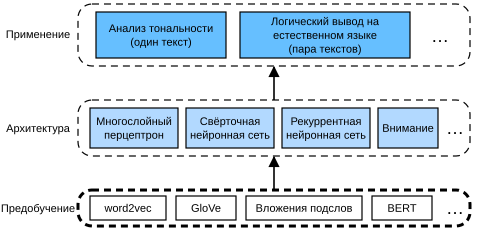

# 14. Обработка естественного языка: предобучение

Людям необходимо общаться. Из этой базовой потребности каждый день возникает огромное количество письменных текстов. Богатые тексты в социальных сетях, мессенджерах, электронной почте, отзывах о товарах, новостных статьях, научных работах и книгах делают крайне важным, чтобы компьютеры могли их понимать — помогать людям или принимать решения на основе человеческого языка.

*Обработка естественного языка* (natural language processing) изучает взаимодействие между компьютерами и людьми, использующими естественный язык. На практике методы обработки естественного языка очень часто применяют для обработки и анализа текстовых данных: примерами служат языковые модели из раздела 8.3 и модели машинного перевода из раздела 9.5.

Чтобы понимать текст, можно начать с изучения его представления. Используя существующие последовательности текста из больших корпусов, *самоконтролируемое обучение* (self-supervised learning) широко применяется для предобучения представлений текста: например, скрытую часть текста предсказывают по остальным частям окружающего текста. Так модели могут учиться «с учителем» на *огромных* объёмах текстовых данных, не нуждаясь в *дорогой* разметке!

В этой главе мы увидим, что если считать каждое слово или подслово отдельным токеном, то представление каждого токена можно предобучить на больших корпусах с помощью word2vec, GloVe или моделей вложения подслов. После предобучения представление каждого токена — это вектор. Однако он остаётся неизменным независимо от контекста. Например, векторное представление слова «bank» (по-русски «банк» или «берег») одинаково в предложениях «go to the bank to deposit some money» («пойти в банк, чтобы положить деньги») и «go to the bank to sit down» («пойти на берег, чтобы присесть»). Поэтому многие более новые предобученные модели подстраивают представление одного и того же токена под разные контексты. К ним относится BERT — более глубокая самоконтролируемая модель на основе кодировщика Transformer. В этой главе мы сосредоточимся на том, как предобучать такие представления текста, как показано на рис. 14.1.

На рис. 14.1 показано, что предобученные представления текста можно подать в различные архитектуры глубокого обучения и применить к разным задачам обработки естественного языка. Их мы рассмотрим в главе 15.
