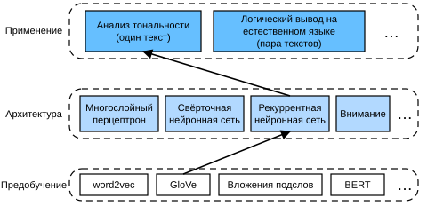

# 15.2 Анализ тональности: рекуррентные нейронные сети

Как и в задачах на сходство слов и аналогии, предобученные векторы слов можно применять и к анализу тональности. Поскольку набор рецензий IMDb из раздела 15.1 не очень велик, использование представлений текста, предобученных на крупномасштабных корпусах, может уменьшить переобучение модели. В качестве конкретного примера, показанного на рис. 15.2.1, мы будем представлять каждый токен предобученной моделью GloVe и подавать эти представления токенов в многослойную двунаправленную рекуррентную нейронную сеть, чтобы получить представление текстовой последовательности, которое затем будет преобразовано в выход анализа тональности (Maas et al., 2011). Для той же прикладной задачи позже мы рассмотрим другие архитектурные варианты.



**Рис. 15.2.1.** Подача GloVe в архитектуру на основе рекуррентной нейронной сети для анализа тональности

**MXNet:**

```python
from d2l import mxnet as d2l
from mxnet import gluon, init, np, npx
from mxnet.gluon import nn, rnn
npx.set_np()

batch_size = 64
train_iter, test_iter, vocab = d2l.load_data_imdb(batch_size)
```

**PyTorch:**

```python
from d2l import torch as d2l
import torch
from torch import nn

batch_size = 64
train_iter, test_iter, vocab = d2l.load_data_imdb(batch_size)
```

**PaddlePaddle:**

```python
from d2l import paddle as d2l
import warnings
warnings.filterwarnings("ignore")
import paddle
from paddle import nn

batch_size = 64
train_iter, test_iter, vocab = d2l.load_data_imdb(batch_size)
```

## 15.2.1 Представление одиночного текста рекуррентной нейронной сетью

В задачах классификации текстов, таких как анализ тональности, текстовая последовательность переменной длины преобразуется в категорию фиксированной длины. В следующем классе `BiRNN` каждый токен текстовой последовательности получает своё отдельное предобученное представление GloVe через слой вложений (`self.embedding`), а вся последовательность кодируется двунаправленной рекуррентной нейронной сетью (`self.encoder`). Точнее, скрытые состояния двунаправленной сети долгой краткосрочной памяти (на последнем слое) в начальный и конечный временные шаги конкатенируются и служат представлением текстовой последовательности. Затем это представление одиночного текста преобразуется в выходные категории полносвязным слоем (`self.decoder`) с двумя выходами («положительная» и «отрицательная»).

**MXNet:**

```python
class BiRNN(nn.Block):
    def __init__(self, vocab_size, embed_size, num_hiddens,
                 num_layers, **kwargs):
        super(BiRNN, self).__init__(**kwargs)
        self.embedding = nn.Embedding(vocab_size, embed_size)
        # Задаём bidirectional=True, чтобы получить двунаправленную
        # рекуррентную нейронную сеть
        self.encoder = rnn.LSTM(num_hiddens, num_layers=num_layers,
                                bidirectional=True, input_size=embed_size)
        self.decoder = nn.Dense(2)

    def forward(self, inputs):
        # Форма inputs: (размер минибатча, число временных шагов).
        # Поскольку LSTM требует, чтобы первое измерение входа было временным,
        # перед получением представлений токенов вход транспонируется.
        # Форма выхода: (число временных шагов, размер минибатча,
        # размерность вектора слова)
        embeddings = self.embedding(inputs.T)
        # Возвращает скрытые состояния последнего скрытого слоя
        # на разных временных шагах.
        # Форма outputs: (число временных шагов, размер минибатча,
        # 2 * число скрытых элементов)
        outputs = self.encoder(embeddings)
        # Конкатенируем скрытые состояния начального и конечного временных
        # шагов как вход полносвязного слоя.
        # Его форма: (размер минибатча, 4 * число скрытых элементов)
        encoding = np.concatenate((outputs[0], outputs[-1]), axis=1)
        outs = self.decoder(encoding)
        return outs
```

**PyTorch:**

```python
class BiRNN(nn.Module):
    def __init__(self, vocab_size, embed_size, num_hiddens,
                 num_layers, **kwargs):
        super(BiRNN, self).__init__(**kwargs)
        self.embedding = nn.Embedding(vocab_size, embed_size)
        # Задаём bidirectional=True, чтобы получить двунаправленную
        # рекуррентную нейронную сеть
        self.encoder = nn.LSTM(embed_size, num_hiddens, num_layers=num_layers,
                                bidirectional=True)
        self.decoder = nn.Linear(4 * num_hiddens, 2)

    def forward(self, inputs):
        # Форма inputs: (размер минибатча, число временных шагов).
        # Поскольку LSTM требует, чтобы первое измерение входа было временным,
        # перед получением представлений токенов вход транспонируется.
        # Форма выхода: (число временных шагов, размер минибатча,
        # размерность вектора слова)
        embeddings = self.embedding(inputs.T)
        self.encoder.flatten_parameters()
        # Возвращает скрытые состояния последнего скрытого слоя
        # на разных временных шагах.
        # Форма outputs: (число временных шагов, размер минибатча,
        # 2 * число скрытых элементов)
        outputs, _ = self.encoder(embeddings)
        # Конкатенируем скрытые состояния начального и конечного временных
        # шагов как вход полносвязного слоя.
        # Его форма: (размер минибатча, 4 * число скрытых элементов)
        encoding = torch.cat((outputs[0], outputs[-1]), dim=1)
        outs = self.decoder(encoding)
        return outs
```

**PaddlePaddle:**

```python
class BiRNN(nn.Layer):
    def __init__(self, vocab_size, embed_size, num_hiddens,
                 num_layers, **kwargs):
        super(BiRNN, self).__init__(**kwargs)
        self.embedding = nn.Embedding(vocab_size, embed_size)
        # Задаём direction='bidirect' или 'bidirectional', чтобы получить
        # двунаправленную рекуррентную нейронную сеть
        self.encoder = nn.LSTM(embed_size, num_hiddens, num_layers=num_layers,
                                direction='bidirect',time_major=True)
        self.decoder = nn.Linear(4 * num_hiddens, 2)

    def forward(self, inputs):
        # Форма inputs: (размер минибатча, число временных шагов).
        # Поскольку LSTM требует, чтобы первое измерение входа было временным,
        # перед получением представлений токенов вход транспонируется.
        # Форма выхода: (число временных шагов, размер минибатча,
        # размерность вектора слова)
        embeddings = self.embedding(inputs.T)
        self.encoder.flatten_parameters()
        # Возвращает скрытые состояния последнего скрытого слоя
        # на разных временных шагах.
        # Форма outputs: (число временных шагов, размер минибатча,
        # 2 * число скрытых элементов)
        outputs, _ = self.encoder(embeddings)
        # Конкатенируем скрытые состояния начального и конечного временных
        # шагов как вход полносвязного слоя.
        # Его форма: (размер минибатча, 4 * число скрытых элементов)
        encoding = paddle.concat((outputs[0], outputs[-1]), axis=1)
        outs = self.decoder(encoding)
        return outs
```

Построим двунаправленную рекуррентную нейронную сеть с двумя скрытыми слоями для представления одиночного текста при анализе тональности.

```python
embed_size, num_hiddens, num_layers = 100, 100, 2
devices = d2l.try_all_gpus()
net = BiRNN(len(vocab), embed_size, num_hiddens, num_layers)
```

**MXNet:**

```python
net.initialize(init.Xavier(), ctx=devices)
```

**PyTorch:**

```python
def init_weights(m):
    if type(m) == nn.Linear:
        nn.init.xavier_uniform_(m.weight)
    if type(m) == nn.LSTM:
        for param in m._flat_weights_names:
            if "weight" in param:
                nn.init.xavier_uniform_(m._parameters[param])
net.apply(init_weights);
```

**PaddlePaddle:**

```python
def init_weights(layer):
    if isinstance(layer,(nn.Linear, nn.Embedding)):
        if isinstance(layer.weight, paddle.Tensor):
            nn.initializer.XavierUniform()(layer.weight)
    if isinstance(layer, nn.LSTM):
        for n, p in layer.named_parameters():
            if "weigth" in n:
                nn.initializer.XavierUniform()(p)
net.apply(init_weights)
```

## 15.2.2 Загрузка предобученных векторов слов

Ниже мы загружаем предобученные 100-мерные (размерность должна совпадать с `embed_size`) вложения GloVe для слов словаря.

```python
glove_embedding = d2l.TokenEmbedding('glove.6b.100d')
```

Выведем форму векторов всех токенов словаря.

```python
embeds = glove_embedding[vocab.idx_to_token]
embeds.shape
```

Мы используем эти предобученные векторы слов для представления токенов рецензий и не обновляем эти векторы во время обучения.

**MXNet:**

```python
net.embedding.weight.set_data(embeds)
net.embedding.collect_params().setattr('grad_req', 'null')
```

**PyTorch:**

```python
net.embedding.weight.data.copy_(embeds)
net.embedding.weight.requires_grad = False
```

**PaddlePaddle:**

```python
net.embedding.weight.set_value(embeds)
net.embedding.weight.stop_gradient = False
```

## 15.2.3 Обучение и оценка модели

Теперь можно обучить двунаправленную рекуррентную нейронную сеть для анализа тональности.

**MXNet:**

```python
lr, num_epochs = 0.01, 5
trainer = gluon.Trainer(net.collect_params(), 'adam', {'learning_rate': lr})
loss = gluon.loss.SoftmaxCrossEntropyLoss()
d2l.train_ch13(net, train_iter, test_iter, loss, trainer, num_epochs, 
    devices)
```

**PyTorch:**

```python
lr, num_epochs = 0.01, 5
trainer = torch.optim.Adam(net.parameters(), lr=lr)
loss = nn.CrossEntropyLoss(reduction="none")
d2l.train_ch13(net, train_iter, test_iter, loss, trainer, num_epochs,
    devices)
```

**PaddlePaddle:**

```python
lr, num_epochs = 0.01, 2
trainer = paddle.optimizer.Adam(learning_rate=lr,parameters=net.parameters())
loss = nn.CrossEntropyLoss(reduction="none")
d2l.train_ch13(net, train_iter, test_iter, loss, trainer, num_epochs,
    devices)
```

Определим следующую функцию, которая с помощью обученной модели `net` предсказывает тональность текстовой последовательности.

**MXNet:**

```python
#@save
def predict_sentiment(net, vocab, sequence):
    """Предсказывает тональность текстовой последовательности"""
    sequence = np.array(vocab[sequence.split()], ctx=d2l.try_gpu())
    label = np.argmax(net(sequence.reshape(1, -1)), axis=1)
    return 'positive' if label == 1 else 'negative'
```

**PyTorch:**

```python
#@save
def predict_sentiment(net, vocab, sequence):
    """Предсказывает тональность текстовой последовательности"""
    sequence = torch.tensor(vocab[sequence.split()], device=d2l.try_gpu())
    label = torch.argmax(net(sequence.reshape(1, -1)), dim=1)
    return 'positive' if label == 1 else 'negative'
```

**PaddlePaddle:**

```python
#@save
def predict_sentiment(net, vocab, sequence):
    """Предсказывает тональность текстовой последовательности"""
    sequence = paddle.to_tensor(vocab[sequence.split()], place=d2l.try_gpu())
    label = paddle.argmax(net(sequence.reshape((1, -1))), axis=1)
    return 'positive' if label == 1 else 'negative'
```

Наконец, предскажем тональность двух простых предложений обученной моделью.

```python
predict_sentiment(net, vocab, 'this movie is so great')
```

```python
predict_sentiment(net, vocab, 'this movie is so bad')
```

## Резюме

* Предобученные векторы слов могут представлять отдельные токены текстовой последовательности.
* Двунаправленные рекуррентные нейронные сети могут представлять текстовую последовательность. Например, конкатенируя скрытые состояния в начальный и конечный временные шаги, можно с помощью полносвязного слоя преобразовать это представление одиночного текста в категорию.

## Упражнения

1. Повысит ли увеличение числа эпох точность на обучающих и тестовых наборах? А настройка других гиперпараметров?
1. Используйте предобученные векторы слов большего размера, например 300-мерные вложения GloVe. Повышает ли это точность классификации?
1. Можно ли повысить точность классификации с помощью токенизации spaCy? Нужно установить spaCy (`pip install spacy`) и английский языковой пакет (`python -m spacy download en`). В коде сначала импортируйте spaCy (`import spacy`). Затем загрузите английский пакет spaCy (`spacy_en = spacy.load('en')`). Наконец, определите функцию `def tokenizer(text): return [tok.text for tok in spacy_en.tokenizer(text)]` и замените ею исходную функцию `tokenizer`. Обратите внимание на различия в форме токенов-фраз в GloVe и spaCy. Например, токен-фраза «new york» в GloVe имеет вид «new-york», а после токенизации spaCy — «new york».

**MXNet:**
[Обсуждение](https://discuss.d2l.ai/t/5723)

**PyTorch:**
[Обсуждение](https://discuss.d2l.ai/t/5724)

**PaddlePaddle:**
[Обсуждение](https://discuss.d2l.ai/t/11826)

## Литература

* Maas, A. L., Daly, R. E., Pham, P. T., Huang, D., Ng, A. Y., & Potts, C. (2011). Learning word vectors for sentiment analysis. In *Proceedings of the 49th annual meeting of the association for computational linguistics: Human language technologies-volume 1*, 142–150.
