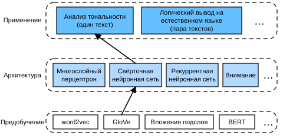
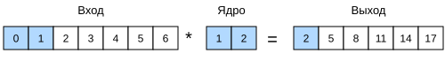
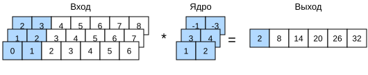
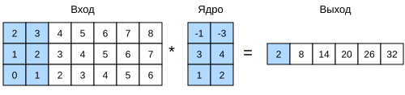
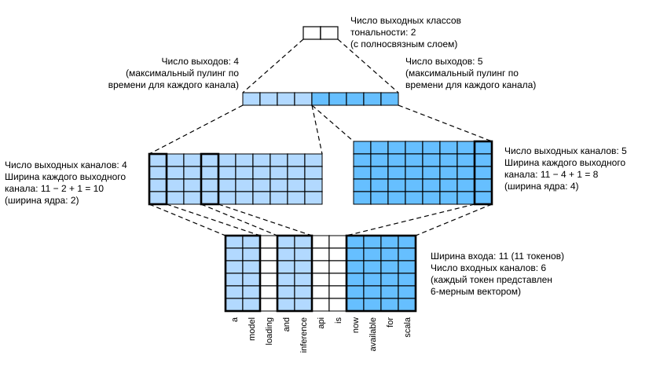

# 15.3 Анализ тональности: свёрточные нейронные сети

В главе 6 мы изучили механизмы обработки двумерных данных изображений двумерными свёрточными нейронными сетями и применили их к локальным признакам, таким как соседние пиксели. Хотя свёрточные нейронные сети изначально проектировались для компьютерного зрения, их широко используют и в обработке естественного языка. Проще говоря, достаточно представить любую текстовую последовательность как одномерное изображение. Так одномерные свёрточные нейронные сети могут обрабатывать локальные признаки в тексте, например $n$-граммы.

В этом разделе мы на модели *textCNN* покажем, как спроектировать свёрточную нейронную сеть для представления одиночного текста (Kim, 2014). По сравнению с рис. 15.2.1, где для анализа тональности использована рекуррентная архитектура с предобучением GloVe, единственное отличие на рис. 15.3.1 — выбор архитектуры.



**MXNet:**

```python
from d2l import mxnet as d2l
from mxnet import gluon, init, np, npx
from mxnet.gluon import nn
npx.set_np()

batch_size = 64
train_iter, test_iter, vocab = d2l.load_data_imdb(batch_size)
```

**PyTorch:**

```python
from d2l import torch as d2l
import torch
from torch import nn

batch_size = 64
train_iter, test_iter, vocab = d2l.load_data_imdb(batch_size)
```

**PaddlePaddle:**

```python
from d2l import paddle as d2l
import warnings
warnings.filterwarnings("ignore")
import paddle
from paddle import nn

batch_size = 64
train_iter, test_iter, vocab = d2l.load_data_imdb(batch_size)
```

## Одномерные свёртки

Прежде чем перейти к модели, посмотрим, как работает одномерная свёртка. Помните, что это лишь частный случай двумерной свёртки, основанной на операции взаимной корреляции.



Как показано на рис. 15.3.2, в одномерном случае окно свёртки скользит по входному тензору слева направо. Во время скольжения подтензор входа, попавший в окно свёртки в некоторой позиции (например, $0$ и $1$ на рис. 15.3.2), и тензор ядра (например, $1$ и $2$ на рис. 15.3.2) поэлементно умножаются. Сумма этих произведений даёт одно скалярное значение в соответствующей позиции выходного тензора (например, $0\times1+1\times2=2$ на рис. 15.3.2).

Одномерную взаимную корреляцию мы реализуем в следующей функции `corr1d`. Для входного тензора `X` и тензора ядра `K` она возвращает выходной тензор `Y`.

**MXNet, PyTorch:**

```python
def corr1d(X, K):
    w = K.shape[0]
    Y = d2l.zeros((X.shape[0] - w + 1))
    for i in range(Y.shape[0]):
        Y[i] = (X[i: i + w] * K).sum()
    return Y
```

**PaddlePaddle:**

```python
def corr1d(X, K):
    w = K.shape[0]
    Y = d2l.zeros([X.shape[0] - w + 1], dtype=X.dtype)
    for i in range(Y.shape[0]):
        Y[i] = (X[i: i + w] * K).sum()
    return Y
```

Чтобы проверить выход приведённой реализации одномерной взаимной корреляции, построим входной тензор `X` и тензор ядра `K` по рис. 15.3.2.

```python
X, K = d2l.tensor([0, 1, 2, 3, 4, 5, 6]), d2l.tensor([1, 2])
corr1d(X, K)
```

Для любого одномерного входа с несколькими каналами ядро свёртки должно иметь такое же число входных каналов. Затем для каждого канала выполняется взаимная корреляция одномерного входного тензора и одномерного тензора ядра, а результаты по всем каналам суммируются, давая одномерный выходной тензор. На рис. 15.3.3 показана одномерная взаимная корреляция с 3 входными каналами.



Можно реализовать одномерную взаимную корреляцию для нескольких входных каналов и проверить результаты с рис. 15.3.3.

```python
def corr1d_multi_in(X, K):
    # Сначала проходим по нулевому измерению (измерению каналов) X и K.
    # Затем складываем результаты
    return sum(corr1d(x, k) for x, k in zip(X, K))

X = d2l.tensor([[0, 1, 2, 3, 4, 5, 6],
              [1, 2, 3, 4, 5, 6, 7],
              [2, 3, 4, 5, 6, 7, 8]])
K = d2l.tensor([[1, 2], [3, 4], [-1, -3]])
corr1d_multi_in(X, K)
```

Заметим, что одномерная взаимная корреляция с несколькими входными каналами эквивалентна двумерной взаимной корреляции с одним входным каналом. Например, эквивалент одномерной взаимной корреляции с несколькими входными каналами с рис. 15.3.3 — двумерная взаимная корреляция с одним входным каналом на рис. 15.3.4, где высота ядра свёртки должна совпадать с высотой входного тензора.



Выходы на рис. 15.3.2 и рис. 15.3.3 имеют только один канал. Как и для двумерных свёрток с несколькими выходными каналами, описанных в подразделе «Несколько выходных каналов» раздела 6.4, можно задать несколько выходных каналов и для одномерной свёртки.

## Слой максимального пулинга по времени

Аналогично можно использовать слой пулинга, чтобы извлечь из представления последовательности максимальное значение как самый важный признак по временным шагам. *Слой максимального пулинга по времени* (max-over-time pooling), используемый в textCNN, работает подобно одномерному глобальному пулингу (Collobert et al., 2011). Для многоканального входа, где каждый канал хранит значения на разных временных шагах, выходом каждого канала служит максимальное значение этого канала. Заметим, что максимальный пулинг по времени допускает разное число временных шагов в разных каналах.

## Модель textCNN

Используя одномерную свёртку и максимальный пулинг по времени, модель textCNN принимает на вход отдельные предобученные представления токенов, а затем получает и преобразует представление последовательности для прикладной задачи.

Для одиночной текстовой последовательности из $n$ токенов, представленных $d$-мерными векторами, ширина, высота и число каналов входного тензора равны $n$, $1$ и $d$ соответственно. Модель textCNN преобразует вход в выход следующим образом:

1. Определяется несколько одномерных ядер свёртки, и свёрточные операции выполняются над входом по отдельности. Ядра разной ширины могут улавливать локальные признаки между разным числом соседних токенов.
1. Над всеми выходными каналами выполняется максимальный пулинг по времени, после чего все скалярные выходы пулинга конкатенируются в вектор.
1. Конкатенированный вектор преобразуется в выходные категории полносвязным слоем. Для уменьшения переобучения можно использовать dropout.



На рис. 15.3.5 архитектура textCNN иллюстрируется конкретным примером. Входом служит предложение из 11 токенов, каждый из которых представлен 6-мерным вектором. Таким образом, у нас 6-канальный вход шириной 11. Определим два одномерных ядра свёртки шириной 2 и 4 с 4 и 5 выходными каналами соответственно. Они дают 4 выходных канала шириной $11-2+1=10$ и 5 выходных каналов шириной $11-4+1=8$. Хотя ширина этих 9 каналов различна, слой максимального пулинга по времени даёт конкатенированный 9-мерный вектор, который в итоге преобразуется в 2-мерный выходной вектор для бинарного предсказания тональности.

### Определение модели

Мы реализуем модель textCNN в следующем классе. По сравнению с двунаправленной рекуррентной моделью из раздела 15.2, помимо замены рекуррентных слоёв свёрточными, мы используем два слоя вложений: один с обучаемыми весами, а другой с фиксированными.

**MXNet:**

```python
class TextCNN(nn.Block):
    def __init__(self, vocab_size, embed_size, kernel_sizes, num_channels,
                 **kwargs):
        super(TextCNN, self).__init__(**kwargs)
        self.embedding = nn.Embedding(vocab_size, embed_size)
        # Этот слой вложений не обучается
        self.constant_embedding = nn.Embedding(vocab_size, embed_size)
        self.dropout = nn.Dropout(0.5)
        self.decoder = nn.Dense(2)
        # У слоя максимального пулинга по времени нет параметров,
        # поэтому этот экземпляр можно использовать совместно
        self.pool = nn.GlobalMaxPool1D()
        # Создаём несколько одномерных свёрточных слоёв
        self.convs = nn.Sequential()
        for c, k in zip(num_channels, kernel_sizes):
            self.convs.add(nn.Conv1D(c, k, activation='relu'))

    def forward(self, inputs):
        # Конкатенируем два слоя вложений вдоль размерности вектора.
        # Форма выхода каждого слоя вложений:
        # (размер мини-батча, число токенов, размерность вектора токена)
        embeddings = np.concatenate((
            self.embedding(inputs), self.constant_embedding(inputs)), axis=2)
        # Согласно формату входа одномерных свёрточных слоёв
        # переставляем измерения тензора так, чтобы каналы шли вторым измерением
        embeddings = embeddings.transpose(0, 2, 1)
        # После слоя максимального пулинга по времени для каждого
        # одномерного свёрточного слоя получаем тензор формы
        # (размер мини-батча, число каналов, 1).
        # Удаляем последнее измерение и конкатенируем по измерению каналов
        encoding = np.concatenate([
            np.squeeze(self.pool(conv(embeddings)), axis=-1)
            for conv in self.convs], axis=1)
        outputs = self.decoder(self.dropout(encoding))
        return outputs
```

**PyTorch:**

```python
class TextCNN(nn.Module):
    def __init__(self, vocab_size, embed_size, kernel_sizes, num_channels,
                 **kwargs):
        super(TextCNN, self).__init__(**kwargs)
        self.embedding = nn.Embedding(vocab_size, embed_size)
        # Этот слой вложений не обучается
        self.constant_embedding = nn.Embedding(vocab_size, embed_size)
        self.dropout = nn.Dropout(0.5)
        self.decoder = nn.Linear(sum(num_channels), 2)
        # У слоя максимального пулинга по времени нет параметров,
        # поэтому этот экземпляр можно использовать совместно
        self.pool = nn.AdaptiveAvgPool1d(1)
        self.relu = nn.ReLU()
        # Создаём несколько одномерных свёрточных слоёв
        self.convs = nn.ModuleList()
        for c, k in zip(num_channels, kernel_sizes):
            self.convs.append(nn.Conv1d(2 * embed_size, c, k))

    def forward(self, inputs):
        # Конкатенируем два слоя вложений вдоль размерности вектора.
        # Форма выхода каждого слоя вложений:
        # (размер мини-батча, число токенов, размерность вектора токена)
        embeddings = torch.cat((
            self.embedding(inputs), self.constant_embedding(inputs)), dim=2)
        # Согласно формату входа одномерных свёрточных слоёв
        # переставляем измерения тензора так, чтобы каналы шли вторым измерением
        embeddings = embeddings.permute(0, 2, 1)
        # После слоя максимального пулинга по времени для каждого
        # одномерного свёрточного слоя получаем тензор формы
        # (размер мини-батча, число каналов, 1).
        # Удаляем последнее измерение и конкатенируем по измерению каналов
        encoding = torch.cat([
            torch.squeeze(self.relu(self.pool(conv(embeddings))), dim=-1)
            for conv in self.convs], dim=1)
        outputs = self.decoder(self.dropout(encoding))
        return outputs
```

**PaddlePaddle:**

```python
class TextCNN(nn.Layer):
    def __init__(self, vocab_size, embed_size, kernel_sizes, num_channels,
                 **kwargs):
        super(TextCNN, self).__init__(**kwargs)
        self.embedding = nn.Embedding(vocab_size, embed_size)
        # Этот слой вложений не обучается
        self.constant_embedding = nn.Embedding(vocab_size, embed_size)
        self.dropout = nn.Dropout(0.5)
        self.decoder = nn.Linear(sum(num_channels), 2)
        # У слоя максимального пулинга по времени нет параметров,
        # поэтому этот экземпляр можно использовать совместно
        self.pool = nn.AdaptiveAvgPool1D(1)
        self.relu = nn.ReLU()
        # Создаём несколько одномерных свёрточных слоёв
        self.convs = nn.LayerList()
        for c, k in zip(num_channels, kernel_sizes):
            self.convs.append(nn.Conv1D(2 * embed_size, c, k))

    def forward(self, inputs):
        # Конкатенируем два слоя вложений вдоль размерности вектора.
        # Форма выхода каждого слоя вложений:
        # (размер мини-батча, число токенов, размерность вектора токена)
        embeddings = paddle.concat((
            self.embedding(inputs), self.constant_embedding(inputs)), axis=2)
        # Согласно формату входа одномерных свёрточных слоёв
        # переставляем измерения тензора так, чтобы каналы шли вторым измерением
        embeddings = embeddings.transpose([0, 2, 1])
        # После слоя максимального пулинга по времени для каждого
        # одномерного свёрточного слоя получаем тензор формы
        # (размер мини-батча, число каналов, 1).
        # Удаляем последнее измерение и конкатенируем по измерению каналов
        encoding = paddle.concat([
            paddle.squeeze(self.relu(self.pool(conv(embeddings))), axis=-1)
            for conv in self.convs], axis=1)
        outputs = self.decoder(self.dropout(encoding))
        return outputs
```

Создадим экземпляр textCNN. У него 3 свёрточных слоя с шириной ядер 3, 4 и 5 и по 100 выходных каналов у каждого.

**MXNet:**

```python
embed_size, kernel_sizes, nums_channels = 100, [3, 4, 5], [100, 100, 100]
devices = d2l.try_all_gpus()
net = TextCNN(len(vocab), embed_size, kernel_sizes, nums_channels)
net.initialize(init.Xavier(), ctx=devices)
```

**PyTorch:**

```python
embed_size, kernel_sizes, nums_channels = 100, [3, 4, 5], [100, 100, 100]
devices = d2l.try_all_gpus()
net = TextCNN(len(vocab), embed_size, kernel_sizes, nums_channels)

def init_weights(m):
    if type(m) in (nn.Linear, nn.Conv1d):
        nn.init.xavier_uniform_(m.weight)

net.apply(init_weights);
```

**PaddlePaddle:**

```python
embed_size, kernel_sizes, nums_channels = 100, [3, 4, 5], [100, 100, 100]
devices = d2l.try_all_gpus()
net = TextCNN(len(vocab), embed_size, kernel_sizes, nums_channels)

def init_weights(net):
    init_normal = nn.initializer.XavierUniform()
    for i in net.sublayers():
        if type(i) in [nn.Linear, nn.Conv1D]:  
            init_normal(i.weight)
            
init_weights(net)
```

### Загрузка предобученных векторов слов

Как и в разделе 15.2, мы загружаем предобученные 100-мерные вложения GloVe в качестве начальных представлений токенов. Эти представления токенов (веса вложений) будут обучаться в `embedding` и фиксироваться в `constant_embedding`.

**MXNet:**

```python
glove_embedding = d2l.TokenEmbedding('glove.6b.100d')
embeds = glove_embedding[vocab.idx_to_token]
net.embedding.weight.set_data(embeds)
net.constant_embedding.weight.set_data(embeds)
net.constant_embedding.collect_params().setattr('grad_req', 'null')
```

**PyTorch:**

```python
glove_embedding = d2l.TokenEmbedding('glove.6b.100d')
embeds = glove_embedding[vocab.idx_to_token]
net.embedding.weight.data.copy_(embeds)
net.constant_embedding.weight.data.copy_(embeds)
net.constant_embedding.weight.requires_grad = False
```

**PaddlePaddle:**

```python
glove_embedding = d2l.TokenEmbedding('glove.6b.100d')
embeds = glove_embedding[vocab.idx_to_token]
net.embedding.weight.set_value(embeds)
net.constant_embedding.weight.set_value(embeds)
net.constant_embedding.weight.stop_gradient = True
```

### Обучение и оценка модели

Теперь можно обучить модель textCNN для анализа тональности.

**MXNet:**

```python
lr, num_epochs = 0.001, 5
trainer = gluon.Trainer(net.collect_params(), 'adam', {'learning_rate': lr})
loss = gluon.loss.SoftmaxCrossEntropyLoss()
d2l.train_ch13(net, train_iter, test_iter, loss, trainer, num_epochs, devices)
```

**PyTorch:**

```python
lr, num_epochs = 0.001, 5
trainer = torch.optim.Adam(net.parameters(), lr=lr)
loss = nn.CrossEntropyLoss(reduction="none")
d2l.train_ch13(net, train_iter, test_iter, loss, trainer, num_epochs, devices)
```

**PaddlePaddle:**

```python
lr, num_epochs = 0.001, 5
trainer = paddle.optimizer.Adam(learning_rate=lr, parameters=net.parameters())
loss = nn.CrossEntropyLoss(reduction="none")
d2l.train_ch13(net, train_iter, test_iter, loss, trainer, num_epochs, devices)
```

Ниже мы предсказываем тональность двух простых предложений обученной моделью.

```python
d2l.predict_sentiment(net, vocab, 'this movie is so great')
```

```python
d2l.predict_sentiment(net, vocab, 'this movie is so bad')
```

## Резюме

* Одномерные свёрточные нейронные сети могут обрабатывать локальные признаки в тексте, например $n$-граммы.
* Одномерная взаимная корреляция с несколькими входными каналами эквивалентна двумерной взаимной корреляции с одним входным каналом.
* Слой максимального пулинга по времени допускает разное число временных шагов в разных каналах.
* Модель textCNN преобразует представления отдельных токенов в выходы прикладной задачи с помощью одномерных свёрточных слоёв и слоёв максимального пулинга по времени.

## Упражнения

1. Настройте гиперпараметры и сравните две архитектуры анализа тональности — из раздела 15.2 и из этого раздела, — например по точности классификации и вычислительной эффективности.
1. Попробуйте ещё повысить точность классификации модели методами из упражнений раздела 15.2.
1. Добавьте во входное представление позиционное кодирование. Повышает ли оно точность классификации?

**MXNet:**
[Обсуждение](https://discuss.d2l.ai/t/5719)

**PyTorch:**
[Обсуждение](https://discuss.d2l.ai/t/5720)

**PaddlePaddle:**
[Обсуждение](https://discuss.d2l.ai/t/11827)

## Литература

* Kim, Y. (2014). Convolutional neural networks for sentence classification. *arXiv preprint arXiv:1408.5882*.
* Collobert, R., Weston, J., Bottou, L., Karlen, M., Kavukcuoglu, K., & Kuksa, P. (2011). Natural language processing (almost) from scratch. *Journal of machine learning research*, 12, 2493–2537.
