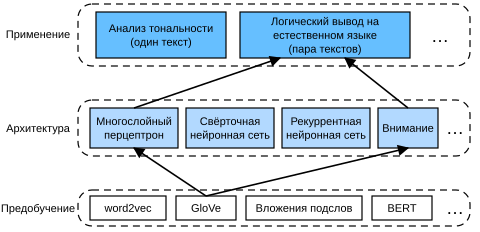
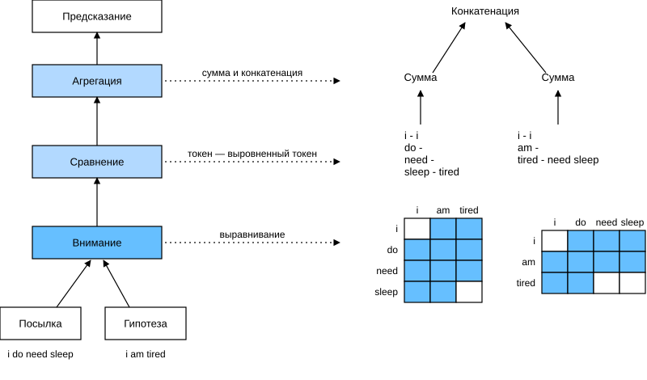

# 15.5 Логический вывод на естественном языке: внимание

В разделе 15.4 мы представили задачу логического вывода на естественном языке и набор данных SNLI. Поскольку многие модели основаны на сложных и глубоких архитектурах, Parikh и др. предложили решать задачу логического вывода на естественном языке с помощью механизмов внимания и назвали этот подход «моделью декомпозируемого внимания» (decomposable attention model) (Parikh et al., 2016). Так получилась модель без рекуррентных и свёрточных слоёв, которая достигла на наборе данных SNLI лучшего на тот момент результата с гораздо меньшим числом параметров. В этом разделе мы опишем и реализуем такой метод логического вывода на естественном языке на основе внимания (с использованием многослойных перцептронов), как показано на рис. 15.5.1.



**Рис. 15.5.1.** Подача предобученных GloVe в архитектуру логического вывода на естественном языке на основе внимания и многослойных перцептронов

## 15.5.1 Модель

Вместо того чтобы сохранять порядок токенов в посылке и гипотезе, можно выровнять токены одной текстовой последовательности с каждым токеном другой, а затем сравнить и агрегировать эту информацию, чтобы предсказать логическое отношение между посылкой и гипотезой. Подобно выравниванию токенов между исходными и целевыми предложениями в машинном переводе, выравнивание токенов между посылкой и гипотезой можно гибко выполнять с помощью механизмов внимания.



**Рис. 15.5.2.** Логический вывод на естественном языке с помощью механизмов внимания

На рис. 15.5.2 показан метод логического вывода на естественном языке с механизмами внимания. На высоком уровне он состоит из трёх совместно обучаемых шагов: внимания (attending), сравнения (comparing) и агрегации (aggregating). Ниже мы опишем их шаг за шагом.

**MXNet:**

```python
from d2l import mxnet as d2l
from mxnet import gluon, init, np, npx
from mxnet.gluon import nn

npx.set_np()
```

**PyTorch:**

```python
from d2l import torch as d2l
import torch
from torch import nn
from torch.nn import functional as F
```

**PaddlePaddle:**

```python
from d2l import paddle as d2l
import warnings
warnings.filterwarnings("ignore")
import paddle
from paddle import nn
from paddle.nn import functional as F
```

### 15.5.1.1 Внимание (Attending)

Первый шаг — выровнять токены одной текстовой последовательности с каждым токеном другой. Допустим, посылка — «i do need sleep» («мне действительно нужно поспать»), а гипотеза — «i am tired» («я устал»). Из-за семантической близости можно выровнять «i» в гипотезе с «i» в посылке и «tired» в гипотезе с «sleep» в посылке. Аналогично можно выровнять «i» в посылке с «i» в гипотезе, а «need» и «sleep» в посылке — с «tired» в гипотезе. Обратите внимание, что такое выравнивание «мягкое» — оно использует взвешенное среднее, где в идеале большие веса связаны с токенами, которые нужно выровнять. Для простоты демонстрации на рис. 15.5.2 это выравнивание показано «жёстким» способом.

Теперь опишем мягкое выравнивание с механизмами внимания подробнее. Обозначим через $\mathbf{A} = (\mathbf{a}_1, \ldots, \mathbf{a}_m)$ и $\mathbf{B} = (\mathbf{b}_1, \ldots, \mathbf{b}_n)$ посылку и гипотезу, число токенов в которых равно $m$ и $n$ соответственно, где $\mathbf{a}_i, \mathbf{b}_j \in \mathbb{R}^{d}$ ($i = 1, \ldots, m, j = 1, \ldots, n$) — $d$-мерные векторы слов. Для мягкого выравнивания мы вычисляем веса внимания $e_{ij} \in \mathbb{R}$ как

$$e_{ij} = f(\mathbf{a}_i)^\top f(\mathbf{b}_j),\tag{15.5.1}$$

где функция $f$ — многослойный перцептрон, определённый в следующей функции `mlp`. Выходная размерность $f$ задаётся аргументом `num_hiddens` функции `mlp`.

**MXNet:**

```python
def mlp(num_hiddens, flatten):
    net = nn.Sequential()
    net.add(nn.Dropout(0.2))
    net.add(nn.Dense(num_hiddens, activation='relu', flatten=flatten))
    net.add(nn.Dropout(0.2))
    net.add(nn.Dense(num_hiddens, activation='relu', flatten=flatten))
    return net
```

**PyTorch:**

```python
def mlp(num_inputs, num_hiddens, flatten):
    net = []
    net.append(nn.Dropout(0.2))
    net.append(nn.Linear(num_inputs, num_hiddens))
    net.append(nn.ReLU())
    if flatten:
        net.append(nn.Flatten(start_dim=1))
    net.append(nn.Dropout(0.2))
    net.append(nn.Linear(num_hiddens, num_hiddens))
    net.append(nn.ReLU())
    if flatten:
        net.append(nn.Flatten(start_dim=1))
    return nn.Sequential(*net)
```

**PaddlePaddle:**

```python
def mlp(num_inputs, num_hiddens, flatten):
    net = []
    net.append(nn.Dropout(0.2))
    net.append(nn.Linear(num_inputs, num_hiddens))
    net.append(nn.ReLU())
    if flatten:
        net.append(nn.Flatten(start_axis=1)) 
    net.append(nn.Dropout(0.2))
    net.append(nn.Linear(num_hiddens, num_hiddens))
    net.append(nn.ReLU())
    if flatten:
        net.append(nn.Flatten(start_axis=1))
    return nn.Sequential(*net)
```

Следует отметить, что в (15.5.1) $f$ принимает на вход $\mathbf{a}_i$ и $\mathbf{b}_j$ по отдельности, а не пару из них вместе. Такой приём *декомпозиции* приводит к тому, что $f$ вычисляется всего $m + n$ раз (линейная сложность), а не $mn$ раз (квадратичная сложность).

Нормируя веса внимания из (15.5.1), мы вычисляем взвешенное среднее всех векторов токенов гипотезы, чтобы получить представление гипотезы, мягко выровненной с токеном посылки с индексом $i$:

$$
\boldsymbol{\beta}_i = \sum_{j=1}^{n}\frac{\exp(e_{ij})}{ \sum_{k=1}^{n} \exp(e_{ik})} \mathbf{b}_j.
$$

Аналогично вычислим мягкое выравнивание токенов посылки для каждого токена гипотезы с индексом $j$:

$$
\boldsymbol{\alpha}_j = \sum_{i=1}^{m}\frac{\exp(e_{ij})}{ \sum_{k=1}^{m} \exp(e_{kj})} \mathbf{a}_i.
$$

Ниже мы определяем класс `Attend`, который вычисляет мягкое выравнивание гипотезы (`beta`) с входной посылкой `A` и мягкое выравнивание посылки (`alpha`) с входной гипотезой `B`.

**MXNet:**

```python
class Attend(nn.Block):
    def __init__(self, num_hiddens, **kwargs):
        super(Attend, self).__init__(**kwargs)
        self.f = mlp(num_hiddens=num_hiddens, flatten=False)

    def forward(self, A, B):
        # Форма A/B: (размер минибатча, число токенов последовательности A/B,
        # embed_size)
        # Форма f_A/f_B: (размер минибатча, число токенов
        # последовательности A/B, num_hiddens)
        f_A = self.f(A)
        f_B = self.f(B)
        # Форма e: (размер минибатча, число токенов последовательности A,
        # число токенов последовательности B)
        e = npx.batch_dot(f_A, f_B, transpose_b=True)
        # Форма beta: (размер минибатча, число токенов последовательности A,
        # embed_size), то есть последовательность B мягко выравнивается
        # с каждым токеном последовательности A (измерение 1 у beta)
        beta = npx.batch_dot(npx.softmax(e), B)
        # Форма alpha: (размер минибатча, число токенов последовательности B,
        # embed_size), то есть последовательность A мягко выравнивается
        # с каждым токеном последовательности B (измерение 1 у alpha)
        alpha = npx.batch_dot(npx.softmax(e.transpose(0, 2, 1)), A)
        return beta, alpha
```

**PyTorch:**

```python
class Attend(nn.Module):
    def __init__(self, num_inputs, num_hiddens, **kwargs):
        super(Attend, self).__init__(**kwargs)
        self.f = mlp(num_inputs, num_hiddens, flatten=False)

    def forward(self, A, B):
        # Форма A/B: (размер минибатча, число токенов последовательности A/B,
        # embed_size)
        # Форма f_A/f_B: (размер минибатча, число токенов
        # последовательности A/B, num_hiddens)
        f_A = self.f(A)
        f_B = self.f(B)
        # Форма e: (размер минибатча, число токенов последовательности A,
        # число токенов последовательности B)
        e = torch.bmm(f_A, f_B.permute(0, 2, 1))
        # Форма beta: (размер минибатча, число токенов последовательности A,
        # embed_size), то есть последовательность B мягко выравнивается
        # с каждым токеном последовательности A (измерение 1 у beta)
        beta = torch.bmm(F.softmax(e, dim=-1), B)
        # Форма alpha: (размер минибатча, число токенов последовательности B,
        # embed_size), то есть последовательность A мягко выравнивается
        # с каждым токеном последовательности B (измерение 1 у alpha)
        alpha = torch.bmm(F.softmax(e.permute(0, 2, 1), dim=-1), A)
        return beta, alpha
```

**PaddlePaddle:**

```python
class Attend(nn.Layer):
    def __init__(self, num_inputs, num_hiddens, **kwargs):
        super(Attend, self).__init__(**kwargs)
        self.f = mlp(num_inputs, num_hiddens, flatten=False)

    def forward(self, A, B):
        # Форма A/B: (размер минибатча, число токенов последовательности A/B,
        # embed_size)
        # Форма f_A/f_B: (размер минибатча, число токенов
        # последовательности A/B, num_hiddens)
        f_A = self.f(A)
        f_B = self.f(B)
        # Форма e: (размер минибатча, число токенов последовательности A,
        # число токенов последовательности B)
        e = paddle.bmm(f_A, f_B.transpose([0, 2, 1]))
        # Форма beta: (размер минибатча, число токенов последовательности A,
        # embed_size), то есть последовательность B мягко выравнивается
        # с каждым токеном последовательности A (измерение 1 у beta)
        beta = paddle.bmm(F.softmax(e, axis=-1), B)
        # Форма alpha: (размер минибатча, число токенов последовательности B,
        # embed_size), то есть последовательность A мягко выравнивается
        # с каждым токеном последовательности B (измерение 1 у alpha)
        alpha = paddle.bmm(F.softmax(e.transpose([0, 2, 1]), axis=-1), A)
        return beta, alpha
```

### 15.5.1.2 Сравнение (Comparing)

На следующем шаге мы сравниваем токен одной последовательности с той последовательностью, которая мягко с ним выровнена. Обратите внимание, что при мягком выравнивании все токены одной последовательности (хотя, возможно, с разными весами внимания) сравниваются с токеном другой последовательности. Для простоты демонстрации на рис. 15.5.2 токены выровнены *жёстко*. Например, если на шаге *внимания* (attending) определено, что «need» и «sleep» в посылке выровнены с «tired» в гипотезе, то будет сравниваться пара «tired — need sleep».

На шаге сравнения мы подаём конкатенацию (оператор $[\cdot, \cdot]$) токенов одной последовательности и выровненных токенов другой в функцию $g$ (многослойный перцептрон):

$$\mathbf{v}_{A,i} = g([\mathbf{a}_i, \boldsymbol{\beta}_i]), i = 1, \ldots, m\\ \mathbf{v}_{B,j} = g([\mathbf{b}_j, \boldsymbol{\alpha}_j]), j = 1, \ldots, n.\tag{15.5.2}$$

В (15.5.2) $\mathbf{v}_{A,i}$ — это сравнение токена $i$ посылки со всеми токенами гипотезы, мягко выровненными с ним, а $\mathbf{v}_{B,j}$ — сравнение токена $j$ гипотезы со всеми токенами посылки, мягко выровненными с ним. Шаг сравнения определяет следующий класс `Compare`.

**MXNet:**

```python
class Compare(nn.Block):
    def __init__(self, num_hiddens, **kwargs):
        super(Compare, self).__init__(**kwargs)
        self.g = mlp(num_hiddens=num_hiddens, flatten=False)

    def forward(self, A, B, beta, alpha):
        V_A = self.g(np.concatenate([A, beta], axis=2))
        V_B = self.g(np.concatenate([B, alpha], axis=2))
        return V_A, V_B
```

**PyTorch:**

```python
class Compare(nn.Module):
    def __init__(self, num_inputs, num_hiddens, **kwargs):
        super(Compare, self).__init__(**kwargs)
        self.g = mlp(num_inputs, num_hiddens, flatten=False)

    def forward(self, A, B, beta, alpha):
        V_A = self.g(torch.cat([A, beta], dim=2))
        V_B = self.g(torch.cat([B, alpha], dim=2))
        return V_A, V_B
```

**PaddlePaddle:**

```python
class Compare(nn.Layer):
    def __init__(self, num_inputs, num_hiddens, **kwargs):
        super(Compare, self).__init__(**kwargs)
        self.g = mlp(num_inputs, num_hiddens, flatten=False)

    def forward(self, A, B, beta, alpha):
        V_A = self.g(paddle.concat([A, beta], axis=2))
        V_B = self.g(paddle.concat([B, alpha], axis=2))
        return V_A, V_B
```

### 15.5.1.3 Агрегация (Aggregating)

Теперь у нас есть два набора векторов сравнения $\mathbf{v}_{A,i}$ ($i = 1, \ldots, m$) и $\mathbf{v}_{B,j}$ ($j = 1, \ldots, n$). На последнем шаге мы агрегируем эту информацию, чтобы вывести логическое отношение. Сначала суммируем оба набора векторов сравнения:

$$
\mathbf{v}_A = \sum_{i=1}^{m} \mathbf{v}_{A,i}, \quad \mathbf{v}_B = \sum_{j=1}^{n}\mathbf{v}_{B,j}.
$$

Затем подаём конкатенацию двух сумм в функцию $h$ (многослойный перцептрон), чтобы получить результат классификации логического отношения:

$$
\hat{\mathbf{y}} = h([\mathbf{v}_A, \mathbf{v}_B]).
$$

Шаг агрегации определён в следующем классе `Aggregate`.

**MXNet:**

```python
class Aggregate(nn.Block):
    def __init__(self, num_hiddens, num_outputs, **kwargs):
        super(Aggregate, self).__init__(**kwargs)
        self.h = mlp(num_hiddens=num_hiddens, flatten=True)
        self.h.add(nn.Dense(num_outputs))

    def forward(self, V_A, V_B):
        # Суммируем два набора векторов сравнения по отдельности
        V_A = V_A.sum(axis=1)
        V_B = V_B.sum(axis=1)
        # Подаём конкатенацию двух сумм в многослойный перцептрон
        Y_hat = self.h(np.concatenate([V_A, V_B], axis=1))
        return Y_hat
```

**PyTorch:**

```python
class Aggregate(nn.Module):
    def __init__(self, num_inputs, num_hiddens, num_outputs, **kwargs):
        super(Aggregate, self).__init__(**kwargs)
        self.h = mlp(num_inputs, num_hiddens, flatten=True)
        self.linear = nn.Linear(num_hiddens, num_outputs)

    def forward(self, V_A, V_B):
        # Суммируем два набора векторов сравнения по отдельности
        V_A = V_A.sum(dim=1)
        V_B = V_B.sum(dim=1)
        # Подаём конкатенацию двух сумм в многослойный перцептрон
        Y_hat = self.linear(self.h(torch.cat([V_A, V_B], dim=1)))
        return Y_hat
```

**PaddlePaddle:**

```python
class Aggregate(nn.Layer):
    def __init__(self, num_inputs, num_hiddens, num_outputs, **kwargs):
        super(Aggregate, self).__init__(**kwargs)
        self.h = mlp(num_inputs, num_hiddens, flatten=True)
        self.linear = nn.Linear(num_hiddens, num_outputs)

    def forward(self, V_A, V_B):
        # Суммируем два набора векторов сравнения по отдельности
        V_A = V_A.sum(axis=1)
        V_B = V_B.sum(axis=1)
        # Подаём конкатенацию двух сумм в многослойный перцептрон
        Y_hat = self.linear(self.h(paddle.concat([V_A, V_B], axis=1)))
        return Y_hat
```

### 15.5.1.4 Сборка кода

Объединяя шаги внимания, сравнения и агрегации, мы определяем модель декомпозируемого внимания, совместно обучающую эти три шага.

**MXNet:**

```python
class DecomposableAttention(nn.Block):
    def __init__(self, vocab, embed_size, num_hiddens, **kwargs):
        super(DecomposableAttention, self).__init__(**kwargs)
        self.embedding = nn.Embedding(len(vocab), embed_size)
        self.attend = Attend(num_hiddens)
        self.compare = Compare(num_hiddens)
        # Возможны 3 выхода: следование, противоречие и нейтральность
        self.aggregate = Aggregate(num_hiddens, 3)

    def forward(self, X):
        premises, hypotheses = X
        A = self.embedding(premises)
        B = self.embedding(hypotheses)
        beta, alpha = self.attend(A, B)
        V_A, V_B = self.compare(A, B, beta, alpha)
        Y_hat = self.aggregate(V_A, V_B)
        return Y_hat
```

**PyTorch:**

```python
class DecomposableAttention(nn.Module):
    def __init__(self, vocab, embed_size, num_hiddens, num_inputs_attend=100,
                 num_inputs_compare=200, num_inputs_agg=400, **kwargs):
        super(DecomposableAttention, self).__init__(**kwargs)
        self.embedding = nn.Embedding(len(vocab), embed_size)
        self.attend = Attend(num_inputs_attend, num_hiddens)
        self.compare = Compare(num_inputs_compare, num_hiddens)
        # Возможны 3 выхода: следование, противоречие и нейтральность
        self.aggregate = Aggregate(num_inputs_agg, num_hiddens, num_outputs=3)

    def forward(self, X):
        premises, hypotheses = X
        A = self.embedding(premises)
        B = self.embedding(hypotheses)
        beta, alpha = self.attend(A, B)
        V_A, V_B = self.compare(A, B, beta, alpha)
        Y_hat = self.aggregate(V_A, V_B)
        return Y_hat
```

**PaddlePaddle:**

```python
class DecomposableAttention(nn.Layer):
    def __init__(self, vocab, embed_size, num_hiddens, num_inputs_attend=100,
                 num_inputs_compare=200, num_inputs_agg=400, **kwargs):
        super(DecomposableAttention, self).__init__(**kwargs)
        self.embedding = nn.Embedding(len(vocab), embed_size)
        self.attend = Attend(num_inputs_attend, num_hiddens)
        self.compare = Compare(num_inputs_compare, num_hiddens)
        # Возможны 3 выхода: следование, противоречие и нейтральность
        self.aggregate = Aggregate(num_inputs_agg, num_hiddens, num_outputs=3)

    def forward(self, X):
        premises, hypotheses = X
        A = self.embedding(premises)
        B = self.embedding(hypotheses)
        beta, alpha = self.attend(A, B)
        V_A, V_B = self.compare(A, B, beta, alpha)
        Y_hat = self.aggregate(V_A, V_B)
        return Y_hat
```

## 15.5.2 Обучение и оценка модели

Теперь мы обучим и оценим определённую модель декомпозируемого внимания на наборе данных SNLI. Начнём с чтения набора данных.

### 15.5.2.1 Чтение набора данных

Мы скачиваем и читаем набор данных SNLI с помощью функции, определённой в разделе 15.4. Размер минибатча и длина последовательности равны $256$ и $50$ соответственно.

**MXNet, PyTorch:**

```python
batch_size, num_steps = 256, 50
train_iter, test_iter, vocab = d2l.load_data_snli(batch_size, num_steps)
```

**PaddlePaddle:**

```python
def load_data_snli(batch_size, num_steps=50):
    """Скачивает набор данных SNLI и возвращает итераторы данных и словарь

    Определено в разделе 15.4"""
    data_dir = d2l.download_extract('SNLI')
    train_data = d2l.read_snli(data_dir, True)
    test_data = d2l.read_snli(data_dir, False)
    train_set = d2l.SNLIDataset(train_data, num_steps)
    test_set = d2l.SNLIDataset(test_data, num_steps, train_set.vocab)
    train_iter = paddle.io.DataLoader(train_set,batch_size=batch_size,
                                             shuffle=True,
                                             num_workers=0,
                                             return_list=True)

    test_iter = paddle.io.DataLoader(test_set, batch_size=batch_size,
                                            shuffle=False,
                                            num_workers=0,
                                            return_list=True)
    return train_iter, test_iter, train_set.vocab

batch_size, num_steps = 256, 50
train_iter, test_iter, vocab = load_data_snli(batch_size, num_steps)
```

### 15.5.2.2 Создание модели

Для представления входных токенов мы используем предобученные 100-мерные вложения GloVe. Таким образом, размерность векторов $\mathbf{a}_i$ и $\mathbf{b}_j$ в (15.5.1) заранее задана равной 100. Выходная размерность функции $f$ в (15.5.1) и функции $g$ в (15.5.2) равна 200. Затем мы создаём экземпляр модели, инициализируем её параметры и загружаем вложения GloVe для инициализации векторов входных токенов.

**MXNet:**

```python
embed_size, num_hiddens, devices = 100, 200, d2l.try_all_gpus()
net = DecomposableAttention(vocab, embed_size, num_hiddens)
net.initialize(init.Xavier(), ctx=devices)
glove_embedding = d2l.TokenEmbedding('glove.6b.100d')
embeds = glove_embedding[vocab.idx_to_token]
net.embedding.weight.set_data(embeds)
```

**PyTorch:**

```python
embed_size, num_hiddens, devices = 100, 200, d2l.try_all_gpus()
net = DecomposableAttention(vocab, embed_size, num_hiddens)
glove_embedding = d2l.TokenEmbedding('glove.6b.100d')
embeds = glove_embedding[vocab.idx_to_token]
net.embedding.weight.data.copy_(embeds);
```

**PaddlePaddle:**

```python
embed_size, num_hiddens, devices = 100, 200, d2l.try_all_gpus()
net = DecomposableAttention(vocab, embed_size, num_hiddens)
glove_embedding = d2l.TokenEmbedding('glove.6b.100d')
embeds = glove_embedding[vocab.idx_to_token]
net.embedding.weight.set_value(embeds);
```

### 15.5.2.3 Обучение и оценка модели

В отличие от функции `split_batch` из раздела 12.5, принимающей один вход (например, текстовую последовательность или изображение), мы определяем функцию `split_batch_multi_inputs`, которая принимает в минибатче несколько входов, например посылки и гипотезы.

**MXNet:**

```python
#@save
def split_batch_multi_inputs(X, y, devices):
    """Разделяет многовходные 'X' и 'y' между несколькими устройствами"""
    X = list(zip(*[gluon.utils.split_and_load(
        feature, devices, even_split=False) for feature in X]))
    return (X, gluon.utils.split_and_load(y, devices, even_split=False))
```

Теперь можно обучить и оценить модель на наборе данных SNLI.

**MXNet:**

```python
lr, num_epochs = 0.001, 4
trainer = gluon.Trainer(net.collect_params(), 'adam', {'learning_rate': lr})
loss = gluon.loss.SoftmaxCrossEntropyLoss()
d2l.train_ch13(net, train_iter, test_iter, loss, trainer, num_epochs, 
    devices, split_batch_multi_inputs)
```

**PyTorch:**

```python
lr, num_epochs = 0.001, 4
trainer = torch.optim.Adam(net.parameters(), lr=lr)
loss = nn.CrossEntropyLoss(reduction="none")
d2l.train_ch13(net, train_iter, test_iter, loss, trainer, num_epochs, 
    devices)
```

**PaddlePaddle:**

```python
lr, num_epochs = 0.001, 4
trainer = paddle.optimizer.Adam(learning_rate=lr, parameters=net.parameters())
loss = nn.CrossEntropyLoss(reduction="none")
d2l.train_ch13(net, train_iter, test_iter, loss, trainer, num_epochs,
    devices[:1])
```

### 15.5.2.4 Использование модели

Наконец, определим функцию предсказания, которая выводит логическое отношение между парой посылки и гипотезы.

**MXNet:**

```python
#@save
def predict_snli(net, vocab, premise, hypothesis):
    """Предсказывает логическое отношение между посылкой и гипотезой"""
    premise = np.array(vocab[premise], ctx=d2l.try_gpu())
    hypothesis = np.array(vocab[hypothesis], ctx=d2l.try_gpu())
    label = np.argmax(net([premise.reshape((1, -1)),
                           hypothesis.reshape((1, -1))]), axis=1)
    return 'entailment' if label == 0 else 'contradiction' if label == 1 \
            else 'neutral'
```

**PyTorch:**

```python
#@save
def predict_snli(net, vocab, premise, hypothesis):
    """Предсказывает логическое отношение между посылкой и гипотезой"""
    net.eval()
    premise = torch.tensor(vocab[premise], device=d2l.try_gpu())
    hypothesis = torch.tensor(vocab[hypothesis], device=d2l.try_gpu())
    label = torch.argmax(net([premise.reshape((1, -1)),
                           hypothesis.reshape((1, -1))]), dim=1)
    return 'entailment' if label == 0 else 'contradiction' if label == 1 \
            else 'neutral'
```

**PaddlePaddle:**

```python
#@save
def predict_snli(net, vocab, premise, hypothesis):
    """Предсказывает логическое отношение между посылкой и гипотезой"""
    net.eval()
    premise = paddle.to_tensor(vocab[premise], place=d2l.try_gpu())
    hypothesis = paddle.to_tensor(vocab[hypothesis], place=d2l.try_gpu())
    label = paddle.argmax(net([premise.reshape((1, -1)),
                           hypothesis.reshape((1, -1))]), axis=1)
                           
    return 'entailment' if label == 0 else 'contradiction' if label == 1 \
            else 'neutral'
```

С помощью обученной модели можно получить результат логического вывода на естественном языке для примера предложений.

```python
predict_snli(net, vocab, ['he', 'is', 'good', '.'], ['he', 'is', 'bad', '.'])
```

## Резюме

* Модель декомпозируемого внимания состоит из трёх шагов для предсказания логического отношения между посылкой и гипотезой: внимания, сравнения и агрегации.
* С помощью механизмов внимания можно выровнять токены одной текстовой последовательности с каждым токеном другой и наоборот. Это выравнивание мягкое и использует взвешенное среднее, где в идеале большие веса связаны с токенами, которые нужно выровнять.
* При вычислении весов внимания приём декомпозиции даёт линейную, а не квадратичную сложность, что выгоднее.
* В качестве входного представления для прикладных задач обработки естественного языка, таких как логический вывод на естественном языке, можно использовать предобученные векторы слов.

## Упражнения

1. Обучите модель с другими сочетаниями гиперпараметров. Можно ли получить более высокую точность на тестовом наборе?
1. Каковы главные недостатки модели декомпозируемого внимания для логического вывода на естественном языке?
1. Допустим, нужно получить уровень семантического сходства для любой пары предложений (например, непрерывное значение от 0 до 1). Как собрать и разметить набор данных? Попробуйте спроектировать модель с механизмами внимания.

**MXNet:**
[Обсуждение](https://discuss.d2l.ai/t/5727)

**PyTorch:**
[Обсуждение](https://discuss.d2l.ai/t/5728)

**PaddlePaddle:**
[Обсуждение](https://discuss.d2l.ai/t/11829)

## Литература

* Parikh, A. P., Täckström, O., Das, D., & Uszkoreit, J. (2016). A decomposable attention model for natural language inference. *arXiv preprint arXiv:1606.01933*.
