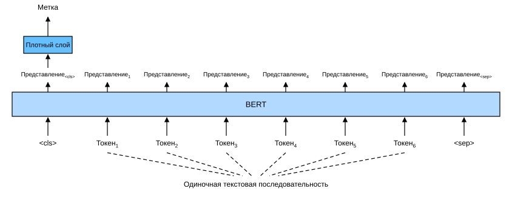
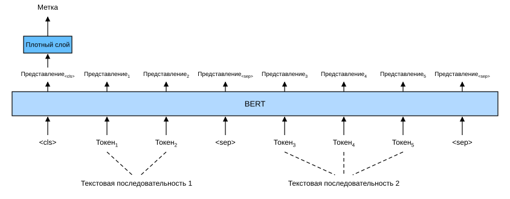
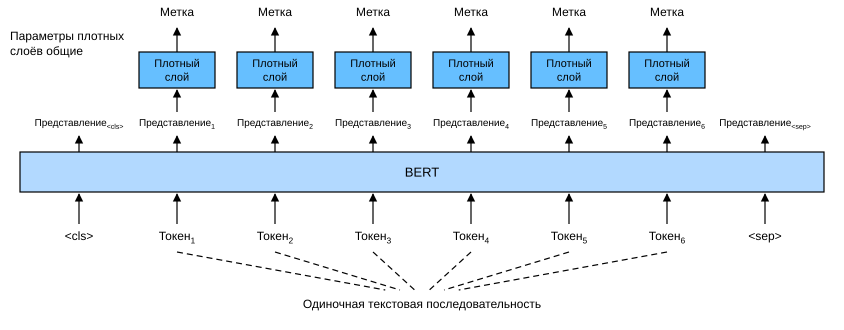
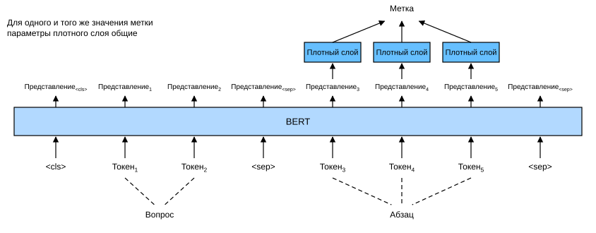

# 15.6 Дообучение BERT для приложений уровня последовательности и уровня токенов

В предыдущих разделах этой главы мы проектировали разные модели для приложений обработки естественного языка — например, на основе рекуррентных нейронных сетей, свёрточных нейронных сетей, внимания и многослойных перцептронов. Такие модели полезны, когда есть ограничения по пространству или времени, но на практике тщательно проектировать отдельную модель для каждой задачи обработки естественного языка невозможно. В разделе 14.8 мы представили предобученную модель BERT, которой для широкого круга задач обработки естественного языка требуются лишь минимальные изменения архитектуры. С одной стороны, на момент появления BERT улучшил лучшие известные результаты в разных задачах обработки естественного языка. С другой стороны, как отмечено в разделе 14.10, у двух версий исходной модели BERT 110 миллионов и 340 миллионов параметров. Поэтому при достаточных вычислительных ресурсах можно рассмотреть дообучение BERT для прикладных задач обработки естественного языка.

Далее мы рассмотрим ряд приложений обработки естественного языка, разделив их на приложения уровня последовательности и уровня токенов. На уровне последовательности мы покажем, как преобразовать представление текстового входа BERT в выходную метку в задачах классификации одиночного текста и классификации (или регрессии) пар текстов. На уровне токенов мы кратко рассмотрим новые приложения — разметку текста и ответы на вопросы — и покажем, как BERT представляет их входы и преобразует в выходные метки. При дообучении «минимальные изменения архитектуры», необходимые BERT для разных приложений, — это дополнительные полносвязные слои. При контролируемом обучении прикладной задачи параметры дополнительных слоёв обучаются с нуля, а все параметры предобученной модели BERT дообучаются.

## 15.6.1 Классификация одиночного текста

*Классификация одиночного текста* принимает на вход одну текстовую последовательность и выдаёт результат её классификации. Помимо анализа тональности, который мы изучали в этой главе, корпус лингвистической приемлемости (Corpus of Linguistic Acceptability, CoLA) — тоже набор данных для классификации одиночного текста, в котором нужно определить, приемлемо ли данное предложение с точки зрения грамматики (Warstadt et al., 2019). Например, «I should study.» приемлемо, а «I should studying.» — нет.

**Рис. 15.6.1.** Дообучение BERT для приложений классификации одиночного текста, таких как анализ тональности и проверка лингвистической приемлемости (здесь предполагается, что во входном одиночном тексте шесть токенов)

В разделе 14.8 описано входное представление BERT. Входная последовательность BERT однозначно представляет и одиночный текст, и пары текстов, где специальный токен классификации `<cls>` используется для классификации последовательности, а специальный токен `<sep>` отмечает конец одиночного текста или разделяет пару текстов. Как показано на рис. 15.6.1, в приложениях классификации одиночного текста представление BERT специального токена `<cls>` кодирует информацию всей входной текстовой последовательности. Как представление входного одиночного текста оно подаётся в небольшой многослойный перцептрон, состоящий из полносвязных (плотных) слоёв, чтобы получить распределение по всем дискретным значениям меток.

## 15.6.2 Классификация или регрессия пар текстов

В этой главе мы также изучили логический вывод на естественном языке. Он относится к *классификации пар текстов* — типу приложений, в которых классифицируется пара текстов.

*Семантическое сходство текстов* — популярная задача «регрессии пар текстов»: на вход подаётся пара текстов, а на выходе получается непрерывное значение. Эта задача оценивает семантическое сходство предложений. Например, в эталонном наборе данных семантического сходства текстов (Semantic Textual Similarity Benchmark) оценка сходства пары предложений — это балл на шкале от 0 (нет семантического перекрытия) до 5 (семантическая эквивалентность) (Cer et al., 2017). Цель — предсказывать эти баллы. Примеры из этого набора включают (предложение 1, предложение 2, оценка сходства):

* «A plane is taking off.» («Самолёт взлетает.»), «An air plane is taking off.» («Самолёт взлетает.»), 5.000;
* «A woman is eating something.» («Женщина что-то ест.»), «A woman is eating meat.» («Женщина ест мясо.»), 3.000;
* «A woman is dancing.» («Женщина танцует.»), «A man is talking.» («Мужчина разговаривает.»), 0.000.

**Рис. 15.6.2.** Дообучение BERT для приложений классификации или регрессии пар текстов, таких как логический вывод на естественном языке и семантическое сходство текстов (предполагается, что во входной паре текстов два и три токена соответственно)

По сравнению с классификацией одиночного текста на рис. 15.6.1, дообучение BERT для классификации пар текстов на рис. 15.6.2 отличается входным представлением. Для задач регрессии пар текстов, таких как семантическое сходство текстов, можно внести небольшие изменения, например выдавать непрерывное значение метки и использовать среднеквадратичные потери, которые обычны для регрессии.

## 15.6.3 Разметка текста

Теперь рассмотрим задачи уровня токенов, например *разметку текста* (text tagging), где каждому токену присваивается метка. Среди задач разметки текста *разметка частей речи* присваивает каждому слову метку части речи (например, прилагательное или определитель) в зависимости от роли слова в предложении. Например, по набору тегов Penn Treebank II предложение «John Smith's car is new» должно быть размечено как «NNP (существительное, имя собственное, единственное число) NNP POS (окончание притяжательного падежа) NN (существительное, единственное число или неисчисляемое) VBZ (глагол, 3-е лицо единственного числа настоящего времени) JJ (прилагательное)».

**Рис. 15.6.3.** Дообучение BERT для приложений разметки текста, таких как разметка частей речи. Предполагается, что во входном одиночном тексте шесть токенов

Дообучение BERT для приложений разметки текста показано на рис. 15.6.3. По сравнению с рис. 15.6.1, единственное отличие в том, что в разметке текста представление BERT *каждого токена* входного текста подаётся в один и тот же дополнительный полносвязный слой, чтобы получить метку токена, например метку части речи.

## 15.6.4 Ответы на вопросы

Как ещё одно приложение уровня токенов, *ответы на вопросы* отражают способность к чтению с пониманием. Например, Stanford Question Answering Dataset (SQuAD v1.1) состоит из абзацев для чтения и вопросов, где ответом на каждый вопрос служит лишь фрагмент текста (текстовый отрезок) из абзаца (Rajpurkar et al., 2016). Возьмём в качестве примера абзац: «Some experts report that a mask's efficacy is inconclusive. However, mask makers insist that their products, such as N95 respirator masks, can guard against the virus.» («Некоторые эксперты сообщают, что эффективность масок не доказана. Однако производители масок настаивают, что их продукция, например респираторы N95, может защитить от вируса.») и вопрос: «Who say that N95 respirator masks can guard against the virus?» («Кто говорит, что респираторы N95 могут защитить от вируса?»). Ответом должен быть текстовый отрезок «mask makers» («производители масок») из абзаца. Таким образом, цель SQuAD v1.1 — по заданным вопросу и абзацу предсказать начало и конец текстового отрезка в абзаце.

**Рис. 15.6.4.** Дообучение BERT для ответов на вопросы (предполагается, что во входной паре текстов два и три токена соответственно)

Чтобы дообучить BERT для ответов на вопросы, вопрос и абзац подаются во вход BERT как первая и вторая текстовые последовательности соответственно. Чтобы предсказать позицию начала текстового отрезка, один и тот же дополнительный полносвязный слой преобразует представление BERT любого токена из позиции $i$ в скалярную оценку $s_i$. Оценки всех токенов абзаца дополнительно преобразуются softmax в распределение вероятностей, так что каждой позиции токена $i$ в абзаце присваивается вероятность $p_i$ быть началом текстового отрезка. Предсказание конца текстового отрезка делается так же, только параметры его дополнительного полносвязного слоя не зависят от параметров, использованных для предсказания начала. При предсказании конца токен в позиции $i$ преобразуется тем же полносвязным слоем в скалярную оценку $e_i$. На рис. 15.6.4 показано дообучение BERT для ответов на вопросы.

Для ответов на вопросы цель контролируемого обучения так же проста, как максимизация логарифмического правдоподобия истинных позиций начала и конца. При предсказании отрезка можно вычислять оценку $s_i + e_j$ допустимого отрезка от позиции $i$ до позиции $j$ ($i \leq j$) и выдавать отрезок с наибольшей оценкой.

## Резюме

* Для приложений уровня последовательности и уровня токенов BERT требует лишь минимальных изменений архитектуры (дополнительных полносвязных слоёв) — в классификации одиночного текста (например, анализе тональности и проверке лингвистической приемлемости), классификации или регрессии пар текстов (например, логическом выводе на естественном языке и семантическом сходстве текстов), разметке текста (например, разметке частей речи) и ответах на вопросы.
* При контролируемом обучении прикладной задачи параметры дополнительных слоёв обучаются с нуля, а все параметры предобученной модели BERT дообучаются.

## Упражнения

1. Давайте спроектируем алгоритм поисковой системы для новостных статей. Когда система получает запрос (например, «нефтяная промышленность во время вспышки коронавируса»), она должна вернуть ранжированный список новостных статей, наиболее релевантных запросу. Допустим, у нас есть огромный пул новостных статей и большое число запросов. Чтобы упростить задачу, предположим, что для каждого запроса размечена наиболее релевантная статья. Как применить отрицательную выборку (см. раздел 14.2.1) и BERT при проектировании алгоритма?
1. Как использовать BERT для обучения языковых моделей?
1. Можно ли использовать BERT в машинном переводе?

[Обсуждение](https://discuss.d2l.ai/t/5729)

## Литература

* Warstadt, A., Singh, A., & Bowman, S. R. (2019). Neural network acceptability judgments. *Transactions of the Association for Computational Linguistics*, 7, 625–641.
* Cer, D., Diab, M., Agirre, E., Lopez-Gazpio, I., & Specia, L. (2017). SemEval-2017 Task 1: Semantic Textual Similarity Multilingual and Crosslingual Focused Evaluation. In *Proceedings of the 11th International Workshop on Semantic Evaluation (SemEval-2017)*, 1–14.
* Rajpurkar, P., Zhang, J., Lopyrev, K., & Liang, P. (2016). Squad: 100,000+ questions for machine comprehension of text. *arXiv preprint arXiv:1606.05250*.
