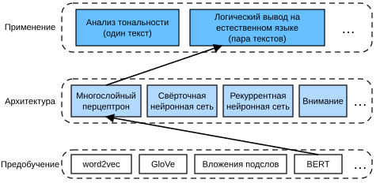

# 15.7 Логический вывод на естественном языке: дообучение BERT

В предыдущих разделах этой главы мы спроектировали архитектуру на основе внимания (раздел 15.5) для задачи логического вывода на естественном языке на наборе данных SNLI (раздел 15.4). Теперь вернёмся к этой задаче, дообучая BERT. Как обсуждалось в разделе 15.6, логический вывод на естественном языке — это задача классификации пар текстов на уровне последовательности, а для дообучения BERT нужна лишь дополнительная архитектура на основе многослойного перцептрона, как показано на рис. 15.7.1.



**Рис. 15.7.1.** Подача предобученного BERT в архитектуру логического вывода на естественном языке на основе многослойного перцептрона

В этом разделе мы скачаем предобученную малую версию BERT и затем дообучим её для логического вывода на естественном языке на наборе данных SNLI.

**MXNet:**

```python
from d2l import mxnet as d2l
import json
import multiprocessing
from mxnet import gluon, np, npx
from mxnet.gluon import nn
import os

npx.set_np()
```

**PyTorch:**

```python
from d2l import torch as d2l
import json
import multiprocessing
import torch
from torch import nn
import os
```

**PaddlePaddle:**

```python
from d2l import paddle as d2l
import warnings
warnings.filterwarnings("ignore")
import json
import multiprocessing
import paddle
from paddle import nn
import os
```

## 15.7.1 Загрузка предобученного BERT

Мы предобучили BERT на наборе данных WikiText-2 в разделах 14.9 и 14.10 (заметим, что исходная модель BERT была предобучена на гораздо больших корпусах). Как обсуждалось в разделе 14.10, у исходной модели BERT сотни миллионов параметров. Ниже мы предоставляем две версии предобученного BERT: «bert.base» — такая же большая, как исходная базовая модель BERT, для её дообучения нужно много вычислительных ресурсов, а «bert.small» — малая версия для удобства демонстрации.

**MXNet:**

```python
d2l.DATA_HUB['bert.base'] = (d2l.DATA_URL + 'bert.base.zip',
                             '7b3820b35da691042e5d34c0971ac3edbd80d3f4')
d2l.DATA_HUB['bert.small'] = (d2l.DATA_URL + 'bert.small.zip',
                              'a4e718a47137ccd1809c9107ab4f5edd317bae2c')
```

**PyTorch:**

```python
d2l.DATA_HUB['bert.base'] = (d2l.DATA_URL + 'bert.base.torch.zip',
                             '225d66f04cae318b841a13d32af3acc165f253ac')
d2l.DATA_HUB['bert.small'] = (d2l.DATA_URL + 'bert.small.torch.zip',
                              'c72329e68a732bef0452e4b96a1c341c8910f81f')
```

**PaddlePaddle:**

```python
d2l.DATA_HUB['bert_small'] = ('https://paddlenlp.bj.bcebos.com/models/bert.small.paddle.zip', '9fcde07509c7e87ec61c640c1b277509c7e87ec6153d9041758e4')

d2l.DATA_HUB['bert_base'] = ('https://paddlenlp.bj.bcebos.com/models/bert.base.paddle.zip', '9fcde07509c7e87ec61c640c1b27509c7e87ec61753d9041758e4')
```

Обе предобученные модели BERT содержат файл «vocab.json», определяющий словарь, и файл «pretrained.params» с предобученными параметрами. Мы реализуем следующую функцию `load_pretrained_model`, чтобы **загрузить предобученные параметры BERT**.

**MXNet:**

```python
def load_pretrained_model(pretrained_model, num_hiddens, ffn_num_hiddens,
                          num_heads, num_layers, dropout, max_len, devices):
    data_dir = d2l.download_extract(pretrained_model)
    # Определяем пустой словарь, чтобы загрузить предопределённый словарь
    vocab = d2l.Vocab()
    vocab.idx_to_token = json.load(open(os.path.join(data_dir,
         'vocab.json')))
    vocab.token_to_idx = {token: idx for idx, token in enumerate(
        vocab.idx_to_token)}
    bert = d2l.BERTModel(len(vocab), num_hiddens, ffn_num_hiddens, 
                         num_heads, num_layers, dropout, max_len)
    # Загружаем предобученные параметры BERT
    bert.load_parameters(os.path.join(data_dir, 'pretrained.params'),
                         ctx=devices)
    return bert, vocab
```

**PyTorch:**

```python
def load_pretrained_model(pretrained_model, num_hiddens, ffn_num_hiddens,
                          num_heads, num_layers, dropout, max_len, devices):
    data_dir = d2l.download_extract(pretrained_model)
    # Определяем пустой словарь, чтобы загрузить предопределённый словарь
    vocab = d2l.Vocab()
    vocab.idx_to_token = json.load(open(os.path.join(data_dir, 
        'vocab.json')))
    vocab.token_to_idx = {token: idx for idx, token in enumerate(
        vocab.idx_to_token)}
    bert = d2l.BERTModel(len(vocab), num_hiddens, norm_shape=[256],
                         ffn_num_input=256, ffn_num_hiddens=ffn_num_hiddens,
                         num_heads=4, num_layers=2, dropout=0.2,
                         max_len=max_len, key_size=256, query_size=256,
                         value_size=256, hid_in_features=256,
                         mlm_in_features=256, nsp_in_features=256)
    # Загружаем предобученные параметры BERT
    bert.load_state_dict(torch.load(os.path.join(data_dir,
                                                 'pretrained.params')))
    return bert, vocab
```

**PaddlePaddle:**

```python
def load_pretrained_model(pretrained_model, num_hiddens, ffn_num_hiddens,
                          num_heads, num_layers, dropout, max_len, devices):
    data_dir = d2l.download_extract(pretrained_model)
    # Определяем пустой словарь, чтобы загрузить предопределённый словарь
    vocab = d2l.Vocab()
    vocab.idx_to_token = json.load(open(os.path.join(data_dir,
        'vocab.json')))
    vocab.token_to_idx = {token: idx for idx, token in enumerate(
        vocab.idx_to_token)}
    bert = d2l.BERTModel(len(vocab), num_hiddens, norm_shape=[256],
                         ffn_num_input=256, ffn_num_hiddens=ffn_num_hiddens,
                         num_heads=4, num_layers=2, dropout=0.2,
                         max_len=max_len, key_size=256, query_size=256,
                         value_size=256, hid_in_features=256,
                         mlm_in_features=256, nsp_in_features=256)
    # Загружаем предобученные параметры BERT
    bert.set_state_dict(paddle.load(os.path.join(data_dir,
                                                 'pretrained.pdparams')))

    return bert, vocab
```

Чтобы демонстрацию можно было запустить на большинстве машин, в этом разделе мы загрузим и дообучим малую версию предобученного BERT («bert.small»). В упражнениях мы покажем, как дообучить гораздо более крупную «bert.base», чтобы заметно повысить точность на тесте.

**MXNet, PyTorch:**

```python
devices = d2l.try_all_gpus()
bert, vocab = load_pretrained_model(
    'bert.small', num_hiddens=256, ffn_num_hiddens=512, num_heads=4,
    num_layers=2, dropout=0.1, max_len=512, devices=devices)
```

**PaddlePaddle:**

```python
devices = d2l.try_all_gpus()
bert, vocab = load_pretrained_model(
    'bert_small', num_hiddens=256, ffn_num_hiddens=512, num_heads=4,
    num_layers=2, dropout=0.1, max_len=512, devices=devices)
```

## 15.7.2 Набор данных для дообучения BERT

Для прикладной задачи логического вывода на естественном языке на наборе данных SNLI мы определяем пользовательский класс набора данных `SNLIBERTDataset`. В каждом примере посылка и гипотеза образуют пару текстовых последовательностей и упаковываются в одну входную последовательность BERT, как показано на рис. 15.6.2. Вспомним из раздела 14.8.4, что индексы сегментов используются для различения посылки и гипотезы во входной последовательности BERT. Для заданной максимальной длины входной последовательности BERT (`max_len`) мы последовательно удаляем последний токен более длинного из текстов входной пары, пока не будет выполнено условие `max_len`. Чтобы ускорить генерацию набора данных SNLI для дообучения BERT, мы используем 4 рабочих процесса для параллельной генерации обучающих и тестовых примеров.

**MXNet:**

```python
class SNLIBERTDataset(gluon.data.Dataset):
    def __init__(self, dataset, max_len, vocab=None):
        all_premise_hypothesis_tokens = [[
            p_tokens, h_tokens] for p_tokens, h_tokens in zip(
            *[d2l.tokenize([s.lower() for s in sentences])
              for sentences in dataset[:2]])]
        
        self.labels = np.array(dataset[2])
        self.vocab = vocab
        self.max_len = max_len
        (self.all_token_ids, self.all_segments,
         self.valid_lens) = self._preprocess(all_premise_hypothesis_tokens)
        print('прочитано ' + str(len(self.all_token_ids)) + ' примеров')

    def _preprocess(self, all_premise_hypothesis_tokens):
        pool = multiprocessing.Pool(4)  # Используем 4 процесса
        out = pool.map(self._mp_worker, all_premise_hypothesis_tokens)
        all_token_ids = [
            token_ids for token_ids, segments, valid_len in out]
        all_segments = [segments for token_ids, segments, valid_len in out]
        valid_lens = [valid_len for token_ids, segments, valid_len in out]
        return (np.array(all_token_ids, dtype='int32'),
                np.array(all_segments, dtype='int32'), 
                np.array(valid_lens))

    def _mp_worker(self, premise_hypothesis_tokens):
        p_tokens, h_tokens = premise_hypothesis_tokens
        self._truncate_pair_of_tokens(p_tokens, h_tokens)
        tokens, segments = d2l.get_tokens_and_segments(p_tokens, h_tokens)
        token_ids = self.vocab[tokens] + [self.vocab['<pad>']] \
                             * (self.max_len - len(tokens))
        segments = segments + [0] * (self.max_len - len(segments))
        valid_len = len(tokens)
        return token_ids, segments, valid_len

    def _truncate_pair_of_tokens(self, p_tokens, h_tokens):
        # Резервируем место для токенов '<CLS>', '<SEP>' и '<SEP>' во входе BERT
        while len(p_tokens) + len(h_tokens) > self.max_len - 3:
            if len(p_tokens) > len(h_tokens):
                p_tokens.pop()
            else:
                h_tokens.pop()

    def __getitem__(self, idx):
        return (self.all_token_ids[idx], self.all_segments[idx],
                self.valid_lens[idx]), self.labels[idx]

    def __len__(self):
        return len(self.all_token_ids)
```

**PyTorch:**

```python
class SNLIBERTDataset(torch.utils.data.Dataset):
    def __init__(self, dataset, max_len, vocab=None):
        all_premise_hypothesis_tokens = [[
            p_tokens, h_tokens] for p_tokens, h_tokens in zip(
            *[d2l.tokenize([s.lower() for s in sentences])
              for sentences in dataset[:2]])]
        
        self.labels = torch.tensor(dataset[2])
        self.vocab = vocab
        self.max_len = max_len
        (self.all_token_ids, self.all_segments,
         self.valid_lens) = self._preprocess(all_premise_hypothesis_tokens)
        print('прочитано ' + str(len(self.all_token_ids)) + ' примеров')

    def _preprocess(self, all_premise_hypothesis_tokens):
        pool = multiprocessing.Pool(4)  # Используем 4 процесса
        out = pool.map(self._mp_worker, all_premise_hypothesis_tokens)
        all_token_ids = [
            token_ids for token_ids, segments, valid_len in out]
        all_segments = [segments for token_ids, segments, valid_len in out]
        valid_lens = [valid_len for token_ids, segments, valid_len in out]
        return (torch.tensor(all_token_ids, dtype=torch.long),
                torch.tensor(all_segments, dtype=torch.long), 
                torch.tensor(valid_lens))

    def _mp_worker(self, premise_hypothesis_tokens):
        p_tokens, h_tokens = premise_hypothesis_tokens
        self._truncate_pair_of_tokens(p_tokens, h_tokens)
        tokens, segments = d2l.get_tokens_and_segments(p_tokens, h_tokens)
        token_ids = self.vocab[tokens] + [self.vocab['<pad>']] \
                             * (self.max_len - len(tokens))
        segments = segments + [0] * (self.max_len - len(segments))
        valid_len = len(tokens)
        return token_ids, segments, valid_len

    def _truncate_pair_of_tokens(self, p_tokens, h_tokens):
        # Резервируем место для токенов '<CLS>', '<SEP>' и '<SEP>' во входе BERT
        while len(p_tokens) + len(h_tokens) > self.max_len - 3:
            if len(p_tokens) > len(h_tokens):
                p_tokens.pop()
            else:
                h_tokens.pop()

    def __getitem__(self, idx):
        return (self.all_token_ids[idx], self.all_segments[idx],
                self.valid_lens[idx]), self.labels[idx]

    def __len__(self):
        return len(self.all_token_ids)
```

**PaddlePaddle:**

```python
class SNLIBERTDataset(paddle.io.Dataset):
    def __init__(self, dataset, max_len, vocab=None):
        all_premise_hypothesis_tokens = [[
            p_tokens, h_tokens] for p_tokens, h_tokens in zip(
            *[d2l.tokenize([s.lower() for s in sentences])
              for sentences in dataset[:2]])]

        self.labels = paddle.to_tensor(dataset[2])
        self.vocab = vocab
        self.max_len = max_len
        (self.all_token_ids, self.all_segments,
         self.valid_lens) = self._preprocess(all_premise_hypothesis_tokens)
        print('прочитано ' + str(len(self.all_token_ids)) + ' примеров')

    def _preprocess(self, all_premise_hypothesis_tokens):
        # pool = multiprocessing.Pool(1)  # Используем 4 процесса
        # out = pool.map(self._mp_worker, all_premise_hypothesis_tokens)
        out = []
        for i in all_premise_hypothesis_tokens:
            tempOut = self._mp_worker(i)
            out.append(tempOut)
        
        all_token_ids = [
            token_ids for token_ids, segments, valid_len in out]
        all_segments = [segments for token_ids, segments, valid_len in out]
        valid_lens = [valid_len for token_ids, segments, valid_len in out]
        return (paddle.to_tensor(all_token_ids, dtype='int64'),
                paddle.to_tensor(all_segments, dtype='int64'),
                paddle.to_tensor(valid_lens))

    def _mp_worker(self, premise_hypothesis_tokens):
        p_tokens, h_tokens = premise_hypothesis_tokens
        self._truncate_pair_of_tokens(p_tokens, h_tokens)
        tokens, segments = d2l.get_tokens_and_segments(p_tokens, h_tokens)
        token_ids = self.vocab[tokens] + [self.vocab['<pad>']] \
                             * (self.max_len - len(tokens))
        segments = segments + [0] * (self.max_len - len(segments))
        valid_len = len(tokens)
        return token_ids, segments, valid_len

    def _truncate_pair_of_tokens(self, p_tokens, h_tokens):
        # Резервируем место для токенов '<CLS>', '<SEP>' и '<SEP>' во входе BERT
        while len(p_tokens) + len(h_tokens) > self.max_len - 3:
            if len(p_tokens) > len(h_tokens):
                p_tokens.pop()
            else:
                h_tokens.pop()

    def __getitem__(self, idx):
        return (self.all_token_ids[idx], self.all_segments[idx],
                self.valid_lens[idx]), self.labels[idx]

    def __len__(self):
        return len(self.all_token_ids)
```

После скачивания набора данных SNLI мы **генерируем обучающие и тестовые примеры**, создавая экземпляры класса `SNLIBERTDataset`. Эти примеры будут читаться минибатчами при обучении и тестировании логического вывода на естественном языке.

**MXNet:**

```python
# Если возникает ошибка нехватки видеопамяти, уменьшите «batch_size».
# В исходной модели BERT max_len=512
batch_size, max_len, num_workers = 512, 128, d2l.get_dataloader_workers()
data_dir = d2l.download_extract('SNLI')
train_set = SNLIBERTDataset(d2l.read_snli(data_dir, True), max_len, vocab)
test_set = SNLIBERTDataset(d2l.read_snli(data_dir, False), max_len, vocab)
train_iter = gluon.data.DataLoader(train_set, batch_size, shuffle=True,
                                   num_workers=num_workers)
test_iter = gluon.data.DataLoader(test_set, batch_size,
                                  num_workers=num_workers)
```

**PyTorch:**

```python
# Если возникает ошибка нехватки видеопамяти, уменьшите «batch_size».
# В исходной модели BERT max_len=512
batch_size, max_len, num_workers = 512, 128, d2l.get_dataloader_workers()
data_dir = d2l.download_extract('SNLI')
train_set = SNLIBERTDataset(d2l.read_snli(data_dir, True), max_len, vocab)
test_set = SNLIBERTDataset(d2l.read_snli(data_dir, False), max_len, vocab)
train_iter = torch.utils.data.DataLoader(train_set, batch_size, shuffle=True,
                                   num_workers=num_workers)
test_iter = torch.utils.data.DataLoader(test_set, batch_size,
                                  num_workers=num_workers)
```

**PaddlePaddle:**

```python
# Если возникает ошибка нехватки видеопамяти, уменьшите «batch_size».
# В исходной модели BERT max_len=512
batch_size, max_len, num_workers = 512, 128, d2l.get_dataloader_workers()
data_dir = d2l.download_extract('SNLI')
train_set = SNLIBERTDataset(d2l.read_snli(data_dir, True), max_len, vocab)
test_set = SNLIBERTDataset(d2l.read_snli(data_dir, False), max_len, vocab)
train_iter = paddle.io.DataLoader(train_set, batch_size=batch_size, shuffle=True, return_list=True)
test_iter = paddle.io.DataLoader(test_set, batch_size=batch_size, return_list=True)
```

## 15.7.3 Дообучение BERT

Как показано на рис. 15.6.2, для дообучения BERT для логического вывода на естественном языке нужен лишь дополнительный многослойный перцептрон из двух полносвязных слоёв (см. `self.hidden` и `self.output` в следующем классе `BERTClassifier`). **Этот многослойный перцептрон преобразует представление BERT специального токена `<cls>`**, кодирующее информацию и посылки, и гипотезы, **в три выхода логического вывода на естественном языке**: следование, противоречие и нейтральность.

**MXNet:**

```python
class BERTClassifier(nn.Block):
    def __init__(self, bert):
        super(BERTClassifier, self).__init__()
        self.encoder = bert.encoder
        self.hidden = bert.hidden
        self.output = nn.Dense(3)

    def forward(self, inputs):
        tokens_X, segments_X, valid_lens_x = inputs
        encoded_X = self.encoder(tokens_X, segments_X, valid_lens_x)
        return self.output(self.hidden(encoded_X[:, 0, :]))
```

**PyTorch:**

```python
class BERTClassifier(nn.Module):
    def __init__(self, bert):
        super(BERTClassifier, self).__init__()
        self.encoder = bert.encoder
        self.hidden = bert.hidden
        self.output = nn.Linear(256, 3)

    def forward(self, inputs):
        tokens_X, segments_X, valid_lens_x = inputs
        encoded_X = self.encoder(tokens_X, segments_X, valid_lens_x)
        return self.output(self.hidden(encoded_X[:, 0, :]))
```

**PaddlePaddle:**

```python
class BERTClassifier(nn.Layer):
    def __init__(self, bert):
        super(BERTClassifier, self).__init__()
        self.encoder = bert.encoder
        self.hidden = bert.hidden
        self.output = nn.Linear(256, 3)

    def forward(self, inputs):
        tokens_X, segments_X, valid_lens_x = inputs
        encoded_X = self.encoder(tokens_X, segments_X, valid_lens_x.squeeze(1))
        return self.output(self.hidden(encoded_X[:, 0, :]))
```

Далее предобученная модель BERT `bert` подаётся в экземпляр `net` класса `BERTClassifier` для прикладной задачи. В типичных реализациях дообучения BERT с нуля обучаются только параметры выходного слоя дополнительного многослойного перцептрона (`net.output`). Все параметры предобученного кодировщика BERT (`net.encoder`) и скрытого слоя дополнительного многослойного перцептрона (`net.hidden`) будут дообучаться.

**MXNet:**

```python
net = BERTClassifier(bert)
net.output.initialize(ctx=devices)
```

**PyTorch, PaddlePaddle:**

```python
net = BERTClassifier(bert)
```

Вспомним, что в разделе 14.8 классы `MaskLM` и `NextSentencePred` содержат параметры в используемых ими многослойных перцептронах. Эти параметры входят в параметры предобученной модели BERT `bert` и, следовательно, в параметры `net`. Однако такие параметры используются лишь для вычисления потерь маскированной языковой модели и потерь предсказания следующего предложения при предобучении. Эти две функции потерь не относятся к дообучению для прикладных задач, поэтому при дообучении BERT параметры многослойных перцептронов в `MaskLM` и `NextSentencePred` не обновляются (устаревают, stale).

Чтобы допустить параметры с устаревшими градиентами, в функции `step` внутри `d2l.train_batch_ch13` установлен флаг `ignore_stale_grad=True`. С помощью этой функции мы обучаем и оцениваем модель `net` на обучающем (`train_iter`) и тестовом (`test_iter`) наборах SNLI. Из-за ограниченных вычислительных ресурсов точность обучения и тестирования можно ещё повысить: обсуждение мы оставляем для упражнений.

**MXNet:**

```python
lr, num_epochs = 1e-4, 5
trainer = gluon.Trainer(net.collect_params(), 'adam', {'learning_rate': lr})
loss = gluon.loss.SoftmaxCrossEntropyLoss()
d2l.train_ch13(net, train_iter, test_iter, loss, trainer, num_epochs, 
    devices, d2l.split_batch_multi_inputs)
```

**PyTorch:**

```python
lr, num_epochs = 1e-4, 5
trainer = torch.optim.Adam(net.parameters(), lr=lr)
loss = nn.CrossEntropyLoss(reduction='none')
d2l.train_ch13(net, train_iter, test_iter, loss, trainer, num_epochs, 
    devices)
```

**PaddlePaddle:**

```python
lr, num_epochs = 1e-4, 5
trainer = paddle.optimizer.Adam(learning_rate=lr, parameters=net.parameters())
loss = nn.CrossEntropyLoss(reduction='none')
d2l.train_ch13(net, train_iter, test_iter, loss, trainer, num_epochs,
    devices)
```

## Резюме

* Предобученную модель BERT можно дообучить для прикладных задач, например для логического вывода на естественном языке на наборе данных SNLI.
* При дообучении модель BERT становится частью модели прикладной задачи. Параметры, связанные только с потерями предобучения, при дообучении не обновляются.

## Упражнения

1. Если позволяют вычислительные ресурсы, дообучите гораздо более крупную предобученную модель BERT, такую же большую, как исходная базовая модель BERT. Измените настройки аргументов функции `load_pretrained_model`: замените «bert.small» на «bert.base» и увеличьте значения `num_hiddens=256`, `ffn_num_hiddens=512`, `num_heads=4` и `num_layers=2` до 768, 3072, 12 и 12 соответственно. Увеличив число эпох дообучения (и, возможно, настроив другие гиперпараметры), можно ли получить точность на тесте выше 0.86?
1. Как усекать пару последовательностей согласно отношению их длин? Сравните этот метод усечения пар с использованным в классе `SNLIBERTDataset`. Каковы их плюсы и минусы?

**MXNet:**
[Обсуждение](https://discuss.d2l.ai/t/5715)

**PyTorch:**
[Обсуждение](https://discuss.d2l.ai/t/5718)

**PaddlePaddle:**
[Обсуждение](https://discuss.d2l.ai/t/11831)
