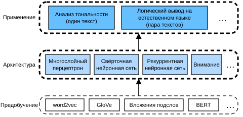

# 15. Обработка естественного языка: приложения

Ранее мы научились представлять токены в текстовых последовательностях и в главе 14 обучили представления токенов. Такие предобученные представления текста можно с помощью разных архитектур моделей подавать в различные прикладные задачи обработки естественного языка.

В предыдущих главах мы уже упоминали некоторые приложения обработки естественного языка, не использовавшие предобучение: они лишь объясняли архитектуры глубокого обучения. Например, в главе 8 мы полагались на рекуррентные нейронные сети, чтобы спроектировать языковую модель, генерирующую текст, похожий на повесть. В главах 9 и 10 мы также спроектировали модели машинного перевода на основе рекуррентных нейронных сетей и механизмов внимания.

Однако эта книга не стремится охватить все такие приложения. Вместо этого мы сосредоточимся на том, *как применять глубокое обучение языковых представлений для решения задач обработки естественного языка*. Располагая предобученными представлениями текста, в этой главе мы рассмотрим две популярные и показательные прикладные задачи обработки естественного языка: анализ тональности и логический вывод на естественном языке, которые анализируют соответственно одиночный текст и отношения между парами текстов.

Как показано на рис. 15.1, в этой главе мы опишем и затем используем разные типы архитектур глубокого обучения (многослойные перцептроны, свёрточные нейронные сети, рекуррентные нейронные сети и внимание) для проектирования моделей обработки естественного языка. Хотя на рис. 15.1 любое предобученное представление текста можно комбинировать с архитектурой любого приложения, мы выбрали несколько показательных сочетаний. Конкретно, для анализа тональности мы изучим популярные архитектуры на основе рекуррентных и свёрточных нейронных сетей. Для логического вывода на естественном языке мы выберем внимание и многослойные перцептроны, чтобы показать, как анализировать пары текстов. Наконец, мы расскажем, как дообучать предобученную модель BERT для широкого круга приложений обработки естественного языка — на уровне последовательности (классификация одиночного текста и классификация пар текстов) и на уровне токенов (разметка текста и ответы на вопросы). В качестве конкретного эмпирического примера мы дообучим BERT для логического вывода на естественном языке.

Как мы объясняли в разделе 14.8, BERT требует лишь минимальных изменений архитектуры для широкого круга приложений обработки естественного языка. Однако это преимущество достигается ценой дообучения огромного числа параметров BERT для прикладных задач. Когда пространство или время ограничены, более осуществимыми становятся тщательно построенные модели на основе многослойных перцептронов, свёрточных нейронных сетей, рекуррентных нейронных сетей и внимания. Ниже мы начнём с приложения анализа тональности и разберём устройство моделей на основе рекуррентных и свёрточных нейронных сетей соответственно.
