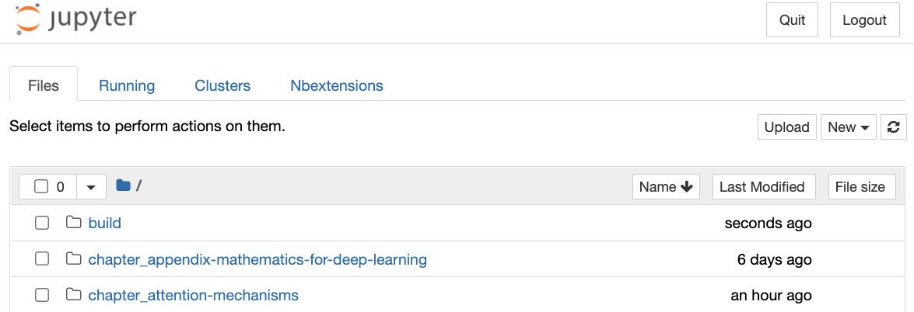
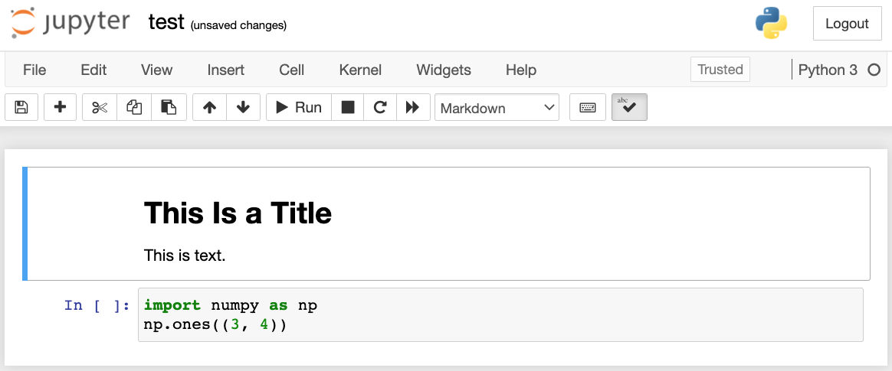
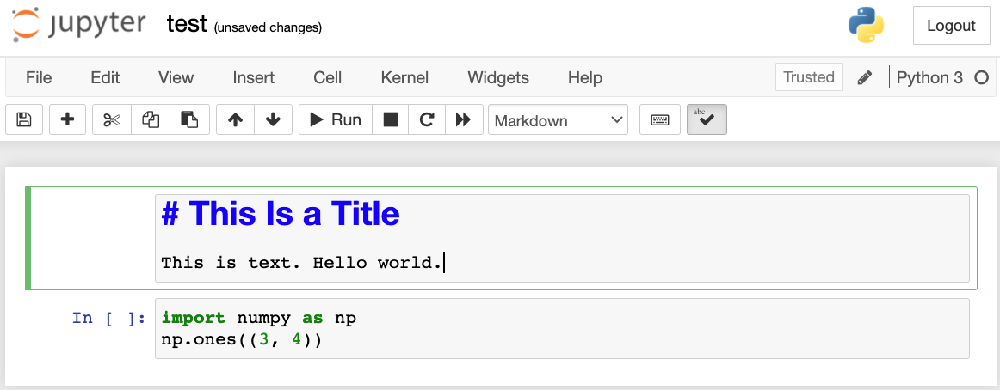
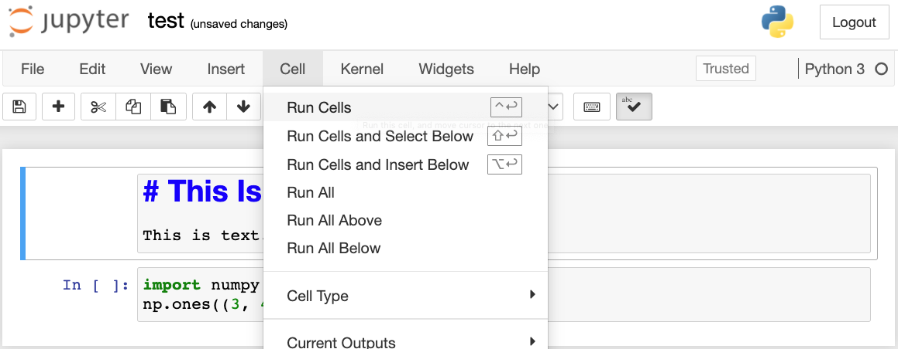
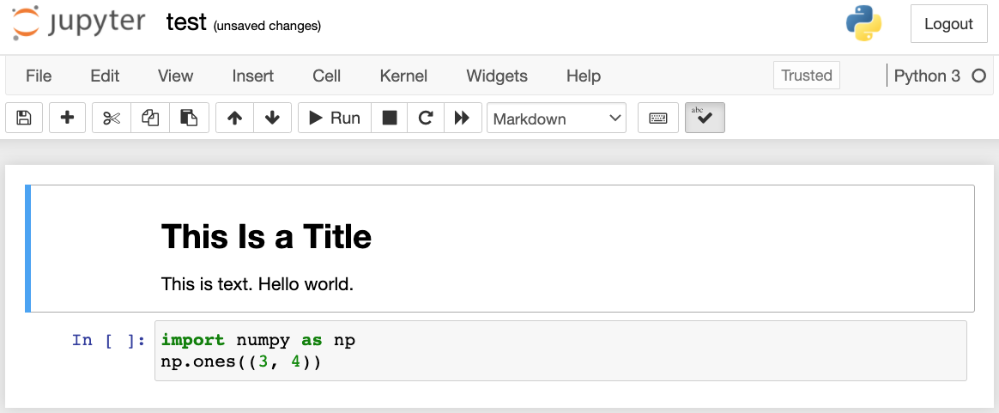
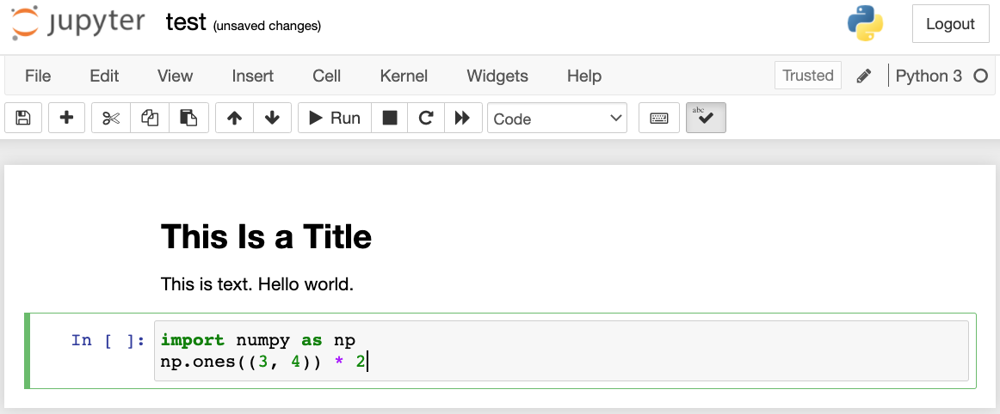
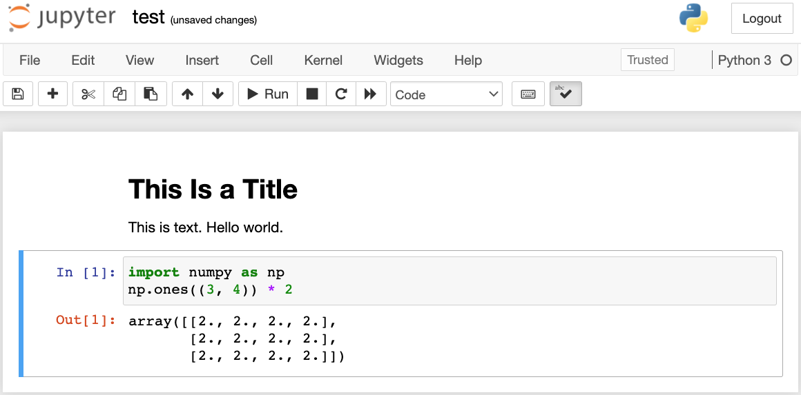

# 16.1 Использование Jupyter Notebook

В этом разделе рассказано, как редактировать и запускать код из глав книги с помощью Jupyter Notebook. Убедитесь, что вы установили Jupyter и скачали код, как описано в разделе «Установка». Если вы хотите узнать о Jupyter больше, обратитесь к отличным руководствам в его [документации](https://jupyter.readthedocs.io/en/latest/).

## 16.1.1 Редактирование и запуск кода локально

Предположим, что локальный путь к коду книги — `xx/yy/d2l-zh/`. Перейдите в оболочке в этот каталог (`cd xx/yy/d2l-zh`) и выполните команду `jupyter notebook`. Если браузер не открылся автоматически, откройте http://localhost:8888. Вы увидите интерфейс Jupyter и все папки с кодом книги, как показано на рис. 16.1.1.



**Рис. 16.1.1.** Папки с кодом книги

Файлы блокнотов открываются щелчком по папкам на веб-странице. Обычно они имеют расширение «.ipynb». Для краткости мы создали временный файл «test.ipynb». Его содержимое после щелчка показано на рис. 16.1.2. Этот блокнот содержит одну ячейку Markdown и одну ячейку с кодом. В ячейке Markdown находятся «This Is a Title» и «This is text.». Ячейка с кодом содержит две строки кода на Python.



**Рис. 16.1.2.** Ячейки Markdown и кода в файле «test.ipynb»

Дважды щёлкните по ячейке Markdown, чтобы перейти в режим редактирования. Добавьте в конец ячейки новую строку «Hello world.», как показано на рис. 16.1.3.



**Рис. 16.1.3.** Редактирование ячейки Markdown

Как показано на рис. 16.1.4, выберите в строке меню «Cell» $\rightarrow$ «Run Cells», чтобы выполнить изменённую ячейку.



**Рис. 16.1.4.** Выполнение ячейки

После выполнения ячейка Markdown выглядит так, как показано на рис. 16.1.5.



**Рис. 16.1.5.** Ячейка Markdown после редактирования

Затем щёлкните по ячейке с кодом. Умножьте на 2 элемент после последней строки кода, как показано на рис. 16.1.6.



**Рис. 16.1.6.** Редактирование ячейки с кодом

Ячейку также можно выполнить сочетанием клавиш (по умолчанию Ctrl+Enter); результат вывода показан на рис. 16.1.7.



**Рис. 16.1.7.** Выполнение ячейки с кодом и вывод результата

Когда в блокноте много ячеек, можно выбрать в меню «Kernel» $\rightarrow$ «Restart & Run All», чтобы выполнить все ячейки блокнота. Выбрав «Help» $\rightarrow$ «Edit Keyboard Shortcuts», можно изменить сочетания клавиш по своему вкусу.

## 16.1.2 Дополнительные возможности

Помимо локального редактирования, важны ещё две вещи: редактирование блокнотов в формате Markdown и удалённый запуск Jupyter. Второе важно, когда мы хотим запускать код на более быстром сервере. Первое важно потому, что собственный формат Jupyter — ipynb — хранит много вспомогательных данных, которые на самом деле не относятся к содержимому блокнота, а в основном связаны с тем, как и где запускался код. Это сбивает с толку git и сильно затрудняет слияние правок. К счастью, есть альтернатива — локальное редактирование в Markdown.

### 16.1.2.1 Файлы Markdown в Jupyter

Если вы хотите внести вклад в содержание книги, вам нужно изменять исходные файлы на GitHub (md-файлы, а не ipynb). С помощью плагина notedown можно изменять блокноты в формате md прямо в Jupyter.

Сначала установите плагин notedown, запустите Jupyter Notebook и загрузите плагин:

```
pip install d2l-notedown  # возможно, придётся удалить исходный notedown
jupyter notebook --NotebookApp.contents_manager_class='notedown.NotedownContentsManager'
```

Чтобы плагин notedown включался по умолчанию при запуске Jupyter Notebook, сделайте следующее. Сначала сгенерируйте файл конфигурации Jupyter Notebook (если он уже создан, этот шаг можно пропустить).

```
jupyter notebook --generate-config
```

Затем добавьте в конец файла конфигурации Jupyter Notebook следующую строку (в Linux/macOS он обычно находится в `~/.jupyter/jupyter_notebook_config.py`):

```
c.NotebookApp.contents_manager_class = 'notedown.NotedownContentsManager'
```

После этого для запуска с плагином notedown по умолчанию достаточно выполнить команду `jupyter notebook`.

### 16.1.2.2 Запуск Jupyter Notebook на удалённом сервере

Иногда бывает нужно запустить Jupyter Notebook на удалённом сервере и работать с ним через браузер на локальном компьютере. Если на локальном компьютере установлена Linux или macOS (в Windows это тоже возможно с помощью стороннего ПО, например PuTTY), можно использовать перенаправление портов:

```
ssh myserver -L 8888:localhost:8888
```

Здесь `myserver` — адрес удалённого сервера. После этого по адресу http://localhost:8888 мы можем обратиться к удалённому серверу `myserver`, на котором запущен Jupyter Notebook. Как запускать Jupyter Notebook на экземпляре AWS, подробно рассказано в разделе 16.3.

### 16.1.2.3 Время выполнения

С помощью плагина `ExecuteTime` можно измерять время выполнения каждой ячейки с кодом в Jupyter Notebook. Установите плагин следующими командами:

```
pip install jupyter_contrib_nbextensions
jupyter contrib nbextension install --user
jupyter nbextension enable execute_time/ExecuteTime
```

## Резюме

* С помощью Jupyter Notebook можно редактировать и запускать код книги и вносить в неё свой вклад.
* Для запуска Jupyter Notebook на удалённом сервере используется перенаправление портов.

## Упражнения

1. Отредактируйте и запустите код из этой книги с помощью Jupyter Notebook на локальном компьютере.
1. Отредактируйте и запустите код из этой книги удалённо с помощью Jupyter Notebook и перенаправления портов.
1. Для двух квадратных матриц $\mathbf{A}$ и $\mathbf{B}$ в $\mathbb{R}^{1024 \times 1024}$ измерьте время выполнения операций $\mathbf{A}^\top \mathbf{B}$ и $\mathbf{A} \mathbf{B}$. Какая из них быстрее?

[Обсуждение](https://discuss.d2l.ai/t/5731)
