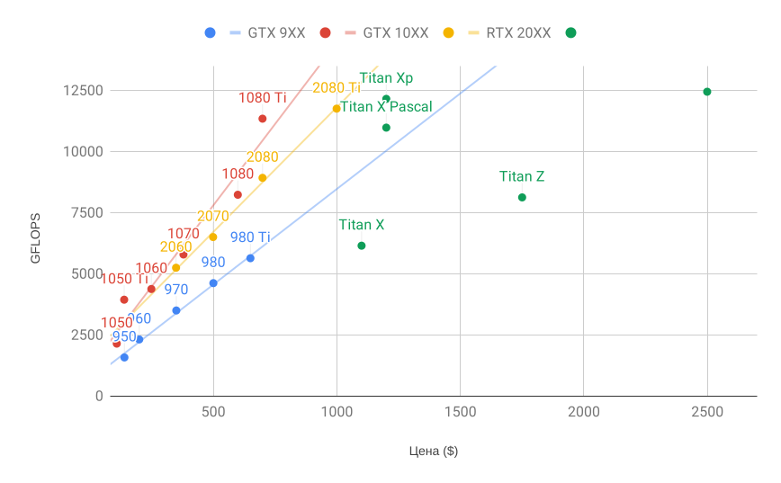
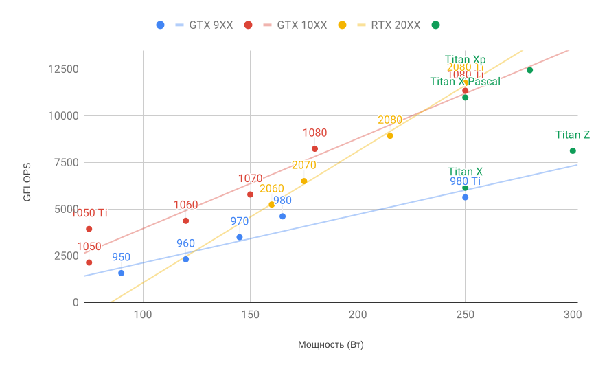

# 16.4 Выбор серверов и GPU

Обучение глубокого обучения обычно требует очень больших вычислений. Сейчас GPU — наиболее экономичные аппаратные ускорители для глубокого обучения. По сравнению с CPU, GPU дешевле и производительнее — зачастую более чем на порядок. Кроме того, один сервер может поддерживать несколько GPU: в высококлассных серверах — до 8. Более типично число до 4 GPU в инженерной рабочей станции, потому что тепловыделение, охлаждение и потребность в питании быстро растут и выходят за пределы того, что может обеспечить офисное здание. Для более крупных развёртываний практичнее облачные вычисления, например экземпляры Amazon [P3](https://aws.amazon.com/ec2/instance-types/p3/) и [G4](https://aws.amazon.com/blogs/aws/in-the-works-ec2-instances-g4-with-nvidia-t4-gpus/).

## 16.4.1 Выбор серверов

Обычно нет необходимости покупать высококлассный CPU с большим числом потоков, поскольку основная часть вычислений происходит на GPU. Тем не менее из-за глобальной блокировки интерпретатора (global interpreter lock, GIL) в Python однопоточная производительность CPU может быть важна, когда у нас 4–8 GPU. При прочих равных это означает, что экономичнее может оказаться CPU с меньшим числом ядер, но более высокой тактовой частотой. Например, при выборе между 6-ядерным CPU на 4 ГГц и 8-ядерным на 3,5 ГГц предпочтительнее первый, даже если его суммарная скорость ниже. Важно и то, что GPU потребляют много электроэнергии и, следовательно, выделяют много тепла. Это требует очень хорошего охлаждения и достаточно большого корпуса, чтобы вместить GPU. По возможности придерживайтесь следующих рекомендаций:

1. **Питание**. GPU потребляют много энергии. Закладывайте до 350 Вт на устройство (смотрите на *пиковую* потребность видеокарты, а не на среднюю: эффективный код может потреблять много энергии). Если блока питания не хватает, система станет нестабильной.
1. **Размер корпуса**. GPU велики, а вспомогательным разъёмам питания обычно нужно дополнительное место. Кроме того, большой корпус легче охлаждать.
1. **Охлаждение GPU**. Если у вас много GPU, возможно, стоит вложиться в жидкостное охлаждение. Кроме того, стремитесь к «референсному дизайну», даже если у него меньше вентиляторов, потому что такие карты достаточно тонкие, чтобы воздух поступал между устройствами. Если вы устанавливаете несколько GPU с несколькими вентиляторами, они могут оказаться слишком толстыми, и воздуха не хватит.
1. **Слоты PCIe**. Перемещение данных на GPU и с GPU (а также обмен ими между GPU) требует большой пропускной способности. Рекомендуются слоты PCIe 3.0 с 16 линиями. Если установлено несколько GPU, обязательно внимательно прочитайте описание материнской платы и убедитесь, что при одновременном использовании нескольких GPU по-прежнему доступна пропускная способность 16$\times$ и что это именно PCIe 3.0, а не PCIe 2.0 для дополнительных слотов. У некоторых материнских плат при установке нескольких GPU пропускная способность падает до 8$\times$ или даже 4$\times$. Отчасти это связано с ограниченным числом линий PCIe, которое предоставляет CPU.

Ниже кратко приведены рекомендации по сборке сервера для глубокого обучения.

* **Начинающий.** Купите недорогой GPU с низким энергопотреблением (дешёвый игровой GPU, подходящий для глубокого обучения, потребляет 150–200 Вт). Если повезёт, ваш нынешний компьютер его поддержит.
* **1 GPU.** Достаточно недорогого 4-ядерного CPU, а большинство материнских плат подойдут. Ориентируйтесь на не менее 32 ГБ DRAM и вложитесь в SSD для локального доступа к данным. Блока питания на 600 Вт должно хватить. Купите GPU с большим числом вентиляторов.
* **2 GPU.** Достаточно недорогого 4–6-ядерного CPU. Подумайте о 64 ГБ DRAM и вложитесь в SSD. Для двух высококлассных GPU понадобится блок питания на 1000 Вт. Что касается материнской платы, убедитесь, что у неё *два* слота PCIe 3.0 x16. Если возможно, берите плату, у которой между слотами PCIe 3.0 x16 есть два свободных слота (расстояние 60 мм), чтобы было больше воздуха. В этом случае купите два GPU с большим числом вентиляторов.
* **4 GPU.** Убедитесь, что вы покупаете CPU с относительно высокой однопоточной скоростью (то есть с высокой тактовой частотой). Возможно, понадобится CPU с большим числом линий PCIe, например AMD Threadripper. Чтобы получить 4 слота PCIe 3.0 x16, возможно, придётся купить относительно дорогую материнскую плату, поскольку им может понадобиться PLX для мультиплексирования линий PCIe. Покупайте GPU с референсным дизайном: они узкие и пропускают воздух между картами. Нужен блок питания на 1600–2000 Вт, а офисная розетка может такого не выдержать. Такой сервер, возможно, будет *громким и горячим* во время работы. Вы не захотите ставить его под стол. Рекомендуется 128 ГБ DRAM. Возьмите SSD для локального хранилища (1–2 ТБ NVMe) и жёсткие диски в конфигурации RAID для хранения данных.
* **8 GPU.** Нужно купить специализированный серверный корпус для нескольких GPU с несколькими резервными блоками питания (например, 2+1 по 1600 Вт). Потребуются двухсокетные серверные CPU, 256 ГБ памяти ECC DRAM, быстрая сетевая карта (рекомендуется 10 GbE), а также нужно проверить, поддерживает ли сервер *физический форм-фактор* GPU. Поток воздуха и расположение проводки у потребительских и серверных GPU заметно различаются (например, RTX 2080 и Tesla V100). Это означает, что потребительский GPU, возможно, не удастся установить в сервер из-за недостаточного зазора для силового кабеля или отсутствия подходящей проводки (один из соавторов книги убедился в этом на собственном горьком опыте).

## 16.4.2 Выбор GPU

В настоящее время AMD и NVIDIA — два основных производителя специализированных GPU. NVIDIA первой пришла в глубокое обучение и благодаря CUDA лучше поддерживается фреймворками глубокого обучения. Поэтому большинство покупателей выбирают GPU NVIDIA.

NVIDIA предлагает два типа GPU: для индивидуальных пользователей (например, серии GTX и RTX) и для корпоративных (серия Tesla). Эти два типа GPU обладают сопоставимой вычислительной мощностью. Однако у корпоративных GPU обычно принудительное (пассивное) охлаждение, больше памяти и память ECC (с коррекцией ошибок). Эти GPU больше подходят для центров обработки данных и обычно стоят в десять раз дороже потребительских.

Если вы крупная компания со 100 серверами, вам стоит присмотреться к серии NVIDIA Tesla или использовать серверы с GPU в облаке. Для лаборатории или малой и средней компании с 10+ серверами наиболее экономичной может оказаться серия NVIDIA RTX; можно купить предварительно сконфигурированные серверы в корпусах Supermicro или Asus, в которых эффективно размещаются 4–8 GPU.

Поставщики GPU обычно выпускают новое поколение раз в один-два года, например серию GTX 1000 (Pascal) в 2017 году и серию RTX 2000 (Turing) в 2019 году. Каждая серия включает несколько моделей с разным уровнем производительности. Производительность GPU определяется в основном комбинацией трёх параметров:

1. **Вычислительная мощность.** Обычно ищут мощность вычислений с плавающей запятой 32 бит. Обучение с 16-битной плавающей запятой (FP16) тоже входит в обиход. Если вас интересует только вывод (предсказание), можно использовать и 8-битные целые числа. Последнее поколение GPU Turing поддерживает ускорение 4 бит. К сожалению, алгоритмы обучения сетей низкой точности пока не получили широкого распространения;
1. **Объём памяти.** По мере роста моделей или размера батчей, используемых при обучении, потребуется больше памяти GPU. Обратите внимание на HBM2 (память с высокой пропускной способностью) и GDDR6 (графическая DDR). HBM2 быстрее, но дороже;
1. **Пропускная способность памяти.** Вычислительную мощность можно использовать на полную только при достаточной пропускной способности памяти. При использовании GDDR6 ищите широкую шину памяти.

Большинству пользователей достаточно посмотреть на вычислительную мощность. Учтите, что у многих GPU есть разные виды ускорения. Например, Tensor Cores от NVIDIA ускоряют подмножество операторов в 5$\times$. Убедитесь, что используемые вами библиотеки это поддерживают. Памяти GPU должно быть не менее 4 ГБ (лучше 8 ГБ). Старайтесь не использовать GPU ещё и для вывода графического интерфейса (используйте вместо этого встроенную графику). Если этого не избежать, добавьте 2 ГБ RAM для надёжности.

На рис. 16.4.1 сравниваются вычислительная мощность в GFLOPS и цена различных моделей серий GTX 900, GTX 1000 и RTX 2000. Цены — рекомендованные, взятые из Википедии.

**Рис. 16.4.1.** Сравнение вычислительной мощности с плавающей запятой и цены

Из рисунка видно несколько вещей:

1. Внутри каждой серии цена и производительность примерно пропорциональны. Модели Titan стоят заметно дороже из-за большого объёма памяти GPU. Однако при сравнении 980 Ti и 1080 Ti видно, что новые модели экономичнее. Цена в серии RTX 2000, судя по всему, не очень выросла. Зато они обеспечивают гораздо лучшую производительность при низкой точности (FP16, INT8 и INT4);
2. Отношение производительности к цене у серии GTX 1000 примерно вдвое лучше, чем у серии 900;
3. Для серии RTX 2000 вычислительная мощность с плавающей запятой — «аффинная» функция цены.

**Рис. 16.4.2.** Вычислительная мощность с плавающей запятой и энергопотребление

На рис. 16.4.2 видно, что энергопотребление в основном линейно зависит от объёма вычислений. Кроме того, более поздние поколения эффективнее. Это, по-видимому, противоречит графику для серии RTX 2000. Однако так получается из-за непропорционально большого энергопотребления Tensor Cores.

## Резюме

* При сборке сервера следите за питанием, линиями шины PCIe, однопоточной скоростью CPU и охлаждением.
* По возможности стоит покупать GPU последнего поколения.
* Для больших развёртываний используйте облако.
* Серверы высокой плотности могут быть несовместимы со всеми GPU. Прежде чем покупать, проверьте механические и тепловые характеристики.
* Для повышения эффективности используйте FP16 или меньшую точность.
