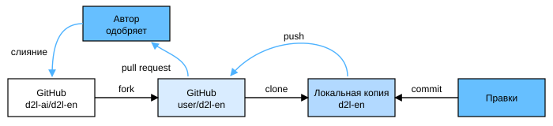

# 16.5 Вклад в развитие книги

Вклад читателей очень помогает нам улучшать качество книги. Если вы нашли опечатку, нерабочую ссылку, место, где, по вашему мнению, мы пропустили цитирование, неизящный код или неясное объяснение, пожалуйста, откликнитесь и помогите читателям. В обычных книгах интервал между тиражами (то есть между исправлениями опечаток) часто составляет годы, а улучшения этой книги обычно занимают от нескольких часов до нескольких дней. Это достаточно эффективно благодаря системе контроля версий и непрерывной автоматической интеграции (CI) с тестированием. Для этого нужно отправить [pull request](https://github.com/d2l-ai/d2l-en/pulls) в репозиторий на GitHub. Когда авторы примут ваш pull request в кодовую базу, вы станете [соавтором](https://github.com/d2l-ai/d2l-en/graphs/contributors).

> **Примечание переводчика.** Этот раздел описывает работу с репозиторием оригинала (`d2l-ai/d2l-en`). Замечания к русскому переводу направляйте в репозиторий, в котором опубликована эта книга; общие правила изложены в файле `CONTRIBUTING.md` в его корне.

## 16.5.1 Небольшие правки

Самый распространённый вид вклада — правка одного предложения или исправление опечатки. Рекомендуем найти исходный файл (файл Markdown) в [репозитории GitHub](https://github.com/d2l-ai/d2l-en). Затем нажмите кнопку «Edit this file» в правом верхнем углу страницы файла и внесите изменения в файл Markdown.

После этого в панели «Propose file change» («Предложить изменение файла») внизу страницы заполните описание изменений и нажмите кнопку «Propose file change». Вы будете перенаправлены на новую страницу, где можно просмотреть свои изменения. Если всё в порядке, отправьте pull request, нажав кнопку «Create pull request».

## 16.5.2 Крупные правки текста или кода

Если вы планируете изменить значительный объём текста или кода, нужно лучше знать формат, используемый в книге. Исходные файлы написаны в [формате Markdown](https://daringfireball.net/projects/markdown/syntax) с набором расширений, которые предоставляет пакет [d2lbook](http://book.d2l.ai/user/markdown.html): ссылки на формулы, изображения, разделы и цитаты. Открывать и изменять эти файлы можно в любом редакторе Markdown.

Если вы хотите изменить код, мы рекомендуем открывать эти файлы Markdown в Jupyter Notebook, как описано в разделе 16.1. Так вы сможете запускать и проверять свои изменения. Не забудьте очистить все выходные данные перед отправкой изменений: наша система CI выполнит обновлённые вами разделы и сгенерирует вывод.

Некоторые разделы могут поддерживать реализации для нескольких фреймворков. Если вы добавляете новый блок кода не для mxnet, пометьте первую строку блока кода маркером `#@tab`. Например, `#@tab pytorch` — для блока кода PyTorch, `#@tab tensorflow` — для блока кода TensorFlow, `#@tab paddle` — для блока кода PaddlePaddle, а `#@tab all` — для блока кода, общего для всех реализаций. Подробнее см. в пакете [d2lbook](http://book.d2l.ai/user/code_tabs.html).

## 16.5.3 Крупные изменения

Для крупных изменений мы рекомендуем использовать стандартный процесс работы с Git. Если коротко, он выглядит так, как показано на рис. 16.5.1.



**Рис. 16.5.1.** Вклад в книгу

Мы подробно пройдём по этим шагам. Если вы уже знакомы с Git, этот раздел можно пропустить. В примерах мы будем считать, что имя пользователя автора правки — «astonzhang».

### 16.5.3.1 Установка Git

В открытой книге о Git описано, [как установить Git](https://git-scm.com/book/en/v2). Обычно это делается командой `apt install git` в Ubuntu Linux, установкой инструментов разработчика Xcode в macOS или с помощью [настольного клиента](https://desktop.github.com) GitHub. Если у вас нет учётной записи GitHub, нужно зарегистрироваться.

### 16.5.3.2 Вход в GitHub

Введите в браузере [адрес](https://github.com/d2l-ai/d2l-en/) репозитория с кодом книги. Нажмите кнопку `Fork` в правом верхнем углу страницы репозитория, чтобы скопировать репозиторий книги. Это будет ваша собственная копия, и вы можете менять её как угодно.

Теперь репозиторий книги будет разветвлён (то есть скопирован) в вашу учётную запись: например, в левом верхнем углу страницы вы увидите `astonzhang/d2l-en`.

### 16.5.3.3 Клонирование репозитория

Чтобы клонировать репозиторий (то есть сделать локальную копию), нужно узнать его адрес: он показывается при нажатии зелёной кнопки «Code» на странице репозитория. Если вы решите держать этот форк дольше, следите, чтобы локальная копия была синхронизирована с основным репозиторием. Пока же просто выполните инструкции из раздела «Установка». Главное отличие в том, что теперь вы скачиваете собственный форк репозитория.

```
# Замените your_github_username своим именем пользователя на GitHub
git clone https://github.com/your_github_username/d2l-en.git
```

### 16.5.3.4 Редактирование и отправка изменений

Пора редактировать книгу. Лучше всего делать это в Jupyter Notebook, как описано в разделе 16.1. Внесите изменения и убедитесь, что всё работает. Предположим, мы исправили опечатку в файле `~/d2l-en/chapter_appendix_tools/how-to-contribute.md`. Можно проверить, какие файлы вы изменили.

В этот момент Git сообщит, что файл `chapter_appendix_tools/how-to-contribute.md` изменён.

```
mylaptop:d2l-en me$ git status
On branch master
Your branch is up-to-date with 'origin/master'.

Changes not staged for commit:
  (use "git add <file>..." to update what will be committed)
  (use "git checkout -- <file>..." to discard changes in working directory)

	modified:   chapter_appendix_tools/how-to-contribute.md
```

Убедившись, что это именно то, что вам нужно, выполните следующие команды:

```
git add chapter_appendix_tools/how-to-contribute.md
git commit -m 'fix typo in git documentation'
git push
```

Изменённый код окажется в вашей личной ветке репозитория. Чтобы предложить добавить изменения, нужно создать pull request в официальный репозиторий книги.

### 16.5.3.5 Отправка pull request

Перейдите на GitHub в свой форк репозитория и нажмите «New pull request». Откроется страница, показывающая различия между вашими правками и текущим содержимым основного репозитория книги.

Наконец, нажмите кнопку «Create pull request», чтобы отправить pull request. Обязательно опишите в нём внесённые изменения. Так авторам будет проще его проверить и слить с книгой. В зависимости от изменений pull request может быть принят сразу, отклонён или, что вероятнее всего, вы получите замечания по изменениям. Когда ваши правки будут слиты, всё готово.

## Резюме

* Вносить вклад в книгу можно через GitHub.
* Небольшие правки можно делать прямо на GitHub.
* Для значительных изменений нужно сделать форк репозитория, отредактировать содержимое локально и отправить вклад, когда всё готово.
* Старайтесь не отправлять огромные pull request: их трудно понять и слить. Лучше разбить их на несколько небольших.

## Упражнения

1. Сделайте звёздочку (star) и форк репозитория `d2l-ai/d2l-en`.
1. Если вы заметили что-то, что нужно улучшить (например, отсутствующую ссылку на источник), отправьте pull request.
1. Обычно лучше создавать pull request в новой ветке. Узнайте, как это делать с помощью [ветвления Git](https://git-scm.com/book/en/v2/Git-Branching-Branches-in-a-Nutshell).

[Обсуждение](https://discuss.d2l.ai/t/5730)
