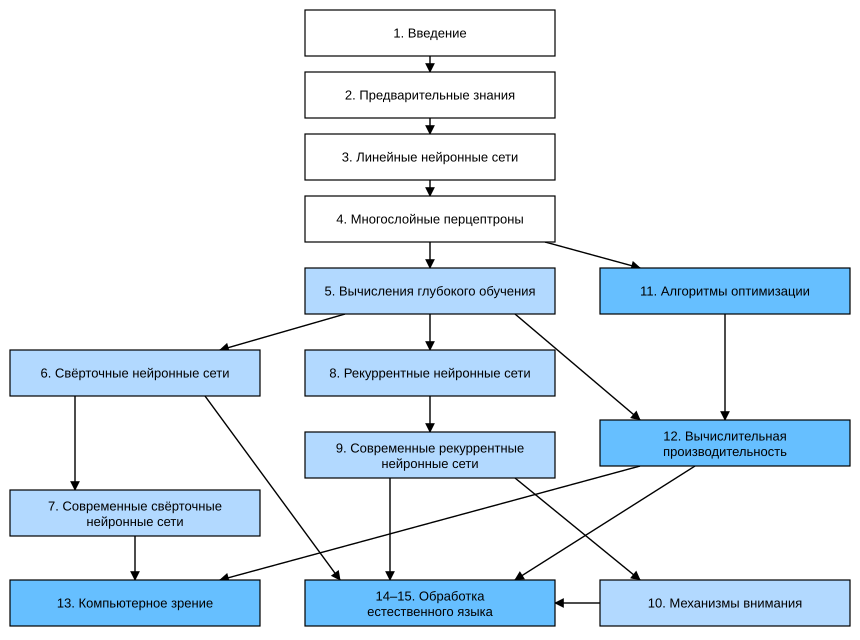

# Предисловие

Ещё несколько лет назад ни в крупных компаниях, ни в стартапах не было целых отделов специалистов по глубокому обучению, разрабатывающих интеллектуальные продукты и услуги. Когда в эту область пришли мы, младшие из авторов, машинное обучение ещё не попадало в заголовки газет. Наши родители понятия не имели, что такое машинное обучение, не говоря уже о том, почему мы могли бы предпочесть его карьере в медицине или юриспруденции. Машинное обучение было перспективной академической дисциплиной с узким кругом практических применений. А те применения, которые существовали, — например, распознавание речи и компьютерное зрение, — требовали столько предметных знаний, что их обычно считали совершенно отдельными областями, где машинное обучение было лишь небольшим компонентом. Поэтому нейронные сети — предшественники моделей глубокого обучения, которым посвящена эта книга, — считались устаревшим инструментом.

Всего за последние пять лет глубокое обучение застало мир врасплох и ускорило прогресс в самых разных областях: компьютерном зрении, обработке естественного языка, автоматическом распознавании речи, обучении с подкреплением и статистическом моделировании. Благодаря этим достижениям мы можем создавать автомобили с более высокой степенью автономности, чем когда-либо (хотя и не такой высокой, как пытаются убедить нас некоторые компании), системы умных ответов, которые сами составляют черновики обычных писем и освобождают людей от угнетающе огромных почтовых ящиков, и программы, которые в го и других играх обыгрывают лучших игроков мира — а это ещё недавно считалось делом далёкого будущего. Эти инструменты уже оказывают всё более широкое влияние на промышленность и общество: они меняют способы создания фильмов и диагностики заболеваний и играют растущую роль в фундаментальных науках — от астрофизики до биологии.

## О книге

Эта книга — наша попытка сделать глубокое обучение доступным: научить читателя *концепциям*, *контексту* и *коду*.

### Среда, объединяющая код, математику и HTML

Чтобы любая вычислительная технология раскрыла весь свой потенциал, она должна быть хорошо понята, хорошо документирована и опираться на зрелые, хорошо поддерживаемые инструменты. Ключевые идеи должны быть чётко изложены, чтобы новым специалистам требовалось как можно меньше времени на то, чтобы войти в курс дела. Зрелые библиотеки должны автоматизировать типовые задачи, а примеры кода должны позволять практикам легко изменять, применять и расширять типовые приложения под свои нужды. Возьмём для примера динамические веб-приложения. Хотя многие компании, например Amazon, разработали успешные веб-приложения на основе баз данных ещё в 1990-х годах, потенциал этой технологии для поддержки творческих предпринимателей был реализован в гораздо большей степени за последние десять лет — отчасти благодаря появлению мощных, хорошо документированных фреймворков.

Проверить потенциал глубокого обучения непросто, потому что любое отдельное приложение объединяет разные дисциплины. Применение глубокого обучения требует одновременно понимать: (1) мотивацию постановки задачи определённым образом; (2) математику данного подхода к моделированию; (3) алгоритмы оптимизации, подгоняющие модели под данные; (4) инженерные приёмы, позволяющие эффективно обучать модели, справляться с вычислительными ловушками и максимально использовать имеющееся оборудование. Учить одновременно критическому мышлению, необходимому для формулировки задач, математике, необходимой для их решения, и программным инструментам, необходимым для реализации этих решений, — серьёзная задача.

Когда мы начинали работу над этой книгой, не существовало ресурсов, которые одновременно: (1) были бы актуальными; (2) охватывали все области современного машинного обучения с достаточной технической глубиной; (3) сочетали качественное изложение, характерное для хорошего учебника, с чистым исполняемым кодом, какой ожидаешь найти в практических руководствах. Мы нашли множество примеров кода о том, как пользоваться тем или иным фреймворком глубокого обучения (например, как выполнять базовые численные вычисления с матрицами в TensorFlow) или как реализовать конкретные приёмы (например, фрагменты кода для LeNet, AlexNet, ResNet), разбросанные по блогам и репозиториям GitHub. Однако такие примеры обычно сосредоточены на том, *как* реализовать тот или иной подход, и оставляют за кадром обсуждение того, *почему* принимаются те или иные алгоритмические решения. Интерактивные ресурсы по отдельным темам появлялись лишь время от времени — например, увлекательные записи в блоге [Distill](http://distill.pub) или личные блоги, — но они охватывали лишь избранные темы глубокого обучения и часто не содержали кода. С другой стороны, появилось несколько учебников, из которых самый известный — «Deep Learning» (Goodfellow et al., 2016), — дающих всестороннее обзорное изложение концепций глубокого обучения, но они не связывают описание этих концепций с их реализацией в коде, и порой читатель остаётся в полном неведении относительно того, как их реализовать. Кроме того, слишком много ресурсов спрятано за платными стенами коммерческих поставщиков курсов.

Мы поставили себе целью создать ресурс, который: (1) был бы свободно доступен всем; (2) обладал бы достаточной технической глубиной, чтобы стать отправной точкой на пути к тому, чтобы стать настоящим специалистом по прикладному машинному обучению; (3) включал бы исполняемый код, показывающий читателям, как решать задачи на практике; (4) позволял быстро обновляться как нам, так и сообществу в целом; (5) дополнялся [форумом](http://discuss.d2l.ai) для интерактивного обсуждения технических деталей и ответов на вопросы.

Эти цели нередко противоречили друг другу. Формулы, теоремы и ссылки лучше всего оформлять и вёрстывать в LaTeX. Код лучше всего описывать на Python. Веб-страницы изначально строятся на HTML и JavaScript. Кроме того, мы хотим, чтобы содержимое было доступно и как исполняемый код, и как печатная книга, и как загружаемый PDF, и как сайт в интернете. Подходящих под эти требования инструментов и рабочих процессов не существует, поэтому нам пришлось собрать их самим. Наш подход подробно описан в разделе 16.5. Мы выбрали GitHub для хранения исходников и приёма правок, блокноты Jupyter — для сочетания кода, формул и текста, Sphinx — как движок вёрстки, создающий разные выходные форматы, и Discourse — для форума. Хотя наша система ещё несовершенна, эти решения дают хороший компромисс между противоречивыми требованиями. Мы полагаем, что это, возможно, первая книга, изданная с использованием такого интегрированного рабочего процесса.

### Обучение на практике

Многие учебники последовательно излагают набор тем, каждую очень подробно. Например, превосходный учебник Криса Бишопа (Bishop, 2006) учит каждой теме настолько обстоятельно, что добраться до главы о линейной регрессии требует немалой работы. Хотя специалисты любят эту книгу именно за её основательность, для начинающих это свойство ограничивает её полезность как вводного текста.

В этой книге мы будем излагать большинство концепций по мере необходимости. Иными словами, вы будете узнавать концепции именно тогда, когда они нужны для достижения какой-то практической цели. Хотя в начале мы потратим некоторое время на базовые сведения — линейную алгебру и вероятность, — мы хотим, чтобы вы успели почувствовать удовлетворение от обучения модели прежде, чем вникать в более экзотические распределения вероятностей.

Помимо нескольких вводных разделов, дающих ускоренный курс базовой математики, каждая последующая глава вводит разумное число новых концепций и содержит несколько самодостаточных рабочих примеров на реальных наборах данных. Это создаёт организационные трудности. Некоторые модели логично было бы сгруппировать в одном разделе. А некоторые идеи лучше всего преподавать, последовательно запуская несколько моделей. С другой стороны, у подхода «один рабочий пример — один раздел» есть большое преимущество: он позволяет как можно проще начать собственный исследовательский проект, воспользовавшись нашим кодом. Достаточно скопировать содержимое раздела и приступить к изменениям.

Исполняемый код мы будем перемежать справочным материалом по мере необходимости. Как правило, мы будем ошибаться в сторону того, чтобы предоставлять инструменты раньше, чем полностью объясним их (а справочные сведения дадим позже). Например, мы можем использовать *стохастический градиентный спуск*, прежде чем полностью объясним, почему он полезен или почему он работает. Это помогает дать практикам «боеприпасы», необходимые для быстрого решения задач, но требует от читателя доверия к некоторым нашим решениям.

Эта книга будет учить концепциям глубокого обучения с нуля. Иногда нам хочется углубиться в детали моделей, которые обычно скрыты высокоуровневыми абстракциями фреймворков глубокого обучения. Особенно это касается базовых учебных разделов, где мы хотим, чтобы вы понимали всё, что происходит в данном слое или оптимизаторе. В таких случаях мы обычно приводим два варианта примера: в одном мы реализуем всё с нуля, опираясь только на операции с тензорами и автоматическое дифференцирование; в другом, более практичном, пишем лаконичный код с помощью высокоуровневых API фреймворков глубокого обучения. Как только мы объясним, как работает какой-то компонент, в последующих разделах мы будем пользоваться высокоуровневыми API.

### Содержание и структура

Книгу можно условно разделить на три части, показанные на рис. 1 разными цветами:



**Рис. 1.** Структура книги

* Первая часть охватывает основы и предварительные знания. Глава 1 — введение в глубокое обучение. В главе 2 мы быстро знакомим вас с необходимыми для практики глубокого обучения предварительными сведениями: как хранить и обрабатывать данные и как применять различные численные операции, основанные на базовых понятиях линейной алгебры, математического анализа и теории вероятностей. Главы 3 и 4 охватывают самые базовые концепции и приёмы глубокого обучения, такие как линейная регрессия, многослойные перцептроны и регуляризация.

* Следующие шесть глав посвящены современным приёмам глубокого обучения. Глава 5 описывает ключевые компоненты вычислений в глубоком обучении и закладывает основу для реализации более сложных моделей в дальнейшем. Затем в главах 6 и 7 мы представляем свёрточные нейронные сети (convolutional neural network, CNN) — мощный инструмент, составляющий основу большинства современных систем компьютерного зрения. Далее, в главах 8 и 9, мы вводим рекуррентные нейронные сети (recurrent neural network, RNN) — модели, использующие временную или последовательную структуру данных и обычно применяемые для обработки естественного языка и прогнозирования временных рядов. В главе 10 мы представляем новый класс моделей, использующих приём под названием механизмы внимания; в последнее время они начали вытеснять рекуррентные нейронные сети в обработке естественного языка. Эта часть поможет вам быстро освоить основные инструменты, лежащие в основе большинства современных приложений глубокого обучения.

* Третья часть посвящена масштабируемости, эффективности и приложениям. Сначала в главе 11 мы обсуждаем несколько распространённых алгоритмов оптимизации, используемых для обучения моделей глубокого обучения. В следующей главе 12 рассматриваются несколько ключевых факторов, влияющих на вычислительную производительность кода глубокого обучения. В главе 13 мы показываем основные применения глубокого обучения в компьютерном зрении. В главах 14 и 15 мы показываем, как предобучать модели языковых представлений и применять их к задачам обработки естественного языка.

### Код

В большинстве разделов этой книги есть исполняемый код, потому что мы считаем интерактивный опыт обучения очень важным в глубоком обучении. Сейчас некоторую интуицию можно выработать только методом проб и ошибок: слегка подправляя код и наблюдая за результатом. В идеале изящная математическая теория могла бы точно подсказать, как менять код для достижения желаемого результата. К сожалению, такой изящной теории пока нет. Несмотря на все наши усилия, формальных объяснений для разных приёмов по-прежнему не хватает — как потому, что математика, описывающая эти модели, может быть очень сложной, так и потому, что серьёзное изучение этих тем лишь недавно набрало обороты. Мы надеемся, что по мере развития теории глубокого обучения будущие версии этой книги смогут дать понимание там, где текущая версия не может.

Иногда, чтобы избежать лишних повторений, мы выносим в пакет `d2l` функции, классы и прочее, которые часто импортируются и используются в книге. Любой блок кода — функцию, класс или набор импортов, — который нужно сохранить в пакете, мы помечаем `#@save`. Подробное описание этих функций и классов приведено в разделе 16.6. Пакет `d2l` лёгкий и требует в качестве зависимостей только следующие пакеты и модули:

```python
#@save
import collections
from collections import defaultdict
from IPython import display
import math
from matplotlib import pyplot as plt
from matplotlib_inline import backend_inline
import os
import pandas as pd
import random
import re
import shutil
import sys
import tarfile
import time
import requests
import zipfile
import hashlib
d2l = sys.modules[__name__]
```

**MXNet:** большая часть кода в этой книге основана на Apache MXNet. MXNet — фреймворк глубокого обучения с открытым исходным кодом, который выбирают Amazon, а также многие университеты и компании. Весь код этой книги прошёл проверку на последней версии MXNet. Однако из-за быстрого развития глубокого обучения часть кода в печатной версии оригинала может перестать работать в будущих версиях MXNet. Мы планируем поддерживать онлайн-версию в актуальном состоянии. Если вы столкнётесь с такой проблемой, обратитесь к разделу «Установка», чтобы обновить код и среду выполнения.

Вот как мы импортируем модули из MXNet:

**MXNet:**

```python
#@save
from mxnet import autograd, context, gluon, image, init, np, npx
from mxnet.gluon import nn, rnn
```

**PyTorch:** большая часть кода в этой книге основана на PyTorch — фреймворке глубокого обучения с открытым исходным кодом, очень популярном в исследовательском сообществе. Весь код этой книги прошёл проверку на последней версии PyTorch. Однако из-за быстрого развития глубокого обучения часть кода в печатной версии оригинала может перестать работать в будущих версиях PyTorch. Мы планируем поддерживать онлайн-версию в актуальном состоянии. Если вы столкнётесь с такой проблемой, обратитесь к разделу «Установка», чтобы обновить код и среду выполнения.

Вот как мы импортируем модули из PyTorch:

**PyTorch:**

```python
#@save
import numpy as np
import torch
import torchvision
from torch import nn
from torch.nn import functional as F
from torch.utils import data
from torchvision import transforms
from PIL import Image
```

**TensorFlow:** большая часть кода в этой книге основана на TensorFlow — фреймворке глубокого обучения с открытым исходным кодом, очень популярном и в исследовательском сообществе, и в промышленности. Весь код этой книги прошёл проверку на последней версии TensorFlow. Однако из-за быстрого развития глубокого обучения часть кода в печатной версии оригинала может перестать работать в будущих версиях TensorFlow. Мы планируем поддерживать онлайн-версию в актуальном состоянии. Если вы столкнётесь с такой проблемой, обратитесь к разделу «Установка», чтобы обновить код и среду выполнения.

Вот как мы импортируем модули из TensorFlow:

**TensorFlow:**

```python
#@save
import numpy as np
import tensorflow as tf
```

**PaddlePaddle:**

```python
#@save
import numpy as np
import warnings
warnings.filterwarnings("ignore")
import paddle
from paddle import nn
from paddle.nn import functional as F
from paddle.vision import transforms
import paddle.vision as paddlevision
from PIL import Image
paddle.disable_signal_handler()
```

### Целевая аудитория

Книга рассчитана на студентов (бакалавриата и магистратуры), инженеров и исследователей, которые хотят уверенно овладеть практическими приёмами глубокого обучения. Поскольку мы объясняем каждую концепцию с нуля, предварительный опыт глубокого или машинного обучения не требуется. Полноценное изложение методов глубокого обучения требует некоторой математики и программирования, но мы предполагаем лишь базовые знания: линейная алгебра, математический анализ, вероятность и самые основы программирования на Python. Кроме того, в приложениях к онлайн-версии оригинала мы даём обзор большей части математики, которая используется в книге. В большинстве случаев мы отдаём предпочтение интуиции и идеям перед математической строгостью. Есть много замечательных книг, которые могут увести заинтересованного читателя гораздо дальше. «Линейный анализ» Белы Боллобаша (Bollobas, 1999) глубоко рассматривает линейную алгебру и функциональный анализ. «All of Statistics» (Wasserman, 2013) — отличное руководство по статистике. Если вы раньше не пользовались языком Python, можно внимательно изучить этот [учебник по Python](http://learnpython.org/).

### Форум

В связи с этой книгой мы запустили форум [discuss.d2l.ai](https://discuss.d2l.ai/). Если у вас возникнут вопросы по какому-либо разделу книги, ссылку на соответствующую страницу обсуждения вы найдёте в конце каждого раздела.

## Благодарности

Мы благодарим сотни авторов англоязычных и китайских черновиков. Они помогли улучшить содержание и дали ценные отзывы.
Мы благодарим Анируддха Дагара (Anirudh Dagar) и Тана Юаня (Tang Yuan), которые адаптировали часть ранних версий реализаций на MXNet к PyTorch и TensorFlow соответственно.
Мы благодарим команду Baidu, которая адаптировала более новые реализации на PyTorch к PaddlePaddle.
Мы благодарим Чжан Шуая (Zhang Shuai) за интеграцию обновлённого стиля LaTeX в сборку PDF-файла.

Особо мы хотим поблагодарить каждого, кто участвовал в работе над китайской версией, — их самоотверженный труд сделал эту книгу лучше. Их идентификаторы на GitHub или имена (в произвольном порядке): alxnorden, avinashingit, bowen0701, brettkoonce, Chaitanya Prakash Bapat,
cryptonaut, Davide Fiocco, edgarroman, gkutiel, John Mitro, Liang Pu,
Rahul Agarwal, Mohamed Ali Jamaoui, Michael (Stu) Stewart, Mike Müller,
NRauschmayr, Prakhar Srivastav, sad-, sfermigier, Sheng Zha, sundeepteki,
topecongiro, tpdi, vermicelli, Vishaal Kapoor, Vishwesh Ravi Shrimali, YaYaB, Yuhong Chen,
Evgeniy Smirnov, lgov, Simon Corston-Oliver, Igor Dzreyev, Ha Nguyen, pmuens,
Andrei Lukovenko, senorcinco, vfdev-5, dsweet, Mohammad Mahdi Rahimi, Abhishek Gupta,
uwsd, DomKM, Lisa Oakley, Bowen Li, Aarush Ahuja, Prasanth Buddareddygari, brianhendee,
mani2106, mtn, lkevinzc, caojilin, Lakshya, Fiete Lüer, Surbhi Vijayvargeeya,
Muhyun Kim, dennismalmgren, adursun, Anirudh Dagar, liqingnz, Pedro Larroy,
lgov, ati-ozgur, Jun Wu, Matthias Blume, Lin Yuan, geogunow, Josh Gardner,
Maximilian Böther, Rakib Islam, Leonard Lausen, Abhinav Upadhyay, rongruosong,
Steve Sedlmeyer, Ruslan Baratov, Rafael Schlatter, liusy182, Giannis Pappas,
ati-ozgur, qbaza, dchoi77, Adam Gerson, Phuc Le, Mark Atwood, christabella, vn09,
Haibin Lin, jjangga0214, RichyChen, noelo, hansent, Giel Dops, dvincent1337, WhiteD3vil,
Peter Kulits, codypenta, joseppinilla, ahmaurya, karolszk, heytitle, Peter Goetz, rigtorp,
Tiep Vu, sfilip, mlxd, Kale-ab Tessera, Sanjar Adilov, MatteoFerrara, hsneto,
Katarzyna Biesialska, Gregory Bruss, Duy–Thanh Doan, paulaurel, graytowne, Duc Pham,
sl7423, Jaedong Hwang, Yida Wang, cys4, clhm, Jean Kaddour, austinmw, trebeljahr, tbaums,
Cuong V. Nguyen, pavelkomarov, vzlamal, NotAnotherSystem, J-Arun-Mani, jancio, eldarkurtic,
the-great-shazbot, doctorcolossus, gducharme, cclauss, Daniel-Mietchen, hoonose, biagiom,
abhinavsp0730, jonathanhrandall, ysraell, Nodar Okroshiashvili, UgurKap, Jiyang Kang,
StevenJokes, Tomer Kaftan, liweiwp, netyster, ypandya, NishantTharani, heiligerl, SportsTHU,
Hoa Nguyen, manuel-arno-korfmann-webentwicklung, aterzis-personal, nxby, Xiaoting He, Josiah Yoder,
mathresearch, mzz2017, jroberayalas, iluu, ghejc, BSharmi, vkramdev, simonwardjones, LakshKD,
TalNeoran, djliden, Nikhil95, Oren Barkan, guoweis, haozhu233, pratikhack, 315930399, tayfununal,
steinsag, charleybeller, Andrew Lumsdaine, Jiekui Zhang, Deepak Pathak, Florian Donhauser, Tim Gates,
Adriaan Tijsseling, Ron Medina, Gaurav Saha, Murat Semerci, Lei Mao, Zhu Yuanxiang,
thebesttv, Quanshangze Du, Yanbo Chen.

Мы благодарим Amazon Web Services, и в особенности Свами Сивасубраманиана (Swami Sivasubramanian), Питера ДеСантиса (Peter DeSantis), Адама Селипски (Adam Selipsky) и Эндрю Джесси (Andrew Jassy), за щедрую поддержку работы над этой книгой. Без доступного времени, ресурсов, обсуждений с коллегами и постоянного ободрения эта книга не была бы написана.

## Резюме

* Глубокое обучение произвело переворот в распознавании образов, предложив набор технологий, которые применяются в компьютерном зрении, обработке естественного языка и автоматическом распознавании речи.
* Чтобы успешно применять глубокое обучение, необходимо понимать, как сформулировать задачу, математику моделирования, алгоритмы подгонки моделей к данным и инженерные приёмы, с помощью которых всё это реализуется.
* Эта книга — всесторонний ресурс, в котором текст, рисунки, математика и код собраны в одном месте.
* Чтобы получить ответы на вопросы, связанные с этой книгой, зайдите на наш форум [discuss.d2l.ai](https://discuss.d2l.ai/).
* Все блокноты Jupyter можно скачать на GitHub.

## Упражнения

1. Зарегистрируйте учётную запись на форуме этой книги [discuss.d2l.ai](https://discuss.d2l.ai/).
1. Установите Python на свой компьютер.
1. Перейдите по ссылкам в конце раздела на форум: там вы можете попросить о помощи, обсудить книгу и найти ответы на вопросы, общаясь с авторами и сообществом.

**MXNet:**
[Обсуждение](https://discuss.d2l.ai/t/2085)

**PyTorch:**
[Обсуждение](https://discuss.d2l.ai/t/2086)

**TensorFlow:**
[Обсуждение](https://discuss.d2l.ai/t/2087)

**PaddlePaddle:**
[Обсуждение](https://discuss.d2l.ai/t/11678)

## Литература

* Bishop, C. M. (2006). *Pattern recognition and machine learning*. Springer.
* Bollobás, B. (1999). *Linear analysis*. Cambridge University Press.
* Goodfellow, I., Bengio, Y., & Courville, A. (2016). *Deep learning*. MIT Press. http://www.deeplearningbook.org
* Wasserman, L. (2013). *All of statistics: A concise course in statistical inference*. Springer Science & Business Media.

* Bollobás, B. (1999). *Linear analysis*. Cambridge University Press.
