# 1.1 История развития робототехники и её контекст

**Автор**: Хо Хайцзе | **Контакты**: howe12@126.com

---

> **Вступление**: этот раздел — фундамент для остальных глав книги. Прежде чем изучать инструменты и методы программирования роботов, полезно понять, откуда пришла робототехника, где она находится сейчас и куда движется. Только с этим багажом становится ясно, почему платформы вроде ROS2 устроены именно так и почему навыки симуляции роботов сегодня так важны.

---

## 1. Истоки робототехники

### 1.1 От мифов к машинам — тысячелетняя мечта о «создании жизни»

Мечта о создании роботов восходит к древним мифам.

В греческой мифологии Гефест — бог огня и ремесла — якобы создал механических служанок, которые помогали ему ковать металл. Это первое известное представление о «создании искусственных работников». Есть похожие предания и в Китае: «деревянные быки и скользящие кони», которых предание приписывает стратегу эпохи Троецарствия Чжугэ Ляну, часто называют одними из первых автоматических механизмов. Их реальное устройство до сих пор спорно, но они отражают стремление древних людей создать механизмы, способные сами перевозить грузы.

Позднее европейские мастера начали воплощать мифы в реальность. В 1738 году французский изобретатель Жак де Вокансон построил «механическую утку», которая умела двигать крыльями, есть и «выделять». Это была всего лишь изящная игрушка, но она показала, что механическая передача может имитировать движения живых существ. Позже швейцарские часовые мастера создавали «автоматических кукол», которые умели писать, рисовать и играть на музыкальных инструментах. Эти устройства хранились при европейских дворах и были символом слияния техники и искусства.

### 1.2 Рождение слова «робот»

В 1920 году появилось слово, которое навсегда вошло в историю.

Чешский писатель Карел Чапек в своей научно-фантастической пьесе «R.U.R.» (Rossum's Universal Robots, «Универсальные роботы Россума») впервые употребил слово «робот». В чешском языке «robota» означает «принудительный труд» или «тяжёлую работу». Чапек использовал его для обозначения «искусственного работника», который неустанно трудится на людей. В пьесе искусственные роботы восстают и уничтожают людей, и это одно из первых художественных произведений, глубоко размышляющих о рисках, которые может нести искусственный интеллект.

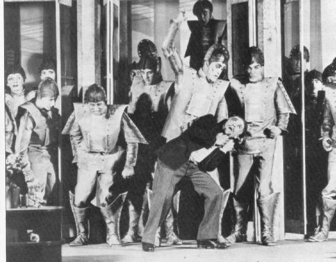

*Афиша премьеры «R.U.R.» в 1920 году. Карел Чапек создал слово «робот»*

С тех пор слово «робот» быстро распространилось по всему миру и стало обозначать любые машины этого типа. А название научной дисциплины «robotics» (робототехника) в 1942 году впервые предложил научно-фантастический писатель Айзек Азимов.

---

## 2. Этапы развития

### 2.1 Три волны — как робототехника пришла к сегодняшнему дню

Если оглянуться на историю робототехники, видны три важных этапа. Каждый технический прорыв сопровождался взрывным ростом отрасли.

**Первое поколение: роботы с обучением по показу (1960-е — 1970-е)**

В 1961 году произошло событие, вошедшее в историю промышленности. На заводе General Motors в Нью-Джерси установили первого в мире промышленного робота — **Unimate**. Его разработал инженер Джозеф Энгельбергер. Этот гигант весил две тонны, работал на гидроприводе и умел точно выполнять сварку. До этого сварку на автомобильных заводах выполняли рабочие с ручными сварочными горелками, что было неэффективно и наносило серьёзный вред их здоровью. Появление Unimate ознаменовало выход роботов на промышленное производство.

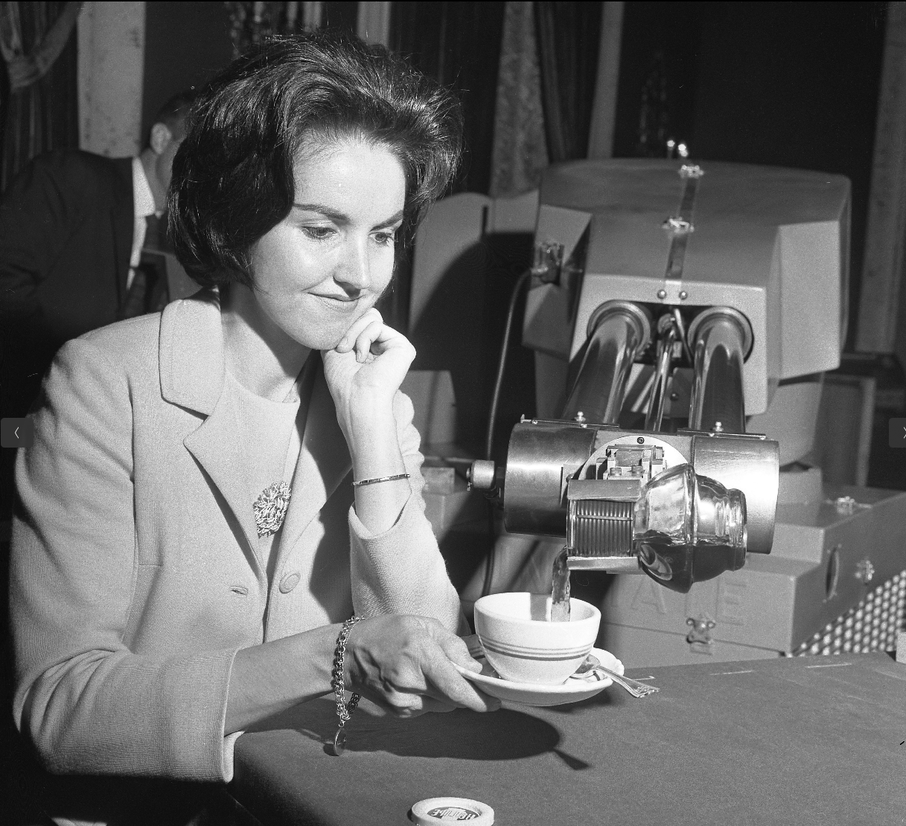

*Unimate — первый промышленный робот, установленный на заводе General Motors в 1961 году*

Ключевая особенность этого поколения — «обучение по показу»: сначала рабочий вручную проводил робота через всю задачу, тот запоминал траекторию движения и мог затем повторять её бесконечное число раз. Это открыло эпоху промышленной автоматизации, но у метода есть очевидный недостаток: он не справляется со сложной и меняющейся средой. Как только меняется модель продукта, нужно заново обучать робота.

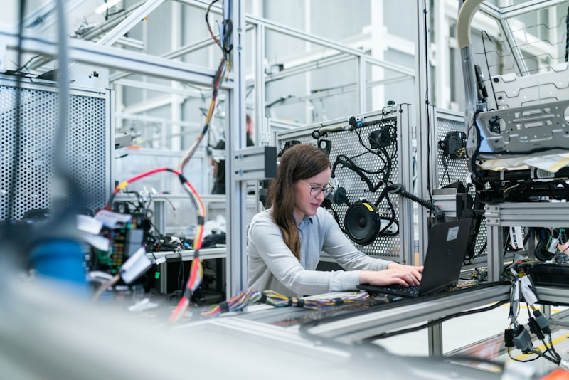

*Современные промышленные роботы широко применяются в автомобилестроении, сборке электроники и других отраслях*

**Второе поколение: роботы с восприятием (1980-е — 1990-е)**

В 1980-е годы с развитием датчиков роботы начали «чувствовать» мир. Такие роботы оснащались датчиками силы, тактильными и даже визуальными датчиками и могли менять своё поведение в зависимости от окружения.

В этот период Япония стала крупнейшим в мире производителем промышленных роботов. Такие компании, как Fanuc, Yaskawa и Panasonic, быстро выросли в лидеров отрасли. 1980 год в индустрии часто называют «годом рождения робототехники».

**Третье поколение: интеллектуальные роботы (с 2000-х годов — по настоящее время)**

В XXI веке прорывы в области искусственного интеллекта сделали роботов по-настоящему «умными». В 2000 году японская компания Honda показала **ASIMO** — робота, который умел ходить, бегать и подниматься по лестницам как человек. Это один из первых человекоподобных роботов с двуногим движением. В 2013 году компания Boston Dynamics впервые публично представила двуногого робота **Atlas**, который совершал прыжки, кувырки и сальто назад, изменив представление людей о двигательных возможностях роботов.

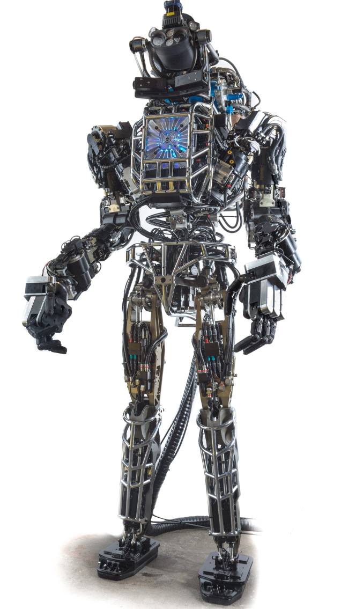

*Atlas от Boston Dynamics — образец интеллектуального робота, способного на сложные движения*

### 2.2 Подъём китайских человекоподобных роботов

В последние годы Китай добился заметного прогресса в области человекоподобных роботов: появились компании и технологии мирового уровня.

**Unitree Robotics** — ведущая китайская компания в области шагающих роботов. Её Unitree H1 — один из самых совершенных человекоподобных роботов в стране. Рост H1 около 1,8 м, вес 47 кг, максимальная скорость бега до 3,3 м/с, что стало рекордом для своего класса. Компания разрабатывает собственные моторные приводы и добилась высокой точности управления движением.

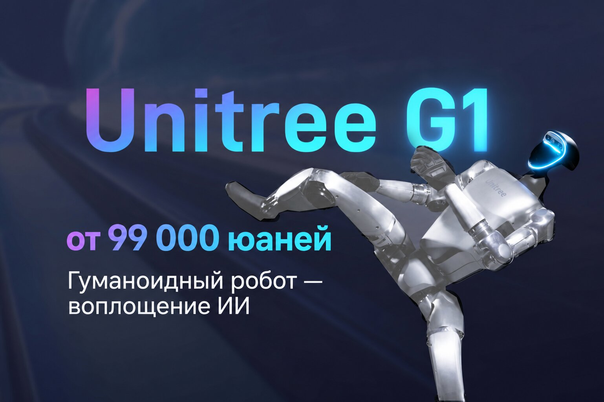

*Человекоподобный робот Unitree H1*

**AgiBot** основана в 2023 году бывшими руководителями Huawei и занимается разработкой универсальных человекоподобных роботов. Компания создаёт высокоинтеллектуальную платформу для промышленности, коммерческих услуг и домашних сценариев.

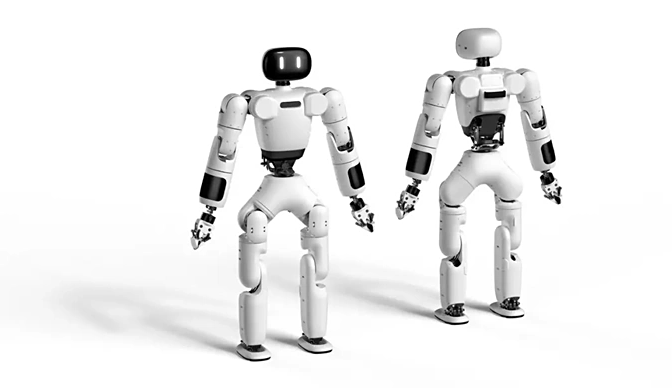

*Универсальный человекоподобный робот AgiBot*

**LimX Dynamics** — ведущая компания в области шагающих роботов, у которой глубокий технический задел в двуногих и многоногих системах. Двуногие роботы серии P от LimX Dynamics уверенно ходят и бегают и хорошо адаптируются к сложному рельефу.

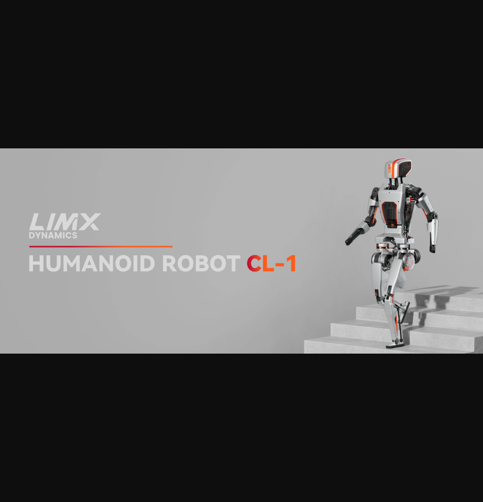

*Двуногий робот LimX Dynamics*

**Сравнение китайских роботов с Atlas**:

| Параметр | Boston Dynamics Atlas | Китайские человекоподобные роботы |
|----------|-----------------------|-----------------------------------|
| Привод | Гидравлический | Электрический |
| Двигательные возможности | Паркур, сальто назад | Ходьба, бег |
| Стоимость | Миллионы долларов | Сотни тысяч долларов |
| Сценарии применения | В основном исследования | Поиск путей коммерциализации |
| Производственная цепочка | США | Производство в Китае |

В целом китайские человекоподобные роботы выигрывают в **коммерческом внедрении** и **контроле стоимости**.

---

## 3. Отраслевой контекст

### 3.1 Какие отрасли уже изменили роботы?

Ценность робототехники проявляется в том, что она решает практические задачи и создаёт экономическую пользу. Сегодня роботы проникли почти во все отрасли.

**Промышленность — революция в автомобилестроении**

Самая зрелая область применения промышленных роботов — производство. Автомобилестроение — крупнейший рынок промышленных роботов. Для производства одного обычного автомобиля используется более сотни различных роботов: сварочных, окрасочных, сборочных, транспортных и др.

Возьмём сварку. Ручная сварка требует, чтобы рабочий долго сохранял одну и ту же позу, это тяжело физически, а качество шва трудно гарантировать. На современных автомобильных заводах почти всю сварку выполняют роботы: швы получаются ровными и красивыми, а производительность в несколько раз выше, чем у человека.

**Логистика и складирование — герои эпохи электронной коммерции**

Когда вы покупаете что-то в интернете, вряд ли задумываетесь о том, как посылки быстро и точно сортируются и грузятся. На складах Amazon десятки тысяч роботов Kiva (ныне Amazon Robotics) снуют по полу, перевозят стеллажи и доставляют нужные товары к сотруднику. Такая схема «товар к человеку» повышает эффективность сортировки более чем в 5 раз.

*Роботы Kiva на складе Amazon существенно повышают эффективность логистики*

**Медицина — защитники жизни**

В операционных хирургический робот «да Винчи» (Da Vinci Surgical System) стал надёжным помощником хирургов. Он не выполняет операции полностью автономно: врач управляет им удалённо и с его помощью проводит тонкие малоинвазивные операции. Хирург сидит за пультом и управляет манипуляторами, как игровым контроллером, а манипуляторы устраняют дрожание рук и делают операцию точнее.

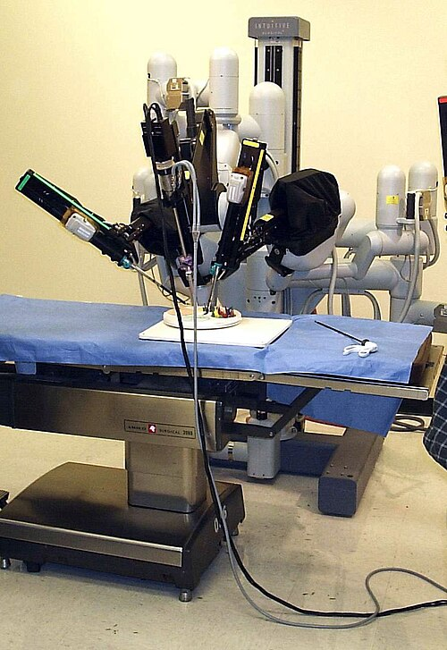

*Хирургический робот да Винчи помогает врачам проводить малоинвазивные операции*

---

## 4. Тенденции развития робототехники

### 4.1 Будущее уже здесь — тенденции, которые меняют отрасль

Сегодня мы ясно видим несколько направлений, в которых развивается робототехника.

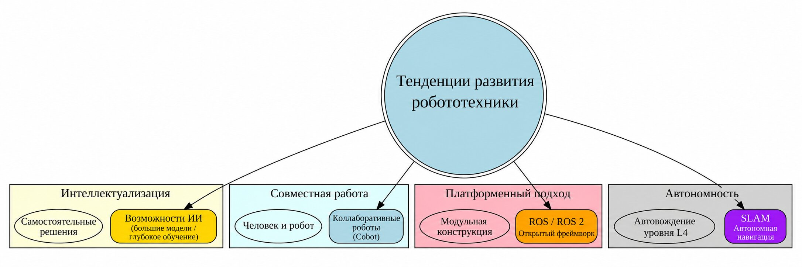

*Четыре основные тенденции робототехники: интеллектуальность, совместная работа, платформенность и автономность*

**Тенденция первая: интеллектуальность — от «автоматизации» к «автономности»**

Традиционным роботам людям приходилось заранее задавать все движения, а новое поколение может «думать» самостоятельно. С развитием глубокого обучения, обучения с подкреплением и других технологий ИИ роботы начинают самостоятельно учиться и принимать решения.

**Тенденция вторая: совместная работа — люди и машины «танцуют вместе»**

Традиционных промышленных роботов ставят за защитные ограждения, потому что они слишком сильны и быстры и опасны вблизи человека. Новое поколение коллаборативных роботов (Collaborative Robot, или Cobot) может безопасно работать с людьми на близком расстоянии.

**Тенденция третья: платформенность — снижение порога входа**

Появление открытой операционной системы для роботов ROS (Robot Operating System) стало революцией в программном обеспечении робототехники. Она предоставляет стандартизированную коммуникационную среду и библиотеки инструментов, так что разработчики могут сосредоточиться на ключевых алгоритмах, а не на низкоуровневых драйверах оборудования.

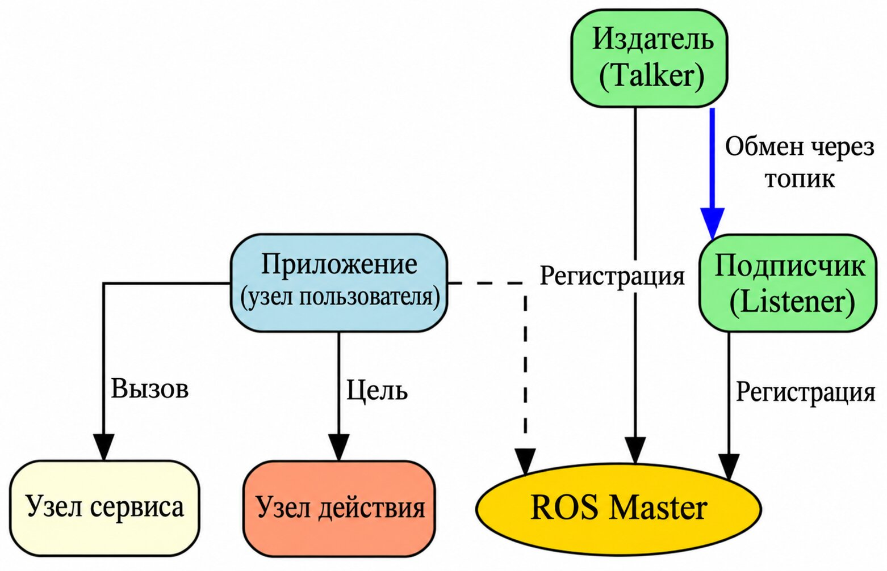

*ROS использует распределённую архитектуру узлов и обменивается данными через топики, сервисы и действия*

---

## 5. Воплощённый ИИ

### 5.1 Почему «воплощённый ИИ» — следующий рубеж искусственного интеллекта?

Если вы следите за новостями в области ИИ, вы наверняка слышали термин «воплощённый ИИ» (Embodied AI). Почему он так важен?

**Что такое воплощённый ИИ?**

Традиционный ИИ — например, голосовой помощник в вашем телефоне или ChatGPT — в основном обрабатывает **символические данные**: тексты, изображения, звук. Такие системы не имеют «тела» и не могут напрямую взаимодействовать с физическим миром.

Воплощённый ИИ, напротив, подразумевает «воплощение» — наличие физического носителя (робота, дрона, умного устройства), который воспринимает мир через датчики, изменяет мир через исполнительные механизмы и учится и развивается во взаимодействии со средой.

**Почему воплощённый ИИ важен?**

Известный исследователь ИИ, профессор Стэнфордского университета Фэй-Фэй Ли выдвинула мысль: «Следующий крупный шаг в развитии ИИ — это наделить ИИ телом».

Причина в том, что всё наше интеллектуальное поведение — язык, рассуждение, обучение — тесно связано с телесным опытом. Мы знаем, что такое «горячее», потому что обжигались; знаем, что такое «тяжёлое», потому что поднимали тяжести. Чисто языковая модель может написать красивое предложение о «боли», но никогда по-настоящему не чувствовала боли.

Чтобы ИИ по-настоящему понимал физический мир, ему нужны body (тело) и experience (опыт).

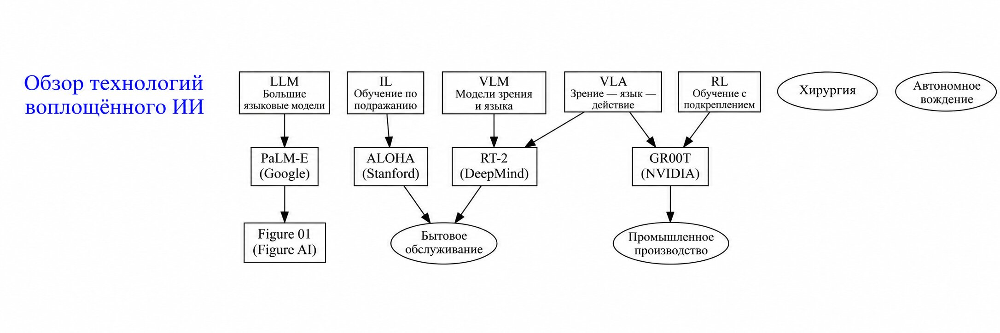

*Ключевые технологии воплощённого ИИ включают LLM, VLM, VLA, обучение с подкреплением и имитационное обучение; среди ключевых проектов — PaLM-E, RT-2, GR00T*

### 5.2 Применение больших языковых моделей в робототехнике

Появление больших языковых моделей (Large Language Model, LLM) дало роботам революционную возможность понимать команды на естественном языке. Раньше системы управления роботами требовали точно переводить команды человека в низкоуровневые действия, и для этого нужны были инженеры, которые долго программировали систему. Большие языковые модели понимают расплывчатые и сложные описания на естественном языке и превращают их в последовательности действий. Это сильно снижает порог взаимодействия с роботами.

Модель **PaLM-E**, которую Google выпустила в 2023 году, — веха в этом направлении. Она объединяет языковую модель PaLM с системой визуального восприятия робота и может напрямую понимать сложные команды вроде «достань микросхему из ящика и положи её в коробку», самостоятельно планируя полную последовательность действий (Driess et al., 2023). PaLM-E показала большой потенциал LLM в планировании задач роботов.

**SayCan** (Ahn et al., 2022) использует более практичный подход: LLM выступает «мозгом» и сочетается с обучаемой библиотекой навыков. LLM понимает задачу и выбирает подходящий навык, а каждый навык выполняет дочерняя политика, обученная методом обучения с подкреплением. Такая модульная архитектура сохраняет гибкость понимания языка и обеспечивает надёжность выполнения действий.

**Code as Policies** (Liang et al., 2023) идёт дальше и предлагает использовать код как универсальное представление поведения робота. LLM может сама генерировать код на Python для управления роботом. Этот код вызывает API восприятия и функции управления исполнительными механизмами и даже содержит циклы обратной связи для сложного поведения.

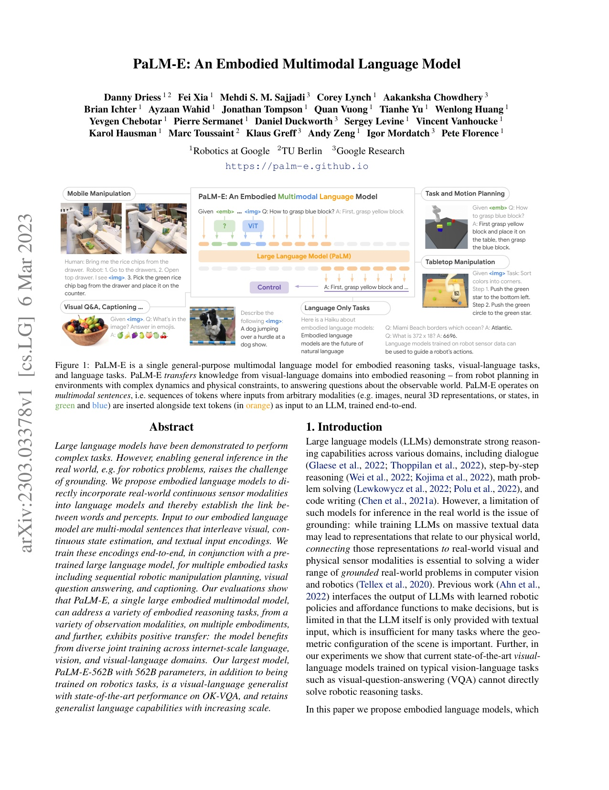

*Модель PaLM-E понимает команды на естественном языке и управляет роботом при выполнении задач*

### 5.3 Применение визуально-языковых моделей в робототехнике

Если большие языковые модели дают роботам «понимание языка», то визуально-языковые модели (Vision-Language Model, VLM) дают им «глаза». VLM одновременно понимает изображения и текст и выполняет межмодальные рассуждения. Это критически важно для восприятия окружающей среды роботом.

**RT-2** (Robotics Transformer 2) — важная работа DeepMind 2023 года. Это первая модель манипуляций роботов, которая может напрямую обобщать знания из визуально-языковых данных интернет-масштаба (Brohan et al., 2023). RT-2 кодирует визуальные входы и языковые команды вместе и через архитектуру Transformer напрямую выдаёт действия робота.

**OK-Robot** (Liu et al., 2024) сосредоточен на захвате объектов по открытому словарю. Работа предлагает простую и эффективную схему, которая позволяет захватывать любые объекты в незнакомой среде.

**Manipulate-Anything** (Duan et al., 2024) исследует, как заставить робота обобщать навыки манипуляций с помощью визуально-языковых моделей без человеческих демонстраций.

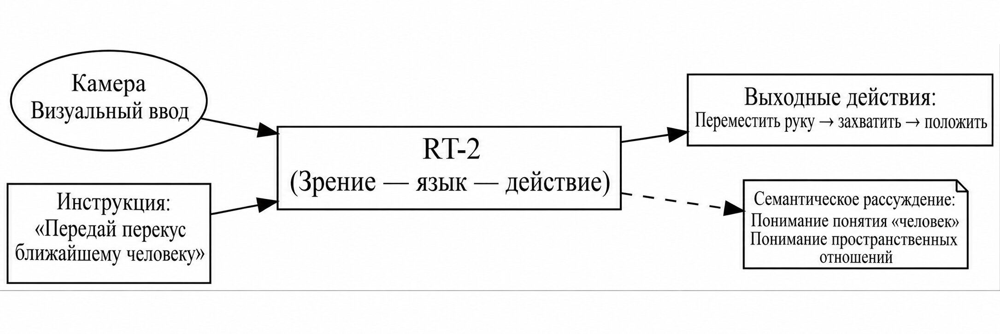

*Визуально-языковые модели позволяют роботам переносить навыки манипуляций на новые объекты и сцены*

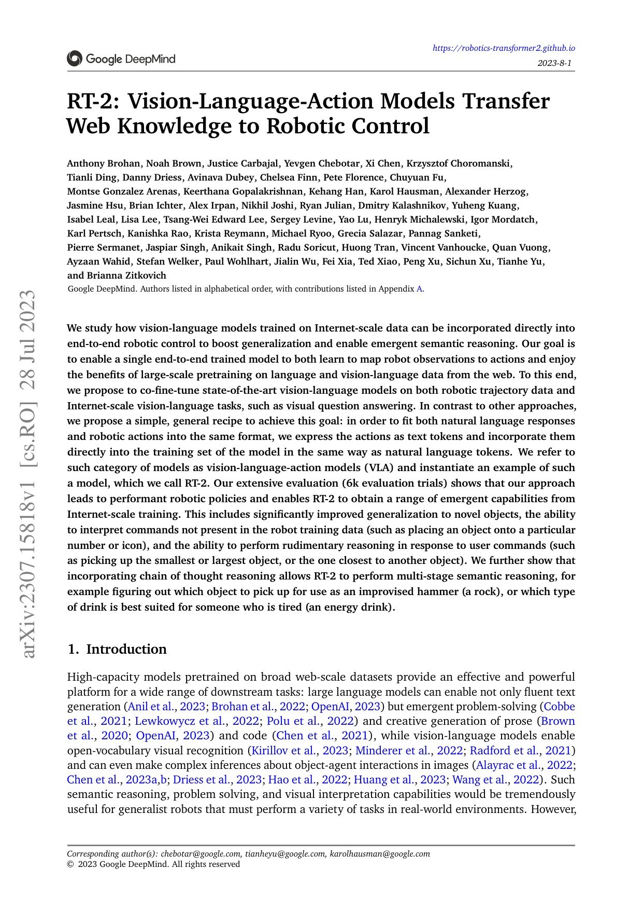

*RT-2 понимает смысловые команды, например «положи закуску в руки ближайшему человеку»*

### 5.4 Визуально-языково-действенные модели

Визуально-языково-действенная модель (Vision-Language-Action Model, VLA) — одно из самых передовых направлений в области воплощённого ИИ. В отличие от VLM, VLA напрямую отображает визуальные наблюдения в действия и обеспечивает сквозное обучение и вывод.

Опираясь на RT-1, **RT-2** дополнительно использует предобучение на визуально-языковых данных интернет-масштаба, и модель приобретает способность к рассуждению и обобщению (Brohan et al., 2023). RT-2 выполняет семантические задачи вроде «положи закуску в руки ближайшему человеку», что показывает потенциал VLA в понимании абстрактных понятий.

Главное преимущество VLA — сквозной характер: от восприятия через принятие решения к исполнению весь процесс выполняется в одной нейронной сети. Это упрощает архитектуру системы и, что важнее, позволяет оптимизировать систему глобально.

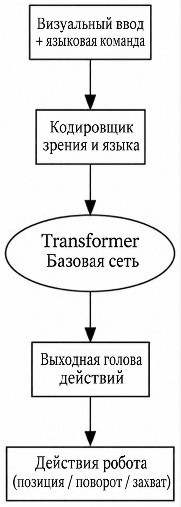

*RT-2 — типичная модель VLA, которая напрямую выдаёт действия робота*

### 5.5 Обучение с подкреплением в управлении роботами

Обучение с подкреплением (Reinforcement Learning, RL) — метод, с помощью которого робот учится оптимальной стратегии, взаимодействуя со средой и пробуя и ошибаясь. В отличие от традиционного программирования на основе правил, обучение с подкреплением позволяет роботу самостоятельно находить эффективные модели поведения в незнакомой среде.

В 2013 году DeepMind показала, что глубокая Q-сеть (Deep Q-Network, DQN) может учиться играть в игры Atari (Mnih et al., 2013). Этот прорыв доказал потенциал глубокого обучения с подкреплением при обработке многомерных сенсорных входов.

В области непрерывного управления основными методами стали **Deep Deterministic Policy Gradient (DDPG)** (Lillicrap et al., 2016) и его последующие улучшения, например TD3 и SAC.

Главная трудность обучения с подкреплением — **эффективность использования выборки**: роботу нужно много проб и ошибок в реальной среде, чтобы выучить эффективную стратегию. Чтобы решить эту проблему, исследователи разработали перенос **«от симуляции к реальности» (Sim-to-Real)**.

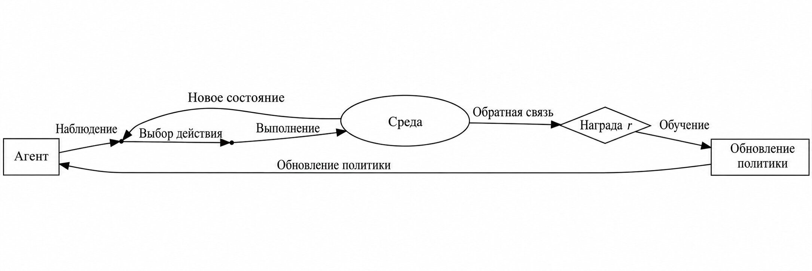

*Агент взаимодействует со средой и методом проб и ошибок учится оптимальной стратегии*

### 5.6 Имитационное обучение в освоении навыков роботов

Имитационное обучение (Imitation Learning) — метод, при котором робот учится навыкам по демонстрациям человека. По сравнению с обучением с подкреплением оно интуитивнее: человек показывает, как выполнять задачу, а робот наблюдает и повторяет то же поведение.

**Клонирование поведения (Behavior Cloning, BC)** — самый базовый метод имитационного обучения. Робот обучается с учителем на демонстрационных данных и выучивает отображение из состояний в действия.

Чтобы справиться с проблемой смещения распределения, **DAgger** (Ross et al., 2011) предлагает итеративный метод обучения. В процессе работы робот постоянно собирает поправки человека, а затем переобучает политику на этих данных.

Стэнфордский фреймворк **ALOHA** (Zhao et al., 2023) поднимает имитационное обучение на новый уровень. ALOHA использует недорогие носимые устройства для записи высокоточных демонстраций операций человека, а затем обучает робота выполнять ту же задачу методом клонирования поведения.

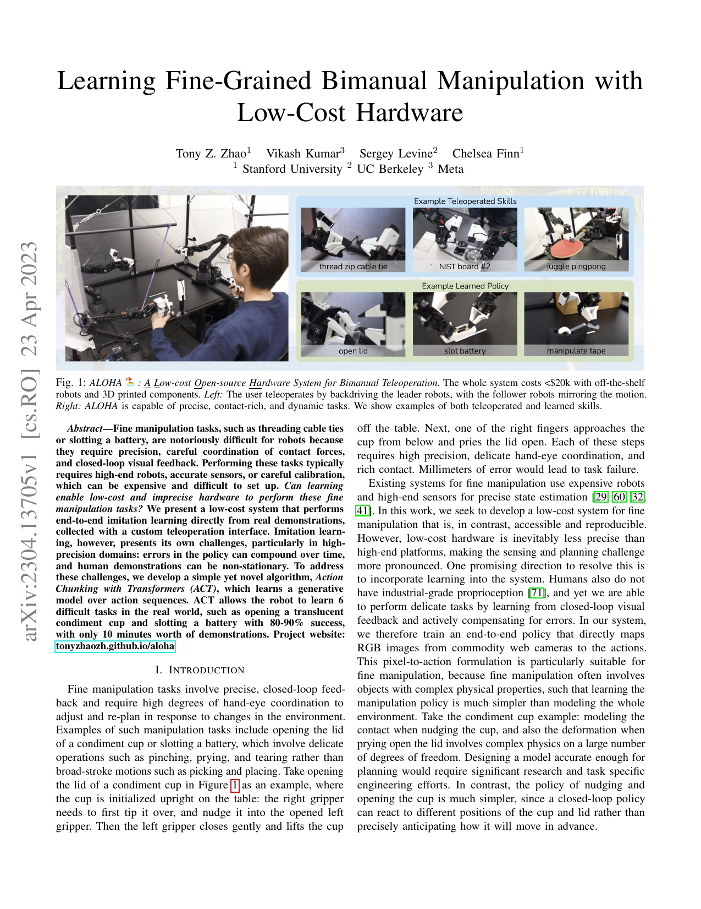

*ALOHA обучает робота тонким навыкам манипуляций на основе демонстраций человека*

### 5.7 Пространственный интеллект и трёхмерное понимание

Пространственный интеллект — это способность робота понимать пространственные отношения в трёхмерном мире. Это одна из ключевых технологий для универсального воплощённого ИИ.

**PointNet** (Qi et al., 2017) — веха в трёхмерном глубоком обучении. Модель напрямую обрабатывает облака точек и решает задачи классификации и сегментации трёхмерных объектов.

**NVIDIA GR00T** — универсальная базовая модель для роботов, представленная в 2024 году. Её цель — дать роботам способность понимать трёхмерное пространство и выполнять сложные задачи.

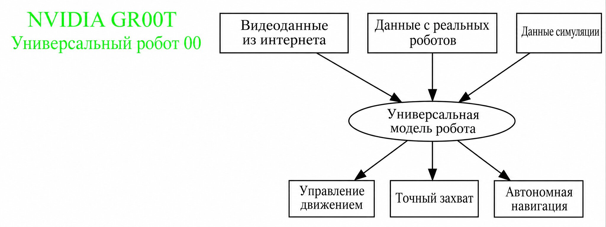

*NVIDIA GR00T — универсальная базовая модель для роботов, поддерживающая множество задач*

#### Взгляды Фэй-Фэй Ли и Яна Лекуна на пространственный интеллект

**Фэй-Фэй Ли (Fei-Fei Li)** — профессор Стэнфордского университета и руководитель Stanford AI Lab. В последние годы она активно продвигает концепцию «пространственного интеллекта» (Spatial Intelligence). В 2024 году Фэй-Фэй Ли неоднократно подчёркивала: настоящий интеллект — это не только понимание языка, но прежде всего понимание трёхмерного пространства. Её команда изучает, как научить системы ИИ понимать пространственные отношения и проводить физические рассуждения, как это делает человек. По её мнению, «видеть» — основа интеллекта, а визуальное понимание — ключевой путь к общему интеллекту. Её исследования охватывают понимание трёхмерных сцен, нейронный рендеринг, воплощённый ИИ и другие области.

**Ян Лекун (Yann LeCun)** — лауреат премии Тьюринга, бывший главный научный сотрудник по ИИ в Meta. В 2025 году Ян Лекун основал новую компанию Advanced Machine Intelligence (AMI) и привлёк более миллиарда долларов на разработку «моделей мира» (World Models). В отличие от современных больших языковых моделей, он считает, что настоящему ИИ нужно понимать физический мир и обладать здравым смыслом и умением рассуждать. Предложенная им архитектура JEPA (Joint Embedding Predictive Architecture, совместная архитектура предсказания вложений) — один из ключевых путей к этой цели. Ян Лекун неоднократно публично заявлял: «Существующие LLM не смогут достичь общего искусственного интеллекта, нам нужны системы ИИ, которые понимают и предсказывают физический мир».

**Общее между ними**: несмотря на разные методы, и Фэй-Фэй Ли, и Ян Лекун считают, что **понимание пространства** — ключ к более высокому интеллекту. Фэй-Фэй Ли идёт от визуального восприятия, Ян Лекун — от моделей мира, и вместе они продвигают развитие воплощённого ИИ.

---

## Итоги главы

В этой главе мы вместе проследили историю развития робототехники. От древних автоматических механизмов и вымышленных «искусственных работников» из научной фантастики до сегодняшних умных роботов, которые самостоятельно ходят и работают вместе с людьми, — человечество не перестаёт мечтать о роботах и стремиться к ним.

**Ключевые выводы:**

1. **Истоки робототехники**: от древних автоматов до появления слова «робот»
2. **Этапы развития**: три крупных этапа — обучение по показу, восприятие и интеллектуальные роботы
3. **Отраслевое применение**: промышленность, логистика, медицина, сфера услуг
4. **Тенденции**: три основных направления — интеллектуальность, совместная работа и платформенность
5. **Воплощённый ИИ**: LLM, VLM, VLA, обучение с подкреплением, имитационное обучение и пространственный интеллект — ключевые технологии

---

## Вопросы и задания

1. **Подумайте**: какие роботы уже используются или скоро появятся рядом с вами? К какому типу они относятся?
2. **Поищите**: какая компания или продукт в робототехнике вас интересует больше всего? Какие ключевые технологии они используют?
3. **Обсудите**: какие этические проблемы может принести развитие воплощённого ИИ? Как человечеству на них реагировать?

---

## Список литературы

### История робототехники

1. Craig, J. J. *Introduction to Robotics: Mechanics and Control* («Введение в робототехнику: механика и управление»)
2. IEEE Robotics and Automation Magazine
3. Чапек, К. «R.U.R.» («Универсальные роботы Россума»), 1920

### Воплощённый ИИ и большие модели

4. Driess, D., et al. (2023). PaLM-E: An Embodied Multimodal Language Model. *arXiv:2303.03378*.
5. Ahn, M., et al. (2022). Do As I Can, Not As I Say: Grounding Language in Robotic Affordances. *arXiv:2204.01691*.
6. Liang, J., et al. (2023). Code as Policies: Language Model Programs for Embodied Control. *arXiv:2209.07753*.
7. Brohan, A., et al. (2022). RT-1: Robotics Transformer for Real-World Control at Scale. *arXiv:2212.06817*.
8. Brohan, A., et al. (2023). RT-2: Vision-Language-Action Models Transfer Web Knowledge to Robotic Control. *arXiv:2307.15818*.
9. Liu, P., et al. (2024). OK-Robot: What Really Matters in Integrating Open-Knowledge Models for Robotics. *arXiv:2401.12202*.
10. Duan, J., et al. (2024). Manipulate-Anything: Automating Real-World Robots using Vision-Language Models. *arXiv:2406.18915*.

### Обучение с подкреплением и имитационное обучение

11. Mnih, V., et al. (2013). Playing Atari with Deep Reinforcement Learning. *NIPS 2013*.
12. Lillicrap, T. P., et al. (2016). Continuous Control with Deep Reinforcement Learning. *ICLR 2016*.
13. Ross, S., et al. (2011). A Reduction of Imitation Learning to No-Regret Online Learning. *AISTATS 2011*.
14. Bojarski, M., et al. (2016). End to End Learning for Self-Driving Cars. *arXiv:1604.07316*.
15. Zhao, T. Z., et al. (2023). Learning Fine-Grained Bimanual Manipulation with Low-Cost Hardware (ALOHA). *RSS 2023*, *arXiv:2304.13705*.

### Пространственный интеллект и трёхмерное понимание

16. Qi, C. R., et al. (2017). PointNet: Deep Learning on Point Sets for 3D Classification and Segmentation. *CVPR 2017*.
17. NVIDIA (2024). GR00T: Generalist Robot 00 Foundation Model. *NVIDIA GTC 2024*.

---

*Далее мы перейдём к разделу «1.2. Состав и классификация робототехнических систем», чтобы разобраться, из каких частей состоит робот и чем различаются разные типы роботов.*
