# 1.2 Состав и классификация робототехнических систем

**Автор**: Хо Хайцзе | **Контакты**: howe12@126.com

---

> **Вступление**: в предыдущем разделе мы говорили о происхождении и развитии робототехники — от древних автоматов до современных умных роботов. Но что на самом деле составляет настоящего робота? Как и у человека, у робота есть «скелет», «мышцы», «органы чувств», «мозг» и «душа». Понимание этих частей позволяет понять, как робот работает. В этом разделе мы систематически разберём «тело» робота.

---

## 1. Зачем роботу нужны эти части?

### 1.1 Как человек — сравнение робота с телом человека

Представьте простое действие: вы протягиваете руку и берёте со стола стакан с водой.

На первый взгляд это просто, но на самом деле здесь работает несколько систем тела. Сначала глаза видят положение стакана (система восприятия). Затем мозг вычисляет, насколько нужно вытянуть руку и под каким углом (система управления). Потом нервная система передаёт команду мышцам (система привода). Наконец мышцы сокращаются и двигают кости (механическая конструкция), и рука тянется к цели. Весь процесс занимает доли секунды и выглядит плавным.

Любой роботизированный комплекс для выполнения задач опирается на эти же четыре системы, которые тесно взаимодействуют друг с другом.

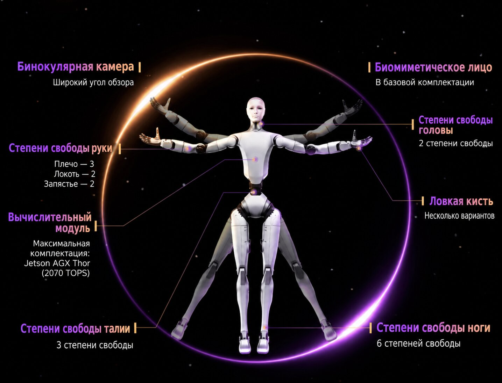

*Аналогия между системами робота и телом человека — механическая конструкция соответствует скелету, привод — мышцам, восприятие — органам чувств, управление — мозгу, программное обеспечение — душе*

**Ни одной части нельзя пропустить.** Если сравнить робота с человеком, то:

- **Механическая конструкция** — это скелет, который определяет базовую форму тела
- **Система привода** — это мышцы, которые создают движущую силу
- **Система восприятия** — это глаза, уши и кожа, благодаря которым мы знаем, что происходит вокруг
- **Система управления** — это мозг, который думает и принимает решения

Все четыре части обязательны и вместе составляют полноценную робототехническую систему.

### 1.2 Четыре основные системы

Полноценная робототехническая система обычно состоит из четырёх основных частей:

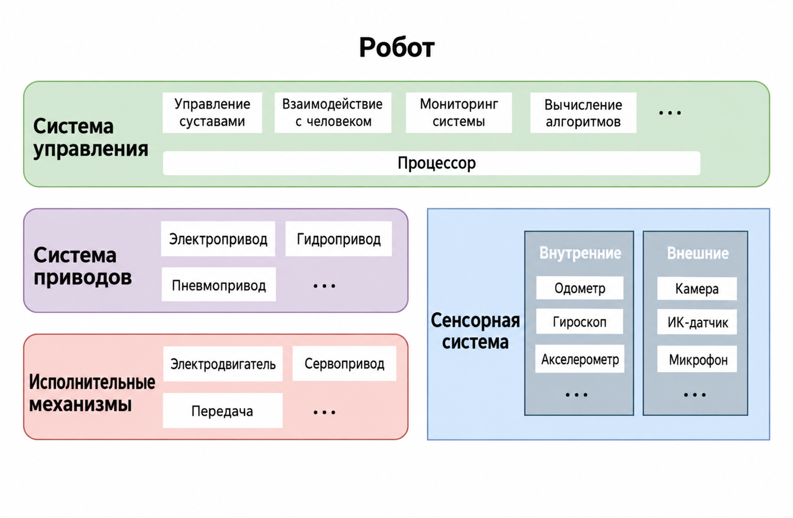

| Система | Аналог в теле человека | Функция | Основные компоненты |
|---------|------------------------|---------|---------------------|
| Механическая конструкция | Скелет | Обеспечивает опору и основу для движения | Суставы, звенья, концевой эффектор |
| Система привода | Мышцы | Создаёт движущую силу | Электродвигатели, гидроцилиндры, пневмоцилиндры |
| Сенсорная система | Органы чувств | Получает внутреннюю и внешнюю информацию | Датчики, обработка сигналов |
| Система управления | Мозг | Обрабатывает информацию и подаёт команды | Контроллер, алгоритмы |

Эти четыре системы не существуют изолированно: через точную связь и обмен данными они образуют единое целое. Датчики получают данные об окружении и передают их системе управления. Система управления вычисляет решение, а система привода выполняет действие. Программное обеспечение координирует весь процесс и позволяет роботу самостоятельно выполнять сложные задачи.

---

## 2. Механическая конструкция — тело робота

### 2.1 Суставы и степени свободы

Механическая конструкция — это «тело» робота. Она определяет, как робот выглядит и какие движения способен выполнять.

Зайдя на любой автомобильный завод, вы увидите множество роботизированных рук разной формы. Одни мощные и тяжёлые — они переносят массивные стальные детали. Другие тонкие и ловкие — они точно выполняют точечную сварку в каждом шве. Все эти манипуляторы устроены по одному и тому же базовому принципу — сочетанию **суставов** и **звеньев**.

**Что такое сустав?**

Сустав — это подвижная часть механической конструкции, которая соединяет две детали. Представьте свою руку: плечевой, локтевой и лучезапястный суставы — каждый из них может поворачиваться. Суставы робота работают похожим образом.

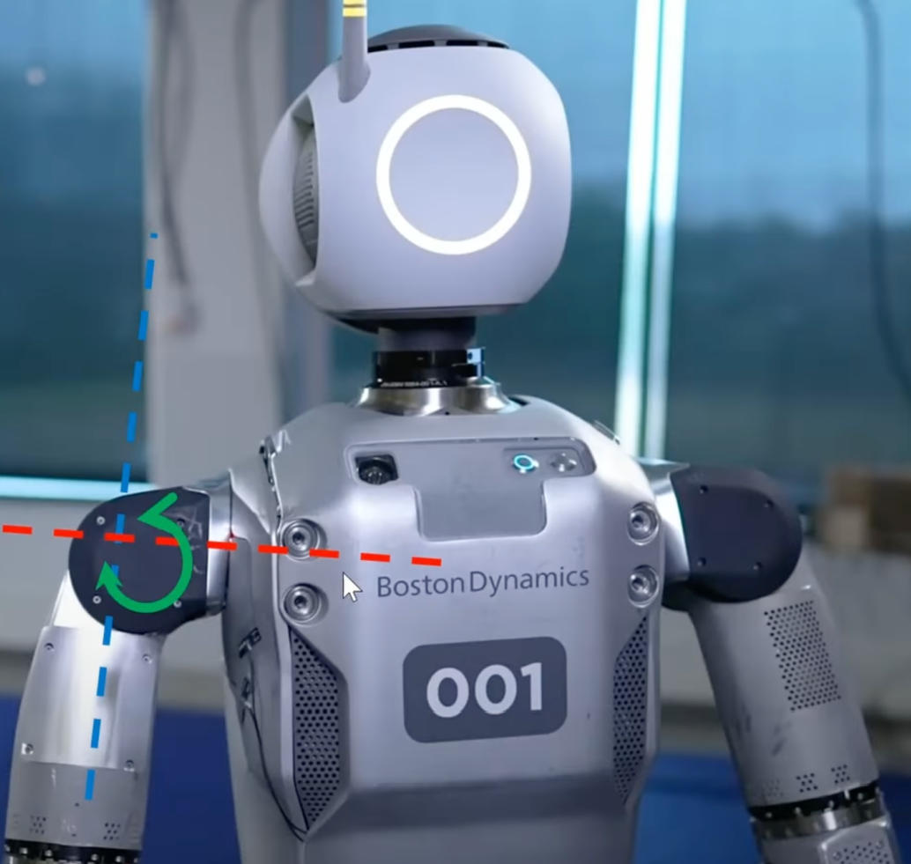

*Плечевой сустав Atlas от Boston Dynamics имеет три вращательные степени свободы: сгибание/разгибание (движение вперёд и назад), отведение/приведение (как при взмахе крыльями) и вращение вокруг оси плеча*

Суставы роботов делятся в основном на два типа:

- **Вращательный сустав (R-сустав)**: вращается вокруг оси, как дверная петля. Это самый распространённый тип суставов в манипуляторах.
- **Поступательный сустав (P-сустав)**: движется по прямой, как ящик стола. Такие суставы встречаются реже, но в некоторых сценариях они незаменимы.

**Степени свободы — насколько гибкий робот?**

В робототехнике ключевое понятие — **степень свободы (Degree of Freedom, DOF)**. Это количество независимых движений, которые может совершить робот. Проще говоря, сколько у робота суставов, способных двигаться независимо, столько и степеней свободы.

Обычный шестиосевой промышленный манипулятор имеет 6 суставов, то есть 6 степеней свободы. Он может достичь любой точки в трёхмерном пространстве (нужны 3 степени свободы) и принять любую ориентацию (ещё 3 степени свободы).

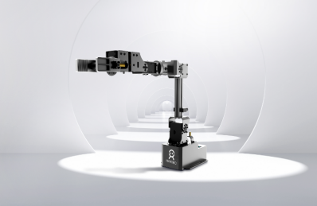

*Шесть суставов шестиосевого манипулятора обеспечивают разные функции движения*

**Концевой эффектор — «рука» робота**

Суставы и звенья образуют «руку» манипулятора, а концевой эффектор — это «ладонь» или инструмент на её конце. В зависимости от задачи концевым эффектором может быть:

- **Захват (схват)**: для захвата предметов
- **Вакуумная присоска**: для захвата гладких поверхностей
- **Сварочная горелка**: для сварки
- **Распылитель**: для равномерной покраски
- **Сверло**: для сверления

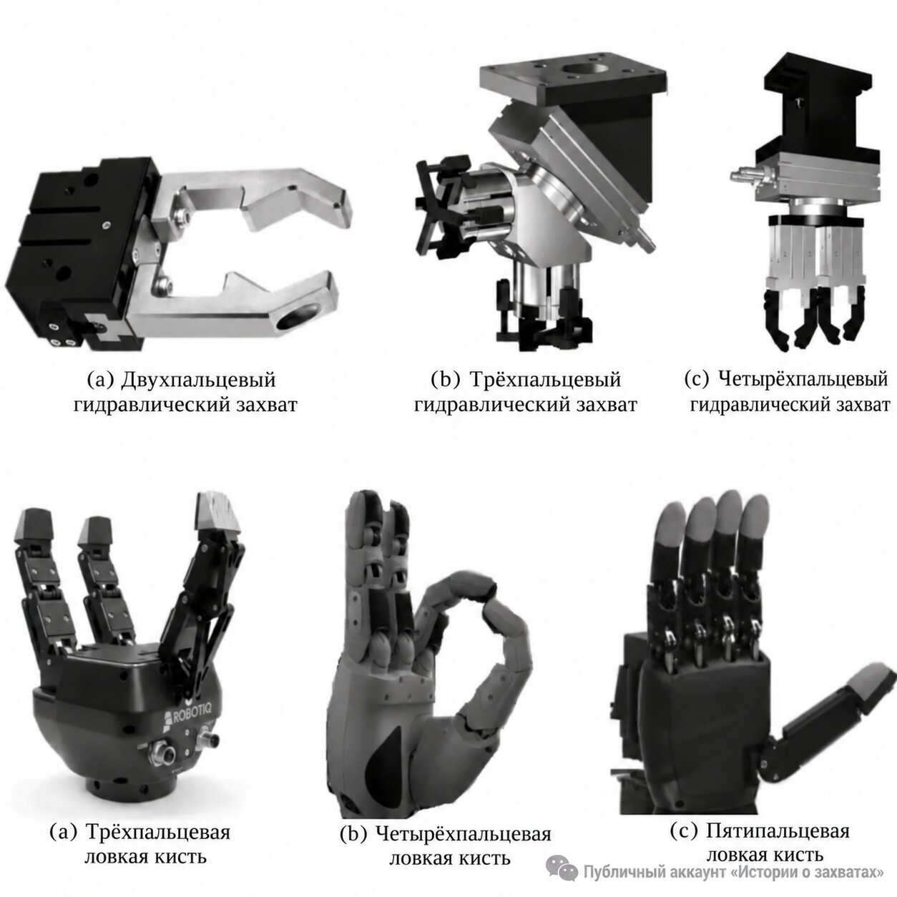

*Гидравлические захваты и многопалые ловкие кисти — разные концевые эффекторы для разных рабочих задач*

---

## 3. Система привода — мышцы робота

### 3.1 Электрический привод

Если механическая конструкция — это скелет, то система привода — мышцы. Она создаёт движущую силу, которая приводит в движение суставы.

На заводе электроники слышен мерный гул электродвигателей. Крошечные сервоприводы установлены внутри каждого сустава и точно управляют каждым движением манипулятора. Такой способ называется **электрическим приводом** — сегодня он самый распространённый способ привода роботов.

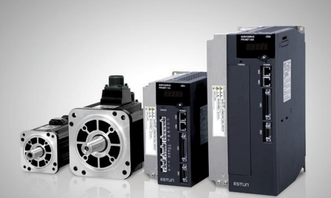

*Типичная система сервопривода промышленного манипулятора, где двигатель и редуктор объединены в одном блоке*

Почему электрический привод так популярен?

- **Высокая точность управления**: регулируя ток, можно обеспечить очень точное управление положением и скоростью
- **Быстрый отклик**: время пуска и остановки двигателя измеряется миллисекундами
- **Высокий КПД**: преобразование электрической энергии в механическую достигает 90 % и выше
- **Чистота и экологичность**: в отличие от гидравлических систем, здесь нет риска утечки масла

Распространённые двигатели для привода роботов:

- **Сервоприводы**: самый частый выбор для промышленных роботов, позволяют точно управлять положением, скоростью и моментом
- **Бесщёточные двигатели постоянного тока**: высокий КПД и долгий срок службы, часто используются в мобильных роботах и небольших манипуляторах
- **Шаговые двигатели**: простое управление и низкая стоимость, подходят для систем с управлением без обратной связи

### 3.2 Гидравлический и пневматический привод

Электрический привод хорош, но в некоторых сценариях другие способы приводов дают больше преимуществ.

**Гидравлический привод — выбор силачей**

Если вы видели, как работает большой экскаватор, вы наверняка впечатлялись его силой. Экскаваторы используют **гидравлический привод**, который передаёт энергию давлением жидкости и может создавать огромный крутящий момент.

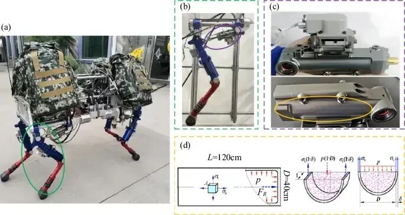

*Схема гидравлического четырёхногого робота HDU. (a) Четырёхногий гидравлический робот; (b) одна нога гидравлического робота; (c) блок HDU и его корпус; (d) схема распределения напряжений в корпусе HDU*

Особенности гидравлического привода:

- **Большой крутящий момент**: при том же объёме гидравлический привод даёт в несколько раз больше усилия, чем электродвигатель
- **Высокая жёсткость**: изменение нагрузки мало влияет на движение
- **Но**: система сложная, требует обслуживания и есть риск утечки масла

Именно поэтому гидравлический привод встречается в тяжёлых специальных роботах и крупном промышленном оборудовании.

**Пневматический привод — король скорости**

На линиях упаковки пищевых продуктов манипуляторы с невероятной скоростью берут и кладут продукцию. Это применение **пневматического привода**.

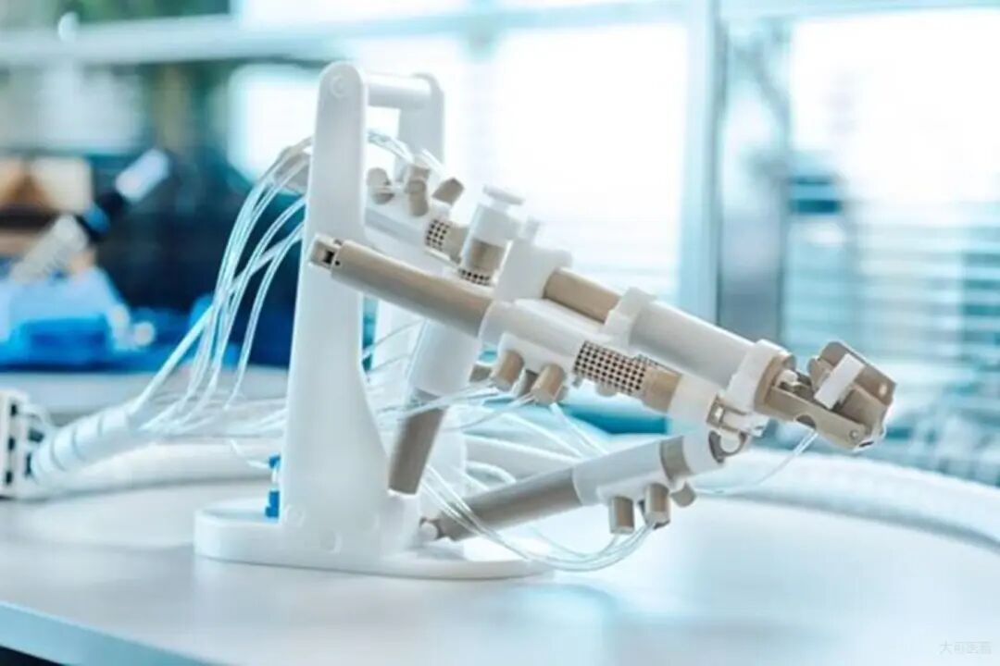

*Пневматический робот для пункции простаты: в качестве рабочей среды используется сжатый воздух, а скорость отклика очень высока*

Особенности пневматического привода:

- **Высокая скорость**: сжатый воздух выходит очень быстро, что подходит для быстрых возвратно-поступательных движений
- **Простая конструкция**: система проста и недорога
- **Но**: точность управления невысока, а энергопотребление выше

Пневматические роботы распространены в пищевой упаковке, сортировке лекарств и других лёгких быстрых задачах.

---

## 4. Сенсорная система — органы чувств робота

### 4.1 Внешнее восприятие

Если робот может только двигаться по заранее заданной программе, он всего лишь автоматический механизм (automated machine). Настоящий робот (robot) должен воспринимать окружающий мир.

**Зрение — важнейший орган чувств робота**

Среди информации, которую получает человек, более 80 % приходит через зрение. У робота то же самое.

Самый распространённый датчик зрения — камера. Современные роботы обычно оснащаются **глубинными камерами**: они не только «видят» предметы, но и воспринимают расстояние до них, подобно стереозрению человеческих глаз.

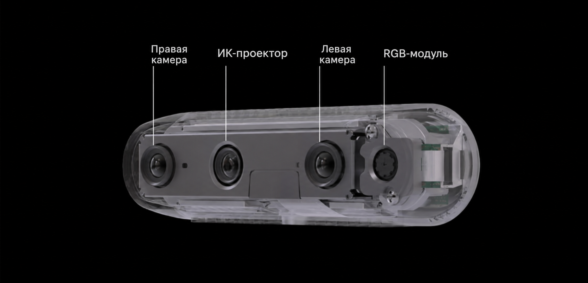

*Глубинная камера получает трёхмерную информацию о сцене и даёт роботу пространственное восприятие*

**Лидар — точный инструмент измерения расстояния**

На беспилотных автомобилях и продвинутых роботах часто видна вращающийся «колпак» — это **лидар (LiDAR)**.

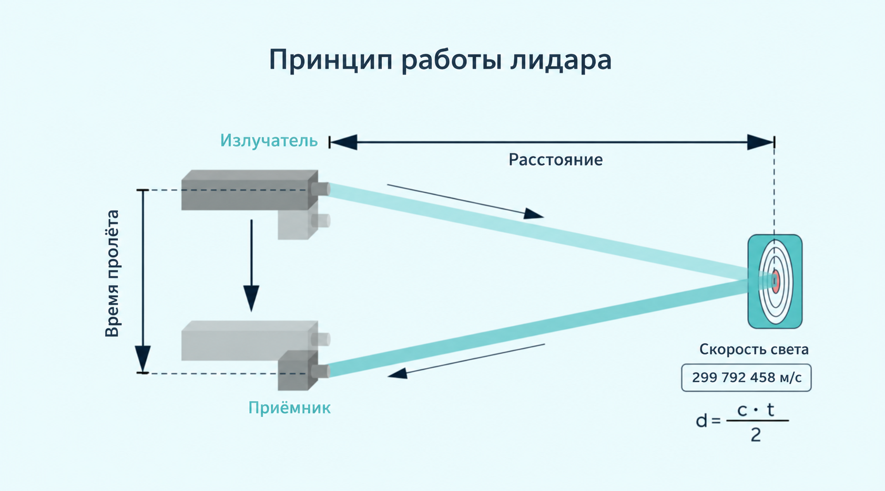

*Лидар испускает лазерный луч и вычисляет расстояние по времени отражения; точность измерения очень высокая*

Особенности лидара:

- **Высокая точность измерения расстояния**: до сантиметров
- **Хорошее угловое разрешение**: позволяет точно воспринимать форму окружающей среды
- **Не зависит от освещённости**: работает одинаково и днём, и ночью

Поэтому практически все беспилотные автомобили и складские AGV оснащаются лидарами.

**Прочие внешние датчики**

Помимо зрения, у робота есть и другие «органы чувств»:

- **Ультразвуковые датчики**: испускают ультразвук для обнаружения препятствий, дешёвые и простые
- **Инфракрасные датчики**: обнаруживают источники тепла или препятствия на небольшом расстоянии
- **Тактильные датчики**: воспринимают силу контакта и распределение давления

### 4.2 Внутреннее восприятие — знание о себе

Роботу нужно знать не только окружающий мир, но и то, **где он сам находится** и **какие движения совершает**.

**Энкодер — «счётчик положения» сустава**

Почти у каждого двигателя есть **энкодер**, который точно измеряет угол поворота ротора. По этим данным система управления вычисляет текущий угол каждого сустава. Так робот «знает» свою позу.

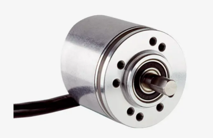

*Энкодер установлен в задней части двигателя и точно измеряет положение и скорость ротора*

**IMU — «вестибулярная система» робота**

Когда вы идёте с закрытыми глазами, вы всё равно понимаете, движетесь ли вперёд или назад, наклонены вы или стоите прямо: это вестибулярный аппарат во внутреннем ухе воспринимает ваши движения и положение тела.

У робота аналогичную функцию выполняет **инерциальный измерительный блок (IMU)**. Он состоит из акселерометра и гироскопа, измеряет ускорение и угловую скорость и помогает роботу понимать своё движение.

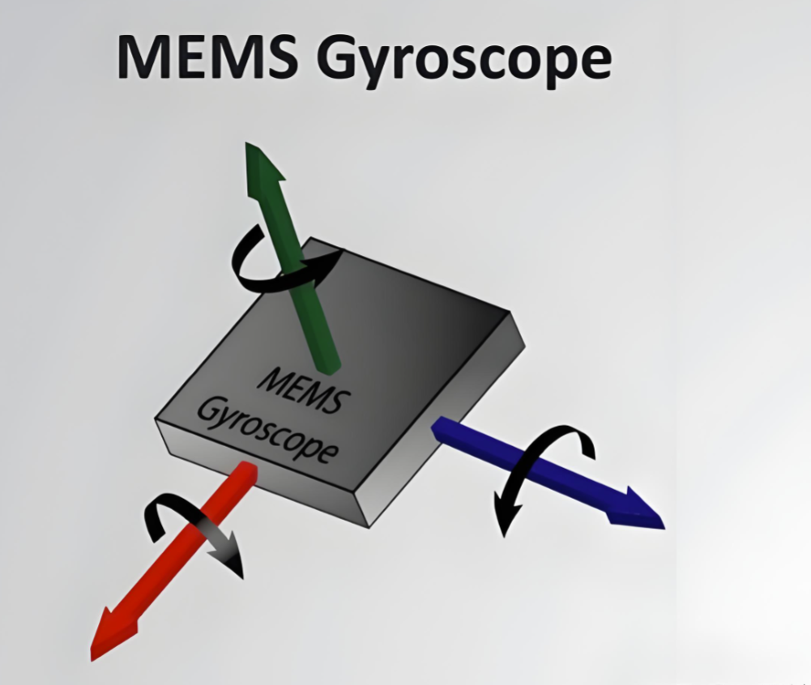

*Датчик IMU объединяет акселерометр и гироскоп и определяет состояние движения робота*

**Датчик момента — ощущение силы**

Высокотехнологичные манипуляторы часто оснащают **датчиками момента** в суставах. Они измеряют крутящий момент, который выдаёт сустав.

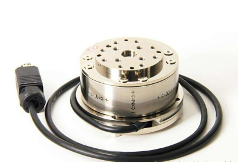

*Суставный датчик момента определяет силы, возникающие при взаимодействии робота со средой*

Зачем это нужно? Когда вы хотите, чтобы робот «аккуратно» взял яйцо, датчик момента позволяет ему почувствовать, какое усилие подходит: и яйцо не раздавится, и не выскользнет.

---

## 5. Система управления — мозг робота

### 5.1 Аппаратная часть контроллера

Если сенсорная система — это «глаза и уши», то система управления — это «мозг». Она получает информацию, обрабатывает её, принимает решения и подаёт команды.

«Мозгом» робота является **контроллер (Controller)**. В шкафу управления роботом находится промышленный компьютер — именно он образует ядро всей системы управления.

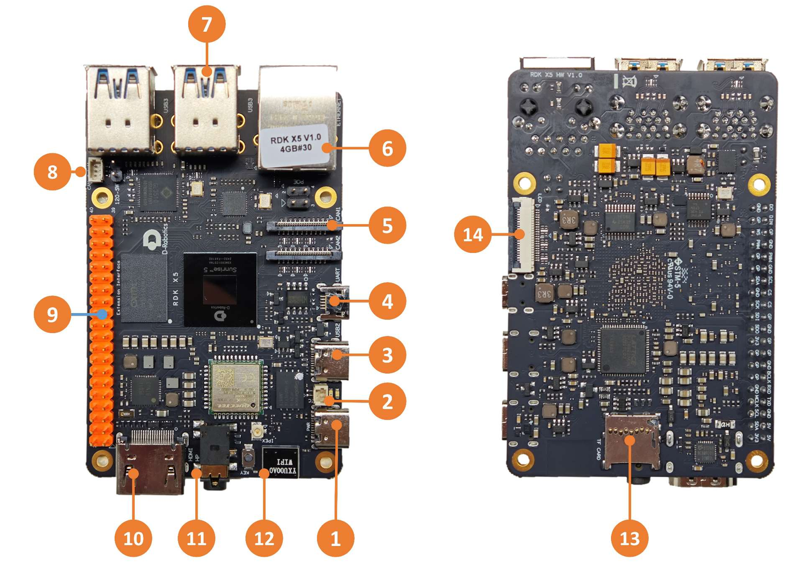

*Контроллеры малых роботов обычно представляют собой высокопроизводительные встраиваемые системы, которые выполняют алгоритмы управления и распределяют задачи*

Работа контроллера:

- получает данные с датчиков
- выполняет алгоритмы управления движением
- отправляет команды приводам
- обменивается данными с другими системами

Распространённые типы контроллеров:

- **Промышленный ПК**: мощный и гибкий
- **ПЛК (программируемый логический контроллер)**: надёжен и подходит для промышленных условий
- **Встраиваемый контроллер**: компактный и маломощный

### 5.2 Принципы управления движением

Основная задача контроллера — заставить робота двигаться так, как задумано. Здесь возникают две базовые задачи:

**Прямая кинематика — по известным углам суставов найти положение конца**

Если известен угол каждого сустава, где находится концевой эффектор? Это задача прямой кинематики.

**Обратная кинематика — по известному положению конца найти углы суставов**

Если нужно, чтобы конец манипулятора попал в определённую точку, на сколько должен повернуться каждый сустав? Это обратная кинематика — одна из самых важных и сложных задач управления роботом.

Решение этих двух задач закладывает математическую основу точного управления роботом.

---

## 6. Программная часть — душа робота

### 6.1 Операционная система для роботов

Если аппаратная часть — это «тело» робота, то программное обеспечение — его «душа». Оно даёт роботу интеллект, гибкость и способность учиться.

Представьте: без программного обеспечения точная механическая конструкция — всего лишь куча металлолома. Программа оживляет холодное железо.

**ROS2 — ядро программной платформы робота**

В области робототехнического ПО **ROS2 (Robot Operating System 2)** — самая популярная платформа разработки.

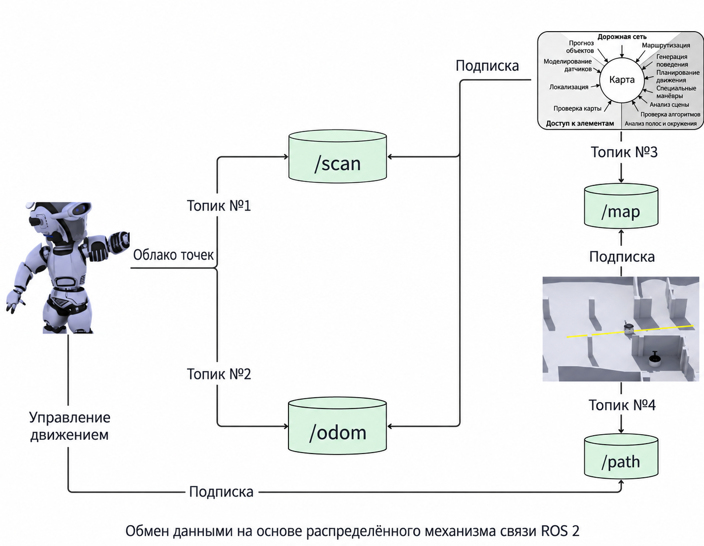

*ROS2 использует распределённую архитектуру узлов и обменивается данными через топики, сервисы и действия*

Основные понятия ROS2:

- **Узел (Node)**: каждый функциональный модуль — отдельная программа
- **Топик (Topic)**: узлы «рассылают» и «подписываются» на данные
- **Сервис (Service)**: взаимодействие узлов по схеме «запрос — ответ»
- **Действие (Action)**: «обратная связь» при выполнении долгих задач

Такая распределённая архитектура делает программное обеспечение робота модульным и удобным в поддержке: каждый функциональный модуль можно разрабатывать и тестировать отдельно, а потом собирать, как конструктор.

### 6.2 Слой прикладного программного обеспечения

Поверх такой базовой платформы, как ROS2, находятся различные прикладные программы:

- **Алгоритмы восприятия**: обрабатывают данные камер и лидаров, распознают объекты и обнаруживают препятствия
- **Локализация и построение карты**: алгоритмы SLAM позволяют роботу в незнакомой среде понять, где он находится
- **Планирование пути**: вычисляет безопасный путь от текущей точки до цели
- **Управление движением**: точно контролирует движение каждого сустава

В последние годы развитие **искусственного интеллекта** делает программное обеспечение роботов всё «умнее». Глубокое обучение позволяет роботам распознавать изображения, понимать язык и принимать решения. Обучение с подкреплением помогает им осваивать новые навыки методом проб и ошибок.

---

## 7. Классификация роботов

### По назначению: промышленные, сервисные, специальные

Роботы применяются в самых разных областях. По назначению их можно разделить на три большие группы:

**Промышленные роботы — опора производства**

Промышленные роботы — «старшие братья» робототехники. С момента появления первого промышленного робота в 1961 году они прослужили в производстве более 60 лет.

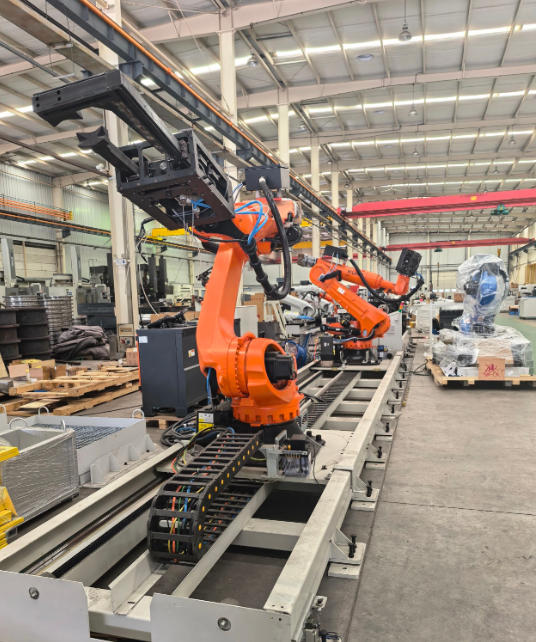

*Промышленные роботы широко используются в автомобилестроении, сборке электроники и других отраслях*

Особенности промышленных роботов:

- **Высокая точность**: повторяемость позиционирования до 0,02 мм
- **Высокая скорость**: скорость движения более 2 м/с
- **Большая грузоподъёмность**: максимальная нагрузка до нескольких тонн
- **Высокая жёсткость**: высокая жёсткость обеспечивает устойчивость движений

Типичные применения: сварка, окраска, перемещение, сборка, укладка на паллеты…

**Сервисные роботы — спутники повседневной жизни**

От робота-пылесоса до доставщика еды в ресторане — сервисные роботы всё активнее входят в дома и заведения.

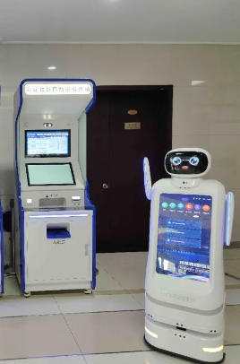

*Сервисные роботы охватывают уборку, доставку, общение и другие сценарии*

Особенности сервисных роботов:

- **Высокая интерактивность**: нужно естественно общаться с людьми
- **Высокая безопасность**: работают близко к людям, безопасность обязательна
- **Высокая адаптивность**: должны гибко реагировать на неструктурированную среду

Типичные применения: роботы-пылесосы, роботы-доставщики, сервис в отелях, роботы в банковских залах…

**Специальные роботы — исследователи экстремальных сред**

Есть места, куда человеку трудно добраться: глубина пожара, морское дно, руины после катастроф, космос… Именно здесь работают специальные роботы.

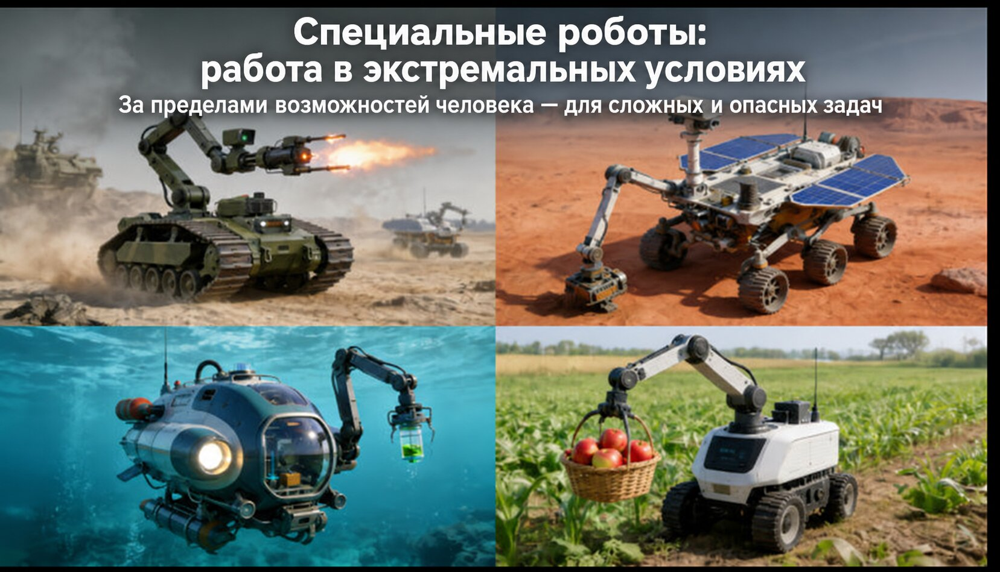

*Специальные роботы применяются в военной сфере, спасении, под водой и в воздухе*

Типичные применения: военные разведывательные роботы, спасательные роботы, подводные исследовательские роботы, дроны для разминирования…

---

## 8. Типовые примеры

### 8.1 AGV — «курьер» склада

Если вы покупали что-то в интернете, скорее всего, вы уже встречались с AGV, даже не заметив этого.

На складах логистики Amazon, Alibaba и JD.com тысячи **AGV (автоматических управляемых тележек)** работают без остановки. Они перевозят стеллажи по складу и доставляют нужные вам товары к сотруднику.

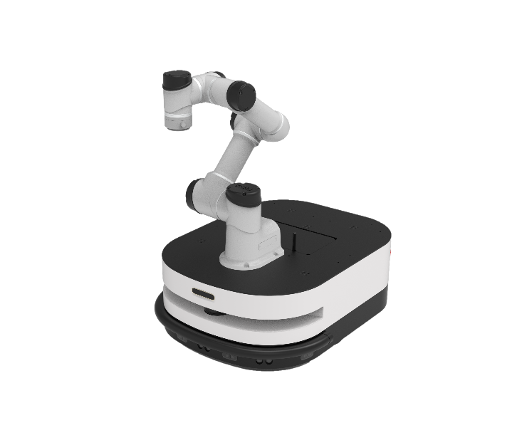

*Складская AGV LEO от Shenzhen Chuangxiang Weilai существенно повышает эффективность логистики*

**Как работает AGV?**

1. **Навигация**: ранние AGV ориентировались по магнитным полосам или цветным лентам на полу; новое поколение использует лазерную навигацию или визуальный SLAM и по-настоящему самостоятельно определяет своё положение
2. **Избегание препятствий**: оснащены лидарами и ультразвуковыми датчиками и обнаруживают препятствия впереди
3. **Связь**: обмениваются данными с верхней системой по Wi-Fi, получают задания и сообщают о статусе
4. **Зарядка**: при низком заряде автоматически возвращаются на зарядную станцию и работают круглосуточно

**Почему AGV так важны?**

В традиционном складе рабочие каждый день проходят по огромному помещению десятки тысяч шагов, перенося товары. Это неэффективно, утомительно и ведёт к ошибкам.

С AGV схема «товар к человеку» повышает эффективность более чем в 5 раз. Сотрудник просто стоит на рабочем месте и ждёт, пока AGV привезёт стеллаж. Это не только резко снижает нагрузку на людей, но и уменьшает число ошибок.

### 8.2 Коллаборативные манипуляторы — рабочие партнёры человека

Традиционные промышленные роботы эффективны, но у них есть недостаток: они слишком «опасны». Они сильны и быстры, поэтому их ставят за защитные ограждения и отделяют от людей.

**Коллаборативные роботы** изменили эту ситуацию.

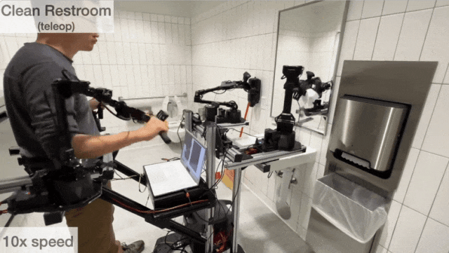

*Коллаборативные роботы могут безопасно находиться в одном пространстве с людьми*

**«Секрет безопасности» коллаборативных роботов**

- **Ограничение момента**: при обнаружении столкновения робот немедленно останавливается, чтобы не причинить вреда
- **Лёгкая конструкция**: общая масса значительно меньше, чем у традиционных роботов
- **Обнаружение столкновений**: встроенные датчики момента фиксируют аномальный контакт
- **Визуальное восприятие**: камеры безопасности обнаруживают приближение людей

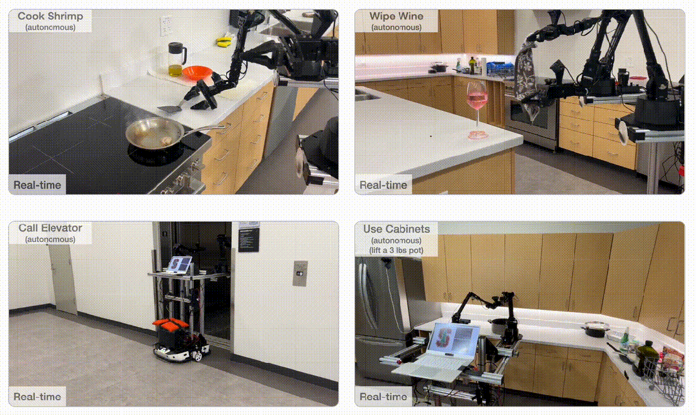

*Коллаборативные роботы оснащены датчиками момента и зрения, что обеспечивает безопасность человека*

**Направляемое обучение — может каждый**

Главная особенность коллаборативных роботов — **простота использования**. Традиционные промышленные роботы требуют программирования и наладки квалифицированным инженером. Коллаборативные роботы поддерживают **направляемое обучение**: вы просто рукой перемещаете манипулятор в нужную точку, а робот сам запоминает траекторию.

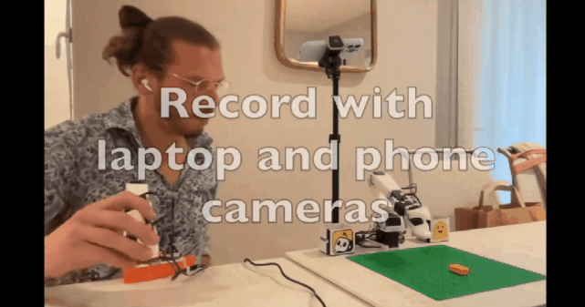

*Пользователь может напрямую перемещать коллаборативный манипулятор, чтобы его обучить*

Это значит, что даже рабочий без опыта программирования может легко научить робота новой задаче. Поэтому коллаборативные роботы любят малые и средние предприятия: автоматизация становится доступна и им.

### 8.3 Домашние сервисные роботы — помощники в быту

Утром, пока вы ещё спите, робот-пылесос тихо убирает комнату. Это уже привычная картина во многих домах.

**Домашние сервисные роботы** стали первопроходцами, которые привели робототехнику в миллионы семей.

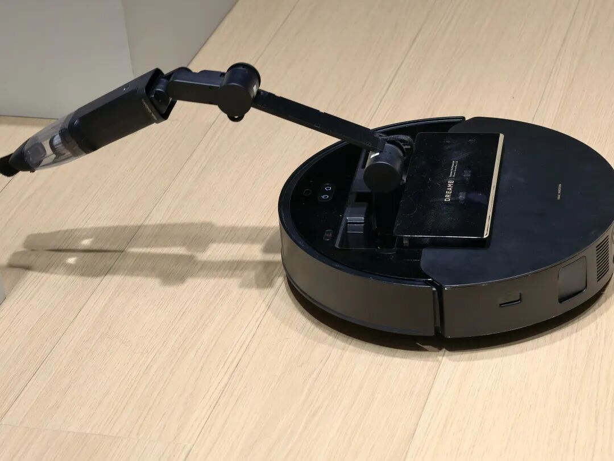

*Робот-пылесос стал самым распространённым домашним сервисным роботом*

**Насколько «умён» робот-пылесос?**

Современные роботы-пылесосы объединяют несколько интеллектуальных технологий:

- **Лазерный дальномер или глубинная камера**: воспринимают окружение и строят карту
- **Алгоритм SLAM**: одновременная локализация и построение карты — робот понимает, где он находится
- **Алгоритм планирования пути**: продумывает маршрут уборки так, чтобы ничего не пропустить и не повторять
- **Датчики защиты от падения**: обнаруживают перепады высоты и не дают упасть с лестницы
- **Автоматический возврат на зарядку**: при низком заряде возвращается на базу

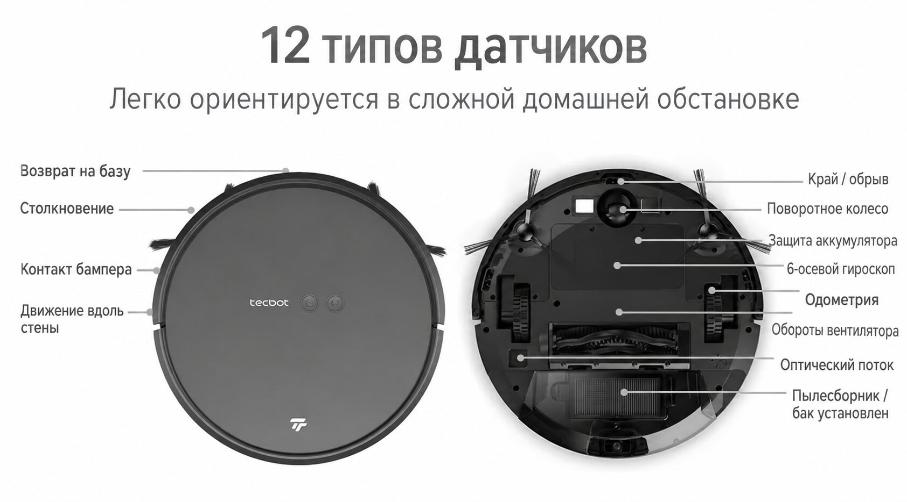

*Робот-пылесос оснащён лидаром, одометрами, датчиками столкновений и другими средствами восприятия*

**Не только уборка**

Семейство домашних сервисных роботов становится всё разнообразнее:

- **Робот для мытья окон**: прилипает к стеклу и моет его автоматически
- **Робот-очиститель воздуха**: передвижной очиститель воздуха
- **Робот-компаньон**: умеет разговаривать и общаться с пожилыми людьми и детьми
- **Умная колонка**: хотя она «неподвижна», это тоже одна из форм домашнего сервисного робота

С развитием искусственного интеллекта домашние сервисные роботы будут становиться всё умнее и станут ключевой точкой входа в экосистему умного дома.

---

## Итоги главы

В этой главе мы познакомились с «телом» робота — его системным составом и классификацией.

**Ключевые выводы:**

1. **Пять основных систем**: робот состоит из механической конструкции, системы привода, сенсорной системы, системы управления и программного обеспечения; каждая часть выполняет свою роль, и все они работают согласованно
2. **Механическая конструкция**: суставы и степени свободы определяют возможности движения; концевой эффектор — «рука» робота
3. **Система привода**: чаще всего используется электрический привод, гидравлический — для мощных задач, пневматический — для быстрых лёгких задач
4. **Сенсорная система**: внешнее восприятие знакомит с окружением, внутреннее — с состоянием самого робота; слияние нескольких датчиков — тренд
5. **Система управления**: контроллер — «мозг» робота; управление движением опирается на прямую и обратную кинематику
6. **Программное обеспечение**: ROS2 — ведущая платформа, а искусственный интеллект делает роботов всё умнее
7. **Классификация**: по назначению — промышленные, сервисные, специальные; по форме движения — мобильные, манипуляторы, комбинированные
8. **Типовые примеры**: AGV, коллаборативные манипуляторы, домашние сервисные роботы — разные сценарии требуют разных решений

---

## Вопросы и задания

1. **Подумайте**: какие роботы есть у вас дома или вокруг? К какому типу они относятся? Из каких систем состоят?
2. **Поищите**: какой тип роботов вам интереснее всего? Какие у него ключевые технологии?
3. **Обсудите**: каким будет дальнейшее развитие отношений между роботами и людьми? Заменят ли роботы людей или будут работать вместе с ними?

---

## Список литературы

### Основы робототехнических систем

1. Craig, J. J. *Introduction to Robotics: Mechanics and Control* («Введение в робототехнику: механика и управление»)
2. Сюн Юлунь. «Основы робототехники»
3. IEEE Transactions on Robotics

### ROS2 и программное обеспечение

4. «Практика программирования роботов на ROS2»
5. Официальная документация ROS2: https://docs.ros.org/en/rolling/

### Классификация и применение роботов

6. «Отчёт о развитии китайской робототехнической отрасли»
7. International Federation of Robotics (IFR)

---

*Первая глава закончена. Дальше мы перейдём к основам: системам координат, кинематике и динамике робота, а также к координации «рука — глаз». Готовы? Давайте продолжим!*
