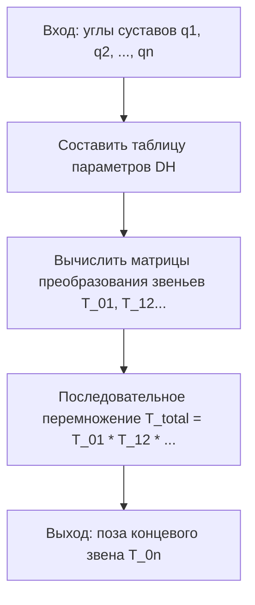

# Кинематика робота и параметры Денавита — Хартенберга

#### 1. Введение

Прямая кинематика (Forward Kinematics) решает задачу: зная все углы суставов, вычислить позу концевого эффектора робота. Метод Денавита — Хартенберга (DH) — стандартный способ задать системы координат звеньев.

#### 2. Параметры DH (стандартная форма)

Связь между соседними звеньями $i-1$ и $i$ описывается всего четырьмя параметрами:

| **Параметр** | **Обозначение** | **Физический смысл** | **Чем определяется** |
| ------------ | --------------- | -------------------- | ------------------ |
| **Длина звена** | $a_i$ | Расстояние вдоль оси $x_i$ от $z_{i-1}$ до $z_i$ | Конструкция самого звена |
| **Угол скрутки звена** | $\alpha_i$ | Угол поворота вокруг оси $x_i$ от $z_{i-1}$ до $z_i$ | Конструкция самого звена |
| **Смещение сустава** | $d_i$ | Расстояние вдоль оси $z_{i-1}$ от $x_{i-1}$ до $x_i$ | Переменная сустава (поступательного) |
| **Угол сустава** | $\theta_i$ | Угол поворота вокруг оси $z_{i-1}$ от $x_{i-1}$ до $x_i$ | Переменная сустава (вращательного) |

Матрица перехода $T_{i-1}^{i}$ между соседними звеньями:

$$T_{i-1}^{i} = \text{Rot}_{z}(\theta_i) \cdot \text{Trans}_{z}(d_i) \cdot \text{Trans}_{x}(a_i) \cdot \text{Rot}_{x}(\alpha_i)$$

#### 3. Схема процесса (Mermaid)



#### 4. Проверка на Python

Код реализует универсальный генератор матриц DH и проверяет его на простом двухзвенном плоском манипуляторе (2-Link Planar Arm).

```python
import numpy as np

def dh_matrix(theta, d, a, alpha):
    """
    Вычисляет матрицу преобразования T_{i-1, i} по стандартным параметрам DH.
    Единицы: углы в радианах, длины в метрах.
    """
    ct, st = np.cos(theta), np.sin(theta)
    ca, sa = np.cos(alpha), np.sin(alpha)

    return np.array([
        [ct, -st*ca,  st*sa, a*ct],
        [st,  ct*ca, -ct*sa, a*st],
        [0,   sa,     ca,    d   ],
        [0,   0,      0,     1   ]
    ])

def forward_kinematics_2link(joint_angles, link_lengths):
    """
    Вычисляет положение конца двухзвенного плоского манипулятора
    """
    theta1, theta2 = joint_angles
    L1, L2 = link_lengths

    # Звено 1: система 0 -> система 1
    # theta=q1, d=0, a=L1, alpha=0
    T_01 = dh_matrix(theta1, 0, L1, 0)

    # Звено 2: система 1 -> система 2
    # theta=q2, d=0, a=L2, alpha=0
    T_12 = dh_matrix(theta2, 0, L2, 0)

    # Итоговая матрица преобразования
    T_02 = T_01 @ T_12

    return T_02

# --- Проверка ---
# Заданы: L1 = 1 м, L2 = 1 м
# Случай 1: q1 = 0, q2 = 0 -> рука вытянута вдоль оси X -> конец в (2, 0, 0)
# Случай 2: q1 = 90°, q2 = 0 -> рука вертикально вверх -> конец в (0, 2, 0)
# Случай 3: q1 = 0, q2 = 90° -> первое звено горизонтально, второе вверх -> конец в (1, 1, 0)

L_params = [1.0, 1.0]
q_case3 = [0, np.radians(90)]

T_final = forward_kinematics_2link(q_case3, L_params)
pos_final = T_final[:3, 3]

print(f"Углы суставов: {np.degrees(q_case3)}")
print(f"Вычисленное положение конца (x, y, z): {np.round(pos_final, 4)}")
# Ожидаемый результат: x=1.0, y=1.0, z=0.0
```
