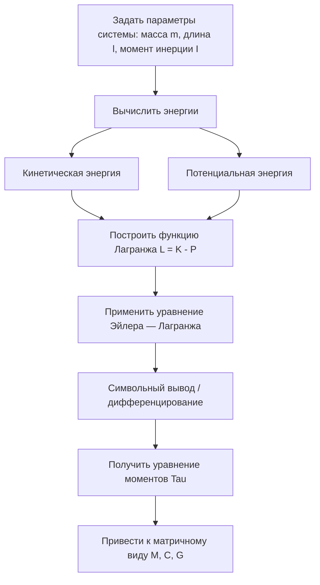

# Динамика робота

#### 1. Введение

Динамика изучает связь между движением робота и силами/моментами, которые нужны, чтобы это движение создать. Различают два вида динамики:

- **Прямая динамика:** по заданным моментам вычислить ускорения и траекторию движения.
- **Обратная динамика:** по заданной траектории (положению, скорости, ускорению) вычислить необходимые моменты в суставах (это нужно для управления).

Чаще всего для моделирования используют **метод Лагранжа (Эйлера — Лагранжа)**, который опирается на закон сохранения энергии.

#### 2. Основные формулы

Функция Лагранжа $L$ определяется как разность полной кинетической энергии $K$ системы и её полной потенциальной энергии $P$:

$$L(q, \dot{q}) = K(q, \dot{q}) - P(q)$$

Уравнение динамики (уравнение Эйлера — Лагранжа):

$$\frac{d}{dt} \left( \frac{\partial L}{\partial \dot{q}_i} \right) - \frac{\partial L}{\partial q_i} = \tau_i$$

Обычно его приводят к стандартному виду динамики робота:

$$M(q)\ddot{q} + C(q, \dot{q})\dot{q} + G(q) = \tau$$

- $M(q)$: матрица инерции (Mass Matrix)
- $C(q, \dot{q})$: члены кориолисовых и центробежных сил
- $G(q)$: член силы тяжести

#### 3. Схема процесса (Mermaid)



#### 4. Проверка на Python (символьный вывод в SymPy)

Вывод динамики очень громоздкий, но символьная библиотека `sympy` позволяет наглядно показать весь процесс. Ниже выводится уравнение динамики простого **маятника**.

```python
import sympy as sp

# 1. Задаём символы
t = sp.symbols('t')
m, l, g = sp.symbols('m l g', real=True, positive=True)
theta = sp.Function('theta')(t)  # угол сустава как функция времени

# Задаём скорость (theta_dot) и ускорение (theta_ddot)
theta_dot = theta.diff(t)
theta_ddot = theta_dot.diff(t)

# 2. Вычисляем энергии
# Кинетическая энергия K = 1/2 * m * v^2. Для маятника v = l * угловая скорость
v = l * theta_dot
K = sp.Rational(1, 2) * m * v**2

# Потенциальная энергия P = m * g * h. Нулевой уровень — нижняя точка,
# поэтому h = l * (1 - cos(theta)). Или, если начало координат на оси вращения
# и ось y направлена вверх, h = -l * cos(theta)
h = -l * sp.cos(theta)
P = m * g * h

# 3. Функция Лагранжа L
L = K - P

# 4. Уравнение Эйлера — Лагранжа
# d/dt (dL/d_theta_dot)
dL_dthetadot = sp.diff(L, theta_dot)
term1 = sp.diff(dL_dthetadot, t)

# dL/d_theta
term2 = sp.diff(L, theta)

# Момент tau = term1 - term2
tau = term1 - term2

# 5. Упрощаем и выводим результат
equation = sp.simplify(tau)
print("--- Автоматически выведенное уравнение динамики (Tau = ...) ---")
sp.pprint(equation)

print("\n--- Выделение членов ---")
# Для маятника без трения: M*q_ddot + G = 0
# Ожидаем M = m*l^2, G = m*g*l*sin(theta)
print(f"Инерционный член (при theta_ddot): {equation.coeff(theta_ddot)}")
# Замечание: выделять нелинейные члены в sympy сложнее, поэтому здесь достаточно
# сравнить напечатанный результат с теорией.
# Теоретический результат: m * l**2 * theta_ddot + m * g * l * sin(theta)
```
