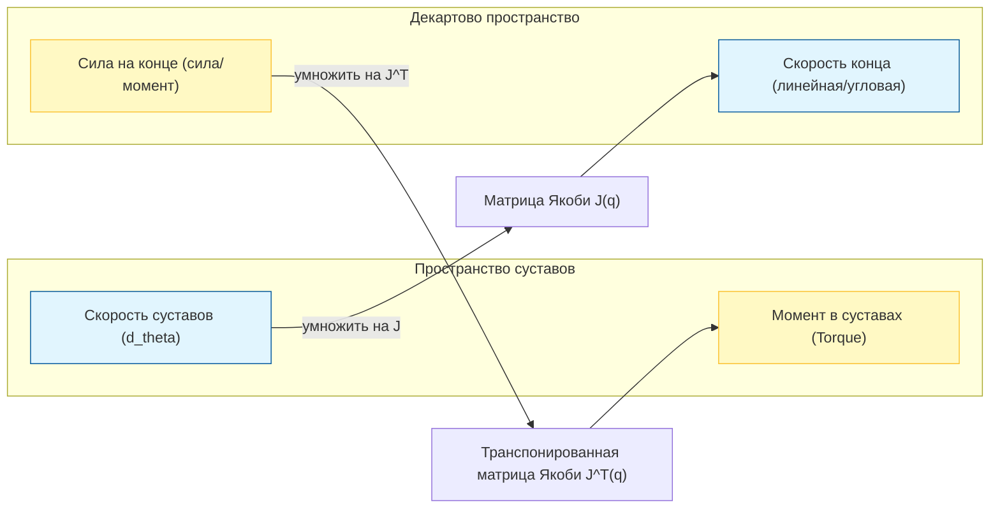

# Скоростная кинематика и матрица Якоби

#### 1. Введение: почему это «мост»?

В предыдущих документах мы изучили **положение** (кинематика) и **силы и моменты** (динамика).

**Матрица Якоби (Jacobian Matrix, $J$)** называют «мостом», потому что она связывает эти две области на уровне дифференциалов:

1. **Связь пространства суставов и декартова пространства**: описывает, как скорости суставов ($\dot{q}$) отображаются в линейную и угловую скорость концевого эффектора ($v, \omega$).

   $$v = J(q) \dot{q}$$

2. **Связь движения и силы (принцип виртуальной работы)**: это вход в динамику. Матрица описывает, как обобщённая сила на конце переходит в моменты, которые должны создать суставы ($\tau$).

    Для плоского манипулятора 2R при полной позе $[\dot{x}, \dot{y}, \dot{\phi}]^T$ обобщённую силу на конце записывают как
    $F=[f_x, f_y, m_z]^T$ (двумерная сила и момент на конце).

   $$\tau = J^T(q) F$$

Без матрицы Якоби нельзя по желаемой скорости конца вычислить скорости суставов или по весу захваченного груза — необходимый момент электродвигателей в суставах.

#### 2. Основное определение

Для робота с $n$ степенями свободы переменные суставов — $q = [q_1, \dots, q_n]^T$. Поза конца (положение и ориентация) записывается как $x = f(q)$.

Матрица Якоби определяется как матрица частных производных:

$$J(q) = \frac{\partial f}{\partial q} = \begin{bmatrix} \frac{\partial x}{\partial q_1} & \cdots & \frac{\partial x}{\partial q_n} \\ \vdots & \ddots & \vdots \\ \end{bmatrix}$$

#### 3. Схема процесса (Mermaid)



#### 4. Проверка на Python: матрица Якоби двухзвенного манипулятора

Символьный вывод в `sympy` автоматически строит полную матрицу Якоби плоского манипулятора 2R размером $3 \times 2$.

```Python
import sympy as sp
import numpy as np

def calculate_jacobian_2link():
    # 1. Задаём символы
    theta1, theta2 = sp.symbols('theta1 theta2')
    l1, l2 = sp.symbols('l1 l2')

    # 2. Уравнения прямой кинематики (концевые x, y и угол ориентации phi)
    # x = l1*c1 + l2*c12
    # y = l1*s1 + l2*s12
    x = l1 * sp.cos(theta1) + l2 * sp.cos(theta1 + theta2)
    y = l1 * sp.sin(theta1) + l2 * sp.sin(theta1 + theta2)
    phi = theta1 + theta2

    # Вектор позы: [x, y, phi]^T
    pose = sp.Matrix([x, y, phi])

    # Вектор переменных суставов
    q = sp.Matrix([theta1, theta2])

    # 3. Матрица Якоби J = d(pose)/d(q), размер 3x2
    J = pose.jacobian(q)

    print("--- Полная символьная матрица Якоби J (3x2) ---")
    sp.pprint(J)

    # 4. Численная проверка (тест на сингулярность)
    # Полная J — неквадратная матрица 3x2, поэтому определитель det(J) не берут.
    # Для задачи позиционирования плоского 2R обычно используют верхнюю часть,
    # линейную подматрицу Jv (первые две строки), чтобы проверить сингулярность.
    # При theta2 = 0 (рука полностью вытянута) определитель Jv равен нулю.
    J_func = sp.lambdify((theta1, theta2, l1, l2), J, 'numpy')

    # Тест: l1=1, l2=1, theta1=0, theta2=0 (рука вытянута)
    J_val = J_func(0, 0, 1, 1)
    Jv_val = J_val[:2, :]
    det_Jv = np.linalg.det(Jv_val)
    rank_J = np.linalg.matrix_rank(J_val)

    print("\n--- Численная проверка (рука вытянута, theta2=0) ---")
    print(f"Полная матрица Якоби J:\n{J_val}")
    print(f"Линейная подматрица Jv:\n{Jv_val}")
    print(f"det(Jv) (близко к 0 означает позиционную сингулярность): {det_Jv}")
    print(f"rank(J) = {rank_J} (показывает, упал ли ранг полного Якобиана; меньше 2 — ранг по столбцам снижен)")
    print("Примечание: сингулярность для задачи позиционирования оценивается по Jv (например, близко ли det(Jv) к 0).")

    # 5. Пример отображения силы: tau = J^T * F
    # F = [fx, fy, mz]^T — плоская сила и момент на конце
    F = np.array([10.0, 5.0, 1.0])
    tau = J_val.T @ F
    print("\n--- Пример отображения силы/момента ---")
    print(f"Обобщённая сила на конце F = {F}")
    print(f"Моменты в суставах tau = J^T F = {tau}")

calculate_jacobian_2link()
```
