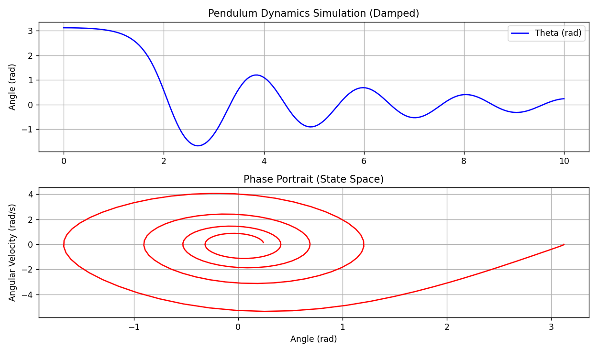

# Комплексная практика и моделирование

#### 1. Практическое задание: таблица параметров DH робота UR5

UR5 — самый классический шестиосевой коллаборативный робот в промышленности. Ниже приведены его стандартные параметры DH. Учтите, что разные производители и литература могут использовать модифицированную форму DH (MDH); здесь показана **стандартная форма DH**, соответствующая определению из документа 2.

**Единицы:** $d, a$ (миллиметры, mm), $\alpha, \theta$ (радианы, rad)

| **Сустав i** | **αi (скрутка)** | **ai (длина звена)** | **di (смещение)** | **θi (переменная)** |
| ------------ | ---------------- | -------------------- | ----------------- | ------------------- |
| **1 (основание)** | $\pi/2$ | 0 | 89.16 | $q_1$ |
| **2 (плечо)** | 0 | -425.00 | 0 | $q_2$ |
| **3 (локоть)** | 0 | -392.25 | 0 | $q_3$ |
| **4 (запястье 1)** | $\pi/2$ | 0 | 109.15 | $q_4$ |
| **5 (запястье 2)** | $-\pi/2$ | 0 | 94.65 | $q_5$ |
| **6 (запястье 3)** | 0 | 0 | 82.30 | $q_6$ |

> **Задание**: используя функцию `dh_matrix` из документа 2 (по образцу `forward_kinematics_2link`), подставьте в неё приведённые выше параметры и вычислите координаты конца UR5 в нулевой позе ($q=[0,0,0,0,0,0]$).

#### 2. Моделирование динамики: фазовый портрет и временной отклик маятника

В документе 3 мы вывели уравнение динамики маятника. Теперь с помощью научной библиотеки Python `scipy` численно проинтегрируем его и смоделируем реальное движение.

**Вид дифференциального уравнения**:

Преобразуем уравнение второго порядка $\ddot{\theta} = -\frac{g}{L}\sin(\theta) - \frac{b}{m L^2}\dot{\theta}$ (с учётом демпфирования $b$) в систему уравнений первого порядка в пространстве состояний.

Пусть вектор состояния $y = [\theta, \omega]^T$, тогда:

$$\frac{dy}{dt} = \begin{bmatrix} \dot{\theta} \\ \dot{\omega} \end{bmatrix} = \begin{bmatrix} \omega \\ -\frac{g}{L}\sin(\theta) - \frac{b}{m L^2}\omega \end{bmatrix}$$

#### 3. Код моделирования на Python (`scipy.integrate.odeint`)

```python
import numpy as np
from scipy.integrate import odeint
import matplotlib.pyplot as plt

# 1. Определяем функцию системы (правые части уравнений)
def pendulum_dynamics(y, t, g, L, m, b):
    """
    y: вектор состояния [theta, omega]
    t: моменты времени
    g, L, m, b: физические параметры
    """
    theta, omega = y

    # Уравнения состояния:
    # d(theta)/dt = omega
    # d(omega)/dt = -(g/L)sin(theta) - (b/(mL^2))omega
    dydt = [omega, -(g/L)*np.sin(theta) - (b/(m*L**2))*omega]

    return dydt

# 2. Задаём параметры
g = 9.81   # ускорение свободного падения
L = 1.0    # длина стержня
m = 1.0    # масса
b = 0.5    # коэффициент демпфирования (сопротивление воздуха и т. п.)

# 3. Начальные условия
theta_0 = np.radians(179) # начальный угол (почти в верхней точке, проверяем нелинейность)
omega_0 = 0.0             # начальная угловая скорость
y0 = [theta_0, omega_0]

# 4. Временной интервал
t = np.linspace(0, 10, 200) # моделируем 10 секунд

# 5. Решаем дифференциальное уравнение
# odeint сам использует численный метод интегрирования
solution = odeint(pendulum_dynamics, y0, t, args=(g, L, m, b))

# 6. Строим графики результатов
theta_traj = solution[:, 0]
omega_traj = solution[:, 1]

plt.figure(figsize=(10, 6))

# Подграфик 1: угол в зависимости от времени
plt.subplot(2, 1, 1)
plt.plot(t, theta_traj, 'b-', label='θ (рад)')
plt.title('Моделирование маятника с демпфированием')
plt.ylabel('Угол (рад)')
plt.grid(True)
plt.legend()

# Подграфик 2: фазовый портрет — скорость от угла
plt.subplot(2, 1, 2)
plt.plot(theta_traj, omega_traj, 'r-')
plt.title('Фазовый портрет (пространство состояний)')
plt.xlabel('Угол (рад)')
plt.ylabel('Угловая скорость (рад/с)')
plt.grid(True)
plt.tight_layout()

print("Моделирование завершено, посмотрите окно с графиками.")
# При запуске убедитесь, что окружение поддерживает plt.show()
# plt.show()
```

#### 4. Анализ результатов

- **Временная диаграмма (верхний график)**: видно, как маятник падает с высокой точки, несколько раз колеблется, а из-за демпфирования $b$ амплитуда постепенно уменьшается и угол стремится к 0 (вертикально вниз).
- **Фазовый портрет (нижний график)**: показывает траекторию $\theta$ и $\omega$. Это должна быть спираль, сходящаяся к началу координат; она наглядно демонстрирует **устойчивость** системы.


