# Дополнение 01. Калибровка «рука — глаз» (Hand-Eye Calibration)

## 6.1.1 Определение калибровки «рука — глаз»

Калибровка «рука — глаз» (Hand-Eye Calibration) — фундаментальная и ключевая задача в прикладном машинном зрении робота. Её цель — согласовать системы координат визуальной системы и робота, то есть определить относительное положение и ориентацию камеры и робота.

> Когда мы хотим, чтобы робот с помощью зрения схватил предмет, нам нужно знать три соотношения:
>
> 1. Взаимное положение концевого эффектора и основания робота.
> 2. Взаимное положение камеры и концевого эффектора.
> 3. Взаимное положение и ориентацию объекта относительно камеры.
>
> Калибровка «рука — глаз» решает прежде всего вторую задачу: она определяет пространственное преобразование между «рукой» и установленным на ней «глазом», то есть вычисляет матрицу перехода между системой координат камеры и системой координат робота. Концевой эффектор робота называется «рукой», а камера — «глазом».

В зависимости от способа установки камеры различают два варианта:
1. **Камера на конце манипулятора** — «глаз в руке» (Eye in hand).
2. **Камера установлена вне манипулятора**, например на основании робота — «глаз вне руки» (Eye to hand).

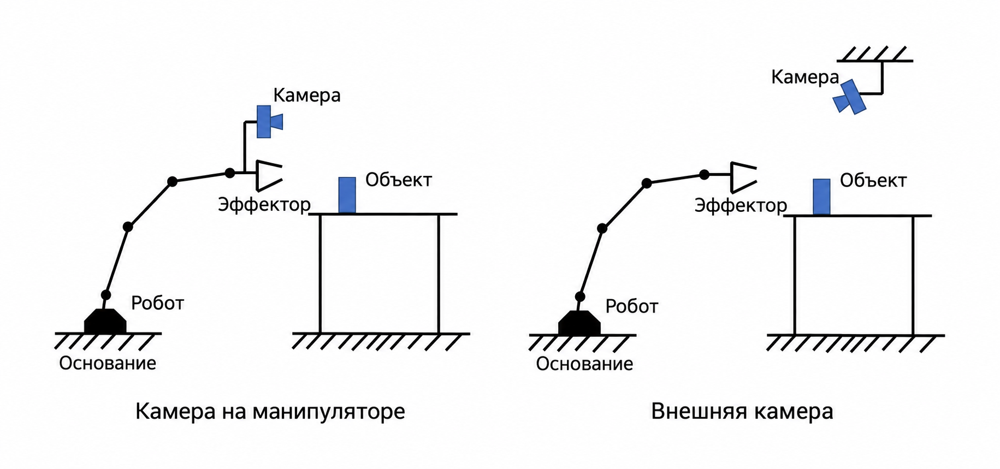

## 6.1.2 Математическая модель калибровки «рука — глаз»

Для обоих вариантов — «глаз в руке» и «глаз вне руки» — уравнение решается одинаково: $AH = HB$. Сначала определим системы координат:

$F_b$: **система координат основания** (Base Frame), закреплённая на основании манипулятора; это глобальная система отсчёта для движения руки.

$F_e$: **система координат концевого эффектора** (End-Effector Frame), закреплённая на захвате или инструменте.

$F_c$: **система координат камеры** (Camera Frame), связанная с оптическим центром камеры; это система отсчёта визуального восприятия.

$F_t$: **система координат калибровочной мишени** (Calibration Target Frame), связанная с мишенью — шахматной доской или плоскостью с точками.

Отношения между системами координат обычно записывают однородной матрицей преобразования (жёсткое преобразование) $T$:

$$
T^i_j = \begin{bmatrix} R^i_j & t^i_j \\ 0 & 1 \end{bmatrix}
$$

Здесь $R \in SO(3)$ — матрица поворота (специальная ортогональная группа), а $t \in \mathbb{R}^3$ — вектор переноса в трёхмерном пространстве. Верхний и нижний индексы $T$ показывают, между какими двумя системами координат выполняется преобразование. Например:

$T^e_c$ — преобразование из системы координат камеры в систему координат концевого эффектора. Оно же задаёт позу камеры в системе концевого эффектора; в случае «глаза в руке» именно эта матрица и является искомой.

### 6.1.2.1 Eye In Hand («глаз в руке»)

Когда камера закреплена на конце манипулятора, преобразование между камерой и концевым эффектором постоянно. Такой вариант называют «глаз в руке». Для калибровки мишень неподвижно закрепляют, а манипулятор перемещают в разные позиции. С камерой на конце руки делают снимки мишени из разных положений.

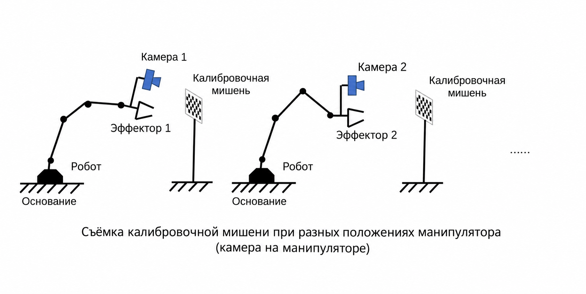

Поскольку мишень и основание робота неподвижны, их относительная поза не меняется, поэтому:

$$
T^b_t = T^b_{e1}\ T^{e1}_{c1}\ T^{c1}_{t} = T^b_{e2}\ T^{e2}_{c2}\ T^{c2}_{t}
$$

Преобразуем это равенство:

$$
(T^b_{e2})^{-1}T^b_{e1}T^{e1}_{c1}T^{c1}_{t} = T^{e2}_{c2}T^{c2}_{t}
$$

$$
(T^b_{e2})^{-1}T^b_{e1}T^{e1}_{c1} = T^{e2}_{c2}T^{c2}_{t}(T^{c1}_{t})^{-1}
$$

$$
T^{e2}_{e1}T^{e1}_{c1} = T^{e2}_{c2}T^{c2}_{c1}
$$

$$
T^{e2}_{e1}T^{e}_{c} = T^{e}_{c}T^{c2}_{c1}
$$

$$
AH = HB
$$

Здесь $T^e_c$ — именно та матрица $H$, которую нужно найти.

### 6.1.2.2 Eye To Hand («глаз вне руки»)

Когда камера установлена вне манипулятора, взаимное положение камеры и концевого эффектора меняется вместе с движением руки. Такой вариант называют «глаз вне руки». Для калибровки мишень закрепляют на конце манипулятора, а робот с мишенью фотографируется неподвижной камерой. Для точного результата обычно нужно более 10 снимков.

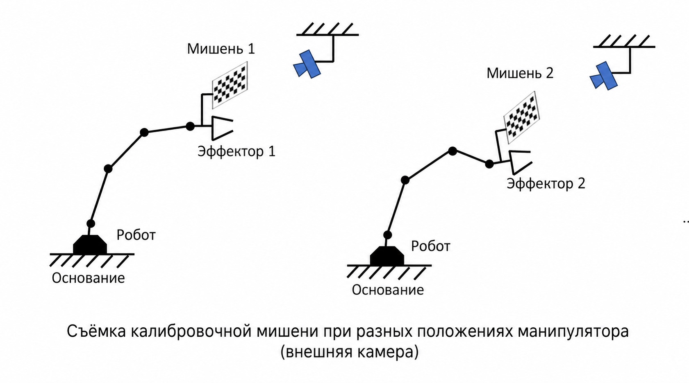

Поскольку мишень закреплена на конце руки, её взаимное положение относительно руки не меняется между снимками, поэтому:

$$
T^e_t = T^{e1}_bT^{b}_{c}T^{c}_{t1} = T^{e2}_bT^{b}_{c}T^{c}_{t2}
$$

Преобразуем:

$$
T^{e1}_bT^{b}_{c}T^{c}_{t1} = T^{e2}_bT^{b}_{c}T^{c}_{t2}
$$

$$
(T^{e2}_b)^{-1}T^{e1}_bT^{b}_{c}T^{c}_{t1} = T^{b}_{c}T^{c}_{t2}
$$

$$
(T^{e2}_b)^{-1}T^{e1}_bT^{b}_{c} = T^{b}_{c}T^{c}_{t2}(T^{c}_{t1})^{-1}
$$

$$
(T^b_{e2}T^{e1}_b)T^{b}_{c} = T^{b}_{c}(T^{c}_{t2}T^{t1}_c)
$$

$$
AH = HB
$$

## 6.1.3 Решение уравнения $AH = HB$

Это важная часть робототехники: с 1980-х годов академическое сообщество много исследует калибровку «рука — глаз» и создало множество методов решения уравнения $AH = HB$. Наиболее распространён пошаговый подход: уравнение раскладывают на части, сначала с помощью свойств матрицы поворота находят вращение, а затем подставляют найденное вращение в уравнение для переноса и вычисляют перенос.

Среди классических двухшаговых алгоритмов — метод Цая — Ленца (Tsai-Lenz), который переводит матрицу поворота в вектор поворота, и метод Парка (Park), который опирается на свойства группы Ли для матриц поворота (присоединённое представление). Ниже рассмотрим метод Парка.

### 6.1.3.1 Метод Парка: нахождение поворота

Все три переменные исходного уравнения — однородные матрицы преобразования (поворот и перенос записаны в одной матрице 4×4), описывающие переход между двумя системами координат:

$$
H = \left[\begin{array}{cc} R & t \\ 0 & 1 \end{array}\right]
$$

Здесь $R \in SO(3)$ — матрица поворота, $t \in \mathbb{R}^3$ — вектор переноса.

Преобразуем исходное уравнение:

$$
\begin{array}{l}
AH = HB \\
\left[\begin{array}{cc}
\theta_{A} & b_{A} \\
0 & 1
\end{array}\right]\left[\begin{array}{cc}
\theta_{X} & b_{X} \\
0 & 1
\end{array}\right] = \left[\begin{array}{cc}
\theta_{X} & b_{X} \\
0 & 1
\end{array}\right]\left[\begin{array}{cc}
\theta_{B} & b_{B} \\
0 & 1
\end{array}\right]
\end{array}
$$

Приравнивая части произведений матриц, получаем:

$$
\begin{aligned}
\theta_{A} \theta_{X} & =\theta_{X} \theta_{B} \\
\theta_{A} b_{X}+b_{A} & =\theta_{X} b_{B}+b_{X}
\end{aligned}
$$

Сначала решаем первое уравнение, которое содержит только матрицы поворота:

$$
\begin{aligned}
\theta_{A} \theta_{X} &=\theta_{X} \theta_{B} \\
\theta_{A} &=\theta_{X} \theta_{B} \theta_{X}^T
\end{aligned}
$$

Матрицы поворота образуют группу SO(3), которая является группой Ли. Каждой группе Ли соответствует алгебра Ли — линейное пространство низкой размерности, которое служит касательным пространством в окрестности единицы группы. Группа Ли и её алгебра связаны экспоненциальным и логарифмическим отображениями:

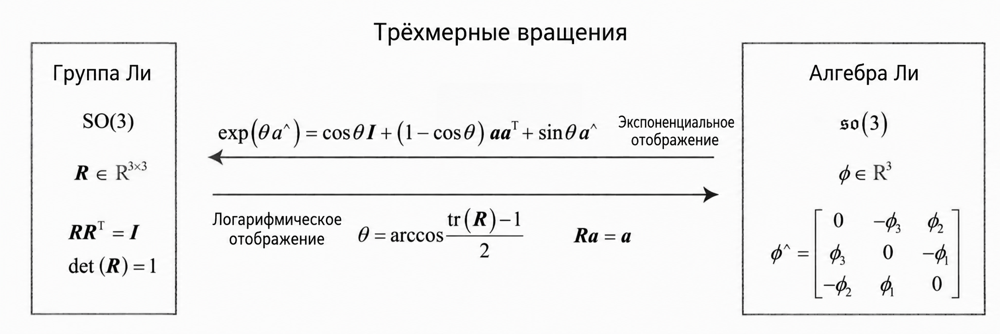

Для матрицы поворота $R$ и соответствующего элемента алгебры $\Phi$ связь записывается так:

$$
R = \exp(\Phi^{\wedge}) = \exp [\Phi]
$$

Здесь символ $[\ ]$ обозначает операцию $\wedge$, то есть преобразование вектора в кососимметричную матрицу (векторное произведение).

Для SO(3) выполняется свойство присоединённого представления:

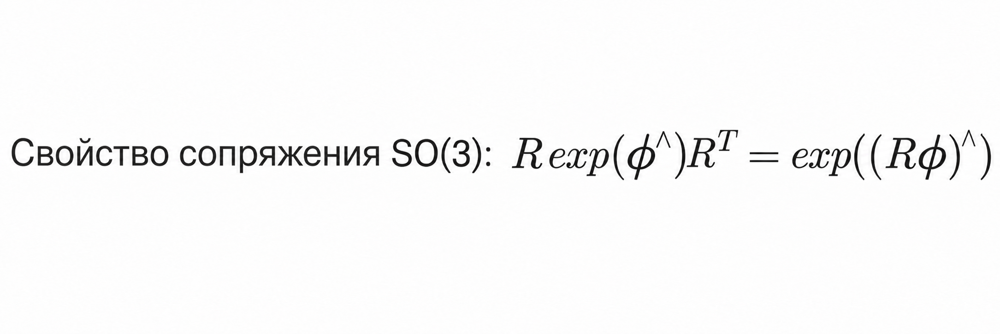

$$
\begin{aligned}
\theta_{A} & =\theta_{X} \theta_{B} \theta_{X}^T \\
\exp [\alpha] & = \theta_{X}\exp [\beta]\theta_{X}^T \\
\exp [\alpha] & = \exp [\theta_{X}\beta] \\
\alpha &= \theta_{X}\beta
\end{aligned}
$$

При нескольких наблюдениях задача сводится к следующей задаче наименьших квадратов:

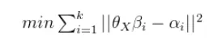

Здесь $\alpha$ и $\beta$ — алгебры Ли соответствующих поворотов; это трёхмерные векторы, которые можно рассматривать как точки в трёхмерном пространстве. Тогда задача эквивалентна задаче регистрации облаков точек:

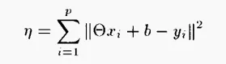

Решение этой задачи в смысле наименьших квадратов:

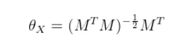

где:

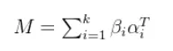

### 6.1.3.2 Метод Парка: нахождение переноса

Найдя матрицу поворота, подставляем её во второе уравнение:

$$
\begin{aligned}
\theta_{A} b_{X}+b_{A} & =\theta_{X} b_{B}+b_{X} \\
\theta_{A} b_{X} - b_{X} & =\theta_{X} b_{B}- b_{A} \\
(\theta_{A} - I)b_{X} & =\theta_{X} b_{B}- b_{A} \\
Cb_{X} &= D
\end{aligned}
$$

Здесь $C$ и $D$ известны. Так как матрица $C$ не обязательно обратима, преобразуем уравнение:

$$
\begin{aligned}
Cb_{X} &= D \\
C^TCb_{X} &= C^TD \\
b_{X} &= (C^TC)^{-1}C^TD
\end{aligned}
$$

Так находится перенос.

При нескольких наблюдениях:

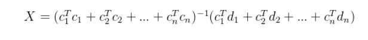

Итоговое решение:

$$
\begin{aligned}
H = \left[\begin{array}{cc}
\theta_{X} & b_{X} \\
0 & 1
\end{array}\right]
\end{aligned}
$$

## 6.1.4 Методы калибровки «рука — глаз» в OpenCV и рекомендации

По принципу работы все алгоритмы калибровки «рука — глаз» делятся на три класса: независимые замкнутые решения, одновременные замкнутые решения и итерационные методы.

> a. **Независимые замкнутые решения (separable closed-form solutions)**: вращение и перенос находятся по отдельности.
>
> Недостаток: ошибка вычисления вращения $R_x$ переходит в вычисление переноса $t_x$.
>
> b. **Одновременные замкнутые решения (simultaneous closed-form solutions)**: вращение и перенос находятся одновременно.
>
> Недостаток: из-за шума найденная матрица вращения $R_x$ может оказаться не ортогональной. Поэтому её необходимо ортогонализировать, но соответствующий перенос при этом не пересчитывается, что приводит к ошибкам.
>
> c. **Итерационные методы (iterative solutions)**: вращение и перенос уточняются итеративно с помощью методов оптимизации.
>
> Недостаток: вычислительные затраты могут быть большими, так как обычно используются сложные процедуры оптимизации. Кроме того, с ростом числа уравнений $n$ разница между итерационным и замкнутым решениями обычно уменьшается. Поэтому перед применением этого метода нужно решить, оправданы ли вычислительные затраты ради точности итерационного решения.

### 6.1.4.1 Интерфейс калибровки «рука — глаз» в OpenCV

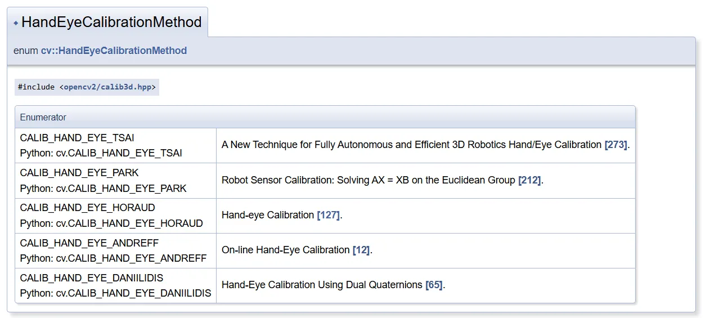

OpenCV реализует в основном первые два класса методов. По умолчанию используется метод TSAI. Методы PARK и HORAUD также относятся к независимым решениям. ANDREFF и DANIILIDIS — одновременные замкнутые решения. По результатам экспериментов на одних и тех же данных считается, что среди независимых решений метод TSAI даёт наибольшую ошибку.

Чтобы получить результат калибровки, нужно собрать несколько наборов калибровочных данных — данные манипулятора и данные определения положения мишени камерой.

### 6.1.4.2 Рекомендации по калибровке

Новичкам при первой калибровке стоит учесть следующее:

1. Функция `calibrateCamera` даёт матрицы $R$ и $t$ от мишени к камере, но её внутренние параметры отличаются от тех, что используются при захвате, что вносит ошибку.
2. Направление углов калибровочной мишени перевёрнуто. По умолчанию нумерация идёт слева направо, но иногда она идёт справа налево, и системы координат оказываются несогласованными.
3. Мишень слишком мала и перемещается только в центре — из-за этого будут неточны края.
4. При калибровке нужно поворачивать мишень.
5. Снимков слишком мало: нужно 10 и более.
6. Некоторые камеры работают некорректно; для RGB-D нужно внимательно проверять матрицу преобразования.

## 6.1.5 Оценка качества калибровки «рука — глаз»

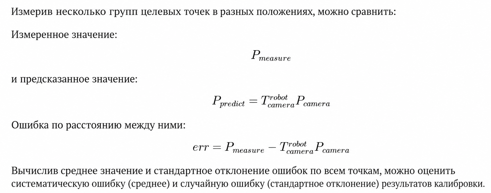

## Литература

1. [Алгоритм калибровки «рука — глаз» Цая — Ленца (A New Technique for Fully Autonomous and Efficient 3D Robotics Hand/Eye Calibration)](https://blog.csdn.net/u010368556/article/details/81585385)
2. [Руководство по калибровке «рука — глаз» для роботов (Mech-Mind)](https://docs.mech-mind.net/1.5/zh-CN/SoftwareSuite/MechVision/CalibrationGuide/CalibrationGuide.html)
3. [Заметки по калибровке, часть 4: подробно о калибровке «рука — глаз»](https://blog.csdn.net/qq_45006390/article/details/121670412)
4. [Camera Calibration and 3D Reconstruction (документация OpenCV)](https://docs.opencv.org/4.10.0/d9/d0c/group__calib3d.html#gad10a5ef12ee3499a0774c7904a801b99)
5. [3D Vision Workshop: калибровка «рука — глаз» (с кодом на OpenCV)](https://blog.csdn.net/z504727099/article/details/115494147)
