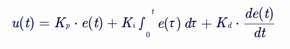
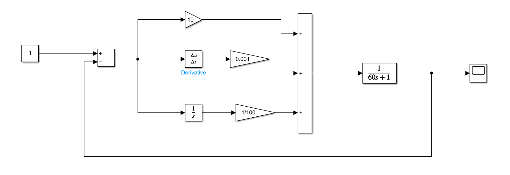
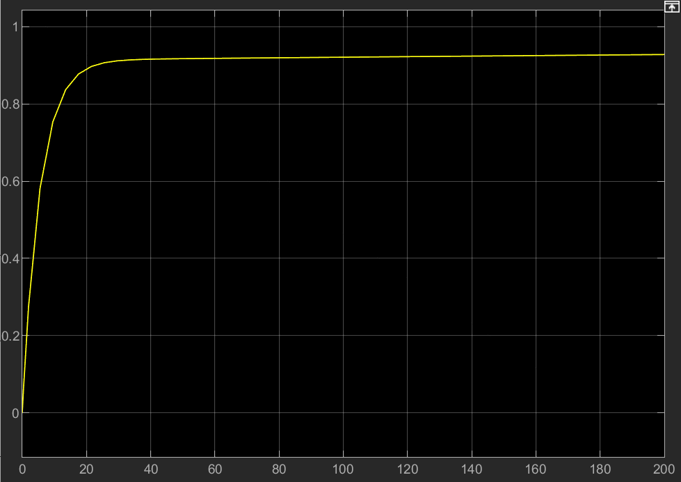
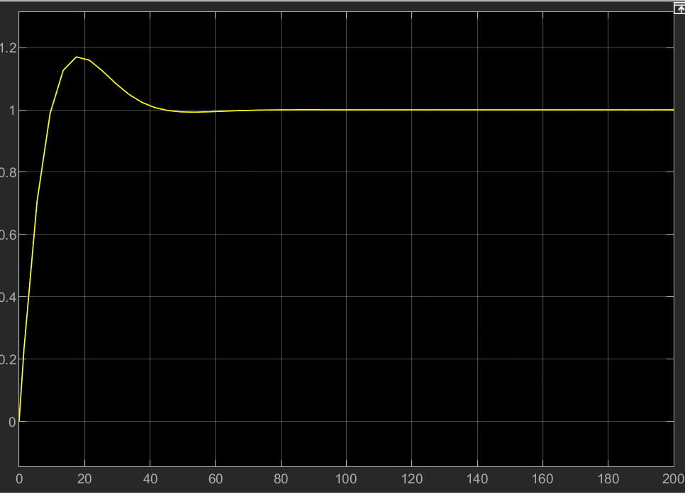
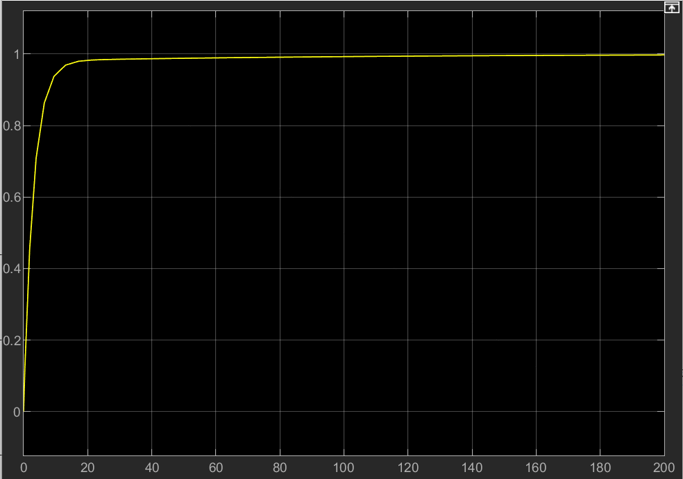
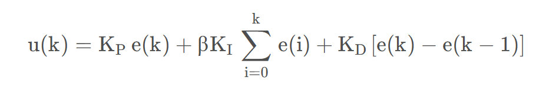
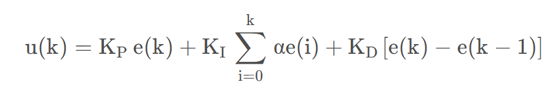
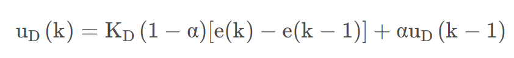

# Дополнение 02. Алгоритм PID-регулирования и его реализация в коде

**Автор**: Jizhiliu Hardware, Лэн Сяомо | **Дата**: 2024-12

## Аннотация

- Алгоритм PID — один из самых распространённых алгоритмов управления в промышленной автоматизации.
- PID вычисляет ошибку между текущим и желаемым выходом и по её пропорциональной (P), интегральной (I) и дифференциальной (D) составляющим корректирует управляющее воздействие, добиваясь точного управления системой.

## Принцип работы

PID-регулятор вычисляет управляющее воздействие по трём базовым составляющим:

- **Пропорциональная (P)**: прямо усиливает ошибку, быстро её уменьшает, но может привести к неустойчивости системы.
- **Интегральная (I)**: интегрирует ошибку, устраняет статическую ошибку системы, но может замедлить её реакцию.
- **Дифференциальная (D)**: прогнозирует тенденцию изменения ошибки по её производной и позволяет заранее корректировать управление, повышая быстродействие и устойчивость системы.

- $e(t)$ — текущая ошибка, то есть разность между желаемым и фактическим выходом.
- $K_p$ — коэффициент пропорциональной составляющей.
- $K_i$ — коэффициент интегральной составляющей.
- $K_d$ — коэффициент дифференциальной составляющей.

## Этапы реализации

1. Вычислить ошибку: разность между текущим и желаемым выходом.
2. Пропорциональная составляющая: умножить ошибку на коэффициент $K_p$.
3. Интегральная составляющая: проинтегрировать ошибку и умножить на $K_i$.
4. Дифференциальная составляющая: вычислить производную ошибки и умножить на $K_d$.
5. Вычислить управляющее воздействие: сложить пропорциональную, интегральную и дифференциальную составляющие.
6. Применить управляющее воздействие к управляемой системе.

Общая формула:



---

## Пример кода (Python)

Ниже — простая реализация PID-регулятора на Python:

> Здесь используется позиционный PID; инкрементальный (приращений) PID и другие варианты можно подставлять в зависимости от задачи — подробнее ниже.

```python
class PID:
    # Инициализация параметров PID
    def __init__(self, Kp, Ki, Kd, setpoint=0, sample_time=0.01):
        self.Kp = Kp
        self.Ki = Ki
        self.Kd = Kd
        self.setpoint = setpoint
        self.sample_time = sample_time

        self.prev_error = 0
        self.integral = 0

    # Расчёт управляющего воздействия
    def update(self, measured_value):
        error = self.setpoint - measured_value  # вычисляем ошибку
        self.integral += error * self.sample_time  # интегрирование
        derivative = (error - self.prev_error) / self.sample_time  # дифференцирование

        output = self.Kp * error + self.Ki * self.integral + self.Kd * derivative  # управляющее воздействие
        self.prev_error = error  # сохраняем ошибку

        return output


pid = PID(Kp=1.0, Ki=0.1, Kd=0.01, setpoint=100)
measured_value = 90  # условное текущее измеренное значение
control_input = pid.update(measured_value)

print(f"Управляющее воздействие: {control_input}")
```

---

## Пример кода (C)

```c
void pid_init(pid_type_def *pid,uint8_t mode,float max_output,float max_iout,const float PID[3])
{

	pid->mode=mode;
	pid->max_output=max_output;
	pid->max_ioutput=max_iout;
	pid->Dbuf[0]=pid->Dbuf[1]=pid->Dbuf[2];
	pid->error[0]=pid->error[1]=pid->error[2]=pid->pout=pid->iout=pid->dout=0.0f;
}

float PID_calc(pid_type_def *pid,float ref,float set,float PID[3])
{
	pid->kp=PID[0];
	pid->ki=PID[1];
	pid->kd=PID[2];

	pid->error[2]=pid->error[1];
	pid->error[1]=pid->error[0];

	pid->set=set;
	pid->cur=ref;

	pid->error[0]=set-ref;

	if (pid->mode ==PID_POSITION)
	{
		pid->pout=pid->kp*pid->error[0];
		pid->iout+=pid->ki*pid->error[0];
		pid->Dbuf[2]=pid->Dbuf[1];
		pid->Dbuf[1]=pid->Dbuf[0];
		pid->Dbuf[0]=pid->error[0]-pid->error[1];
		if (pid->iout>pid->max_ioutput)
		{
			pid->iout=pid->max_ioutput;
		}
		else if (pid->iout<-pid->max_ioutput)
		{
			pid->iout=-pid->max_ioutput;
		}
		if (pid->iout*pid->error[0]<0)
		{
			pid->iout=0;
		}
		if (pid->cur>0.707*pid->set || pid->cur<0.707*pid->set)
		{
				pid->dout=pid->kd*pid->Dbuf[0];
		}
		else
		{
					pid->dout=0;
		}
		pid->output=pid->pout+pid->iout+pid->dout;
		if (pid->output>pid->max_output)
		{
			pid->output=pid->max_output;
		}
	}

	else if (pid->mode==PID_DELTA)
	{
		pid->pout=pid->kp*(pid->error[0]-pid->error[1]);
		pid->iout=pid->ki*pid->error[0];
		if (pid->iout>pid->max_ioutput)
		{
			pid->iout=pid->max_ioutput;
		}
		else if (pid->iout<-pid->max_ioutput)
		{
			pid->iout=-pid->max_ioutput;
		}
		if (pid->iout*pid->error[0]<0)
		{
			pid->iout=0;
		}
		pid->Dbuf[2]=pid->Dbuf[1];
		pid->Dbuf[1]=pid->Dbuf[0];
		pid->Dbuf[0]=pid->error[0]-2.0f*pid->error[1]+pid->error[2];

		if (pid->cur>0.707*pid->set || pid->cur<0.707*pid->set)
		{
				pid->dout=pid->kd*pid->Dbuf[0];
		}
		else
		{
					pid->dout=0;
		}

		pid->output+=pid->pout+pid->iout+pid->dout;

		if (pid->output>pid->max_output)
		{
			pid->output=pid->max_output;
		}
	}

	return pid->output;
}
```

## Практический опыт

- Обычно качество PID-регулирования оценивают по стабильности и характеру отклика на графике.
- Как правило, сначала задают большой коэффициент пропорциональной составляющей, а затем постепенно уменьшают его, пока отклик системы не станет плавным.
- Интегральная составляющая устраняет статическую ошибку, но её добавление замедляет отклик системы.
- Дифференциальная составляющая предсказывает тенденцию изменения ошибки, позволяя заранее корректировать управление и повышая быстродействие и устойчивость.

## Пример анализа (MATLAB-Simulink)

- При P = 10, I = 0.001, D = 0.01 и периоде дискретизации T = 200 получены модель Simulink и график результата.
- Видна статическая ошибка, поэтому нужно увеличить I, чтобы её устранить.
- После увеличения I появляется перерегулирование, поэтому добавляем D.
- Лучший результат показан ниже.






## Оптимизация и другие варианты PID

### Мнемоническое правило для настройки

```
Ищи лучшие параметры — проверяй от малого к большому.
Сначала пропорциональную, потом интегральную,
а дифференциальную добавляй в самом конце.
Колебания частые — пропорциональную увеличь.
Кривая плывёт широкой дугой — пропорциональную уменьши.
Отклик медленный, возврат долгий — интегральное время сократи.
Период волны длинный — интегральное время увеличь.
Колебания быстрые — дифференциальную сначала убавь.
Большие отклонения, медленные волны — дифференциальное время увеличь.
Идеальная кривая — две волны, спад в четыре раза.
Смотри, анализируй, подстраивай — и качество не подведёт.
```

### Дополнительные варианты

Позиционный PID-алгоритм в большинстве случаев обеспечивает устойчивое управление, но в зависимости от сценария применяются и другие оптимизированные варианты.

1. **PID с разделением интегральной составляющей** (integral separation): интегральная составляющая включается только вблизи задания.

   

2. **PID с переменной скоростью интегрирования** (variable-speed integration).

   

3. **PID с неполным дифференцированием** (incomplete differentiation).

   
