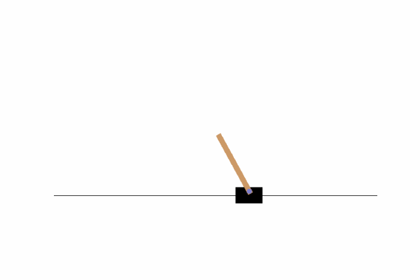
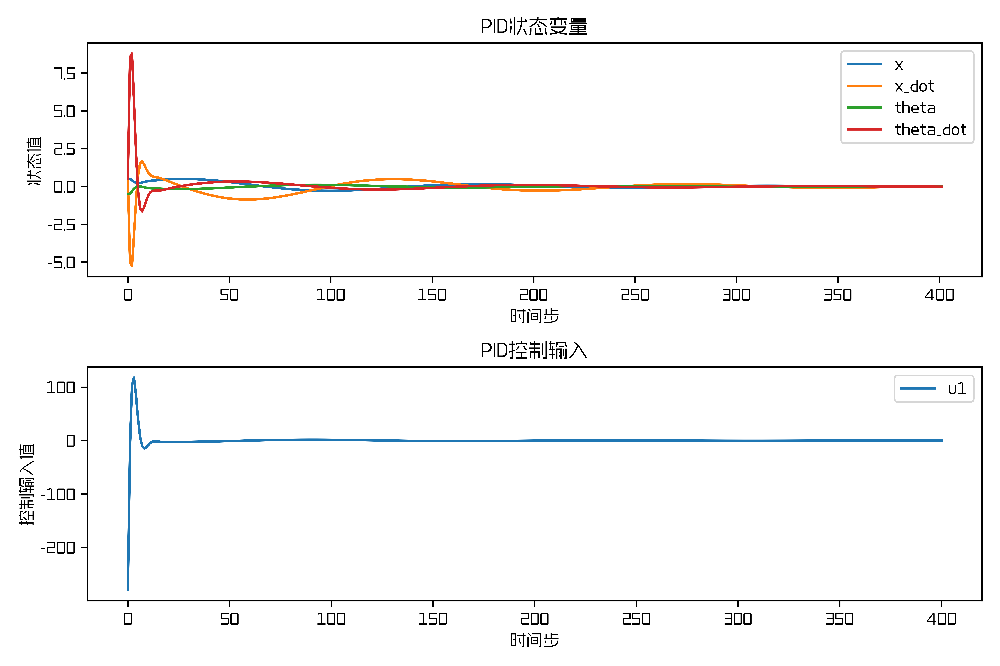
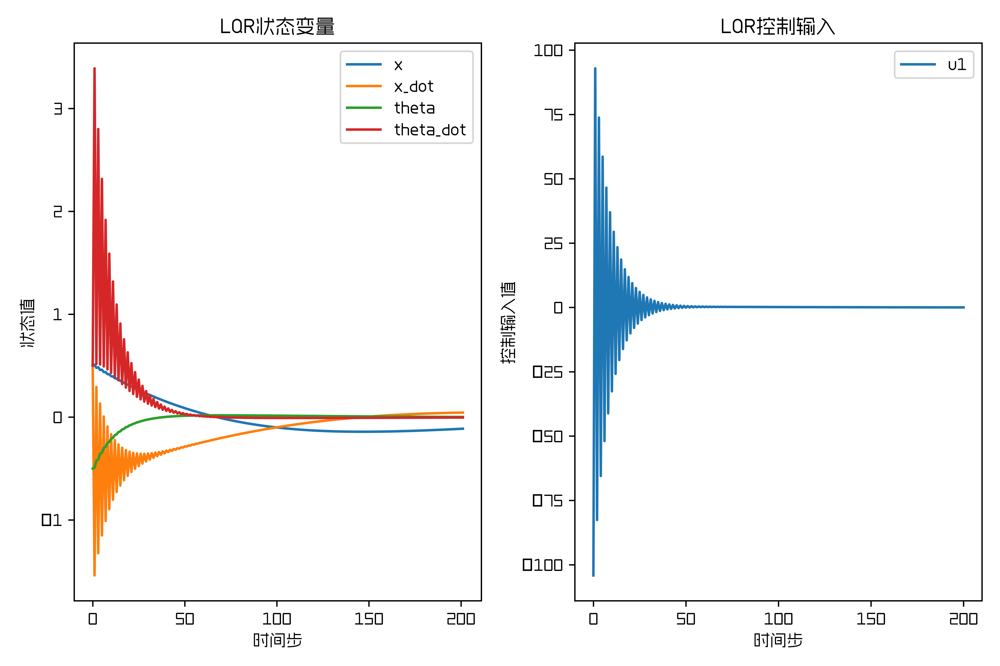
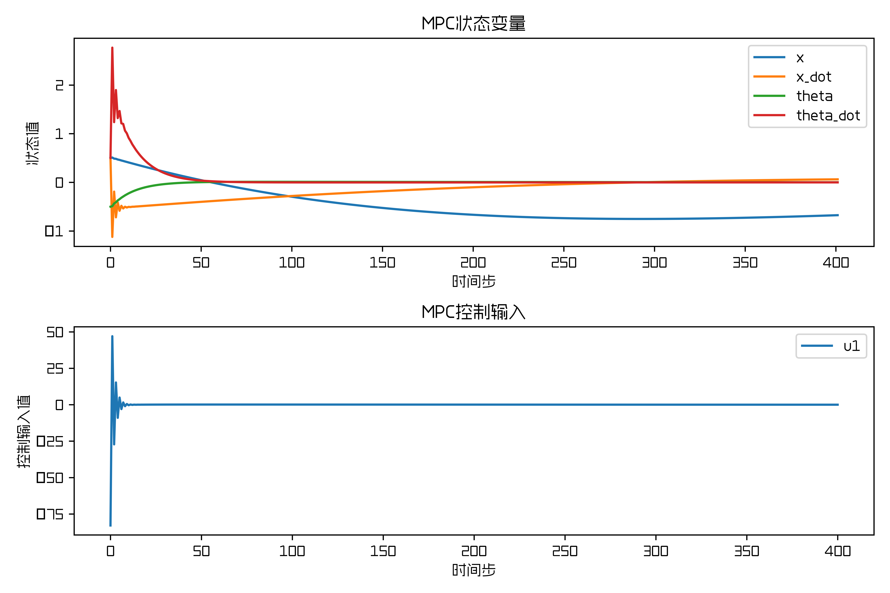

# Моделирование Cartpole и реализация на Python: управление PID, LQR и MPC

### Задача CartPole — удержать стержень вертикально (угол 0) и тележку в центре направляющей (положение 0).

В руководстве не приводится вывод формул. Если хотите разобраться в основах PID, LQR и MPC, изучите их отдельно.

## I. Среда и предварительные знания

1. Windows
2. Матричная теория и теория управления
3. Установка окружения — см. `requirements.txt`

## II. Моделирование Cartpole

Ниже приведён фрагмент официальной динамической модели Cartpole, см. http://incompleteideas.net/sutton/book/code/pole.c

Подробности — в файле `cartpole_env.py` из папки `code`. Во время практики, чтобы применить линейные регуляторы, мы сделали аппроксимацию динамической модели; её описание дано ниже.

```python
# temp = (force + self.polemass_length * theta_dot * theta_dot * sintheta) / self.total_mass
# thetaacc = (self.gravity * sintheta - costheta * temp) / (self.length * (4.0 / 3.0 - self.masspole * costheta * costheta / self.total_mass))
# xacc = temp - self.polemass_length * thetaacc * costheta / self.total_mass
```

В виде формул это выглядит так:

$$
\begin{cases}
\ddot{x}=\frac{F+m_{p} l \dot{\theta}^{2} \sin \theta}{m_{p}+m_{c}}-\frac{m_{p} l \dot{\theta}^{2} \sin \theta}{m_{p}+m_{c}} \\
\ddot{\theta}=\frac{g \sin \theta-\cos \theta \cdot \frac{F+m_{p} l \dot{\theta}^{2} \sin \theta}{m_{p}+m_{c}}}{l\left(\frac{4}{3}-\frac{m_{p} \cos^2 \theta}{m_{p}+m_{c}}\right)}
\end{cases}
$$

Для линейного регулятора угол $\theta$ маятника мал, поэтому его можно аппроксимировать: $\theta \to 0$, $\sin \theta \approx \theta$, $\cos \theta \approx 1$. После такой аппроксимации уравнения принимают вид:

$$
\begin{cases}
\ddot{x}=\left(\frac{1}{m_{p}+m_{c}}+\frac{3 m_{p}}{m_{p}+4 m_{c}}\right) F-\frac{3 m_{p} g}{m_{p}+4 m_{c}} \theta \\
\ddot{\theta}=\frac{3 g\left(m_{p}+m_{c}\right) \theta}{l\left(m_{p}+4 m_{c}\right)}-\frac{3 F}{l\left(m_{p}+4 m_{c}\right)}
\end{cases}
$$

Запишем систему в пространстве состояний:

$$
\left[\begin{array}{c}
\dot{x} \\
\ddot{x} \\
\dot{\theta} \\
\ddot{\theta}
\end{array}\right]=\left[\begin{array}{cccc}
0 & 1 & 0 & 0 \\
0 & 0 & -\frac{3 m_{p} g}{m_{p}+4 m_{c}} & 0 \\
0 & 0 & 0 & 1 \\
0 & 0 & \frac{3 g\left(m_{p}+m_{c}\right)}{l\left(m_{p}+4 m_{c}\right)} & 0
\end{array}\right]\left[\begin{array}{c}
x \\
\dot{x} \\
\theta \\
\dot{\theta}
\end{array}\right]+\left[\begin{array}{c}
0 \\
\frac{1}{m_{p}+m_{c}}+\frac{3 m_{p}}{m_{p}+4 m_{c}} \\
0 \\
-\frac{3}{l\left(m_{p}+4 m_{c}\right)}
\end{array}\right] F
$$

Пространство состояний используется в коде LQR и MPC. Соответствующий код на Python:

```python
A = np.eye(4) + del_t * np.array([[0, 1, 0, 0],
                [0, 0, (-3*m*g)/(m+4*M), 0],
                [0, 0, 0, 1],
                [0, 0, (3*(M+m)*g)/(L*(m+4*M)), 0]])
B = del_t * np.array([[0],
                [(1/(M+m))+((3*m)/(m+4*M))],
                [0],
                [-(3)/(L*(m+4*M))]])
```

## III. Разбор кода

### 1. Регулятор PID

В коде используется только PD-регулирование: отдельно вычисляются отклонения положения тележки и угла стержня, и по ним выполняется PD-регулирование. Ключевой код PD-регулятора:

```python
def pid_cart(self, position):
    bias = position
    d_bias = bias - self.bias_cart_1
    balance = self.kp_cart * bias + self.kd_cart * d_bias
    self.bias_cart_1 = bias
    return balance

def pid_pole(self, angle):
    bias = angle
    d_bias = bias - self.bias_pole_1
    balance = -self.kp_pole * bias - self.kd_pole * d_bias
    self.bias_pole_1 = bias
    return balance
```

### 2. Регулятор LQR

Постановка задачи дискретного LQR:

$$
\begin{array}{l}
\text { S.T. } \quad x(k+1)=A x(k)+B u(k),\\
J=\frac{1}{2} \sum_{k=k_{0}}^{\infty}\left[x^{T}(k) Q x(k)+u^{T}(k) R u(k) + 2x^{T}(k)Nu_{k}\right]
\end{array}
$$

Этапы вычисления дискретного LQR:

1. Решить уравнение для матрицы $S$:

$$
A^{T} S A-S-\left(A^{T} S B+N\right)\left(B^{T} S B+R\right)^{-1}\left(B^{T} S A+N^{T}\right)+Q=0
$$

2. Вычислить матрицу обратной связи $K$:

$$
K=R^{-1}B^{T}P
$$

3. Вычислить управляющее воздействие $u$:

$$
u=-K(x_{now}-x_{des})
$$

В практическом использовании LQR для Cartpole $N$ — весовая матрица перекрёстных членов состояния и управления. В задаче Cartpole перекрёстный член не нужно штрафовать, поэтому $N$ полагают нулевой матрицей.

Ключевой код LQR-регулятора:

```python
def control_output(self, state_des, state_now):
    S = np.matrix(linalg.solve_discrete_are(self.A, self.B, self.Q, self.R))
    K = np.matrix(linalg.inv(self.B.T * S * self.B + self.R) * (self.B.T * S * self.A))
    # print("state_now", state_now)
    # print("state_des", state_des)
    action_list  = -10*np.dot(K, state_now - state_des)
    action = action_list[0,0]
    return action
```

Уравнение Риккати решается функцией `solve_discrete_are` из модуля `linalg`.

### 3. Регулятор MPC

Основные компоненты MPC:

1. **Прогнозная модель**: по текущему состоянию и будущим управляющим воздействиям предсказывает траекторию состояния системы.
2. **Оптимизация на скользящем горизонте**: ищет последовательность управляющих воздействий, при которой критерий качества (функция стоимости) оптимален на горизонте прогноза.
3. **Коррекция по обратной связи**: корректирует прогноз модели по измерениям и на следующем шаге заново прогнозирует и оптимизирует по новому состоянию.

Постановка линейной задачи MPC:

$$
\begin{array}{l}
\text { S.T. } \quad x(k+j+1 \mid k)=A x(k+j \mid k)+B u(k+j \mid k), \quad j=0,1, \ldots, N-1,\\
J=\sum_{j=0}^{N-1}\left[x^{T}(k+j \mid k) Q x(k+j \mid k)+u^{T}(k+j \mid k) R u(k+j \mid k)\right]+x^{T}(k+N \mid k) F x(k+N \mid k)
\end{array}
$$

Здесь:

* $N$ — горизонт прогноза (длина предсказания).
* $x(k+j \mid k)$ — прогноз состояния в момент $k+j$, сделанный в момент $k$.
* $u(k+j \mid k)$ — управляющее воздействие в момент $k+j$, запланированное в момент $k$.
* $Q$ — весовая матрица состояния.
* $R$ — весовая матрица управляющего воздействия.
* $F$ — весовая матрица терминального состояния.

Ключевой код MPC-регулятора:

1) Построение матриц задачи QP: вычисляются матрицы $H$ и $E$ из формулировки QP.

```python
def get_QPMatrix(A, B, Q, R, F, N):
    M = np.vstack([np.eye(n), np.zeros((N*n, n))])
    C = np.zeros(((N+1)*n, N*p))
    temp = np.eye(n)
    for i in range(1,N+1):
        rows = i * n + np.arange(n)
        C[rows,:] = np.hstack([temp @ B, C[rows-n, :-p]])
        temp = A @ temp
        M[rows,:] = temp

    Q_ = np.kron(np.eye(N), Q)
    rows_Q, cols_Q = Q_.shape
    rows_F, cols_F = F.shape
    Q_bar = np.zeros((rows_Q+rows_F, cols_Q+cols_F))
    Q_bar[:rows_Q, :cols_Q] = Q_
    Q_bar[rows_Q:, cols_Q:] = F
    R_bar = np.kron(np.eye(N), R)

    # G = M.T @ Q_bar @ M
    E = C.T @ Q_bar @ M
    H = C.T @ Q_bar @ C + R_bar
    return E, H
```

2) Решение MPC в реальном времени:

CasADi — мощный фреймворк символьных вычислений и автоматического дифференцирования, который часто применяют для задач оптимального управления и нелинейной оптимизации.

```python
def mpc_prediction(x_k, E, H, N, p):
    # Определяем переменные оптимизации
    U = ca.SX.sym('U', N * p)
    # Определяем целевую функцию
    objective = 0.5 * ca.mtimes([U.T, H, U]) + ca.mtimes([U.T, E, x_k])
    qp = {'x': U, 'f': objective}
    opts = {'print_time': False, 'ipopt': {'print_level': 0}}
    solver = ca.nlpsol('solver', 'ipopt', qp, opts)

    # Решаем задачу
    sol = solver()
    # Извлекаем оптимальное решение
    U_k = sol['x'].full().flatten()
    u_k = 10*U_k[:p]  # берём первый элемент результата

    return u_k
```

## IV. Результаты кода

### 1. Результаты PID-управления





### 2. Результаты LQR-управления




### 3. Результаты MPC-управления



