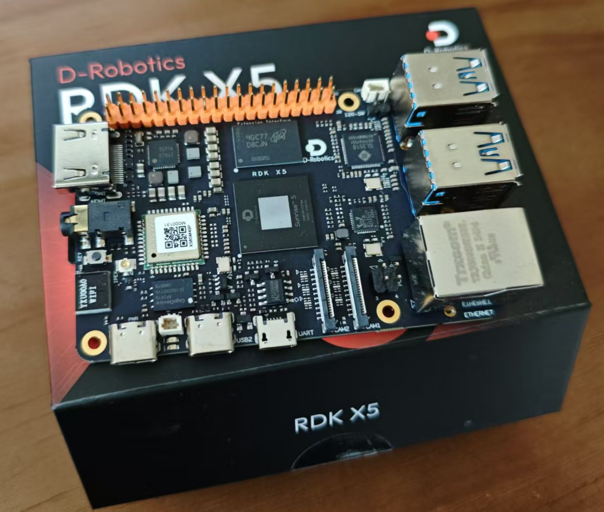
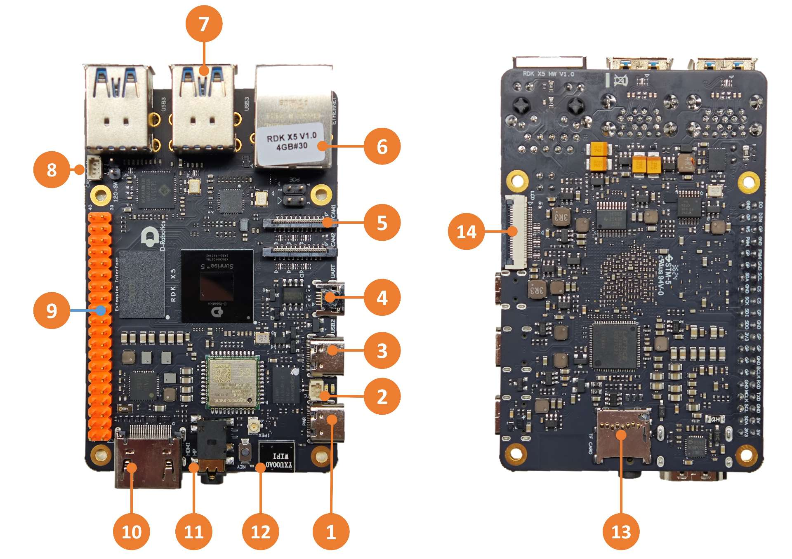
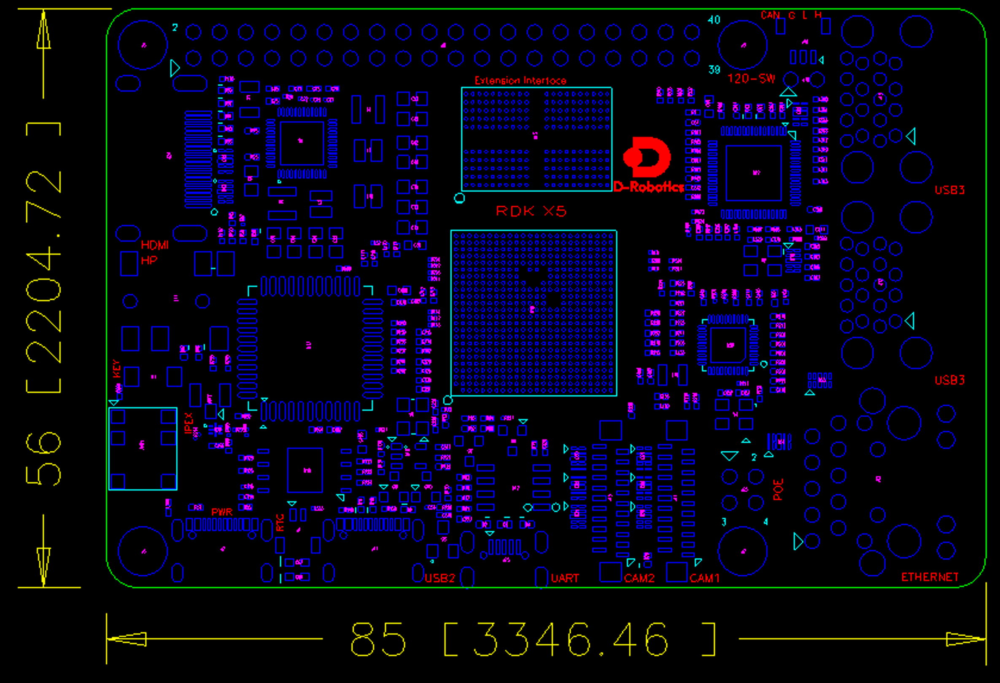
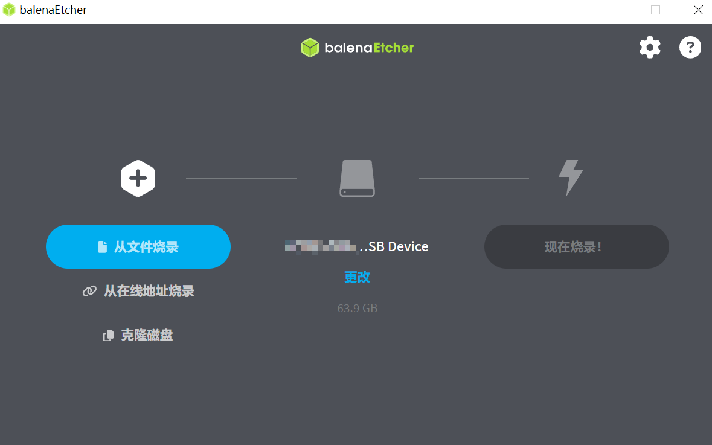
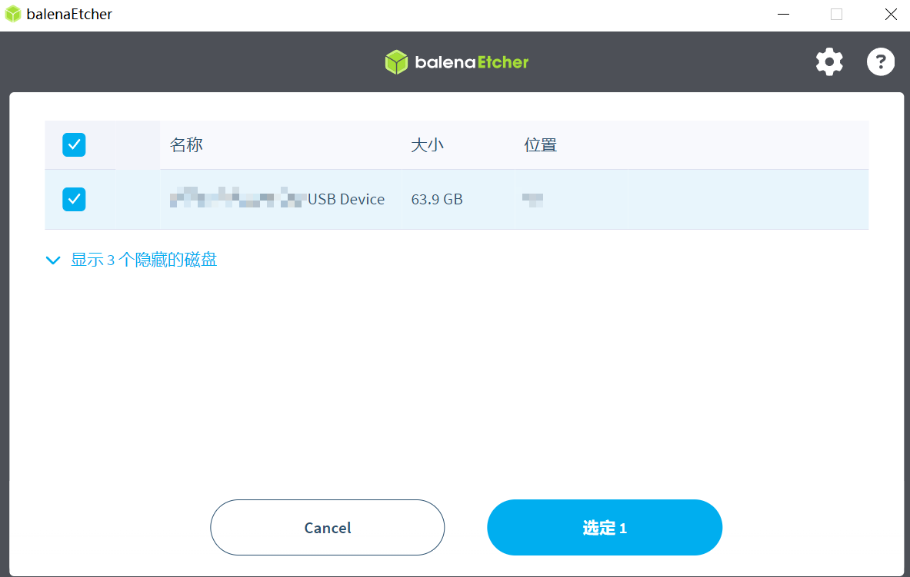
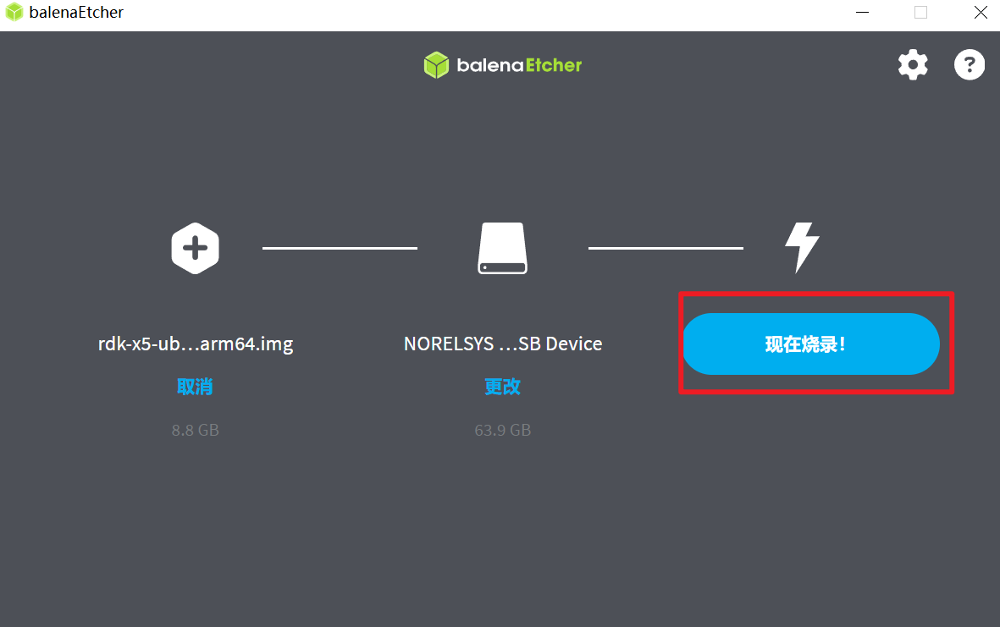
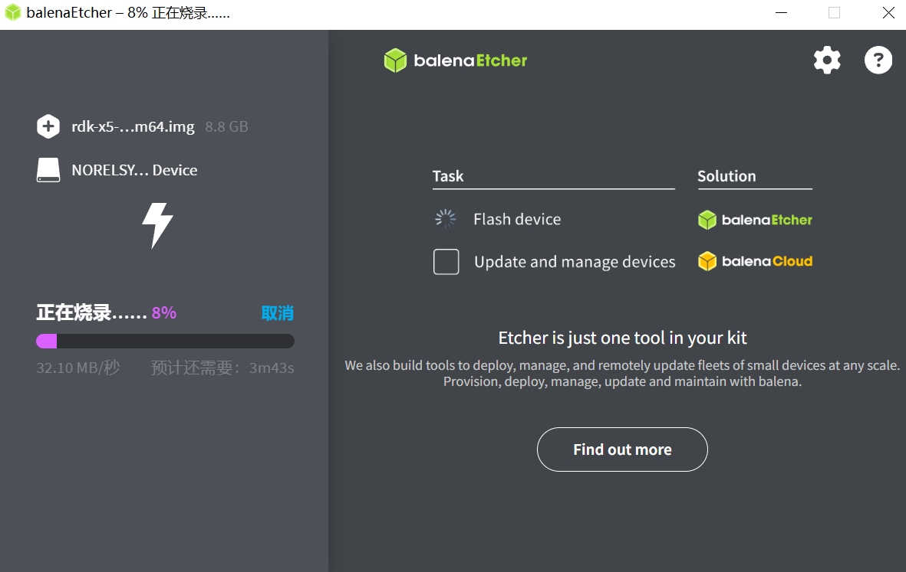
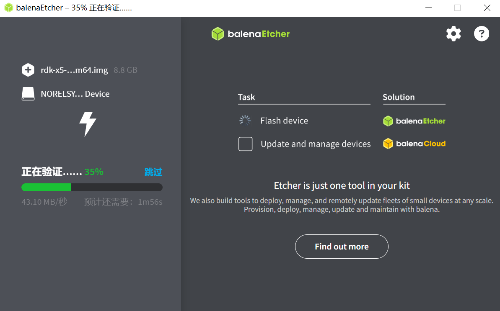
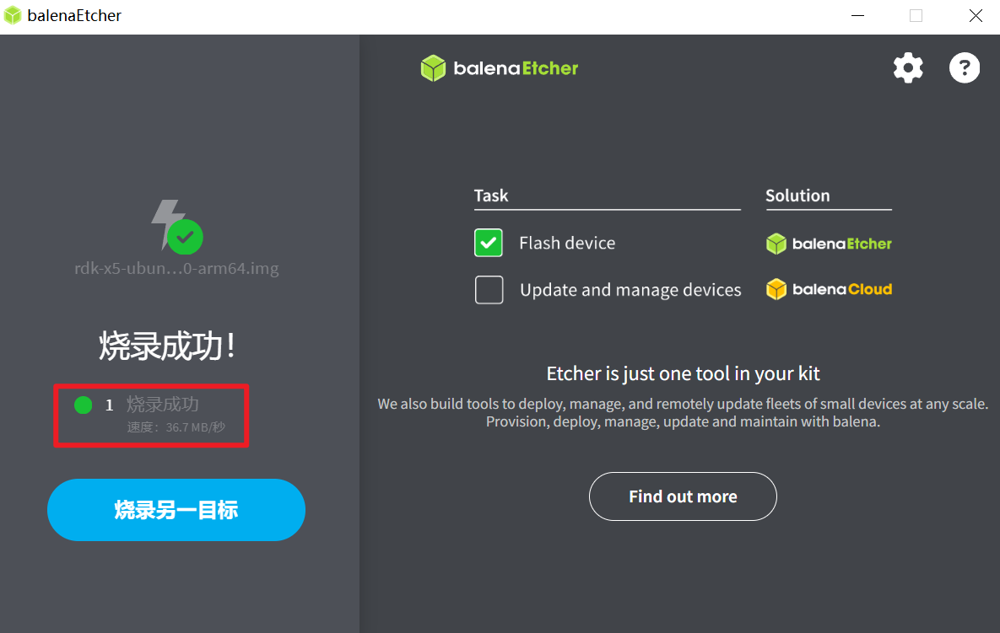

# RDK X5 — руководство для новичков: от записи системы до распознавания объектов YOLO

## Где купить

Первый шаг — **купить плату**! Её можно приобрести на [официальном сайте RDK](https://developer.d-robotics.cc/).

Плата поставляется в аккуратной коробке:

<p align="center">
  
</p>

## Характеристики RDK X5

| Компонент | Параметры |
| --------- | --------- |
| CPU | 8× A55 @ 1,5 ГГц |
| RAM | 4 ГБ / 8 ГБ LPDDR4 |
| BPU | 10 TOPS |
| GPU | 32 GFlops |
| Хранилище | внешняя карта microSD (покупается отдельно) |
| Мультимедиа | H.265 (HEVC) Main Profile @ L5.1, H.264 (AVC) Baseline/Constrained Baseline/Main/High Profiles @ L5.2 с кодированием SVC-T, кодирование и декодирование H.265/H.264 до 3840×2160@60 fps |

RDK X5 имеет сетевой порт, USB, камеры, LCD, HDMI, CAN FD, 40-контактный разъём и другие интерфейсы для разработки и тестирования приложений обработки изображений, мультимедиа и алгоритмов глубокого обучения. Расположение интерфейсов платы:

<p align="center">
  
</p>

| № | Функция | № | Функция | № | Функция |
| - | ------- | - | ------- | - | ------- |
| 1 | Питание (USB Type-C) | 2 | Разъём батареи RTC | 3 | Разъём Easy Connect (USB Type-C) |
| 4 | Отладочный последовательный порт (Micro USB) | 5 | 2 интерфейса камер MIPI | 6 | Гигабитный Ethernet, поддержка PoE |
| 7 | 4 порта USB 3.0 Type-A | 8 | Высокоскоростной интерфейс CAN FD | 9 | 40-контактный разъём |
| 10 | Интерфейс HDMI | 11 | Разъём для наушников (стандарт с совместимостью) | 12 | Встроенная антенна Wi-Fi |
| 13 | Слот TF-карты (нижняя сторона) | 14 | Интерфейс LCD (MIPI DSI) | | |

Механические размеры:

<p align="center">
  
</p>

## Запись системы

### Подготовка к записи

#### Питание

RDK X5 питается через разъём USB Type-C. Используйте блок питания, рассчитанный на **5 В / 3 А**.

> **Примечание.** Не питайте плату от USB-порта компьютера: недостаточная мощность приведёт к **внезапным отключениям и постоянным перезагрузкам**.

#### Хранилище

Плата использует карту microSD как загрузочный носитель. Рекомендуется карта объёмом не менее `8 ГБ`, чтобы хватило места для Ubuntu и прикладного программного обеспечения.

> **Важно.** Не экономьте на карте: дешёвые SD-карты иногда не позволяют системе загрузиться. Ориентируйтесь на цену около 1 юаня за 1 ГБ от известных производителей.

#### Дисплей

RDK X5 поддерживает интерфейс HDMI. Соедините плату с монитором HDMI-кабелем, чтобы работать с графическим рабочим столом.

#### Сетевое подключение

RDK X5 поддерживает Ethernet и Wi-Fi; можно использовать любой из них.

#### Запись системы

Комплект RDK сейчас поставляет образ Ubuntu 22.04 с поддержкой графического рабочего стола Desktop.

> **Примечание.** На модуле **RDK X5 Module** уже записан тестовый образ системы. Чтобы использовать последнюю версию, **рекомендуем записать свежий образ по этому руководству**.

### Загрузка образа

Откройте [страницу загрузки образов](https://archive.d-robotics.cc/downloads/os_images/rdk_x5/), выберите нужную версию и перейдите на страницу загрузки версии 3.1.0.

После загрузки распакуйте образ Ubuntu, например `rdk-x5-ubuntu22-preinstalled-desktop-3.1.0-arm64.img`.

> **Совет.**
> - `desktop` — Ubuntu с рабочим столом: можно подключить экран, мышь и клавиатуру.
> - `server` — Ubuntu без рабочего стола: работа через последовательный порт или удалённо по сети.

### Запись на карту

Перед записью образа Ubuntu подготовьте:

- карту microSD объёмом не менее `8 ГБ`;
- считыватель SD-карт;
- программу записи [balenaEtcher](https://etcher.balena.io/) — кроссплатформенный инструмент для Windows, macOS и Linux. Можно использовать и лёгкую программу [Rufus](https://rufus.ie/zh/).

Порядок создания загрузочной карты:

1. Откройте balenaEtcher, нажмите кнопку `Flash from file` и выберите распакованный образ `rdk-x5-ubuntu22-preinstalled-desktop-3.1.0-arm64.img`.

<p align="center">
  
</p>

2. Нажмите `Select target` и выберите карту microSD в качестве целевого устройства.

<p align="center">
  
</p>

3. Нажмите `Flash!` (`现在烧录` в оригинальной версии интерфейса), чтобы начать запись.

<p align="center">
  
</p>

4. Дождитесь окончания записи и проверки.

<p align="center">
  
  
</p>

5. Когда программа сообщит об успешной записи, закройте balenaEtcher и извлеките карту.

<p align="center">
  
</p>

### Запуск системы

Сначала убедитесь, что плата **выключена**. Вставьте записанную карту в слот microSD, соедините плату с монитором HDMI-кабелем и включите питание.

При первом запуске выполняется начальная настройка, которая занимает около 45 секунд. После неё на мониторе появится рабочий стол Ubuntu:


> **Совет. Индикаторы платы.**
> **Зелёный** индикатор: горит, значит питание подано нормально.
>
> Если на экране долго (более 2 минут) ничего не появляется, плата не запустилась. Для диагностики подключите последовательный кабель и проверьте состояние системы.
>
> Если монитора нет, посмотрите, не горит ли рядом с зелёным индикатором питания оранжевый индикатор — он означает, что система запустилась.

### Частые проблемы

- **Плата не включается**: используйте блок питания, рекомендованный выше, и убедитесь, что на микро-SD записан образ Ubuntu.
- **Горячая замена карты памяти**: RDK X5 не поддерживает горячую замену microSD. Если это случилось по ошибке, перезагрузите плату.

> **Внимание. Правила безопасности**
>
> - **Запрещено** подключать или отключать любые устройства, кроме USB, HDMI и сетевого кабеля, когда плата под напряжением.
> - Порт Type-C на RDK X5 используется **только для питания**.
> - Используйте USB-кабель Type-C известного бренда: иначе возможны сбои питания и внезапные отключения системы.

## Тест YOLO

Этот пример выполняет следующее:

1. Загружает модель обнаружения объектов `yolov5s_672x672_nv12`.
2. Читает статичное изображение `kite.jpg` в качестве входа модели.
3. Анализирует результаты модели и отрисовывает найденные объекты.

### Запуск

Полный код и тестовые данные установлены в каталоге `/app/pydev_demo/07_yolov5_sample/`. Выполните команды:

```shell
cd /app/pydev_demo/07_yolov5_sample/
sudo python3 ./test_yolov5.py
```

После успешного запуска будут выведены результаты обнаружения:

```bash
bbox: [593.949768, 80.819038, 672.215027, 147.131607], score: 0.856997, id: 33, name: kite
bbox: [215.716019, 696.537476, 273.653442, 855.298706], score: 0.852251, id: 0, name: person
bbox: [278.934448, 236.631256, 305.838867, 281.294922], score: 0.834647, id: 33, name: kite
bbox: [115.184196, 615.987, 167.202667, 761.042542], score: 0.781627, id: 0, name: person
bbox: [577.261719, 346.008453, 601.795349, 370.308624], score: 0.705358, id: 33, name: kite
bbox: [1083.22998, 394.714569, 1102.146729, 422.34787], score: 0.673642, id: 33, name: kite
bbox: [80.515938, 511.157104, 107.181572, 564.28363], score: 0.662, id: 0, name: person
bbox: [175.470078, 541.949219, 194.192871, 572.981812], score: 0.623189, id: 0, name: person
bbox: [518.504333, 508.224396, 533.452759, 531.92926], score: 0.597822, id: 0, name: person
bbox: [469.970398, 340.634796, 486.181305, 358.508972], score: 0.5593, id: 33, name: kite
bbox: [32.987705, 512.65033, 57.665741, 554.898804], score: 0.508812, id: 0, name: person
bbox: [345.142609, 486.988464, 358.24762, 504.551331], score: 0.50672, id: 0, name: person
bbox: [530.825439, 513.695679, 555.200256, 536.498352], score: 0.459818, id: 0, name: person
```

Результат отрисовки сохраняется в файл `output_image.jpg`:


## Приложение с камерой

### Сохранение изображения с камеры

Пример `vio_capture` выполняет захват изображения с камеры MIPI и сохраняет его локально в форматах `RAW` и `YUV`. Схема работы примера:


#### Подготовка

- Выключите плату и подключите камеру MIPI.
- Соедините плату с монитором HDMI-кабелем.
- Включите плату и войдите в систему через командную строку.

#### Запуск

Пример поставляется в виде исходного кода. Его нужно собрать командой `make` и затем запустить:

```bash
sunrise@ubuntu:~$ cd /app/cdev_demo/vio_capture/
sunrise@ubuntu:/app/cdev_demo/vio_capture$ sudo make
sunrise@ubuntu:/app/cdev_demo/vio_capture$ sudo ./capture -b 16 -c 10 -h 1080 -w 1920
```

Параметры:

- `-b` — разрядность RAW-изображения (`bit`). Для `IMX219` / `IMX477` / `OV5647` укажите `16`; значение `8` нужно лишь очень немногим сенсорам.
- `-c` — количество сохраняемых кадров.
- `-w` — ширина сохраняемого изображения.
- `-h` — высота сохраняемого изображения.

#### Ожидаемый результат

Если программа работает правильно, в текущем каталоге появятся заданное число файлов: `RAW` — `raw_*.raw`, `YUV` — `yuv_*.yuv`. Пример лога:

```bash
sunrise@ubuntu:/app/cdev_demo/vio_capture$ sudo ./capture -b 16 -c 10 -h 1080 -w 1920
Camera 0:
        i2c_bus: 6
        mipi_host: 0
Camera 1:
        i2c_bus: 4
        mipi_host: 2
Camera 2:
        i2c_bus: 0
        mipi_host: 0
Camera 3:
        i2c_bus: 0
        mipi_host: 0
mipi mclk is not configed.
Searching camera sensor on device: /proc/device-tree/soc/cam/vcon@0 i2c bus: 6 mipi rx phy: 0
INFO: Found sensor name:imx219-30fps on mipi rx csi 0, i2c addr 0x10, config_file:linear_1920x1080_raw10_30fps_2lane.c
2024/12/14 12:38:17.478 !INFO [CamInitParam][0279]Setting VSE channel-0: input_width:1920, input_height:1080, dst_w:1920, dst_h:1080
2024/12/14 12:38:17.479 !INFO [CamInitParam][0279]Setting VSE channel-1: input_width:1920, input_height:1080, dst_w:1920, dst_h:1080
2024/12/14 12:38:17.479 !INFO [vp_vin_init][0041]csi0 ignore mclk ex attr, because mclk is not configed at device tree.
... пропущено ...
capture time :0
temp_ptr.data_size[0]:4147200
capture time :1
temp_ptr.data_size[0]:4147200
capture time :2
temp_ptr.data_size[0]:4147200
capture time :3
temp_ptr.data_size[0]:4147200
capture time :4
temp_ptr.data_size[0]:4147200
... пропущено ...
```

Сохранённые файлы:

```bash
-rw-r--r-- 1 root video 4147200 Dec 14 12:38 raw_0.raw
-rw-r--r-- 1 root video 4147200 Dec 14 12:38 raw_1.raw
-rw-r--r-- 1 root video 4147200 Dec 14 12:38 raw_2.raw
-rw-r--r-- 1 root video 4147200 Dec 14 12:38 raw_3.raw
-rw-r--r-- 1 root video 4147200 Dec 14 12:38 raw_4.raw
-rw-r--r-- 1 root video 4147200 Dec 14 12:38 raw_5.raw
-rw-r--r-- 1 root video 4147200 Dec 14 12:38 raw_6.raw
-rw-r--r-- 1 root video 4147200 Dec 14 12:38 raw_7.raw
-rw-r--r-- 1 root video 4147200 Dec 14 12:38 raw_8.raw
-rw-r--r-- 1 root video 4147200 Dec 14 12:38 raw_9.raw
-rw-r--r-- 1 root video 3110400 Dec 14 12:38 yuv_0.yuv
-rw-r--r-- 1 root video 3110400 Dec 14 12:38 yuv_1.yuv
-rw-r--r-- 1 root video 3110400 Dec 14 12:38 yuv_2.yuv
-rw-r--r-- 1 root video 3110400 Dec 14 12:38 yuv_3.yuv
-rw-r--r-- 1 root video 3110400 Dec 14 12:38 yuv_4.yuv
-rw-r--r-- 1 root video 3110400 Dec 14 12:38 yuv_5.yuv
-rw-r--r-- 1 root video 3110400 Dec 14 12:38 yuv_6.yuv
-rw-r--r-- 1 root video 3110400 Dec 14 12:38 yuv_7.yuv
-rw-r--r-- 1 root video 3110400 Dec 14 12:38 yuv_8.yuv
-rw-r--r-- 1 root video 3110400 Dec 14 12:38 yuv_9.yuv
```

## ROS-приложение

### Описание

Этот пример использует алгоритм обнаружения объектов YOLOv8. Он подписывается на изображения с камеры MIPI, после вывода публикует сообщение с результатами, а через пакет websocket показывает изображение и результаты в браузере на ПК.

Модель обучена на [наборе данных COCO](http://cocodataset.org/) и распознаёт 80 классов объектов: людей, животных, фрукты, транспорт и др.

Репозиторий с кодом: https://github.com/D-Robotics/hobot_dnn

### Шаги

```bash
# Настройка окружения tros.b
source /opt/tros/humble/setup.bash

# Настройка камеры MIPI
export CAM_TYPE=mipi

# Запуск launch-файла
ros2 launch dnn_node_example dnn_node_example.launch.py dnn_example_config_file:=config/yolov8workconfig.json dnn_example_image_width:=640 dnn_example_image_height:=640
```

В терминале появится такой лог:

```bash
[example-3]  model_name: 
[example-3] [WARN] [1734150496.829080954] [dnn_example_node]: model_file_name_: /opt/hobot/model/x5/basic/yolov8_640x640_nv12.bin, task_num: 4
[example-3] [BPU_PLAT]BPU Platform Version(1.3.6)!
[example-3] [HBRT] set log level as 0. version = 3.15.54.0
[example-3] [DNN] Runtime version = 1.23.10_(3.15.54 HBRT)
[example-3] [A][DNN][packed_model.cpp:247][Model](2024-12-14,12:28:16.917.894) [HorizonRT] The model builder version = 1.23.6
[example-3] [WARN] [1734150497.032746099] [dnn_example_node]: Get model name: yolov8n_640x640_nv12 from load model.
[example-3] [WARN] [1734150497.032959099] [dnn_example_node]: Create ai msg publisher with topic_name: hobot_dnn_detection
[example-3] [WARN] [1734150497.046993438] [dnn_example_node]: Create img hbmem_subscription with topic_name: /hbmem_img
[mipi_cam-1] [WARN] [1734150499.038839668] [mipi_cam]: [init]->cap F37 init success.
[mipi_cam-1] 
[mipi_cam-1] [WARN] [1734150499.039121668] [mipi_cam]: Enabling zero-copy
[example-3] [WARN] [1734150499.136643335] [dnn_example_node]: Loaned messages are only safe with const ref subscription callbacks. If you are using any other kind of subscriptions, set the ROS_DISABLE_LOANED_MESSAGES environment variable to 1 (the default).
[hobot_codec_republish-2] [WARN] [1734150499.136643251] [hobot_codec]: Loaned messages are only safe with const ref subscription callbacks. If you are using any other kind of subscriptions, set the ROS_DISABLE_LOANED_MESSAGES environment variable to 1 (the default).
[hobot_codec_republish-2] [WARN] [1734150499.136958250] [HobotVenc]: init_pic_w_: 640, init_pic_h_: 640, alined_pic_w_: 640, alined_pic_h_: 640, aline_w_: 16, aline_h_: 16
[example-3] [WARN] [1734150499.136956459] [dnn_example_node]: Recved img encoding: nv12, h: 640, w: 640, step: 640, index: 0, stamp: 1734150499_136107128, data size: 614400, comm delay [0.8273]ms
[example-3] [WARN] [1734150500.175391091] [dnn_example_node]: Sub img fps: 31.25, Smart fps: 31.25, pre process time ms: 3, infer time ms: 8, post process time ms: 4
[hobot_codec_republish-2] [WARN] [1734150500.259715501] [hobot_codec]: sub nv12 640x640, fps: 34.0136, pub jpeg, fps: 34.0136, comm delay [2.5714]ms, codec delay [4.4857]ms
[example-3] [WARN] [1734150501.195177356] [dnn_example_node]: Sub img fps: 30.36, Smart fps: 30.42, pre process time ms: 1, infer time ms: 7, post process time ms: 4
[hobot_codec_republish-2] [WARN] [1734150501.285234834] [hobot_codec]: sub nv12 640x640, fps: 30.2439, pub jpeg, fps: 30.2439, comm delay [0.0000]ms, codec delay [1.5806]ms
[example-3] [WARN] [1734150502.140048396] [dnn_example_node]: Recved img encoding: nv12, h: 640, w: 640, step: 640, index: 91, stamp: 1734150502_139378439, data size: 614400, comm delay [0.6543]ms
```

Из лога видно, что результаты инференса публикуются в топик `hobot_dnn_detection`, а изображение подписывается из топика `/hbmem_img`.

Откройте в браузере на ПК адрес `http://IP:8000/TogetheROS/`, чтобы увидеть изображение и результаты (IP — адрес RDK в сети).

## Заключение

На этом руководство заканчивается. Продолжайте исследовать возможности платы! 😁
