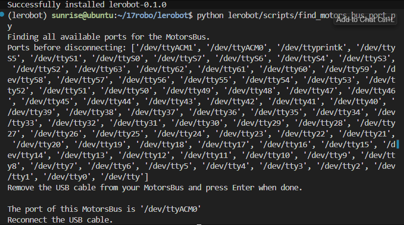
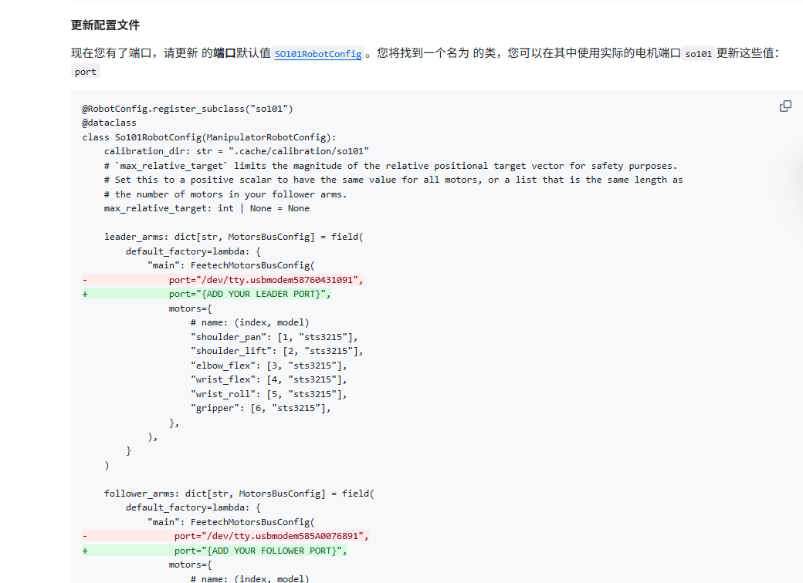
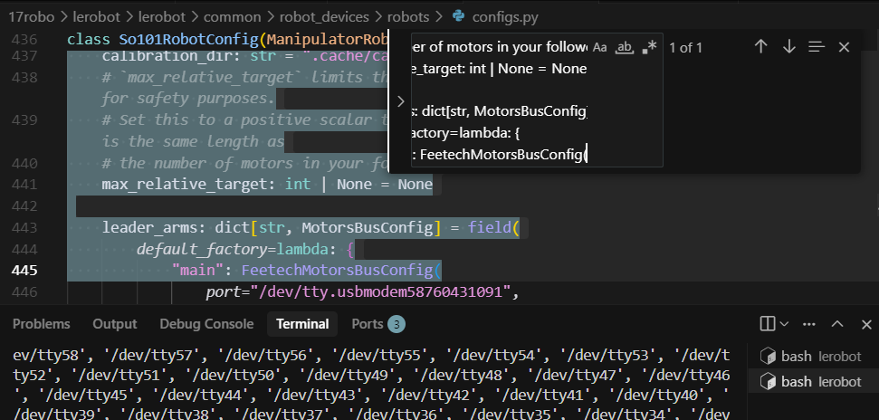
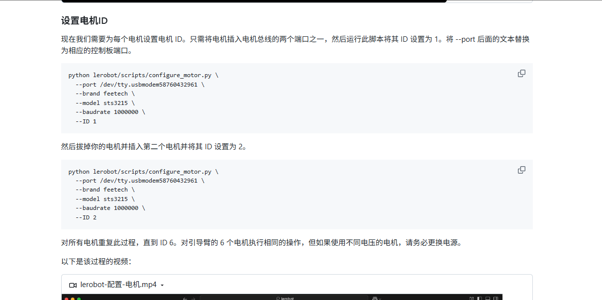
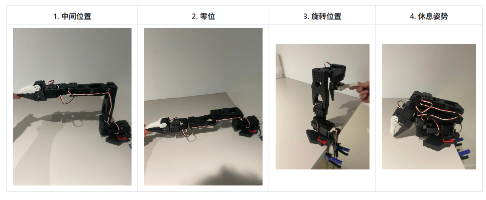
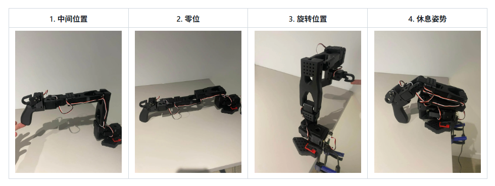

# RDK X5 подключается к манипулятору LeRobot для телеуправления

Подготовьте питание 5 В / 5 А и образ для записи.

Документация по аппаратной части: https://developer.d-robotics.cc/rdk_doc/Quick_start/hardware_introduction/rdk_x5

После записи образа плата готова к работе. Подключите оборудование LeRobot.

Подключение к Wi-Fi:

```bash
nmcli dev wifi                            # посмотреть список сетей
sudo nmcli dev wifi connect xxxxxx password xxxxxx   # имя сети и пароль
```

Установка окружения LeRobot (ARM64):

```bash
# Скачать и распаковать micromamba для ARM64
curl -Ls https://micro.mamba.pm/api/micromamba/linux-aarch64/latest | tar -xvj bin/micromamba
# Инициализировать оболочку
./bin/micromamba shell init -s bash --root-prefix ./micromamba
echo "alias mamba=micromamba" >> ~/.bashrc
source ~/.bashrc
mamba create -y -n lerobot python=3.10
mamba install ffmpeg -c conda-forge
git clone https://github.com/huggingface/lerobot
cd lerobot
git fetch origin
git checkout user/michel-aractingi/2025-06-02-docs-for-hil-serl

pip config set global.index-url https://pypi.tuna.tsinghua.edu.cn/simple
cd lerobot && pip install -e ".[feetech]"
```

Проверка портов подключения манипуляторов:

```bash
sudo chmod 666 /dev/ttyACM0
sudo chmod 666 /dev/ttyACM1
$ python lerobot/scripts/find_motors_bus_port.py
# Скрипт выводит список портов до отключения, затем просит отключить USB-кабель
# от MotorsBus и нажать Enter. Сравните списки портов, чтобы определить порт каждой руки.
# По результатам: ведомая рука — /dev/ttyACM0, ведущая рука — /dev/ttyACM1.
# Затем подключите кабель обратно.
```



Теперь обновите файл с портами:



Проверьте конфигурацию робота:

```bash
ls lerobot/common/robot_devices/robots/configs.py
# В файле должен быть класс So101RobotConfig(ManipulatorRobotConfig) с параметрами
# calibration_dir, max_relative_target, leader_arms и т. д.
```



Если вы купили предустановленную версию, **настраивать ID моторов не нужно**.



Затем выполните выравнивание данных ведущей и ведомой рук:

```bash
python lerobot/scripts/control_robot.py \
  --robot.type=so101 \
  --robot.cameras='{}' \
  --control.type=calibrate \
  --control.arms='["main_follower"]'
```

Достаточно одной команды: она калибрует обе руки. Перемещайте руку в нужное положение и подтверждайте каждый шаг нажатием Enter. Сначала калибруется ведомая рука, затем ведущая.





После этого телеуправление работает:

```bash
python lerobot/scripts/control_robot.py \
  --robot.type=so101 \
  --robot.cameras='{}' \
  --control.type=teleoperate
```
