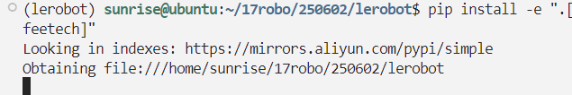
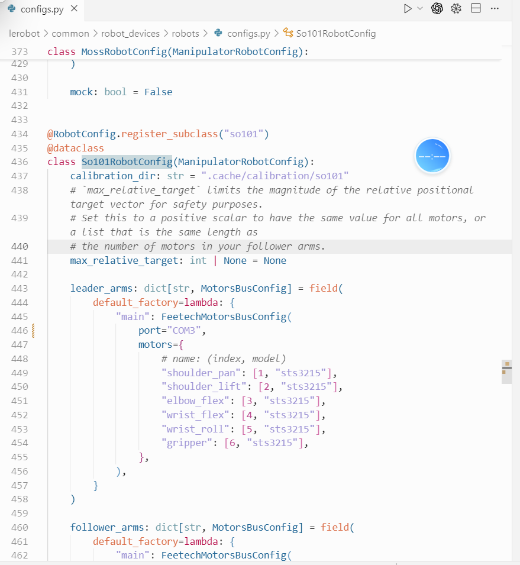
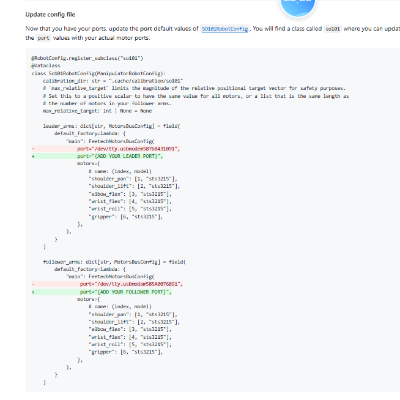
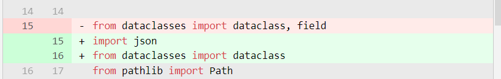

# Система телеуправления LeRobot с двумя руками (ведущая рука на Windows + ведомая рука на Linux)

Этот проект — веб-система дистанционного телеуправления двумя руками SO-101. Ведущая рука (Leader) подключена к компьютеру с Windows, а локальная ведомая рука (Follower) — к серверу на Linux. Система использует официальный драйвер HuggingFace LeRobot и поддерживает определение портов, выбор камер, калибровку через CLI, загрузку данных удалённой ведущей руки и телеуправление через веб-интерфейс.

---

## Содержание

1. [Состав системы и зависимости](#состав-системы-и-зависимости)
2. [Настройка окружения Linux-сервера](#настройка-окружения-linux-сервера)
3. [Настройка окружения ведущей руки на Windows](#настройка-окружения-ведущей-руки-на-windows)
4. [Запуск и работа через веб-интерфейс](#запуск-и-работа-через-веб-интерфейс)
5. [Калибровка](#калибровка)
6. [Загрузка данных удалённой ведущей руки](#загрузка-данных-удалённой-ведущей-руки)
7. [Шаги телеуправления](#шаги-телеуправления)
8. [Используемый API](#используемый-api)
9. [Частые проблемы и диагностика](#частые-проблемы-и-диагностика)

---

## Состав системы и зависимости

| Роль | Содержание |
| ---- | ---------- |
| Linux-сервер | Подключает две ведомые руки SO-101; запускает FastAPI + LeRobot; нужна среда Python (рекомендуется mamba/conda). |
| Компьютер с Windows | Подключает две ведущие руки; запускает скрипты калибровки CLI и загрузки данных; нужны Python 3 и исходный код LeRobot. |
| Сеть | Windows и Linux должны находиться в одной подсети или иметь связь друг с другом; веб-интерфейс доступен по адресу `http://<Linux_IP>:8000`. |
| Камеры | До 3 штук (левая рука / правая рука / голова), чтение через OpenCV. |

> **Важно**: поскольку ведущие руки физически подключены к Windows, при режиме Remote на Windows нужно отдельно настроить окружение LeRobot и запустить скрипты калибровки и отправки данных.

---

## Настройка окружения Linux-сервера

1. **Получите исходный код LeRobot**
   ```bash
   git clone https://github.com/huggingface/lerobot.git /home/sunrise/17robo/250602/lerobot
   pip install -e ".[feetech]"
   # Или используйте уже готовую версию, но она должна совпадать с версией на Windows
   ```

2. **Создайте и активируйте окружение Python** (пример с mamba)
   ```bash
   mamba create -n lerobot-latest python=3.10 -y
   mamba activate lerobot-latest
   pip install -r requirements.txt  # зависимости этого репозитория
   ```

3. **Запустите серверный скрипт**
   ```bash
   cd /home/sunrise/lerobot_bimanual_remote
   export LEROBOT_SRC=/home/sunrise/17robo/250602/lerobot  # измените путь, если он другой
   ./start_server.sh

   # Сначала можно найти номера портов шин, затем изменить конфигурационный файл:
   # python lerobot/scripts/find_motors_bus_port.py
   python lerobot/scripts/control_robot.py \
     --robot.type=so101 \
     --robot.cameras='{}' \
     --control.type=calibrate \
     --control.arms='["main_follower"]'
   ```
   - Скрипт спросит папку калибровки (по умолчанию `.cache/calibration/so101_bimanual`).
   - Скрипт автоматически добавляет `LEROBOT_SRC` в `PYTHONPATH`, чтобы LeRobot импортировался.
   - После запуска в терминале появится адрес для доступа, например `http://192.168.1.100:8000`.

---

## Настройка окружения ведущей руки на Windows

1. Установите Python 3.10 или новее; рекомендуется Anaconda или Miniconda.
2. Клонируйте исходный код LeRobot той же версии, что и на Linux:
   ```powershell
   git clone https://github.com/huggingface/lerobot.git C:\lerobot
   # Можно переключиться: git checkout user/michel-aractingi/2025-06-02-docs-for-hil-serl
   cd C:\lerobot
   pip install -e ".[feetech]"
   ```
3. Подготовьте подключение ведущих рук по реальным последовательным портам (`COM3`, `COM4` и т. д.).
4. Калибровка и скрипты отправки данных выполняются локально на Windows (подробности ниже).

---

## Запуск и работа через веб-интерфейс

1. **Откройте веб-интерфейс**: в любом браузере перейдите по адресу `http://<Linux_IP>:8000`.
2. **Определение портов**:
   - Ведущая рука на Windows: найдите `COMx` в диспетчере устройств или командой PowerShell `Get-WmiObject Win32_SerialPort`.
   - Ведомая рука на Linux: в разделе «🔍 USB Port Detection» веб-интерфейса выполните определение отключением и подключением кабеля.
3. **Ручная настройка**: в разделе «Manual Configuration» введите четыре порта и нажмите `Configure Ports`.
4. **Камеры**: при необходимости нажмите `Scan Cameras`, выберите нужный индекс и нажмите `Configure Cameras`.

В строке состояния отображаются состояние подключения, папка калибровки и источник ведущей руки (Local / Remote).

---

## Калибровка

В системе используется официальная процедура калибровки LeRobot; кнопки веб-интерфейса лишь запускают команды CLI.

1. **Ведомая рука на Linux**:
   - В разделе «Calibration» веб-интерфейса нажмите `CLI: Left Follower` или `CLI: Right Follower`.
   - Сразу переключитесь на терминал, где запущен `start_server.sh`, и следуйте подсказкам: перемещайте руку и подтверждайте Enter (Middle → Zero → Rotated → Rest и т. д.).
   - По завершении в `CALIBRATION_DIR` появятся файлы вида `left_follower.json`, которые автоматически загружаются на шину.

2. **Ведущая рука на Windows (режим Remote)**:

   - В терминале Windows запустите калибровку.
   - Затем потребуется изменить код. После изменения повторно выполнять `pip install` не нужно:
   - 

   

   У нас две ведущие руки: левая — COM3, правая — COM4, поэтому менять конфигурацию нужно дважды.

   Наша конфигурация:

   ***Левая — COM3, правая — COM4***
   ***Ведомые: левая — /dev/ttyACM1, правая — /dev/ttyACM0***

   

   

   Пример изменения в `control_configs.py`:

   ```diff
   # See the License for the specific language governing permissions and
   # limitations under the License.
   - from dataclasses import dataclass, field
   + import json
   + from dataclasses import dataclass
   from pathlib import Path
   import draccus
   @ControlConfig.register_subclass("calibrate")
   @dataclass
   - class CalibrateControlConfig(ControlConfig):
   -     # List of arms to calibrate (e.g. `--arms='["left_follower","right_follower"]' left_leader`)
   -     arms: list[str] | None = field(default=None, metadata={"nargs": "*"})
   class CalibrateControlConfig(ControlConfig):
       # List of arms to calibrate (e.g. `--arms='["left_follower","right_follower"]' left_leader`)
       arms: list[str] | str | None = None
       def __post_init__(self):
           if self.arms is None:
               return
           if isinstance(self.arms, str):
               arm_spec = self.arms.strip()
               if arm_spec.startswith("[") and arm_spec.endswith("]"):
                   try:
                       parsed = json.loads(arm_spec)
                   except json.JSONDecodeError:
                       items = [s.strip().strip('"').strip("'") for s in arm_spec[1:-1].split(",")]
                   else:
                       items = parsed if isinstance(parsed, list) else [parsed]
                   self.arms = [str(item) for item in items if str(item)]
               else:
                   self.arms = [arm_spec]
           else:
               self.arms = list(self.arms)
   @ControlConfig.register_subclass("teleoperate")
   ```

   - После калибровки скопируйте сгенерированный `main_leader.json` в `CALIBRATION_DIR` на Linux-сервере; имя должно соответствовать `left_leader.json` или `right_leader.json`.
   - Если ведущая рука помечена как локальная (не Remote), кнопку можно нажать прямо на Linux.

> **Итог**: пока ведущая рука подключена к Windows, калибровка через CLI на Windows обязательна; иначе ведомая рука не сможет правильно повторять нулевое положение ведущей.

---

## Загрузка данных удалённой ведущей руки

Для телеуправления нужно постоянно передавать текущие углы суставов ведущей руки (в градусах). Обычно это делается так:

1. **Циклическая отправка по HTTP**

   ```python
   import requests

   LINUX_SERVER = "http://192.168.1.100:8000"

   def push_leader(side, positions):
       requests.post(
           f"{LINUX_SERVER}/api/leader/update",
           json={"arm": f"{side}_leader", "positions": positions},
           timeout=1.0,
       )

   # Пример (замените значениями, которые реально читаются с энкодеров)
   push_leader("left", {
       "shoulder_pan": 10.5,
       "shoulder_lift": -20.3,
       "elbow_flex": 45.0,
       "wrist_flex": 5.0,
       "wrist_roll": 0.0,
       "gripper": 20.0,
   })
   ```

2. **Отправка по WebSocket** (подключение к `ws://<Linux_IP>:8000/ws/control`):
   ```json
   {"type": "leader_state", "arm": "left_leader", "positions": {"shoulder_pan": 10.5, ...}}
   ```

В любом случае чтение с ведущей руки должно выполняться синхронно с аппаратной частью. Рекомендуем на стороне Windows опираться на реализацию `control_robot.py --control.type=teleoperate` и получать значение `Present_Position` напрямую.

---

## Шаги телеуправления

1. Выполните калибровку всех четырёх рук (и убедитесь, что файлы калибровки есть в `CALIBRATION_DIR`).
2. На Windows запустите скрипт отправки данных ведущей руки (HTTP или WebSocket).
3. В веб-интерфейсе нажмите `Connect Robot` → `Start Teleoperation`.
4. Когда статус станет «Teleoperation: Active», двигайте ведущую руку — ведомая будет повторять движения; в области видео отображаются три камеры.
5. Для завершения нажмите `Stop Teleoperation`, затем `Disconnect Robot`.

---

## Используемый API

```http
# Камеры
GET  /api/list_cameras              # поиск доступных камер
POST /api/configure/cameras         # задать индексы камер

# Определение порта
POST /api/detect_port/start
POST /api/detect_port/check_unplug
POST /api/detect_port/check_plug
POST /api/detect_port/cancel

# Калибровка
POST /api/calibrate/{arm}           # запустить калибровку CLI (блокирует до завершения)
GET  /api/motor_positions/{arm}     # текущие углы суставов (для отладки)

# Управление роботом
POST /api/connect
POST /api/disconnect
POST /api/teleoperate/start
POST /api/teleoperate/stop
GET  /api/status                    # состояние подключения, калибровки и источника ведущей руки

# Приём данных ведущей руки
POST /api/leader/update             # отправка углов ведущей руки по HTTP
WS   /ws/control                    # WebSocket (teleoperate_step, leader_state, get_state)
```

---

## Частые проблемы и диагностика

| Проблема | Что делать |
| -------- | ---------- |
| `ImportError: No module named lerobot` | Проверьте путь `LEROBOT_SRC` и выполните `export LEROBOT_SRC=/path/to/lerobot` перед запуском `start_server.sh`. |
| Калибровка в веб-интерфейсе не отвечает | В интерфейсе отмечено, что веб-калибровка устарела: используйте кнопки CLI и следуйте подсказкам в терминале. |
| Ведомая рука не повторяет движения ведущей | Проверьте: завершена ли калибровка четырёх рук? Работает ли скрипт отправки данных ведущей руки? Показывает ли `/api/status` источник вроде `Leader Source: Left Remote`? |
| Ошибки передачи данных | Смотрите лог сервера для `/api/leader/update` или ошибок WebSocket; проверьте, что поля JSON `arm` и `positions` заданы верно. |
| Чёрный экран камеры | Проверьте индекс камеры, разрешение и пропускную способность USB; при необходимости включайте только нужные камеры. |
| Отказ в доступе к порту | В Linux выполните `sudo chmod 666 /dev/ttyACM*` или добавьте пользователя в группу dialout; в Windows убедитесь, что порт не занят другой программой. |

Для дальнейшей отладки можно напрямую запускать команды LeRobot CLI (например, `control_robot.py --control.type=teleoperate`) и проверять связь с оборудованием.

---

Выполнив все шаги, вы сможете управлять двумя руками SO-101 через веб-интерфейс: ведущая рука на Windows собирает и передаёт состояние, а ведомая рука на Linux повторяет движения через драйвер LeRobot в реальном времени.
