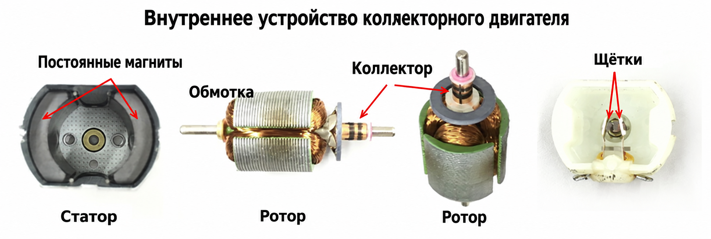
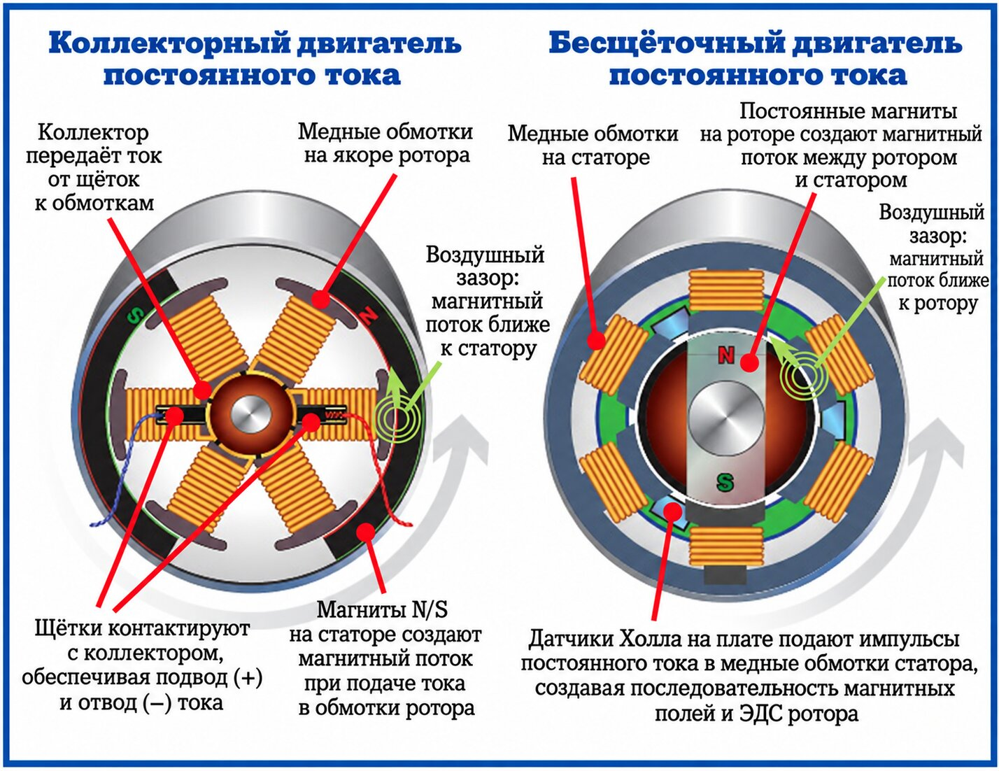
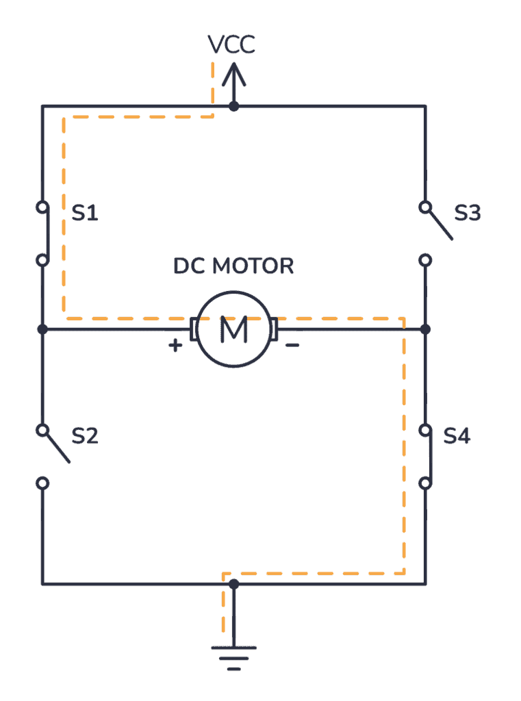
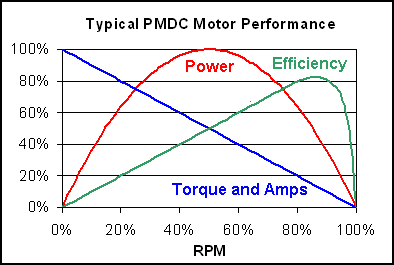
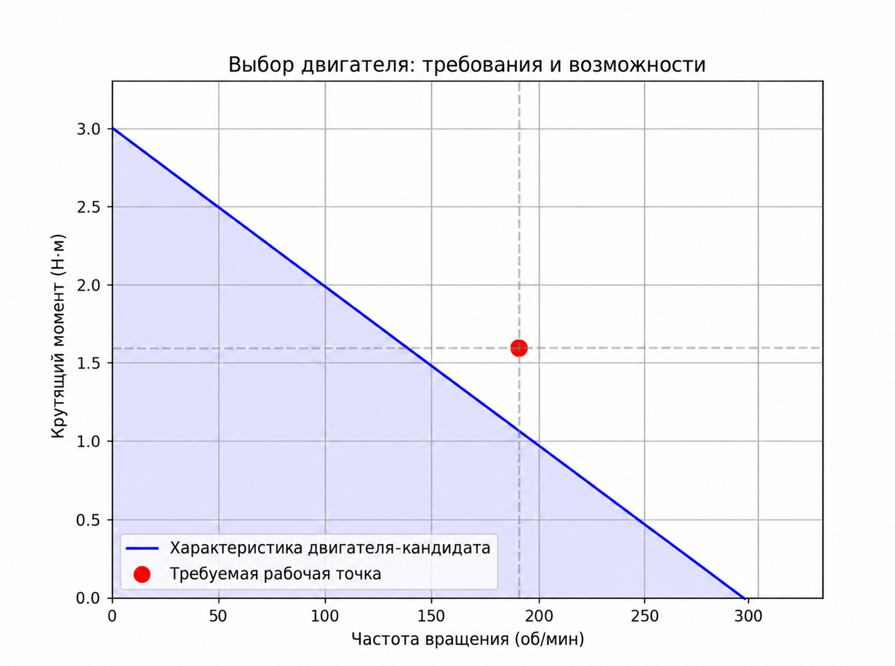

# Исполнительные механизмы робота: принципы, выбор и управление

Исполнительные механизмы (актуаторы) — «мышцы» робота. В этой главе подробно рассказано, как заставить робота двигаться: принципы работы двигателей, схемы управления, передачи и основные методы выбора.

## 1. Классификация двигателей и основные принципы

В робототехнике чаще всего используются три типа двигателей: двигатели постоянного тока (DC), шаговые двигатели (Stepper) и сервоприводы (Servo / PMSM).

### 1.1 Коллекторный двигатель постоянного тока (Brushed DC Motor)
* **Принцип**: щётки и коллектор при физическом контакте меняют направление тока, создавая непрерывное вращение.
* **Плюсы**: простое управление («подал питание — крутится»), низкая стоимость.
* **Минусы**: короткий срок службы из-за износа щёток, искрение, помехи и невысокий КПД.



Рис. 1: внутреннее устройство коллекторного двигателя постоянного тока

### 1.2 Бесщёточный двигатель постоянного тока (BLDC / PMSM)
* **Принцип**: без щёток; переключение обмоток выполняется электронно (ESC). Ротор — постоянный магнит, статор — обмотки.
* **Особенности**: долгий срок службы, низкий уровень шума, высокий КПД, большая удельная мощность.
* **Применение**: квадрокоптеры, высокопроизводительные манипуляторы (например, UR5), мобильные платформы.



Рис. 2: сравнение BLDC и коллекторного двигателя

### 1.3 Шаговый двигатель (Stepper Motor)
* **Принцип**: управляется импульсами; каждый импульс поворачивает вал на фиксированный угол (шаг).
* **Особенности**: точное позиционирование без обратной связи (разомкнутое управление), большой момент на низкой скорости.
* **Минусы**: плохие характеристики на высокой скорости, возможна потеря шагов, сильный резонансный шум.

### 1.4 Таблица сравнения ключевых параметров

| Характеристика | Коллекторный DC | Бесщёточный (BLDC) | Шаговый |
| :--- | :--- | :--- | :--- |
| **Способ управления** | Напряжение / ШИМ | Электронная коммутация (FOC / шестишаговая) | Импульсы (Pulse/Dir) |
| **Срок службы** | Низкий (износ щёток) | Высокий (ресурс подшипников) | Высокий |
| **Высокая скорость** | Средняя | Отличная | Плохая (момент резко падает с ростом скорости) |
| **Стоимость** | Низкая | Высокая | Средняя |
| **Типичное применение** | Игрушки, вентиляторы | Дроны, коллаборативные манипуляторы | 3D-принтеры, подвесы |

---

## 2. Привод и передаточная система

Двигатель обычно нельзя соединять с нагрузкой напрямую: нужны драйвер (усиление сигнала) и редуктор (усиление момента).

### 2.1 Принцип управления двигателем (H-мост и ШИМ)
Выводы GPIO микроконтроллера способны отдавать только слабый ток, поэтому двигатель управляется через H-мост.
* **ШИМ (широтно-импульсная модуляция)**: быстрое переключение питания регулирует среднее напряжение и, значит, скорость.
* **H-мост (H-Bridge)**: переключение четырёх силовых ключей (MOSFET) меняет направление тока, позволяя вращать двигатель вперёд и назад.



Рис. 3: схема H-моста, управляющая вращением двигателя в обоих направлениях

### 2.2 Распространённые передаточные механизмы
* **Планетарный редуктор**: компактный, большое передаточное отношение, соосный выход.
* **Волновой редуктор (гармонический)**: нулевой люфт (backlash), высокая точность, применяется в суставах манипуляторов.
* **Зубчатый ремень**: подходит для передачи на большие расстояния, низкий уровень шума.


------

## 3. Практика выбора двигателя: кривая «момент — скорость»

Новички чаще всего ошибаются именно здесь. **Недостаточно смотреть на номинальную мощность — нужно изучить кривую T-N (момент — скорость).**

### 3.1 Ключевые формулы

$$ P = \tau \cdot \omega $$

- $P$: мощность (Вт)
- $\tau$: крутящий момент (Н·м)
- $\omega$: угловая скорость (рад/с)

### 3.2 Порядок выбора

1. **Определите кинематические параметры**: максимальная скорость $v_{max}$, максимальное ускорение $a_{max}$.
2. **Рассчитайте нагрузочный момент**:
   - **Инерционный момент**: $T_{acc} = J \cdot \alpha$ (нужен при разгоне)
   - **Момент трения**: $T_{fric}$
   - **Момент силы тяжести**: $T_{grav}$ (нужен при подъёме груза)
3. **Коэффициент запаса**: обычно берут запас в 1,5–2 раза.



Рис. 4: кривая «момент — скорость» для двигателя постоянного тока

------

## 4. Практика на Python: калькулятор выбора двигателя

Код ниже вычисляет, какой момент должен развивать двигатель мобильного робота при заданном ускорении и уклоне.

```python
import numpy as np
import matplotlib.pyplot as plt

def motor_sizing_calculator(mass, radius, max_vel, max_acc, slope_deg):
    """
    Вычисляет требуемые параметры двигателя для мобильного робота (пиковый режим)
    """
    g = 9.81
    mu = 0.05

    # 1. Силовой анализ
    F_acc = mass * max_acc
    F_gravity = mass * g * np.sin(np.radians(slope_deg))
    F_friction = mass * g * np.cos(np.radians(slope_deg)) * mu

    Total_Force = F_acc + F_gravity + F_friction

    # 2. Пересчёт на вал двигателя
    Required_Torque = Total_Force * radius

    # 3. Расчёт частоты вращения
    omega = max_vel / radius
    Required_RPM = omega * 60 / (2 * np.pi)

    return Required_Torque, Required_RPM

# --- 1. Расчёт рабочей точки (исходная логика) ---
# Пример: тележка 10 кг, радиус колеса 5 см, скорость 1 м/с, ускорение 1 м/с², уклон 10°
T_req, RPM_req = motor_sizing_calculator(mass=10, radius=0.05, max_vel=1.0, max_acc=1.0, slope_deg=10)

print(f"Требуемая рабочая точка: {T_req:.2f} Н·м @ {RPM_req:.2f} об/мин")

# --- 2. Моделирование характеристики «кандидатного» двигателя (новая часть) ---
# Допустим, выбран двигатель со следующими параметрами:
# Скорость холостого хода (No-load Speed): 300 об/мин
# Момент останова (Stall Torque): 3.0 Н·м
motor_no_load_rpm = 300
motor_stall_torque = 3.0

# Строим кривую двигателя (прямая: T = -k * n + T_stall)
# Характеристика коллекторного DC-двигателя обычно близка к наклонной прямой
rpm_range = np.linspace(0, motor_no_load_rpm, 100)
slope = -motor_stall_torque / motor_no_load_rpm
torque_curve = slope * rpm_range + motor_stall_torque

# --- 3. Построение графика ---
plt.figure(figsize=(8, 6))

# Кривая двигателя (граница возможностей)
plt.plot(rpm_range, torque_curve, 'b-', label='Характеристика двигателя (кандидат)')
# Безопасная область (заливка под кривой)
plt.fill_between(rpm_range, torque_curve, color='blue', alpha=0.1)

# Рабочая точка (нагрузка)
plt.plot(RPM_req, T_req, 'ro', markersize=10, label='Требуемая рабочая точка')

# Вспомогательные линии
plt.axvline(x=RPM_req, color='gray', linestyle='--', alpha=0.5)
plt.axhline(y=T_req, color='gray', linestyle='--', alpha=0.5)

plt.xlim(0, motor_no_load_rpm * 1.1)
plt.ylim(0, motor_stall_torque * 1.1)
plt.xlabel('Скорость (об/мин)')
plt.ylabel('Момент (Н·м)')
plt.title('Выбор двигателя: требование и возможности')
plt.grid(True)
plt.legend()

plt.show()
```



### Как читать результат:

- **Синяя линия**: предельные возможности выбранного двигателя.
- **Красная точка**: самый тяжёлый режим работы тележки.
- **Критерий**: если **красная точка лежит ниже синей линии (в синей заштрихованной области)**, двигатель справится с тележкой. Если точка выше — не хватает момента или скорости, нужен более мощный двигатель.
