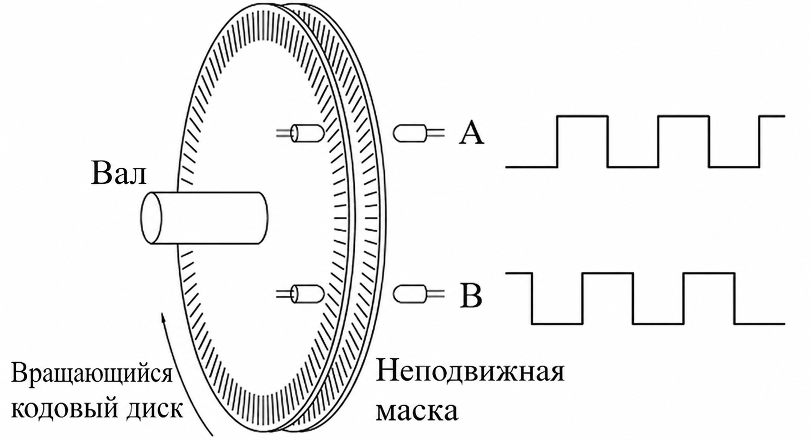
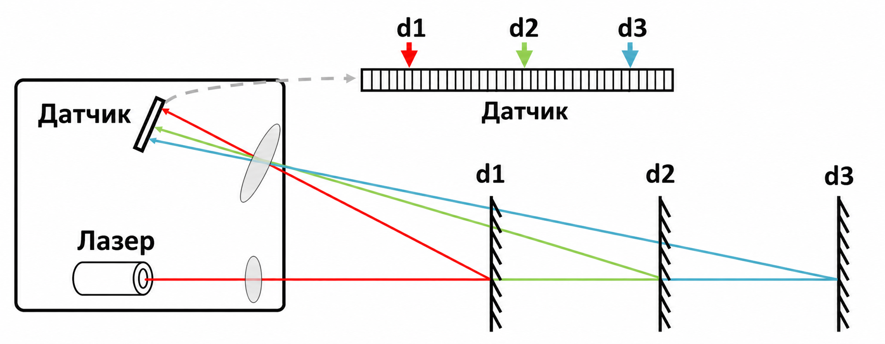
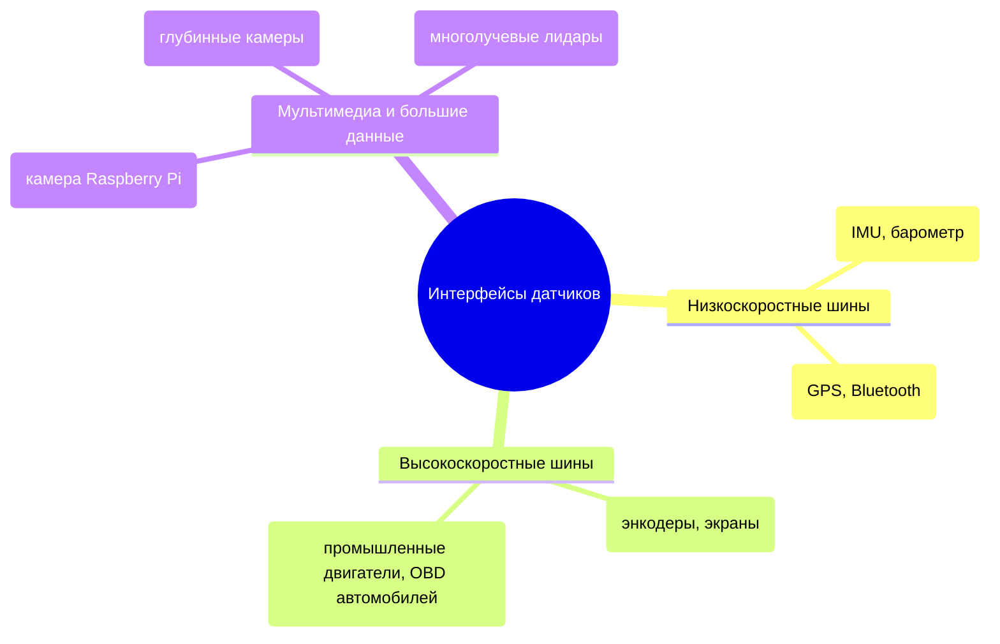
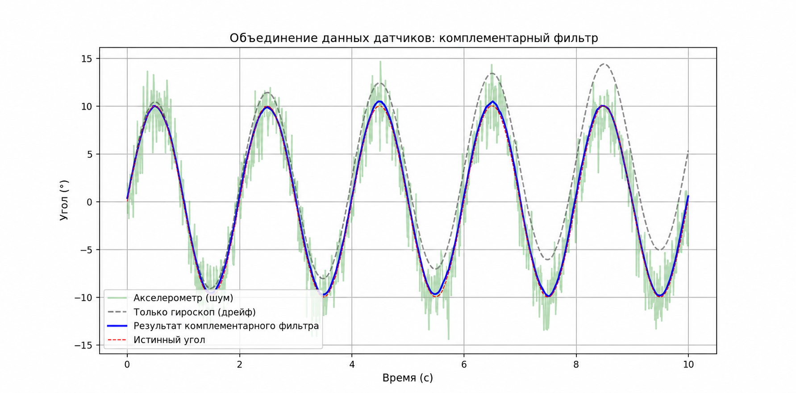

# Датчики: система восприятия робота

Датчики (Sensors) — «органы чувств» робота. В этой главе рассказано, как научить робота «видеть» мир: классификация датчиков, протоколы связи и базовые алгоритмы обработки данных.

## 1. Классификация датчиков

### 1.1 Проприоцептивные датчики (Proprioceptive)
Измеряют состояние самого робота.
* **Энкодер (Encoder)**: измеряет угол поворота и скорость двигателя. Бывают **инкрементальные** (после выключения положение теряется) и **абсолютные** (положение сохраняется при выключении).

* **IMU (инерциальный измерительный блок)**: включает акселерометр (измеряет линейное ускорение и направление гравитации) и гироскоп (измеряет угловую скорость). Это ключевой датчик балансирующих платформ и дронов.

  

Рис. 1: принцип работы оптического энкодера

### 1.2 Экстероцептивные датчики (Exteroceptive)
Измеряют внешнюю среду.
* **Лидар (LiDAR)**:
    * **2D-лидар**: сканирует плоскость и выдаёт облако расстояний. Используется для построения карты SLAM.
    * **3D-лидар**: многолучевое сканирование для автономного вождения.
    * **Принцип**: время пролёта (ToF) или триангуляция.
* **Камера**:
    * **RGB**: обычное цветное изображение.
    * **RGB-D (глубинная камера)**: например RealSense или Kinect. Одновременно выдаёт цвет и расстояние до каждого пикселя.
* **Ультразвук / миллиметровый радар**: для обнаружения препятствий вблизи или работы в дыму.



Рис. 2: принцип триангуляции в лидаре

---

## 2. Аппаратные интерфейсы и протоколы связи

При выборе датчика важно не только его качество, но и соответствие интерфейса плате разработки (например, Raspberry Pi или RDK X5).

| Протокол | Число линий | Скорость | Особенности | Применение |
| :--- | :--- | :--- | :--- | :--- |
| **UART (последовательный порт)** | 2 (TX, RX) | Низкая / средняя | Асинхронный, точка-точка, простой | GPS, Bluetooth-модули, лидары |
| **I2C** | 2 (SDA, SCL) | Средняя | Синхронный, шина, ведущий и ведомые | IMU, датчики температуры и влажности, магнитометры |
| **SPI** | 4 (MOSI, MISO…) | Высокая | Полный дуплекс, высокая скорость | Высокочастотный IMU, цветные экраны |
| **USB** | 4+ | Очень высокая | Универсальность | Камеры, высокопроизводительные лидары |



------

## 3. Обработка сигнала: от шума к истинному значению

Данные датчиков всегда содержат шум. Если использовать сырые данные напрямую, робот может дрожать или потерять управление.

### 3.1 Обработка типичного шума

- **Фильтр низких частот (Low-pass Filter)**: убирает высокочастотную дрожь.
- **Фильтр Калмана (Kalman Filter)**: оптимальная оценка, объединяющая прогноз и измерение.
- **Комплементарный фильтр (Complementary Filter)**: часто используется для расчёта ориентации по IMU (объединяет акселерометр и гироскоп).

### 3.2 Принцип комплементарного фильтра

- **Акселерометр**: хорошо работает на низких частотах (долговременно точен, показывает направление гравитации), но сильно реагирует на высокочастотную вибрацию.
- **Гироскоп**: хорошо работает на высоких частотах (быстрый динамический отклик), но имеет температурный дрейф и при долгом интегрировании уходит в сторону.
- **Формула**: $\theta = \alpha \cdot (\theta + \omega \cdot dt) + (1-\alpha) \cdot \theta_{acc}$

------

## 4. Практика на Python: слияние данных IMU (комплементарный фильтр)

Этот пример генерирует зашумлённые данные датчиков и с помощью комплементарного фильтра получает стабильный угол ориентации.

```python
import numpy as np
import matplotlib.pyplot as plt

def complementary_filter_demo():
    # 1. Моделируем истинный угол (синусоидальное движение)
    t = np.linspace(0, 10, 1000)
    dt = t[1] - t[0]
    true_angle = 10 * np.sin(2 * np.pi * 0.5 * t)  # истинный угол

    # 2. Моделируем показания датчиков (с шумом)
    # Гироскоп измеряет угловую скорость (производную истинного угла) + дрейф + шум
    true_gyro = 10 * 2 * np.pi * 0.5 * np.cos(2 * np.pi * 0.5 * t)
    gyro_reading = true_gyro + 0.5  # моделируем смещение (bias / дрейф)

    # Акселерометр измеряет угол (предполагаем статичность) + сильный высокочастотный шум
    acc_reading = true_angle + np.random.normal(0, 2.0, len(t))

    # 3. Алгоритм комплементарного фильтра
    fused_angle = []
    angle_est = 0.0
    alpha = 0.98  # вес интегрирования гироскопа (0,95–0,99)

    for i in range(len(t)):
        # Интегрирование гироскопа (прогноз)
        gyro_rate = gyro_reading[i]
        angle_pred = angle_est + gyro_rate * dt

        # Измерение акселерометра
        acc_obs = acc_reading[i]

        # Слияние
        angle_est = alpha * angle_pred + (1 - alpha) * acc_obs
        fused_angle.append(angle_est)

    # 4. Сравнительный график
    plt.figure(figsize=(12, 6))
    plt.plot(t, acc_reading, 'g-', alpha=0.3, label='Акселерометр (с шумом)')
    # Чистое интегрирование гироскопа (показывает дрейф)
    gyro_only = np.cumsum(gyro_reading) * dt
    plt.plot(t, gyro_only, 'k--', alpha=0.5, label='Только гироскоп (дрейф)')

    plt.plot(t, fused_angle, 'b-', linewidth=2, label='Результат слияния (комплементарный фильтр)')
    plt.plot(t, true_angle, 'r--', linewidth=1, label='Истинный угол')

    plt.title('Слияние данных датчиков: комплементарный фильтр')
    plt.xlabel('Время (с)')
    plt.ylabel('Угол (град)')
    plt.legend()
    plt.grid(True)
    plt.show()
    print("Фильтрация завершена: обратите внимание, как синяя кривая сочетает «абсолютную позицию» (зелёная) и плавность гироскопа")

if __name__ == "__main__":
    complementary_filter_demo()
```


