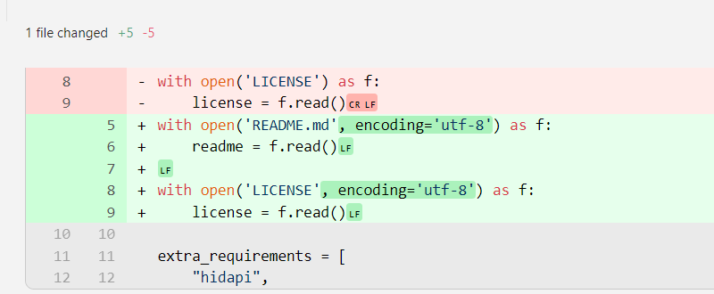

# Дополнение 01. Управление Joy-Con в Robosuite (Windows)

```bash
# Создать окружение conda
conda create -n py310-robosuite python=3.10
conda activate py310-robosuite

# Установить robosuite
git clone https://github.com/box2ai-robotics/robosuite-joycon.git
cd robosuite-joycon
pip3 install -r requirements.txt
pip3 install -r requirements-extra.txt

# Установить joycon-robotics
cd ..
git clone https://github.com/box2ai-robotics/joycon-robotics.git
cd joycon-robotics  # нужно изменить setup.py
pip install -e .
```



```bash
# sudo apt install dkms
# make install

---

cd ..
cd robosuite-joycon
pip install -r robosuite-joycon/requirements-extra.txt

# По умолчанию — управление с клавиатуры
python robosuite/demos/demo_device_control.py

sudo apt install libhidapi-dev
# Один Joy-Con (R)
python robosuite/demos/demo_device_control_joycon_single.py

# Два Joy-Con (двуручный режим)
python robosuite/demos/demo_device_control_joycon_bimanual.py
```

## Схема управления с клавиатуры

### Управление концевым эффектором (захватом) манипулятора

#### Положение (Position)

- Движение вперёд и назад (ось X):
  - ↑ (стрелка вверх): движение по отрицательной оси X (вперёд)
  - ↓ (стрелка вниз): движение по положительной оси X (назад)
- Движение влево и вправо (ось Y):
  - ← (стрелка влево): движение по отрицательной оси Y (влево)
  - → (стрелка вправо): движение по положительной оси Y (вправо)
- Движение вверх и вниз (ось Z):
  - . (точка): движение по отрицательной оси Z (вниз)
  - ; (точка с запятой): движение по положительной оси Z (вверх)

#### Ориентация (Rotation)

- Крен (Roll):
  - e: поворот вокруг положительного направления оси X
  - r: поворот вокруг отрицательного направления оси X
- Тангаж (Pitch):
  - y: поворот вокруг положительного направления оси Y
  - h: поворот вокруг отрицательного направления оси Y
- Рыскание (Yaw):
  - o: поворот вокруг отрицательного направления оси Z
  - p: поворот вокруг положительного направления оси Z

### Управление захватом (Gripper)

- Пробел: переключение состояния захвата. Одно нажатие — захват закрывается, второе — открывается.

### Управление симуляцией и окружением

- Ctrl + q: сброс текущей среды симуляции.
- s: (работает только в средах с несколькими руками) переключение управляемой руки.
- =: (работает только в средах с несколькими роботами) переключение управляемого робота.
- b: (работает только для роботов с мобильной базой) переключение режима «рука / база».

После запуска скрипта убедитесь, что окно симуляции активно: только тогда ввод с клавиатуры будет получен программой.

```bash
sudo snap install bun-js
```

## Поиск и устранение неисправностей

### 1. Не хватает зависимостей

Python-пакет `hid` (он же `hidapi`) не может найти системную библиотеку, которую он вызывает.

Проблема состоит из двух уровней:

1. **Пакет Python (`hid`)**: установлен в окружении `micromamba`. Сам по себе он не общается с устройством, а служит «переводчиком» или «пультом».
2. **Системная библиотека (`libhidapi-*.so`)**: установлена в операционной системе как библиотека на языке C. Именно она отвечает за связь с USB HID-устройствами, например Joy-Con.

Сообщение `Unable to load any of the following libraries: libhidapi-hidraw.so ...` означает, что Python не нашёл «двигатель», с которым может работать.

### **Решение** 🛠️

Нужно установить недостающую библиотеку `hidapi` для вашей операционной системы.

**1. Установите библиотеку разработки `hidapi`**

Имя пакета отличается в разных дистрибутивах Linux. Откройте терминал и выполните:

- **Debian / Ubuntu** (в том числе Ubuntu в WSL):

  ```bash
  sudo apt update
  sudo apt install libhidapi-dev
  ```

  *Версия `-dev` обычно тянет за собой и библиотеки времени выполнения (`libhidapi-hidraw0` и др.), а также заголовочные файлы для сборки. Это самый надёжный вариант.*

- **Arch Linux**:

  ```bash
  sudo pacman -S hidapi
  ```

- **Fedora / CentOS**:

  ```bash
  sudo dnf install hidapi-devel
  ```

**2. (Важно) Настройте правила `udev`**

После установки библиотеки обычно нужно выдать права на устройство Joy-Con. Иначе обычный пользователь не сможет к нему обратиться, и программа не подключится к контроллеру, даже если библиотека найдена.

- **Создайте файл правил udev**: команда даёт всем пользователям права на чтение и запись для всех устройств Nintendo (Vendor ID `057e`):

  ```bash
  echo 'SUBSYSTEM=="hidraw", ATTRS{idVendor}=="057e", MODE="0666"' | sudo tee /etc/udev/rules.d/99-joycon.rules
  ```

- **Перезагрузите правила udev**, чтобы они сразу начали работать:

  ```bash
  sudo udevadm control --reload-rules
  sudo udevadm trigger
  ```

**3. Переподключите Joy-Con** 🎮

Отключите Bluetooth-соединение Joy-Con и подключите его заново, чтобы новые правила udev применились к устройству.

**4. Запустите Python-программу ещё раз**

После этих шагов вернитесь в окружение `micromamba` и снова запустите скрипт. Теперь модуль `hid` должен импортироваться и находить устройство.

```bash
python /home/user/17robo/robosuite-joycon/robosuite/demos/demo_device_control_joycon_bimanual.py
```

### 2. Не установлен mujoco

Установить `mujoco` очень просто: достаточно выполнить `pip` в окружении `py310-robosuite`.

Команда `pip install mujoco` в активном окружении Python установит пакет. По выводу установка прошла успешно.

Дальше нужно вернуться к шагам 2 и 3 решения: найти `mujoco.dll` и скопировать его в нужное место.

Путь к `mujoco.dll` (найден скриптом):

`C:\\Users\\user\\micromamba\envs\py311\Lib\site-packages\mujoco\mujoco.dll`

Файл скопирован в каталог, где его ждёт `robosuite`:

`C:\\Users\\user\\17robo\robosuite-joycon\robosuite\utils\`

Теперь основная проблема с зависимостями должна быть решена. Запустите команду ещё раз:

```powershell
python robosuite/demos/demo_device_control.py
```

Если возникнут другие проблемы, задайте вопрос.
