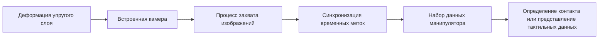

# Дополнение (в работе): подключение визуально-тактильного датчика DTact

DTact через камеру наблюдает деформацию упругой среды и превращает контакт в последовательность изображений, которую можно сохранять и синхронизировать. Такой датчик подходит для обнаружения первого касания, проскальзывания, стабильности захвата и локальной геометрии объекта. Здесь описан способ подключения, совместимый со сбором данных манипулятора, без привязки к конкретной модели.

## Цепочка данных



Тактильные изображения не стоит сохранять отдельно. Каждый кадр должен быть как минимум связан с:

- монотонно возрастающей временной меткой;
- положениями суставов манипулятора и раскрытием захвата;
- номерами задачи, эпизода и кадра;
- силами, моментами или оценкой тока, если они доступны.

## Подготовка окружения

Если программа сбора данных работает на ROS, сначала установите рабочее пространство и инструменты управления зависимостями:

```bash
sudo apt update
sudo apt install -y \
  python3-rosdep \
  python3-rosinstall \
  python3-rosinstall-generator \
  python3-wstool \
  build-essential
```

Эти пакеты отвечают только за сборку и разбор рабочего пространства ROS и не содержат драйверов DTact. Кроме того, нужно установить V4L2 или драйвер производителя для вашей модели камеры.

## Проверка устройства

После подключения датчика сначала убедитесь, что система видит видеоустройство:

```bash
v4l2-ctl --list-devices
```

Выбрав узел устройства, посмотрите поддерживаемые разрешения и частоты кадров:

```bash
export TACTILE_DEVICE=/dev/video2
v4l2-ctl --device "$TACTILE_DEVICE" --list-formats-ext
```

**Контрольная точка 1:** имя видеоустройства, узел и поддерживаемые форматы изображения должны соответствовать реальному датчику. Если после перезагрузки номер устройства меняется, создайте стабильное имя через правило `udev`, а не записывайте `/dev/video2` прямо в программу сбора.

## Калибровка и синхронизация

1. Без контакта снимите фоновое изображение: оно задаёт исходный вид упругого слоя.
2. Используя индентор известной формы, создайте повторяемые касания в нескольких точках и проверьте, что яркость изображения, поле зрения и направление деформации стабильны.
3. В программе сбора запишите монотонные часы на одной временной базе с состоянием суставов.
4. Перед полным эпизодом проведите медленный эксперимент с закрытием захвата и убедитесь, что изменение тактильного изображения и раскрытия захвата происходят синхронно.

**Контрольная точка 2:** при контакте тактильное изображение должно показывать непрерывную деформацию, а после синхронизации состояние суставов не должно отставать систематически больше чем на несколько кадров.

## Интерфейс набора данных

В наборе данных LeRobot тактильное изображение можно задать как отдельный ключ наблюдения, например `observation.images.tactile_left` и `observation.images.tactile_right`. Визуально-тактильная камера и обычная камера — оба потока изображений, но смысл у них разный: обычная камера описывает окружение, тактильная — поверхность контакта. Перед обучением считайте статистику изображений для каждого потока отдельно и не используйте общие параметры нормализации.

## Частые проблемы

- **Мерцание изображения или дрейф цвета:** зафиксируйте экспозицию, усиление и баланс белого, чтобы автоматические настройки не меняли признаки контакта.
- **Изображение в порядке, но не синхронно с действиями:** сначала сравните временные метки захвата, затем проверьте буферы видео и очередь кодирования; не выравнивайте данные по времени сохранения файла.
- **При жёстком контакте область деформации слишком мала:** проверьте жёсткость упругого слоя, фокусное расстояние объектива и конструкцию подсветки; не компенсируйте проблему изображения увеличением силы захвата.

Общий подход к выбору датчиков описан в разделе [Датчики и сбор данных](./06-sensor-selection-and-data-acquisition.md).
