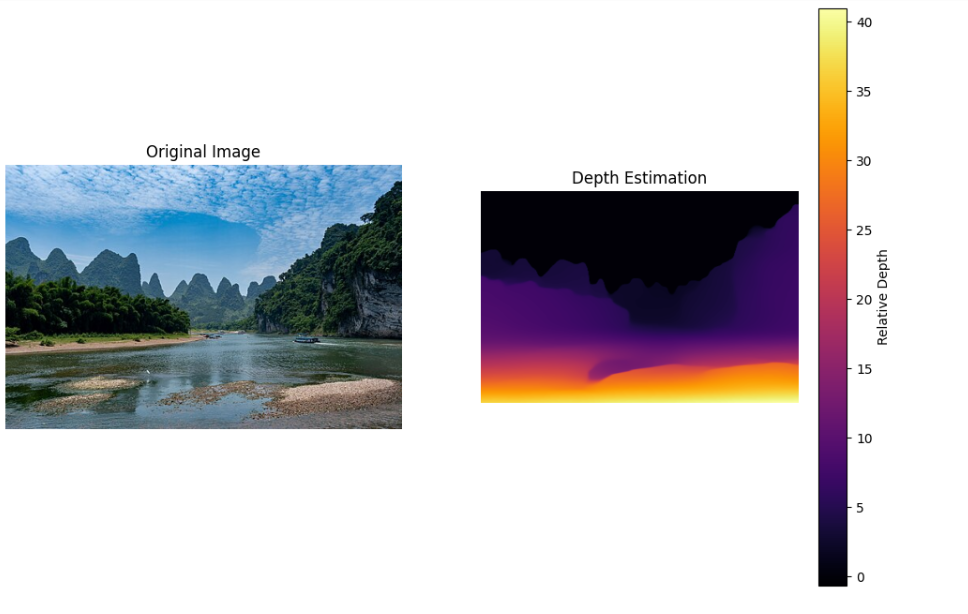

# 01. SAM и оценка глубины по одному кадру: от двумерного восприятия к трёхмерному пониманию

В сценариях воплощённого ИИ роботу недостаточно просто «увидеть» предмет (сегментацию): ему нужно знать, **где** этот предмет находится (глубину). В этой главе мы объединяем **Segment Anything Model (SAM)** от Meta и **оценку глубины по одному изображению (Monocular Depth Estimation)**, чтобы получить трёхмерное семантическое восприятие сцены.

---

## 1. Зачем объединять SAM и оценку глубины?

Сама по себе сегментация или карта глубины ограничены в задачах взаимодействия робота с миром. Их объединение — ключ к **трёхмерному восприятию объектов (3D Object Awareness)**.

### 1.1 Сравнение возможностей

| Модальность | Что видно | Что может извлечь робот | Ограничения |
| :--- | :--- | :--- | :--- |
| **Только SAM (сегментация)** | Чёткий контур предмета | «Здесь есть кружка» (2D-область) | **Нет информации о расстоянии.** Робот не знает, стоит ли кружка у края стола или в другом конце комнаты, и не может спланировать путь захвата. |
| **Только глубина** | Размытая цветовая тепловая карта | «Эта область находится близко ко мне» | **Нет понятия «объект».** Границы на карте глубины размыты, робот с трудом отличает кружку от стола и легко промахивается при захвате. |
| **SAM + глубина** | **Контур + расстояние** | **«Эта чёткая кружка, её центр в 0,8 м от меня»** | **Взаимное дополнение.** SAM даёт точные границы (исправляет размытые края карты глубины), карта глубины — пространственное положение. |

### 1.2 Метрики оценки

В академических исследованиях и при внедрении обычно смотрят на такие показатели:

1. **Качество сегментации (Segmentation Quality)**:
    * **mIoU (mean Intersection over Union)**: у SAM (ViT-H) обычно выше **90 %** по IoU, то есть его маски очень точно повторяют контуры реальных предметов.
2. **Точность глубины (Depth Accuracy)**:
    * **RMSE (среднеквадратичная ошибка)**: показывает отклонение предсказанной глубины от истинной.
    * **AbsRel (абсолютная относительная ошибка)**: чем ниже, тем лучше.
    * *Важно*: монокулярная оценка глубины обычно выдаёт **относительную глубину** (например, значения от 0 до 1). На практике её нужно привести к реальному масштабу (метрам) с помощью параметров камеры или известной опорной точки.

---

## 2. Интерактивная практика: сегментация по клику и измерение расстояния

Чтобы наглядно увидеть эффект «указал — получил», мы подготовили интерактивный скрипт.

**Функции**: загрузить изображение → кликнуть по предмету → в реальном времени получить маску → по карте глубины вычислить среднее расстояние до предмета.

### 2.1 Код скрипта (`interactive_sam_depth.py`)

Сначала выполните настройку окружения из пункта 4.

Создайте новый файл `interactive_sam_depth.py` и запустите его:

```python
import numpy as np
import torch
import cv2
import matplotlib.pyplot as plt
from segment_anything import sam_model_registry, SamPredictor
from transformers import DPTImageProcessor, DPTForDepthEstimation
from PIL import Image
import os

# --- Настройки ---
# Убедитесь, что загружен файл весов: sam_vit_h_4b8939.pth
SAM_CHECKPOINT = "sam_vit_h_4b8939.pth"
MODEL_TYPE = "vit_h"
DEPTH_MODEL_NAME = "Intel/dpt-large"
IMAGE_PATH = "test_image.jpg"  # замените на путь к вашему изображению

device = "cuda" if torch.cuda.is_available() else "cpu"
print(f"Устройство: {device}")

# --- 1. Загрузка моделей ---
print("Загрузка модели глубины...")
depth_processor = DPTImageProcessor.from_pretrained(DEPTH_MODEL_NAME)
depth_model = DPTForDepthEstimation.from_pretrained(DEPTH_MODEL_NAME).to(device)
depth_model.eval()

print("Загрузка модели SAM...")
if not os.path.exists(SAM_CHECKPOINT):
    raise FileNotFoundError(f"Файл весов SAM не найден: {SAM_CHECKPOINT}. Сначала скачайте его.")
sam = sam_model_registry[MODEL_TYPE](checkpoint=SAM_CHECKPOINT)
sam.to(device=device)
predictor = SamPredictor(sam)

# --- 2. Основная функция обработки ---
def get_depth_map(image_pil):
    """Строит относительную карту глубины для всего кадра"""
    inputs = depth_processor(images=image_pil, return_tensors="pt").to(device)
    with torch.no_grad():
        outputs = depth_model(**inputs)
        predicted_depth = outputs.predicted_depth

    # Интерполяция к размеру исходного изображения
    prediction = torch.nn.functional.interpolate(
        predicted_depth.unsqueeze(1),
        size=image_pil.size[::-1],
        mode="bicubic",
        align_corners=False,
    )
    return prediction.squeeze().cpu().numpy()

# --- 3. Логика интерактивного режима ---
def interactive_demo():
    # Читаем изображение
    if not os.path.exists(IMAGE_PATH):
        print(f"Ошибка: изображение {IMAGE_PATH} не найдено.")
        return

    image_cv = cv2.imread(IMAGE_PATH)
    image_cv = cv2.resize(image_cv, (1024, int(1024 * image_cv.shape[0] / image_cv.shape[1])))  # уменьшаем, чтобы помещалось на экран
    image_rgb = cv2.cvtColor(image_cv, cv2.COLOR_BGR2RGB)
    image_pil = Image.fromarray(image_rgb)

    # Предварительно вычисляем карту глубины
    print("Вычисление карты глубины...")
    depth_map = get_depth_map(image_pil)

    # Инициализируем SAM
    print("Подготовка изображения для SAM...")
    predictor.set_image(image_rgb)

    # Переменные состояния
    input_point = []
    input_label = []
    current_mask = None

    print("\n--- Инструкция ---")
    print("Левая кнопка: выбрать объект (передний план)")
    print("Правая кнопка: исключить область (фон)")
    print("Клавиша R: сбросить выбор")
    print("Клавиша Q: выход")

    def mouse_callback(event, x, y, flags, param):
        nonlocal input_point, input_label, current_mask

        if event == cv2.EVENT_LBUTTONDOWN:
            input_point.append([x, y])
            input_label.append(1)  # 1 — передний план
        elif event == cv2.EVENT_RBUTTONDOWN:
            input_point.append([x, y])
            input_label.append(0)  # 0 — фон
        else:
            return

        # Вызываем предсказание SAM
        masks, scores, _ = predictor.predict(
            point_coords=np.array(input_point),
            point_labels=np.array(input_label),
            multimask_output=False
        )
        current_mask = masks[0]

        # Вычисляем статистику глубины
        # Берём значения глубины внутри маски
        masked_depth = depth_map[current_mask]
        if masked_depth.size > 0:
            avg_depth = np.mean(masked_depth)
            print(f"Глубина объекта -> среднее: {avg_depth:.4f} (оценка: {scores[0]:.3f})")

    cv2.namedWindow("SAM + Depth Interaction", cv2.WINDOW_NORMAL)
    cv2.setMouseCallback("SAM + Depth Interaction", mouse_callback)

    while True:
        display_img = image_cv.copy()

        # Рисуем точки клика
        for pt, label in zip(input_point, input_label):
            color = (0, 255, 0) if label == 1 else (0, 0, 255)
            cv2.circle(display_img, tuple(pt), 5, color, -1)

        # Накладываем маску
        if current_mask is not None:
            # Создаём полупрозрачную красную маску
            colored_mask = np.zeros_like(display_img)
            colored_mask[current_mask] = [0, 0, 255]  # формат BGR
            display_img = cv2.addWeighted(display_img, 1, colored_mask, 0.5, 0)

            # Рисуем контур
            contours, _ = cv2.findContours(current_mask.astype(np.uint8), cv2.RETR_EXTERNAL, cv2.CHAIN_APPROX_SIMPLE)
            cv2.drawContours(display_img, contours, -1, (255, 255, 255), 2)

        cv2.imshow("SAM + Depth Interaction", display_img)

        key = cv2.waitKey(50) & 0xFF
        if key == ord('q'):
            break
        elif key == ord('r'):
            input_point = []
            input_label = []
            current_mask = None
            print("Сброс.")

    cv2.destroyAllWindows()

if __name__ == "__main__":
    interactive_demo()
```

---

## 3. Принципы работы

### 3.1 Segment Anything Model (SAM)

SAM — «швейцарский нож» компьютерного зрения.

* **Кодировщик изображения (Image Encoder)**: построен на ViT-H (Vision Transformer Huge) и извлекает глубокие признаки изображения. Это самая затратная часть, но для одного кадра её нужно выполнить только один раз.
* **Кодировщик подсказок (Prompt Encoder)**: превращает клики пользователя (точки), рамки (Box) или текстовые описания в векторы.
* **Декодер масок (Mask Decoder)**: очень лёгкий. Он объединяет признаки изображения и подсказок и строит маску сегментации **за миллисекунды**. Именно поэтому интерактивная демонстрация выше реагирует в реальном времени.

### 3.2 Оценка глубины по одному изображению (Monocular Depth Estimation)

Мы используем DPT (Dense Prediction Transformer).

* **Принцип**: у монокулярной камеры (одного объектива) модель не может вычислить глубину через разницу между двумя изображениями, как это делает стереокамера. Вместо этого DPT учится по **контекстным признакам**:
    * **Перекрытие**: если объект A закрывает объект B, то A ближе.
    * **Перспектива**: дальний конец дороги сходится в точку.
    * **Относительный размер**: одинаковые машины, которые выглядят меньше, находятся дальше.

> **⚠️ Важно: контринтуитивный цвет карты глубины**
> Вы можете заметить, что на полученной карте глубины **чем ближе объект, тем он ярче (больше значение), а чем дальше, тем темнее (меньше значение)**.
> * Причина в том, что модель выдаёт **обратную глубину (Inverse Depth, $1/\text{distance}$)**.
> * **Небо и далёкие горы**: расстояние бесконечно, $\frac{1}{\infty} \approx 0$, поэтому они **чёрные (0)**.
> * **Близкие объекты**: расстояние мало, знаменатель мал, значение велико, поэтому они **ярко-жёлтые**.
> * **Запомните**: **«чем светлее — тем ближе, чем темнее — тем дальше»**.



---

## 4. Настройка окружения

Чтобы запустить код выше, нужны PyTorch, Transformers и библиотека SAM.

1. **Загрузите веса SAM (ViT-H)**

```bash
# Размер файла около 2,4 ГБ
wget 'https://dl.fbaipublicfiles.com/segment_anything/sam_vit_h_4b8939.pth'
```

2. **Установите зависимости Python**

```bash
pip install git+https://github.com/facebookresearch/segment-anything.git
pip install transformers opencv-python matplotlib torch torchvision
```

---

## 5. Пакетная обработка (скрипт автоматической обработки)

Если нужно автоматически построить маски и карты глубины для набора изображений (без интерактивных кликов), используйте следующий скрипт.
**Улучшение**: исправлен путь сохранения файлов — результаты «только глубина», «только SAM» и «оба вместе» сохраняются раздельно и не перезаписывают друг друга.

```python
import torch
import numpy as np
from PIL import Image
import matplotlib.pyplot as plt
import os
import time

# --- Импорт моделей ---
from transformers import DPTImageProcessor, DPTForDepthEstimation
from segment_anything import sam_model_registry, SamAutomaticMaskGenerator

device = "cuda" if torch.cuda.is_available() else "cpu"
print(f"Используемое устройство: {device}")

# --- Вспомогательная функция: показать и сохранить результат ---
def save_visualization(image, mask_or_depth, mode="sam", output_name="output.png"):
    plt.figure(figsize=(12, 8))

    if mode == "depth":
        # Рядом: исходное изображение и карта глубины
        plt.subplot(1, 2, 1)
        plt.imshow(image)
        plt.title("Исходное изображение")
        plt.axis('off')

        plt.subplot(1, 2, 2)
        plt.imshow(mask_or_depth, cmap="inferno")
        plt.colorbar(label="Относительная глубина")
        plt.title("Оценка глубины")
        plt.axis('off')

    elif mode == "sam":
        # Наложение масок SAM
        plt.imshow(image)
        ax = plt.gca()
        ax.set_autoscale_on(False)

        # Сортируем маски по площади: большие снизу, маленькие сверху
        sorted_anns = sorted(mask_or_depth, key=(lambda x: x['area']), reverse=True)

        img_overlay = np.ones((sorted_anns[0]['segmentation'].shape[0], sorted_anns[0]['segmentation'].shape[1], 4))
        img_overlay[:, :, 3] = 0  # инициализация прозрачности

        for ann in sorted_anns:
            m = ann['segmentation']
            color_mask = np.concatenate([np.random.random(3), [0.4]])  # случайный цвет + прозрачность 0,4
            img_overlay[m] = color_mask
        ax.imshow(img_overlay)
        plt.title("Сегментация SAM")
        plt.axis('off')

    plt.savefig(output_name, bbox_inches='tight')
    plt.close()
    print(f"Результат сохранён: {output_name}")

# --- Основной сценарий ---
def main():
    # 1. Пути
    rgb_path = "image_d61af3.jpg"  # замените на своё изображение
    sam_ckpt = "sam_vit_h_4b8939.pth"

    if not os.path.exists(rgb_path):
        print(f"Ошибка: не найдено изображение {rgb_path}")
        return

    # Загружаем изображение
    image_pil = Image.open(rgb_path).convert("RGB")
    image_np = np.array(image_pil)

    # ---------------------------------------------------------
    # Задача 1: оценка глубины (Depth Estimation)
    # ---------------------------------------------------------
    print("\n--- [1/2] Оценка глубины ---")
    try:
        depth_processor = DPTImageProcessor.from_pretrained("Intel/dpt-large")
        depth_model = DPTForDepthEstimation.from_pretrained("Intel/dpt-large").to(device)

        inputs = depth_processor(images=image_pil, return_tensors="pt").to(device)
        with torch.no_grad():
            outputs = depth_model(**inputs)
            predicted_depth = outputs.predicted_depth

        # Интерполяция к исходному размеру
        prediction = torch.nn.functional.interpolate(
            predicted_depth.unsqueeze(1),
            size=image_pil.size[::-1],
            mode="bicubic",
            align_corners=False,
        ).squeeze().cpu().numpy()

        # Сохраняем карту глубины
        save_visualization(image_np, prediction, mode="depth", output_name="result_01_depth.png")

    except Exception as e:
        print(f"Ошибка оценки глубины: {e}")

    # ---------------------------------------------------------
    # Задача 2: полная сегментация SAM (Segment Anything)
    # ---------------------------------------------------------
    print("\n--- [2/2] Сегментация SAM ---")
    if os.path.exists(sam_ckpt):
        try:
            sam = sam_model_registry["vit_h"](checkpoint=sam_ckpt).to(device)
            mask_generator = SamAutomaticMaskGenerator(sam)
            masks = mask_generator.generate(image_np)

            # Сохраняем результат SAM (имя файла другое, чтобы не перезаписать)
            save_visualization(image_np, masks, mode="sam", output_name="result_02_sam_seg.png")

        except Exception as e:
            print(f"Ошибка сегментации SAM: {e}")
    else:
        print(f"Пропуск SAM: не найден файл весов {sam_ckpt}")

if __name__ == "__main__":
    main()
```
