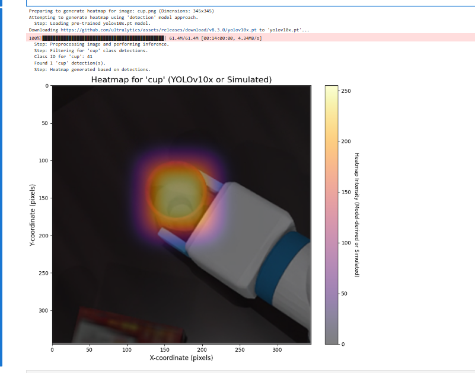

# 02. Карты внимания для захвата: как понять, на что смотрит модель

## Часть первая: принцип карты внимания (Attention Heatmap)

Тепловая карта YOLO, которую мы строили раньше, на самом деле является **картой уверенности детектора**: она показывает, в каких областях модель нашла объект и с какой уверенностью. Под «картой внимания» в академической литературе обычно понимают **карту активации классов (Class Activation Mapping, CAM)** или её улучшенную версию **Grad-CAM**. Она отвечает на более глубокий вопрос: **на каких областях изображения сконцентрировалось «внимание» модели при принятии конкретного классификационного решения?**

Это метод объяснимости модели (Explainable AI, XAI), который позволяет «заглянуть» в процесс «мышления» нейронной сети.

### 1. Основная идея: куда смотрит модель?

Представьте, что вы смотрите на картинку и говорите: «Это кошка». Ваш мозг бессознательно концентрируется на ключевых признаках — ушах, усах, глазах и лапах. Карта внимания пытается показать «точку взгляда» нейронной сети, когда она делает то же самое.

### 2. Принцип работы (на примере Grad-CAM, который более универсален)

Чтобы понять метод, вспомним устройство свёрточной нейронной сети (CNN):

- **Свёрточные слои (Convolutional Layers)**: первая часть сети состоит из нескольких свёрточных слоёв, которые извлекают признаки изображения — от простых краёв и цветов до сложных контуров и деталей (глаз, колёс). Чем глубже слой, тем абстрактнее признаки.

- **Карты признаков (Feature Maps)**: выход каждого свёрточного слоя — набор «карт признаков». Каждую карту можно представить как «детектор», настроенный на конкретный признак. Например, одна карта активируется на всех «круглых» областях, другая — на всех «острых ушах».

- **Итоговое решение**: сеть объединяет информацию из высокоуровневых карт признаков и принимает окончательное решение (например, «с вероятностью 98 % это кружка»).

**Суть Grad-CAM в том, что он вычисляет, какие карты признаков сильнее всего влияют на решение «кружка».**

Шаги метода можно упростить так:

1. **Выбор целевого слоя**: обычно берут последний свёрточный слой, так как в нём больше всего высокоуровневой семантической информации для принятия решения.

2. **Вычисление градиентов**: сеть делает прямой проход и выдаёт оценку класса «кружка». Затем считается **градиент** этой оценки по каждому пикселю выбранного слоя. Градиент показывает: «Если чуть изменить значение этого пикселя, насколько изменится оценка „кружки“?» Чем больше градиент, тем важнее пиксель для решения.

3. **Вычисление весов**: для каждой карты признаков усредняют её градиенты. Так получают «вес важности» этой карты для решения «кружка».

4. **Построение тепловой карты**: все карты признаков суммируют с весами. Важные карты (например, «детектор ручки» или «детектор круглого края») получают больший вес, а нерелевантные — малый. В итоге на исходном изображении выделяются области, связанные с кружкой, — это и есть карта внимания.

**Итог**: карта внимания (Grad-CAM) с помощью градиентов находит области, которые сильнее всего повлияли на итоговое решение классификации, и визуализирует их, показывая «фокус внимания» модели.

---

## Часть вторая: принцип YOLOv10

Главная цель YOLOv10 — **сохранить высокую точность и при этом обеспечить предельную сквозную (end-to-end) производительность в реальном времени**. Главное новшество — устранение узкого места старых моделей YOLO: **NMS (Non-Maximum Suppression, подавление немаксимумов)**.

### 1. Проблема: почему NMS — это проблема?

В предыдущих версиях YOLO при выводе генерировалось много сильно перекрывающихся рамок. NMS — это этап постобработки, который:

- смотрит на все сильно перекрывающиеся рамки, относящиеся к одному и тому же объекту;
- оставляет только рамку с наибольшей уверенностью, а остальные удаляет.

Метод работает, но у него два больших недостатка:

- **Вычислительные затраты**: сам NMS требует расчётов и увеличивает задержку вывода.
- **Невозможность сквозного режима**: это отдельный модуль постобработки, поэтому весь процесс детекции не является «сквозным» (от входа до выхода в один шаг), и его сложнее развёртывать и оптимизировать.

### 2. Главное новшество YOLOv10: отказ от NMS

YOLOv10 использует стратегию **согласованного двойного назначения (Consistent Dual Assignments)**. Она учит модель уже на этапе обучения подавлять избыточные рамки самостоятельно, поэтому при выводе NMS не нужен.

- **Двойное назначение**: при обучении для одного реального объекта традиционный YOLO обычно назначает одну или несколько положительных предсказаний. YOLOv10 одновременно применяет две стратегии:
  - **Соответствие «один к одному» (One-to-One Matching)**: одна ветвь обязана создавать для каждого объекта одну лучшую, качественную рамку. Цель этой ветви — максимальная точность.
  - **Соответствие «один ко многим» (One-to-Many Matching)**: другая ветвь, как в традиционном YOLO, создаёт для каждого объекта несколько рамок. Она даёт более богатый сигнал обучения и помогает модели быстрее сходиться.

- **Согласованный контроль**: модель обучается так, чтобы лучшая рамка ветви «один к одному» как можно лучше совпадала с рамкой с наибольшей оценкой в ветви «один ко многим».

Так модель во время обучения учится самостоятельно выбирать «лучшего представителя» и на этапе вывода отдаёт только эту качественную рамку. Поэтому NMS для фильтрации больше не требуется.

### 3. Другие ключевые решения

Помимо отказа от NMS, YOLOv10 содержит ряд решений, направленных на баланс эффективности и точности:

- **Облегчённая голова классификации (Lightweight Classification Head)**: в задачах детекции классификация намного проще локализации, поэтому структура головы классификации заметно упрощена и требует меньше вычислений.
- **Разделённое по пространству и каналам понижение разрешения (Spatial-Channel Decoupled Downsampling)**: уменьшение разрешения карты признаков (пространство) и изменение числа признаков (каналы) выполняются раздельно, что лучше сохраняет информацию.
- **Свёртки с большим ядром (Large-Kernel Convolutions)**: в глубоких частях сети используются ядра большего размера. Это расширяет рецептивное поле и повышает качество, а на современных вычислительных устройствах почти не добавляет затрат.

**Итог**: благодаря новому обучению без NMS и ряду точных архитектурных улучшений YOLOv10 при той же точности работает быстрее YOLOv8/v9 и обеспечивает сквозную детекцию в реальном времени.

---

Продолжим сравнение версий YOLO.

---

## Часть третья: сравнение версий YOLO

История YOLO — это история развития детекторов объектов в сторону большей скорости, силы и простоты использования.

| Версия | Год выпуска (примерно) | Основная идея / вклад | Итоги |
| ----------------------- | ------------------- | ------------------------ | --------------------------------------------------------------------------------------------------------------------------------------------------------- |
| **YOLOv1 – v3** | 2015–2018 | **Эпоха основ: одноэтапная детекция** | **v1**: задача сведена к регрессии; очень быстро, но точность посредственная. **v2**: введены якорные рамки (Anchor Box), заметно выросли точность и полнота. **v3**: многомасштабные предсказания и более сильная базовая сеть Darknet-53; стала классикой. |
| **YOLOv4 / v5** | 2020 | **Эпоха оптимизации и инженерии** | **v4**: систематически собраны приёмы «Bag of Freebies» и «Bag of Specials», то есть почти все эффективные трюки того времени. **v5**: разработан командой Ultralytics на PyTorch, сильно ориентирован на инженерную практику, простоту и развёртывание; доступна полная линейка моделей от n до x; стал самой широко используемой версией. |
| **YOLOv6 / v7 / YOLOX** | 2021–2022 | **Эпоха детекторов без якорей (Anchor-Free)** | Эти модели начали переход к конструкции без якорных рамок, что упростило обучение. **YOLOX**: динамическая стратегия назначения меток SimOTA. **YOLOv6**: более эффективная структура RepVGG. **YOLOv7**: расширенная эффективная агрегация слоёв (E-ELAN) даёт отличный баланс точности и скорости. |
| **YOLOv8** | 2023 | **Новый стандарт и полная унификация** | Ultralytics полностью переработала линейку на основе успеха v5; стала новым отраслевым стандартом. Также использует детекцию без якорей и вводит модуль C2f, который дополнительно повышает качество. Главное — задачи детекции, сегментации, оценки позы и другие объединены в одном фреймворке, что делает его очень гибким и мощным. |
| **YOLOv9** | 2024 | **Информационное бутылочное горлышко и оптимизация градиентов** | Предложены новые концепции для борьбы с потерей информации в глубоких сетях. **Главный вклад**: программируемая информация о градиентах (PGI) и обобщённая эффективная агрегация слоёв (GELAN). PGI решает проблему размывания информации при прохождении через глубокую сеть, позволяя модели выучивать более полные признаки. |
| **YOLOv10** | 2024 | **Сквозная эпоха без NMS** | Реализована действительно сквозная детекция в реальном времени; ключ — устранение постобработки NMS, на которую долго опирались. **Главный вклад**: стратегия «согласованного двойного назначения» при обучении даёт модели собственную способность подавлять избыточные рамки, поэтому при выводе NMS не нужен, а задержка заметно снижается. |

```
%pip install ultralytics opencv-python
```

```python
import matplotlib.pyplot as plt
import numpy as np
from PIL import Image, ImageDraw  # для обработки изображений и подписей на заглушке
import matplotlib.colors
import cv2  # OpenCV, для размытия по Гауссу

# Пробуем импортировать библиотеку YOLO
try:
    from ultralytics import YOLO
    YOLO_AVAILABLE = True
except ImportError:
    print("Warning: 'ultralytics' library not found. YOLO model functionality will be unavailable, falling back to simulated heatmap.")
    print("Please install the required libraries with 'pip install ultralytics opencv-python'.")
    YOLO_AVAILABLE = False

# --- Вспомогательная функция: смоделированная тепловая карта (заглушка или запасной вариант) ---
def generate_simulated_heatmap(image_width, image_height, object_center_x, object_center_y, object_width, object_height, max_intensity=255, falloff_rate=0.0005):
    """
    Generates a simulated heatmap for an object.
    Intensity is highest at the object's center and falls off.
    This function serves as a placeholder for actual model output or as a fallback.
    """
    y, x = np.ogrid[:image_height, :image_width]
    std_x = object_width / 2
    std_y = object_height / 2
    std_x = max(std_x, 1)  # избегаем деления на ноль
    std_y = max(std_y, 1)  # избегаем деления на ноль

    dist_sq = (((x - object_center_x)**2) / (2 * std_x**2)) + \
              (((y - object_center_y)**2) / (2 * std_y**2))
    heatmap = max_intensity * np.exp(-dist_sq * falloff_rate * 10)
    return np.clip(heatmap, 0, max_intensity)

# --- Функция: получить тепловую карту из реальной модели ---
def get_heatmap_from_actual_model(image_np, model_type='detection', object_class_name='cup'):
    """
    Attempts to get a heatmap from a real model.
    Uses YOLOv10x if available for object detection and heatmap generation.
    Otherwise, falls back to a simulated heatmap.

    Args:
        image_np (numpy.ndarray): Input image as a NumPy array (H, W, C).
        model_type (str): Currently only 'detection' is supported.
        object_class_name (str): Target class name for detection (e.g., 'cup').

    Returns:
        numpy.ndarray: Generated heatmap (2D array).
    """
    print(f"Attempting to generate heatmap using '{model_type}' model approach.")
    image_height, image_width = image_np.shape[:2]

    if model_type == 'detection' and YOLO_AVAILABLE:
        try:
            model_name = 'yolov10x.pt'  # YOLOv10x — самая крупная модель линейки YOLOv10
            # model_name = 'yolov9c.pt'  # можно вернуться к YOLOv9c или другой модели для сравнения
            # model_name = 'yolov8s.pt'
            print(f"  Step: Loading pre-trained {model_name} model.")
            model = YOLO(model_name)
            print("  Step: Preprocessing image and performing inference.")
            # Параметры вывода можно менять, например порог уверенности conf
            results = model(image_np, verbose=False, conf=0.25)  # verbose=False, пример параметра conf

            heatmap = np.zeros((image_height, image_width), dtype=np.float32)
            detections_found = 0

            print(f"  Step: Filtering for '{object_class_name}' class detections.")
            target_cls_id = -1
            if hasattr(model, 'names') and isinstance(model.names, dict):
                for cls_id, name_val in model.names.items():  # переименовано 'name' в 'name_val', чтобы не конфликтовать
                    if name_val == object_class_name:
                        target_cls_id = cls_id
                        break
            else:
                print(f"  Warning: Model class names (model.names) not available in the expected format. Cannot map '{object_class_name}' to class ID.")


            if target_cls_id == -1:
                print(f"  Warning: Class '{object_class_name}' not found in model's classes or model.names not accessible. Will display an empty heatmap.")
            else:
                print(f"  Class ID for '{object_class_name}': {target_cls_id}")

                for result in results:
                    for box in result.boxes:
                        cls = int(box.cls)
                        conf = float(box.conf)
                        if cls == target_cls_id:
                            detections_found += 1
                            x1, y1, x2, y2 = map(int, box.xyxy[0])
                            # Заполняем прямоугольник, используя уверенность как значение «жара»
                            cv2.rectangle(heatmap, (x1, y1), (x2, y2), conf, thickness=cv2.FILLED)

                if detections_found > 0:
                    print(f"  Found {detections_found} '{object_class_name}' detection(s).")
                    # Размер ядра размытия можно подбирать по результату
                    # Большее ядро даёт более размытую (рассеянную) карту
                    blur_kernel_size = (101, 101)  # можно попробовать (51, 51) или увеличить
                    heatmap = cv2.GaussianBlur(heatmap, blur_kernel_size, 0)
                    if heatmap.max() > 0:
                        heatmap = (heatmap / heatmap.max()) * 255  # нормализация к диапазону 0–255
                    print("  Step: Heatmap generated based on detections.")
                    return heatmap.astype(np.uint8)
                else:
                    print(f"  No '{object_class_name}' detections found with current settings. Will display an empty heatmap.")
                    return heatmap  # возвращаем пустую карту

        except Exception as e:
            print(f"  Error during YOLO model operation: {e}")
            print("  Fallback: Using simulated heatmap.")
            # Переход к смоделированной карте

    # ----- Запасной вариант: смоделированная карта, если модель недоступна или произошла ошибка -----
    print("  Fallback: Using simulated heatmap as a placeholder.")
    center_x_ratio = 0.47
    center_y_ratio = 0.45
    width_ratio = 0.20
    height_ratio = 0.30

    obj_center_x_abs = int(center_x_ratio * image_width)
    obj_center_y_abs = int(center_y_ratio * image_height)
    obj_width_abs = int(width_ratio * image_width)
    obj_height_abs = int(height_ratio * image_height)

    simulated_heatmap = generate_simulated_heatmap(
        image_width, image_height,
        obj_center_x_abs, obj_center_y_abs,
        obj_width_abs, obj_height_abs
    )
    return simulated_heatmap

def plot_image_with_heatmap(image_path, heatmap_data, title="Object Detection Heatmap", alpha=0.6, cmap_name='inferno'):
    """
    Overlays a heatmap on an image and displays it. All plot text is in English.
    """
    try:
        img = Image.open(image_path).convert('RGB')
    except FileNotFoundError:
        print(f"Error: Image file not found at {image_path}.")
        img = Image.new('RGB', (500, 500), color=(128, 128, 128))
        draw = ImageDraw.Draw(img)
        draw.text((50, 230), "Image not found.\nPlease use a valid path.", fill=(255, 0, 0))
        heatmap_data = np.zeros((500, 500))
        print("Displaying placeholder image and empty heatmap.")

    img_np = np.array(img)

    fig, ax = plt.subplots(1, 1, figsize=(10, 8))
    ax.imshow(img_np)

    if heatmap_data.max() > 0:
        if heatmap_data.shape[0] != img_np.shape[0] or heatmap_data.shape[1] != img_np.shape[1]:
            print(f"Warning: Heatmap dimensions ({heatmap_data.shape}) differ from image dimensions ({img_np.shape[:2]}). Resizing heatmap.")
            heatmap_pil = Image.fromarray(heatmap_data.astype(np.uint8))
            heatmap_resized_pil = heatmap_pil.resize((img_np.shape[1], img_np.shape[0]), Image.BICUBIC)
            heatmap_data_resized = np.array(heatmap_resized_pil)
            cax = ax.imshow(heatmap_data_resized, cmap=plt.get_cmap(cmap_name), alpha=alpha, extent=(0, img_np.shape[1], img_np.shape[0], 0))
        else:
            cax = ax.imshow(heatmap_data, cmap=plt.get_cmap(cmap_name), alpha=alpha, extent=(0, img_np.shape[1], img_np.shape[0], 0))

        cbar = fig.colorbar(cax, ax=ax, orientation='vertical', fraction=0.046, pad=0.04)
        cbar.set_label('Heatmap Intensity (Model-derived or Simulated)', rotation=270, labelpad=15)
    else:
        print("Heatmap is empty (no detections or model not run), not overlaying.")

    ax.set_title(title, fontsize=16)
    ax.set_xlabel("X-coordinate (pixels)", fontsize=12)
    ax.set_ylabel("Y-coordinate (pixels)", fontsize=12)
    ax.axis('on')
    plt.tight_layout()
    plt.show()

if __name__ == '__main__':
    # --- Настройки ---
    image_file_path = 'cup.png'  # по умолчанию — изображение сверху, на котором раньше были трудности распознавания
    # image_file_path = 'image_2d8ceb.png'  # изображение, которое раньше распознавалось
    # image_file_path = 'image_2d208d.jpg'  # ещё одно тестовое изображение

    target_object_name = 'cup'

    # --- Загрузка изображения ---
    try:
        img_for_model = Image.open(image_file_path).convert('RGB')
        img_np_for_model = np.array(img_for_model)
        img_height, img_width = img_np_for_model.shape[:2]
        print(f"Preparing to generate heatmap for image: {image_file_path} (Dimensions: {img_width}x{img_height})")
    except FileNotFoundError:
        print(f"Fatal Error: Image file '{image_file_path}' not found. Cannot proceed.")
        img_np_for_model = np.zeros((500, 500, 3), dtype=np.uint8)
        img_width, img_height = 500, 500


    # --- Генерация тепловой карты ---
    heatmap_output = get_heatmap_from_actual_model(
        img_np_for_model,
        model_type='detection',
        object_class_name=target_object_name
    )

    # --- Наложение карты на изображение ---
    plot_title = f"Heatmap for '{target_object_name}' (YOLOv10x or Simulated)"
    plot_image_with_heatmap(
        image_path=image_file_path,
        heatmap_data=heatmap_output,
        title=plot_title,
        alpha=0.5,
        cmap_name='inferno'
    )

    if not YOLO_AVAILABLE:
        print("\nReminder: To use the actual YOLO model for heatmap generation, ensure 'ultralytics' and 'opencv-python' are installed.")
        print("You can install them via 'pip install ultralytics opencv-python'.")
        print("Currently displaying a simulated heatmap.")
```


