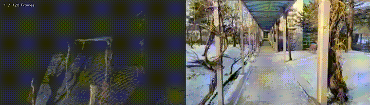
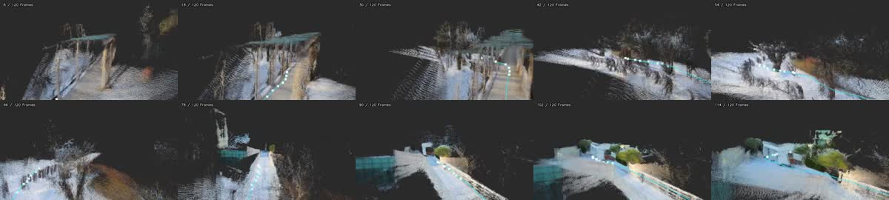
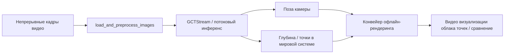

# 03. LingBot-Map: от сканирования видео к трёхмерной карте в виде облака точек

LingBot-Map — проект потоковой трёхмерной реконструкции для длинных видео. По последовательным кадрам он оценивает траекторию камеры, глубину, облако точек и результат визуализации. Это хороший пример того, как робот с камерой обходит помещение и постепенно строит пространственную карту.

В этой главе три цели:

- воспроизвести на своём компьютере официальную непрерывную сцену `university` и получить видео визуализации облака точек;
- объяснить точки входа в код LingBot-Map, поток данных и идею статьи;
- предложить лёгкое веб-демо: пользователь загружает видео, локальный скрипт вывода запускается, и на странице показываются исходное видео и сравнение с визуализацией облака точек.

> Пояснение: результат LingBot-Map ближе к «потоковой позе камеры + глубина + визуализация облака точек или вокселей», а не к обучению полноценной сцены 3D Gaussian Splatting в реальном времени. Его можно использовать как входной слой пространственного понимания для 3DGS, NeRF, SLAM или навигации роботов, но в этой главе мы сосредоточимся на сканировании видео, построении карты и визуализации облака точек.

## 1. Предварительный просмотр результата

В главе используется официальный пример `example/university`: непрерывная сцена кампуса в снегу. Траектория движения здесь не прямая, поэтому пример хорошо показывает процесс «сканирования на ходу».

Исходное видео:

<video controls muted preload="metadata" width="100%">
  <source src="assets/lingbot-map/university_input.mp4" type="video/mp4">
</video>

Результат визуализации облака точек:

<video controls muted preload="metadata" width="100%">
  <source src="assets/lingbot-map/university_pointcloud.mp4" type="video/mp4">
</video>

Сравнение исходных кадров и визуализации облака точек:

<video controls muted preload="metadata" width="100%">
  <source src="assets/lingbot-map/university_compare.mp4" type="video/mp4">
</video>

Если сайт документации не воспроизводит видео, можно посмотреть GIF-превью:



Миниатюры ключевых кадров облака точек:



## 2. Подготовка окружения

Рекомендуем создать отдельное окружение mamba: LingBot-Map одновременно зависит от PyTorch, расширений CUDA, Kaolin, viser и пакетов для рендеринга, и в одном окружении с обычной средой симуляции для робототехники они легко конфликтуют.

Команды ниже предполагают, что вы клонировали LingBot-Map в каталог `$PROJECT_ROOT`:

```bash
export PROJECT_ROOT=/path/to/lingbot-map
cd "$PROJECT_ROOT"
```

Создание окружения:

```bash
mamba create -n lingbot-map python=3.10 -y
mamba activate lingbot-map
```

Установка PyTorch. Официальный README рекомендует PyTorch 2.8.0 с CUDA 12.8, потому что для конвейера пакетного рендеринга Kaolin есть готовые колёса:

```bash
pip install torch==2.8.0 torchvision==0.23.0 --index-url https://download.pytorch.org/whl/cu128
```

Установка проекта и зависимостей для рендеринга:

```bash
pip install -e .
pip install -r demo_render/requirements.txt
```

Если нужен офлайн-рендеринг облака точек, соберите расширение CUDA для рендеринга:

```bash
cd demo_render/render_cuda_ext
python setup.py build_ext --inplace
cd ../..
```

Скачайте веса и поместите их сюда:

```text
$PROJECT_ROOT/checkpoints/lingbot-map-long.pt
```

Официальные веса можно скачать по ссылкам Hugging Face или ModelScope из README проекта. Для длинных видео и больших сцен используйте `lingbot-map-long.pt`.

### Замечания по CUDA и архитектуре Blackwell

Если сервер оснащён GPU архитектуры Blackwell, лучше использовать колёса PyTorch с CUDA 12.8 или новее: некоторые инструменты при запросе возможностей SM 12.x выводят предупреждение «SM 12.x requires CUDA >= 12.9». Если вывод модели при этом работает, предупреждение обычно не мешает проверке из этой главы. Если возникают ошибки компиляции ядер CUDA, FlashInfer или Kaolin, обновите системный CUDA Toolkit или используйте версию CUDA, совместимую с колёсами PyTorch.

## 3. Проверка на официальной непрерывной сцене

В официальном репозитории есть несколько примеров последовательностей:

| Сцена | Особенности | Рекомендация |
| :--- | :--- | :--- |
| `university` | Непрерывное движение на улице кампуса: деревья, ограды, здания и слои рельефа | Рекомендуем |
| `loop` | Замкнутое движение по коридору в помещении | Подходит для объяснения замыканий петель и дрейфа |
| `courthouse` | Обход фасада здания | Подходит для сканирования зданий |
| `oxford` | Внешний вид здания кампуса | Подходит для больших уличных сцен |

Запуск примера `university`, который используется в этой главе:

```bash
export PROJECT_ROOT=/path/to/lingbot-map
cd "$PROJECT_ROOT"
mamba activate lingbot-map

python demo_render/batch_demo.py \
  --input_folder example \
  --scenes university \
  --image_range 0:240:2 \
  --output_folder outputs/official_university_scan \
  --model_path checkpoints/lingbot-map-long.pt \
  --config demo_render/config/outdoor_large.yaml \
  --num_scale_frames 4 \
  --use_sdpa \
  --video_width 640 \
  --video_height 360 \
  --video_fps 12 \
  --camera_vis default \
  --frame_tag \
  --save_predictions \
  --video_suffix _pointcloud
```

После выполнения посмотрите:

```text
outputs/official_university_scan/university_pointcloud.mp4
outputs/official_university_scan/university_pointcloud_combined.mp4
outputs/official_university_scan/batch_results.json
```

В этой проверке использовано 120 кадров. В журнале видна скорость инференса порядка десятков кадров в секунду и генерация облака точек или вокселей масштаба миллионов точек для рендеринга. Реальная скорость зависит от GPU, CUDA, разрешения, числа кадров и параметров рендеринга.

## 4. Сканирование собственным видео

Если у вас есть собственная запись, передайте её в `--video_path`. Сначала проверьте конвейер на непрерывном видео с одной камерой: без частых склеек, быстрых зумов, сильного размытия при движении и больших участков чистого неба.

```bash
export PROJECT_ROOT=/path/to/lingbot-map
export VIDEO_PATH=/path/to/your_scan_video.mp4
cd "$PROJECT_ROOT"
mamba activate lingbot-map

python demo_render/batch_demo.py \
  --video_path "$VIDEO_PATH" \
  --target_frames 120 \
  --output_folder outputs/my_scan \
  --model_path checkpoints/lingbot-map-long.pt \
  --config demo_render/config/outdoor_large.yaml \
  --num_scale_frames 4 \
  --use_sdpa \
  --video_width 640 \
  --video_height 360 \
  --video_fps 12 \
  --camera_vis default \
  --frame_tag \
  --save_predictions \
  --video_suffix _pointcloud
```

Советы по съёмке:

- Для реконструкции лучше подходит непрерывная съёмка одной сцены, чем нарезанное видео.
- Можно поворачивать, обходить объект по кругу и слегка наклонять камеру вверх и вниз; прямая линия не обязательна.
- Движение камеры должно создавать параллакс: при чистом повороте на месте или сдвиге далёкой сцены масштаб восстанавливается плохо.
- На улице старайтесь уменьшить долю чистого неба; при необходимости включите маску неба (sky mask).
- Сначала проверьте конвейер на 60–120 кадрах и только потом переходите к длинным видео.

## 5. Веб-демо

Учебный репозиторий содержит простую веб-обёртку, которая находится в каталоге:

```text
tools/lingbot_map_web_demo/
```

Веса LingBot-Map в ней не встроены, и результаты работы в учебный репозиторий она не записывает. Чтобы указать расположение проекта LingBot-Map и файла весов, задайте переменные окружения:

```bash
export LINGBOT_MAP_ROOT=/path/to/lingbot-map
export LINGBOT_MAP_CKPT=/path/to/lingbot-map/checkpoints/lingbot-map-long.pt
export LINGBOT_MAP_PYTHON=/path/to/mamba/envs/lingbot-map/bin/python
export LINGBOT_MAP_RUN_ROOT=/path/to/lingbot_map_runs

cd /path/to/every-embodied/tools/lingbot_map_web_demo
pip install -r requirements.txt
python app.py
```

Откройте в браузере адрес:

```text
http://127.0.0.1:7860
```

После загрузки непрерывного видео веб-демо вызывает `demo_render/batch_demo.py` и показывает на странице:

- исходное видео;
- видео визуализации облака точек;
- сравнительное видео «исходное видео + визуализация облака точек»;
- журнал выполнения и каталог результатов.

Веб-демо подходит для презентации и проверки работоспособности, но не для производственной эксплуатации. Обработка длинных видео занимает много видеопамяти и места на диске; для публичного развёртывания нужны очередь задач, ограничение параллельных запусков, очистка файлов и контроль доступа.

## 6. Как код соответствует статье

Упрощённая схема потока данных LingBot-Map:



Основные точки входа:

| Файл | Назначение |
| :--- | :--- |
| `demo.py` | Интерактивный 3D-просмотрщик, удобен для отладки коротких последовательностей. |
| `demo_render/batch_demo.py` | Пакетная обработка офлайн, подходит для видео, длинных последовательностей и учебных материалов. |
| `lingbot_map/` | Модель, загрузка весов, утилиты обработки изображений и реализация инференса. |
| `demo_render/rgbd_render/` | Рендеринг предсказанных глубины, камеры и облака точек в видео. |
| `demo_render/render_cuda_ext/` | Расширение CUDA для рендеринга облака точек и вокселей. |

С точки зрения статьи LingBot-Map решает задачу онлайновой пространственной памяти на длинных видео. Модель не обрабатывает каждый кадр изолированно: она поддерживает состояние между кадрами и использует уже увиденное как контекст для понимания следующих кадров. Это позволяет роботу, который движется по коридору, дорожке кампуса или комнате, обновлять пространственное представление по мере поступления кадров, а не ждать окончания видео.

Работу модели можно разделить на три уровня:

1. Визуальное кодирование: каждый кадр превращается в признаки.
2. Агрегация во времени: потоковое состояние сохраняет информацию предыдущих кадров и снижает повторные вычисления на длинных видео.
3. Геометрический выход: предсказываются камера, глубина и мировые точки, которые затем превращаются в облако точек или воксели для рендеринга.

Поэтому модель отвечает не на вопрос «превратить видео в окончательную редактируемую модель 3DGS», а на вопрос «непрерывно восстанавливать трёхмерную структуру из видеопотока робота, пригодную для навигации, осмотра и визуализации».

## 7. Частые вопросы

**1. Это потоковый 3DGS в реальном времени?**

Нет. Модель может давать потоковую геометрическую оценку почти в реальном времени, но в этой главе показана визуализация облака точек и вокселей. Для 3DGS обычно нужна дополнительная оптимизация явных параметров гауссиан или отдельный процесс обучения.

**2. Почему важно непрерывное видео, а не нарезанное?**

Реконструкция опирается на геометрическую согласованность соседних кадров. Нарезанное видео внезапно меняет место и ракурс, модель вынуждена сшивать несвязанные пространственные отношения, и в результате появляются дрейф, смещения и разорванное облако точек.

**3. Нужно ли обновлять CUDA для GPU Blackwell?**

Если колёса PyTorch, FlashInfer, Kaolin и расширения CUDA проекта работают, системный CUDA можно не трогать. При ошибках SM 12.x, сбое компиляции расширения CUDA или ошибках запуска ядер стоит перейти на более новый CUDA Toolkit и проверить согласованность версий PyTorch, драйвера, компилятора и библиотек.

**4. Нужно ли добавлять в учебный репозиторий исходные видео, веса и файлы NPZ с результатами?**

Не рекомендуется. В учебном репозитории стоит оставлять только сжатые превью MP4, GIF и JPG. Веса, исходные видео, большое число файлов `.npz` с предсказаниями и результаты длинных видео лучше хранить в локальном каталоге данных или внешнем объектном хранилище.

## 8. Источники

- Официальный репозиторий и README LingBot-Map.
- PDF статьи LingBot-Map.
- Официальный пример `example/university`. В этой главе публикуются только сжатые учебные превью, без исходных весов, исходных последовательностей и больших файлов предсказаний.
