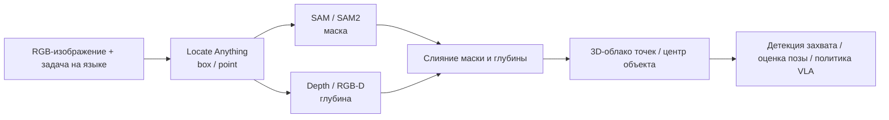
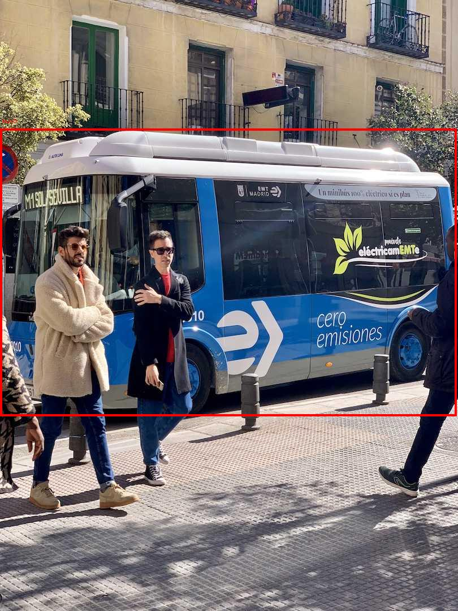
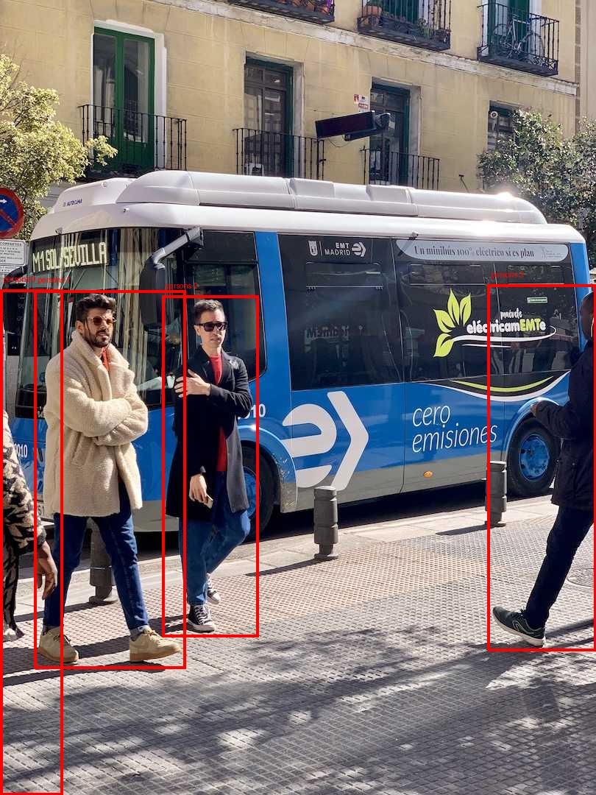
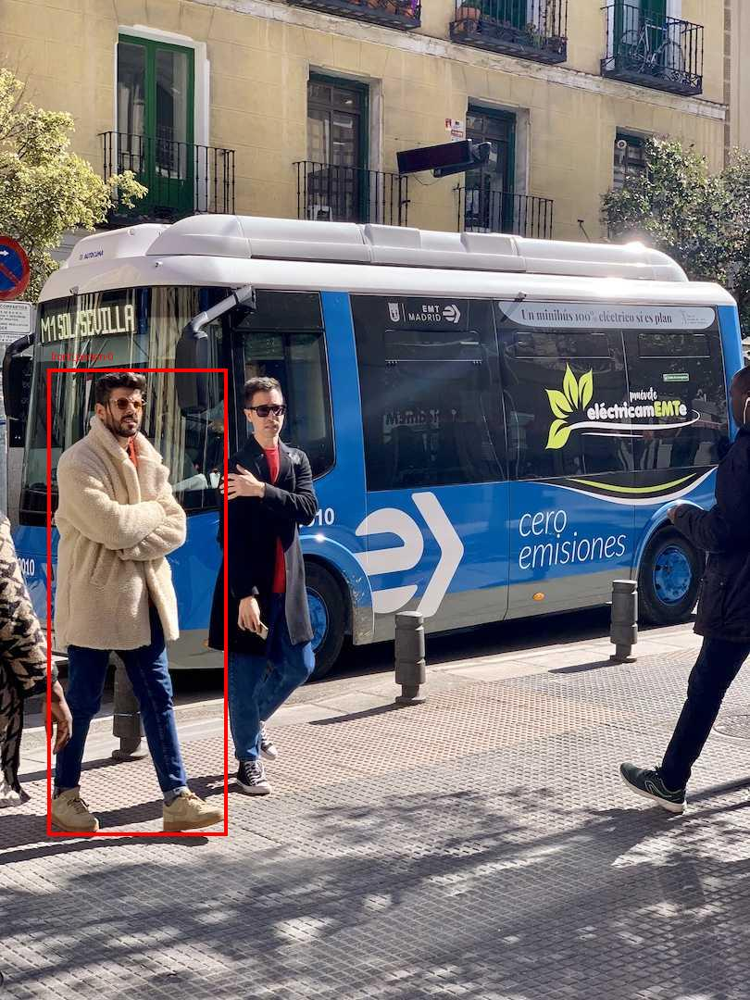
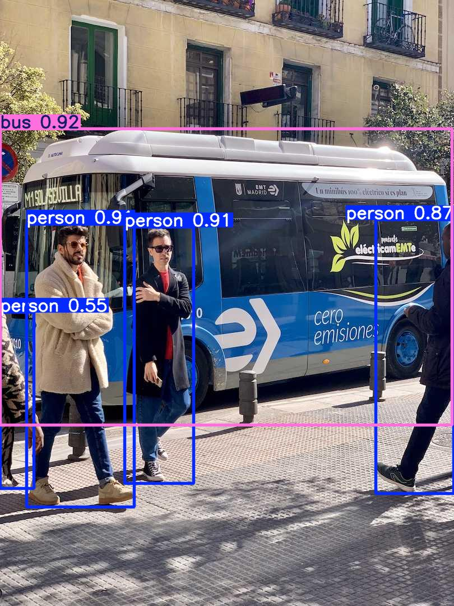

# 04. Locate Anything: превращаем естественный язык в рамку визуальной локализации для робота

Locate Anything — модель визуально-языковой локализации от NVIDIA. Она решает прямую задачу: по изображению и одной фразе на естественном языке выдаёт 2D-рамку (box) или точку (point) искомого объекта. Для воплощённого ИИ это не политика VLA и не планировщик захватов, а языково-управляемый слой восприятия, который хорошо ставится перед VLA, SAM, оценкой глубины и модулем захвата.

После этой главы вы сможете:

- скачать и запустить `nvidia/LocateAnything-3B` на своём компьютере;
- сравнить вывод Locate Anything и YOLO26n на одном изображении по качеству и скорости;
- понять, почему модель использует Parallel Box Decoding и где её правильно разместить в цепочке робота.

> В этой главе окружение, веса модели и результаты запуска размещаются на большом диске `$DATA_ROOT`; в учебный репозиторий попадают только Markdown и лёгкие картинки с результатами. Веса модели, кэш HF, кэш pip и журналы запуска в репозиторий не коммитятся.

## 1. Где модель находится в цепочке воплощённой системы

На вход Locate Anything подаются изображение и текст, а на выходе получается структурированная строка такого вида:

```text
<ref>bus</ref><box><0><211><997><681></box>
```

Координаты — целые числа в нормированной шкале от 0 до 1000; при постобработке их переводят в пиксели исходного изображения. Модель подходит для таких задач:

| Задача | Роль Locate Anything | Следующие модули |
| :--- | :--- | :--- |
| Локализация объекта по языковому описанию | Превращает «человек в кремовой куртке», «ручка ящика», «кнопка в правом верхнем углу» в 2D-рамку | crop, SAM, оценка глубины |
| Автоматическая разметка данных | Пакетно создаёт кандидатные рамки для реальных изображений робота | ручная проверка, очистка обучающей выборки |
| Усиление VLA/VLM | Передаёт политике область, релевантную задаче | политика VLA, модуль памяти |
| Локализация в GUI, OCR и документах | Находит кнопки, текст, таблицы, заголовки | мультимодальный агент, RPA |

Locate Anything не выдаёт напрямую позу в 6D, позу захвата, признаки контакта, планирование пути или сигнал замкнутого управления. Если модель используется для захвата манипулятором, разумнее строить такую цепочку:



## 2. Проверочное окружение

В этой главе модель запущена в таком окружении:

| Параметр | Значение при проверке |
| :--- | :--- |
| GPU | NVIDIA RTX PRO 6000 Blackwell Workstation Edition 96 GB |
| Драйвер / CUDA | NVIDIA Driver 580.159.03, `nvidia-smi` показывает CUDA 13.0 |
| PyTorch | `torch==2.11.0+cu128` |
| Locate Anything | каталог `Embodied` репозитория NVlabs/Eagle, `nvidia/LocateAnything-3B` |
| Transformers | `transformers==4.57.1` |
| Сравнение с YOLO | `ultralytics==8.4.80`, `yolo26n.pt` |

В проверочном запуске не установлены `flash_attn` и `MagiAttention`, поэтому в журнале видно автоматический откат на PyTorch SDPA:

```text
flash_attn is not available for MoonViT inference; falling back to sdpa.
magi_attention not available, falling back to sdpa.
```

Поэтому скорость в этой главе — лишь подтверждение того, что базовое окружение работает, а не официальный пиковый результат. В README официальный показатель для Locate Anything-3B на одной H100 в гибридном режиме (Hybrid Mode) — 12,7 BPS; здесь же замер сделан с откатом на SDPA и при загруженной GPU другими задачами.

## 3. Подготовка окружения и модели

Сначала задайте каталоги. Замените `$DATA_ROOT` на путь к своему большому диску; веса модели в репозиторий класть не нужно.

```bash
export DATA_ROOT=/path/to/large_disk/locate-anything
export ENV_ROOT=/path/to/large_disk/envs/locate-anything
export HF_HOME=/path/to/large_disk/cache/huggingface
export PIP_CACHE_DIR=/path/to/large_disk/cache/pip
export UV_CACHE_DIR=/path/to/large_disk/cache/uv
export TORCH_EXTENSIONS_DIR=/path/to/large_disk/cache/torch_extensions

mkdir -p "$DATA_ROOT" "$HF_HOME" "$PIP_CACHE_DIR" "$UV_CACHE_DIR" "$TORCH_EXTENSIONS_DIR"
```

Если на вашей машине большой диск смонтирован в `/mnt/data`, можно задать так:

```bash
export DATA_ROOT=/mnt/data/01Proj/locate-anything
export ENV_ROOT=/mnt/data/envs/locate-anything
export HF_HOME=/mnt/data/cache/huggingface
export PIP_CACHE_DIR=/mnt/data/cache/pip
export UV_CACHE_DIR=/mnt/data/cache/uv
export TORCH_EXTENSIONS_DIR=/mnt/data/cache/torch_extensions
```

Клонируйте официальный репозиторий:

```bash
cd "$DATA_ROOT"
git clone --depth 1 https://github.com/NVlabs/Eagle.git
cd "$DATA_ROOT/Eagle/Embodied"
```

Создайте окружение Python 3.11:

```bash
uv venv "$ENV_ROOT" --python 3.11
"$ENV_ROOT/bin/python" -m ensurepip --upgrade
"$ENV_ROOT/bin/python" -m pip install --upgrade pip wheel setuptools
```

Установите колёса PyTorch с CUDA 12.8. В проверочной системе драйвер показывает CUDA 13.0, но колёса cu128 работают нормально:

```bash
"$ENV_ROOT/bin/python" -m pip install torch torchvision \
  --index-url https://download.pytorch.org/whl/cu128
```

Проверка CUDA:

```bash
"$ENV_ROOT/bin/python" - <<'PY'
import torch
print("torch", torch.__version__)
print("cuda available", torch.cuda.is_available())
print("cuda version", torch.version.cuda)
if torch.cuda.is_available():
    print("device", torch.cuda.get_device_name(0))
PY
```

Вывод на проверочной машине:

```text
torch 2.11.0+cu128
cuda available True
cuda version 12.8
device NVIDIA RTX PRO 6000 Blackwell Workstation Edition
```

Установите зависимости Locate Anything:

```bash
cd "$DATA_ROOT/Eagle/Embodied"
"$ENV_ROOT/bin/python" -m pip install -e .
```

Ключевые зависимости официального проекта: `transformers==4.57.1`, `tokenizers==0.22.0`, `deepspeed==0.15.4`, `accelerate==1.5.2`, `timm>=1.0.11`, `liger_kernel==0.3.1`, `peft==0.12.0` и `decord`.

Загрузка модели:

```bash
export MODEL_DIR="$DATA_ROOT/models/LocateAnything-3B"
mkdir -p "$DATA_ROOT/models"

"$ENV_ROOT/bin/hf" download nvidia/LocateAnything-3B \
  --local-dir "$MODEL_DIR"
```

После загрузки каталог модели занимает около 7,3 ГБ; основные файлы весов:

```text
model-00001-of-00002.safetensors  4.7G
model-00002-of-00002.safetensors  2.6G
```

Если загрузка прервалась, просто повторите ту же команду `hf download`: она продолжит с места остановки.

## 4. Проверочный запуск Locate Anything

Для проверки возьмём официальное тестовое изображение Ultralytics `bus.jpg`. Так будет проще сравнить результат с YOLO26.

```bash
export IMAGE_PATH="$DATA_ROOT/bus.jpg"
curl -L https://ultralytics.com/images/bus.jpg -o "$IMAGE_PATH"
```

Рисунок 1 — входное изображение.


Запуск Locate Anything:

```bash
cd "$DATA_ROOT/Eagle/Embodied"

HF_HOME="$HF_HOME" \
TORCH_EXTENSIONS_DIR="$TORCH_EXTENSIONS_DIR" \
PYTORCH_CUDA_ALLOC_CONF=expandable_segments:True \
MODEL_DIR="$MODEL_DIR" \
IMAGE_PATH="$IMAGE_PATH" \
DATA_ROOT="$DATA_ROOT" \
"$ENV_ROOT/bin/python" - <<'PY'
import json, os, time
from pathlib import Path
from PIL import Image, ImageDraw
from locateanything_worker import LocateAnythingWorker

model_path = Path(os.environ["MODEL_DIR"])
image_path = Path(os.environ["IMAGE_PATH"])
out_dir = Path(os.environ["DATA_ROOT"]) / "runs/bus_locateanything"
out_dir.mkdir(parents=True, exist_ok=True)

img = Image.open(image_path).convert("RGB")
worker = LocateAnythingWorker(str(model_path), use_batch_runtime=False)

queries = [
    ("bus", "Locate a single instance that matches the following description: bus."),
    ("persons", "Locate all the instances that matches the following description: person."),
    (
        "front_person",
        "Locate a single instance that matches the following description: "
        "the man in the cream coat standing in front of the bus.",
    ),
]

summary = []
for name, prompt in queries:
    t0 = time.time()
    result = worker.predict(
        img,
        prompt,
        generation_mode="hybrid",
        max_new_tokens=512,
        temperature=0.2,
        top_p=0.9,
        verbose=True,
    )
    wall = time.time() - t0
    boxes = LocateAnythingWorker.parse_boxes(result["answer"], *img.size)

    vis = img.copy()
    draw = ImageDraw.Draw(vis)
    for i, b in enumerate(boxes):
        draw.rectangle([b["x1"], b["y1"], b["x2"], b["y2"]], outline="red", width=4)
        draw.text((b["x1"] + 4, max(0, b["y1"] - 20)), f"{name}-{i}", fill="red")

    vis_path = out_dir / f"{name}_locateanything_result.jpg"
    vis.save(vis_path)
    summary.append(
        {
            "name": name,
            "prompt": prompt,
            "answer": result["answer"],
            "stats": result.get("stats"),
            "wall_infer_seconds": round(wall, 4),
            "boxes": boxes,
            "image": str(vis_path),
        }
    )
    print(name, round(wall, 4), result["answer"])

(out_dir / "summary.json").write_text(
    json.dumps(summary, ensure_ascii=False, indent=2), encoding="utf-8"
)
PY
```

Результаты трёх запросов на проверочной машине:

| Запрос | Краткий результат | Время на машине |
| :--- | :--- | :--- |
| `bus` | 1 рамка автобуса | около 1,00 с |
| `person` | 4 рамки пешеходов | около 0,63 с |
| `the man in the cream coat standing in front of the bus` | 1 человек, найденный по описанию | около 0,63 с |

Результат локализации автобуса:



Результат локализации нескольких пешеходов:



Результат по описанию на естественном языке:



Обратите внимание на рисунок 4. Модель здесь не просто ищет класс `person`, а выбирает из нескольких пешеходов того, кто в кремовой куртке и стоит перед автобусом. Именно это отличает такой инструмент от детектора с фиксированным набором классов.

## 5. Сравнение с YOLO26n на одном изображении

YOLO26 — семейство моделей реального времени от Ultralytics. По официальной документации, оно поддерживает детекцию, сегментацию, оценку позы, классификацию и детекцию ориентированных рамок. Модель детекции обучена на 80 классах COCO и ориентирована на сквозной режим без NMS и низкую задержку развёртывания.

Чтобы не нарушить ограничение `numpy<2` в окружении Locate Anything, при установке Ultralytics здесь используется `--no-deps`, а недостающие зависимости добавляются вручную. Более чистый вариант — отдельное маленькое окружение для YOLO.

```bash
"$ENV_ROOT/bin/python" -m pip install --no-deps \
  ultralytics polars polars-runtime-32 nvidia-ml-py ultralytics-thop
```

Запуск YOLO26n:

```bash
export YOLO_CONFIG_DIR=/path/to/large_disk/cache/ultralytics
mkdir -p "$YOLO_CONFIG_DIR/Ultralytics"

cd "$DATA_ROOT"

YOLO_CONFIG_DIR="$YOLO_CONFIG_DIR" \
DATA_ROOT="$DATA_ROOT" \
"$ENV_ROOT/bin/python" - <<'PY'
import json, os, time
from pathlib import Path
from PIL import Image as PILImage
from ultralytics import YOLO

data_root = Path(os.environ["DATA_ROOT"])
image = data_root / "bus.jpg"
out_dir = data_root / "runs/bus_yolo26n"
out_dir.mkdir(parents=True, exist_ok=True)

model = YOLO("yolo26n.pt")

# Сначала прогрев, затем замер второго запуска.
model.predict(str(image), imgsz=640, conf=0.25, device=0, verbose=False)
t0 = time.time()
results = model.predict(str(image), imgsz=640, conf=0.25, device=0, verbose=False)
wall = time.time() - t0

r = results[0]
items = []
for b in r.boxes:
    cls_id = int(b.cls[0])
    items.append(
        {
            "class": model.names[cls_id],
            "confidence": round(float(b.conf[0]), 4),
            "xyxy": [float(x) for x in b.xyxy[0].cpu().tolist()],
        }
    )

plot = r.plot()
plot_path = out_dir / "bus_yolo26n_result.jpg"
PILImage.fromarray(plot[..., ::-1]).save(plot_path)
(out_dir / "bus_yolo26n_result.json").write_text(
    json.dumps(
        {
            "model": "yolo26n.pt",
            "wall_infer_seconds": round(wall, 4),
            "speed_ms": r.speed,
            "boxes": items,
        },
        ensure_ascii=False,
        indent=2,
    ),
    encoding="utf-8",
)

print("wall seconds", round(wall, 4))
print("speed ms", r.speed)
print("boxes", items)
PY
```

На проверочном изображении YOLO26n выдал 5 рамок: 1 `bus` и 4 `person`. Время внутренних этапов после прогрева:

```text
preprocess: 2.38 ms
inference: 4.12 ms
postprocess: 0.80 ms
```



### Итоги сравнения

| Параметр | YOLO26n | Locate Anything-3B |
| :--- | :--- | :--- |
| Основная роль | детектор реального времени с фиксированными классами | модель визуально-языковой локализации |
| Вход | изображение; на выходе классы COCO по умолчанию | изображение + запрос на естественном языке |
| Выход | класс, уверенность, рамка | `<ref>...</ref><box>...</box>` или точка |
| Скорость на том же изображении | около 4,12 мс на инференс модели | около 0,63–1,00 с для генеративной локализации |
| Порядок параметров | по таблице YOLO26 — 2,4 млн параметров у YOLO26n и 55,7 млн у YOLO26x | по карточке модели — 3 млрд параметров |
| Сильные задачи | фиксированные классы, видеопоток в реальном времени, периферийные устройства | референтные запросы, GUI, OCR, макет страницы, открытый словарь |
| Применение в роботе | быстро находить людей, машины, чашки, бутылки и другие частые классы | находить объект по языковому описанию, например «ручка красной чашки слева» |

Если задача — «есть ли в кадре человек, машина, чашка», YOLO26n заметно быстрее, экономнее по видеопамяти и лучше подходит для развёртывания в реальном времени. Если задача — «найти человека в кремовой куртке, стоящего перед автобусом», «найти кнопку загрузки в правом верхнем углу страницы», «первый абзац под заголовком резюме документа» или «прозрачный стакан у захвата на столе», Locate Anything лучше соответствует постановке задачи.

Стоит добавить, что Ultralytics также выпустила YOLOE-26 — модель открытого словаря с текстовыми и визуальными подсказками для детекции и сегментации. YOLOE-26 ближе к «открытому детектору реального времени», а Locate Anything ориентирована на визуально-языковую локализацию, которая охватывает GUI, OCR, структуру документов, референтные выражения и указание точек. В научной работе не стоит описывать их как взаимозаменяемые; точнее так:

```text
YOLO26 / YOLOE-26: семейство моделей детекции и сегментации в реальном времени, важна скорость развёртывания и задачи детекции.
Locate Anything: универсальный визуально-языковой локализатор, важны понимание естественного языка и структурированная локализация в разных областях.
```

## 6. Почему PBD / MTP работают быстрее

Классическая генеративная локализация может выводить координаты как обычные текстовые токены:

```text
<box> <x1> <y1> <x2> <y2> </box>
```

При NTP (Next Token Prediction) модель сначала генерирует `x1`, затем `y1`, потом `x2` и `y2`. У такого подхода две проблемы:

1. Координат много, и генерация идёт медленно.
2. Четыре координаты рамки — единая геометрическая сущность, и при пошаговой генерации легко получить несогласованную рамку.

Главная идея Locate Anything — Parallel Box Decoding (PBD). Рамка или точка рассматривается как неделимый блок фиксированной длины, и все её координаты предсказываются за один параллельный шаг. В официальном README это описано как предсказание нескольких токенов, выровненное по рамке: быстрый режим (Fast Mode) использует MTP, медленный режим (Slow Mode) — NTP, а гибридный режим (Hybrid Mode) по умолчанию работает через MTP и при формальных ошибках или пространственной неоднозначности локально переходит на NTP.

Это можно представить так:

| Способ декодирования | Что делается | Подходит для |
| :--- | :--- | :--- |
| NTP / Slow | токен за токеном | приоритет стабильности, офлайн-разметка |
| MTP / Fast | сразу несколько токенов за шаг | приоритет скорости |
| PBD / Hybrid | рамка предсказывается параллельно как геометрический блок, при необходимости откат | режим по умолчанию |

В журнале запуска на `bus.jpg` для запроса `person` в гибридном режиме:

```text
num_tokens=28
generate_time(s)=0.6157
forward_step=9
num_boxes=4
bps=6.4966
switch_to_ar=1
```

Здесь `switch_to_ar=1` означает, что в гибридном режиме один раз сработал откат на авторегрессивную генерацию. Для одиночного запроса `bus`:

```text
num_tokens=10
generate_time(s)=0.9805
forward_step=3
num_boxes=1
bps=1.0199
switch_to_ar=0
```

Эти цифры подтверждают только то, что проверочный запуск работает. Сравнивать их напрямую с официальным бенчмарком на H100 не стоит.

## 7. Частые вопросы

**1. Работает ли модель на RTX 4090 или на рабочих картах вроде RTX PRO 6000?**

Да. В карточке модели NVIDIA перечислены совместимые архитектуры: Ampere, Hopper, Blackwell и Lovelace; пример Lovelace включает RTX 4090. Проверочная RTX PRO 6000 Blackwell с 96 ГБ обрабатывает одно изображение в BF16 без проблем с памятью. На 4090 с 24 ГБ лучше работать с batch=1, низкой параллельностью, офлайн-разметкой или демо; для 4K, плотных сцен и серверной пакетной обработки стоит брать карту с большей памятью.

**2. Почему в этой главе не установлен MagiAttention?**

Цель главы — сначала запустить базовый инференс. По README официального проекта MagiAttention ориентирован на обучение и инференс с длинным контекстом на Hopper и Blackwell. Если вам нужен контекст 16K–32K и выше или пропускная способность при пакетной обработке, установите и проверьте его отдельно. В базовом руководстве оставлен откат на SDPA, чтобы устранять неполадки было проще.

**3. Locate Anything возвращает `<box>None</box>`. Модель сломалась?**

Не обязательно. Причиной может быть неясный запрос, изображение-коллаж или таблица, где объект неоднозначен, либо объекта нет на снимке. В этой главе на официальном `teaser.jpg` поиск `car` вернул None, но поиски `ship` и `crop tool icon` на том же изображении дали разумные рамки. Сначала проверяйте на чистом изображении с понятной целью, и только потом переходите к сложным сценам.

**4. Может ли она заменить YOLO26?**

Нет, так использовать не стоит. Для детекции фиксированных классов в реальном времени лучше подходит YOLO26. Если задача опирается на естественный язык, GUI, OCR и структуру документов, сложные референтные выражения или языковой смысл задачи робота, ценность у Locate Anything выше. Частая схема комбинирования: YOLO отвечает за быструю и безопасную детекцию частых классов, а Locate Anything — за локализацию по языковой задаче.

**5. Как подключить результат к захвату роботом?**

Сначала передайте 2D-рамку Locate Anything в SAM/SAM2 как подсказку и получите маску. Затем объедините область маски с данными RGB-D о глубине в 3D-облако точек. После этого можно подключить GraspNet, оценку 6D-позы, классические алгоритмы детекции захвата или политику VLA. Когда каждый слой имеет чёткие входы и выходы, отлаживать систему проще.

## 8. Ссылки

- Страница проекта NVIDIA Locate Anything: https://research.nvidia.com/labs/lpr/locate-anything/
- Код `Embodied` в репозитории NVlabs/Eagle: https://github.com/NVlabs/Eagle/tree/main/Embodied
- Карточка модели на Hugging Face: https://huggingface.co/nvidia/LocateAnything-3B
- Документация Ultralytics YOLO26: https://docs.ultralytics.com/models/yolo26/
