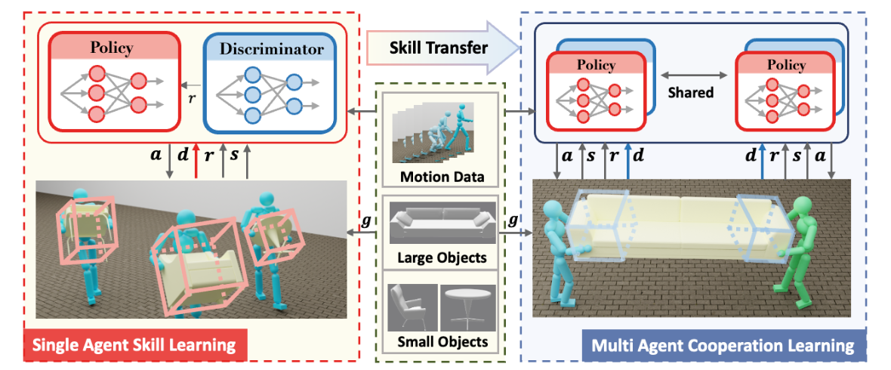

# CooHOI: кооперативное взаимодействие человека и объекта через динамику манипулируемого предмета

Официальная реализация статьи «CooHOI: Learning Cooperative Human-Object Interaction with Manipulated Object Dynamics».



Структура обучения состоит из двух этапов. На первом этапе, как показано на левой части рисунка, мы обучаем навыки переноски одним агентом с помощью фреймворка AMP. На втором этапе эти навыки одного агента переносятся в кооперативную среду. Важно, что мы используем динамику самого объекта как обратную связь и как неявный канал коммуникации; на рисунке это показано ограничивающими рамками.

## Установка

Скачайте Isaac Gym (https://developer.nvidia.com/isaac-gym) или используйте команды:

```bash
wget https://developer.nvidia.com/isaac-gym-preview-4
tar -xvzf isaac-gym-preview-4
```

Создайте окружение conda:

```bash
conda create -n coohoi python=3.8
conda activate coohoi
```

Установите Python-обёртку IsaacGym:

```bash
pip install -e isaacgym/python
```

Установите остальные зависимости:

```bash
git clone https://github.com/Winston-Gu/CooHOI
pip install -r requirements.txt
```

Если возникла ошибка `ImportError: libpython3.8m.so.1.0: cannot open shared object file: No such file or directory`, задайте переменную окружения:

```bash
export LD_LIBRARY_PATH=/path/to/conda/envs/your_env/lib
```

Посмотреть результаты на задаче переноски одним агентом можно так.
Если не хватает памяти, задайте `num_envs` равным 1 или 4.

```bash
CUDA_VISIBLE_DEVICES=0 python coohoi/run.py --test \
--task HumanoidAMPCarryObject \
--num_envs 16 \
--cfg_env coohoi/data/cfg/humanoid_carrybox.yaml \
--cfg_train coohoi/data/cfg/train/amp_humanoid_task.yaml \
--motion_file coohoi/data/motions/coohoi_data/coohoi_data.yaml \
--checkpoint coohoi/data/models/SingleAgent.pth
```

Посмотреть наши результаты на задаче переноски двумя агентами:

```bash
CUDA_VISIBLE_DEVICES=0 python coohoi/run.py --test \
--task ShareHumanoidCarryObject \
--num_envs 16 \
--cfg_env coohoi/data/cfg/share_humanoid_carrybox.yaml \
--cfg_train coohoi/data/cfg/train/share_humanoid_task_coohoi.yaml \
--motion_file coohoi/data/motions/coohoi_data/coohoi_data.yaml \
--checkpoint coohoi/data/models/TwoAgent.pth
```

### Обучение навыков одного гуманоидного робота

Команда обучения:

```bash
CUDA_VISIBLE_DEVICES=0 python coohoi/run.py \
--task HumanoidAMPCarryObject \
--cfg_env coohoi/data/cfg/humanoid_carrybox.yaml \
--cfg_train coohoi/data/cfg/train/amp_humanoid_task.yaml \
--motion_file coohoi/data/motions/coohoi_data/coohoi_data.yaml \
--headless \
--wandb_name "<experiement_name>"
```

Веса модели (checkpoint) появятся в каталоге `output/Humanoid_<date>_<time>/nn`. Оценка:

```bash
CUDA_VISIBLE_DEVICES=0 python coohoi/run.py --test \
--task HumanoidAMPCarryObject \
--num_envs 16 \
--cfg_env coohoi/data/cfg/humanoid_carrybox.yaml \
--cfg_train coohoi/data/cfg/train/amp_humanoid_task.yaml \
--motion_file coohoi/data/motions/coohoi_data/coohoi_data.yaml \
--checkpoint <checkpoint_path>
```

Например:

```bash
CUDA_VISIBLE_DEVICES=0 python coohoi/run.py --test \
--task HumanoidAMPCarryObject \
--num_envs 16 \
--cfg_env coohoi/data/cfg/humanoid_carrybox.yaml \
--cfg_train coohoi/data/cfg/train/amp_humanoid_task.yaml \
--motion_file coohoi/data/motions/coohoi_data/coohoi_data.yaml \
--checkpoint output/Humanoid_19-16-52-17/nn/Humanoid.pth
```

### Кооперативное обучение двух гуманоидных роботов

По умолчанию кооперативное обучение двух гуманоидных роботов начинается с дообучения политики одного робота. Веса однoагентной политики загружаются через `--checkpoint <ckpt_path>`; путь можно заменить на свой файл весов.

Кооперативное обучение:

```bash
CUDA_VISIBLE_DEVICES=0 python coohoi/run.py \
--task ShareHumanoidCarryObject \
--cfg_env coohoi/data/cfg/share_humanoid_carrybox.yaml \
--cfg_train coohoi/data/cfg/train/share_humanoid_task_coohoi.yaml \
--motion_file coohoi/data/motions/coohoi_data/coohoi_data.yaml \
--headless \
--is_finetune \
--pretrain_checkpoint <ckpt_path> \
--wandb \
--wandb_name "<experiement_name>"
```

> Примечание: `<ckpt_path>` должен быть относительным путём к файлу весов однoагентной политики. Этот файл используется для инициализации кооперативной политики.

Например:

```bash
CUDA_VISIBLE_DEVICES=0 python coohoi/run.py \
--task ShareHumanoidCarryObject \
--cfg_env coohoi/data/cfg/share_humanoid_carrybox.yaml \
--cfg_train coohoi/data/cfg/train/share_humanoid_task_coohoi.yaml \
--motion_file coohoi/data/motions/coohoi_data/coohoi_data.yaml \
--headless \
--is_finetune \
--pretrain_checkpoint coohoi/data/models/SingleAgent.pth \
--wandb \
--wandb_name "CooHOI Training"
```

Оценка:

```bash
CUDA_VISIBLE_DEVICES=0 python coohoi/run.py --test \
--task ShareHumanoidCarryObject \
--num_envs 16 \
--cfg_env coohoi/data/cfg/share_humanoid_carrybox.yaml \
--cfg_train coohoi/data/cfg/train/share_humanoid_task_coohoi.yaml \
--motion_file coohoi/data/motions/coohoi_data/coohoi_data.yaml \
--checkpoint <ckpt_path>
```

## Другие материалы

- Исходный код основан на проекте [ASE](https://github.com/nv-tlabs/ASE).
- Набор движений взят из [датасета AMASS](https://amass.is.tue.mpg.de/).
- Набор объектов взят из [датасета SAMP](https://samp.is.tue.mpg.de/).
